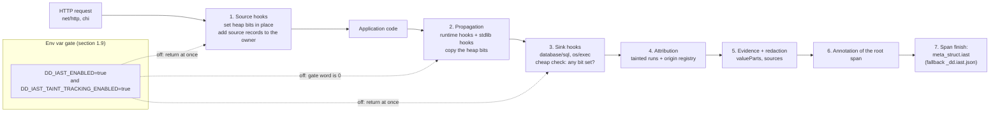
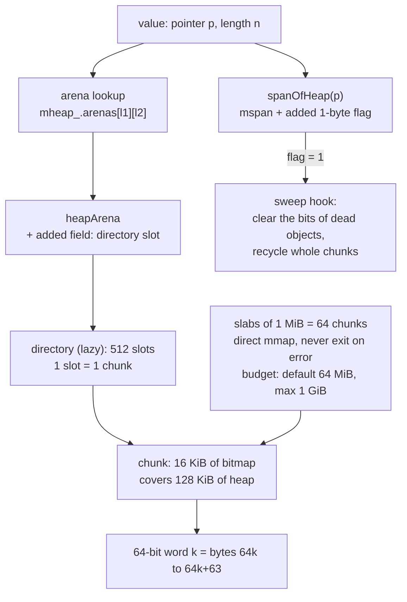
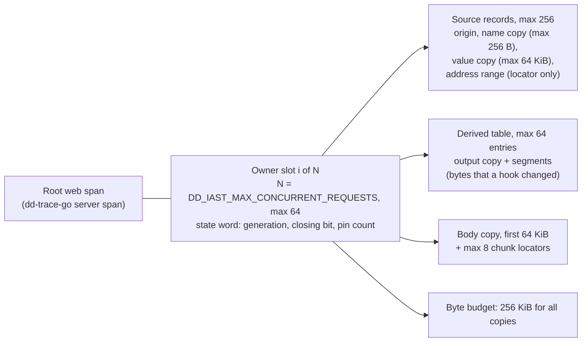
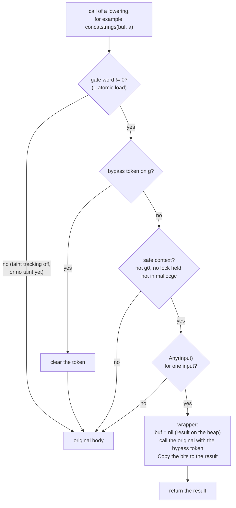
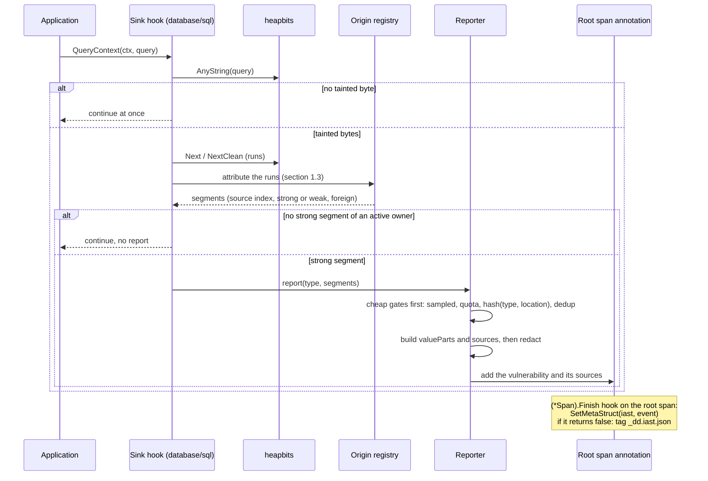
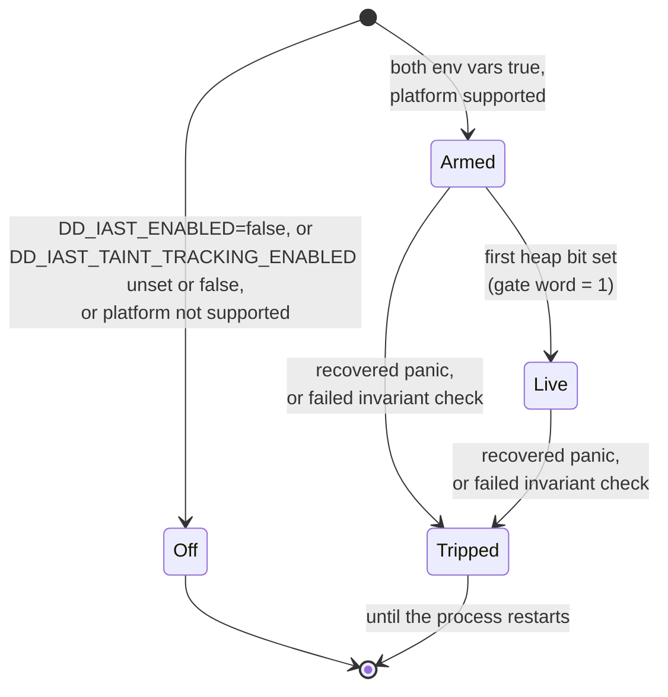

# Design: taint tracking v0 (SQL injection and command injection)

| Field | Value |
|---|---|
| Status | **Draft for review.** Adversarial review (Mission A), then approval by Romain. |
| Epic | Multica DD-69, Jira [APPSEC-70732](https://datadoghq.atlassian.net/browse/APPSEC-70732) |
| Milestone | "Go IAST PoC on the main branch, available to design partners and early adopters", **2026-12-03** |
| Base of this document | `main` at `f79d6f93` (2026-11-18) |
| Proof of concept (PoC) inputs | PR #39, PR #52, PR #58 (read only, see "Clean-room rule"), review PR #51, research notebook `carnet-de-recherches.md` |

This document is the contract for the v0 PR stack. It holds the acceptance
criteria (section 4). Each PR of the stack (section 6) says which criteria it
closes.

## How to read this document

| Section | Content | Read it when |
|---|---|---|
| [0](#0-summary) | Summary in 10 lines | Always |
| [1](#1-approach) | The design, with diagrams | You review the design |
| [2](#2-tradeoffs-and-rejected-options) | Options that we rejected, and why | You want to propose another option |
| [3](#3-constraints) | Go versions, platforms, tools, runtime risk, GC, memory, rollout | You review safety |
| [4](#4-acceptance-criteria) | Acceptance criteria, each with its check | You review a PR of the stack |
| [5](#5-review-requirements) | What each PR needs before merge | You review a PR of the stack |
| [6](#6-pr-stack) | The PR stack: order, scope, dependencies, estimates | You plan the work |
| [7](#7-answers-to-the-3-facts-to-check-in-code) | The 3 facts that the Delivery Lead asked to check | You approve the design |
| [8](#8-known-limits-and-coverage-gaps-v0) | Known limits of v0 | You write user documentation |
| [9](#9-risks) | Risks | You approve the design |
| [10](#10-decisions-to-confirm-and-open-questions) | Decisions to confirm and open questions for Romain | You approve the design |

### Clean-room rule

All v0 code is new code. We do not copy code from PR #39, PR #52 or PR #58.
We use these PRs only to learn two things: what not to do, and which
constraints apply. The facts that this document takes from them are stated as
facts (with their source), not as code. Code that is already on `main` (for
example `internal/spans`, `internal/model`, `internal/vulnerability`) is not
PoC code. The stack can change and extend it.

### Words used in this document

| Word | Meaning |
|---|---|
| Heap taint bits, "bits" | One bit for each byte of heap memory. 1 = the byte is tainted. |
| Owner | The analysis state of one sampled HTTP request. It is bound to the root span of the request. |
| Origin registry | The external map: for each owner, the source records, derived entries and body copy. It gives the origin of tainted bytes. |
| Source record | One untrusted value: origin (for example `http.request.parameter`), name, a copy of the value, and the address range of the value. |
| Run | A sequence of adjacent tainted bytes in a sink argument. |
| Segment | A part of a run that is attributed to one source (or that is "foreign"). |
| Foreign | Tainted bytes that do not match a source of the owner. They are redacted and never make a finding alone. |
| Gate word | One process-wide `uint32` in the runtime. 0 = hooks do nothing. It becomes 1 at the first taint ("sticky"). |
| Hook | Code that Orchestrion or otelc adds to a function at compile time. |
| `S1` … `S13` | The PRs of the stack (section 6). Not GitHub PR numbers. |

## 0. Summary

1. Sources (`net/http` request data, chi `URLParam`) set heap taint bits **in
   place** on the bytes of the request values. They never replace a value that
   the application can see.
2. The bits follow the memory. A sub-string or a sub-slice of a tainted value is
   tainted with no hook.
3. Runtime hooks on compiler lowerings (`concatstrings`, `slicebytetostring`,
   `growslice`, …) copy the bits when Go copies bytes. A small set of standard
   library hooks covers the copies that the compiler does inline (`fmt`,
   `strings.Builder`, `bytes.Buffer`, `bufio`, `encoding/json`, `net/url`).
4. The bits do not say which source a byte comes from. The **origin registry**
   of each request keeps bounded copies of the source values. At the sink, we
   match the tainted runs to these copies to get the origin of each part.
5. Sinks (`database/sql`, `os/exec`) check the bits first (a few nanoseconds),
   then attribute, redact, and report a standard Datadog IAST vulnerability
   (`valueParts` and `sources`) in `meta_struct.iast` on the root span, with the
   `_dd.iast.json` fallback that `main` has.
6. Taint tracking is **off by default**. The env var
   `DD_IAST_TAINT_TRACKING_ENABLED=true` turns it on. Off means: no bit is
   set, no memory is mapped, and each hook costs one load and one branch.
7. Orchestrion and otelc get the same hooks. The runtime-side code has one
   source file; the rules of both tools are generated from it or copy it.
8. Supported: go1.26.x and go1.27.x; linux and darwin on amd64 and arm64.
   Off on other platforms, and with `-asan` or `-msan`. gotip runs in CI as a
   signal only.
9. The stack has 13 PRs (section 6). Each PR leaves `main` green, with the
   feature off by default.
10. The milestone (2026-12-03) is at risk: the critical path is about 125 hours
    of agent work. Section 10 asks Romain which PRs the milestone needs.

## 1. Approach

### 1.1 Overview

The design has 2 storage parts:

- **Heap taint bits** (section 1.2) answer "is this byte tainted?". They are
  fast, lock-free, and correct for any sub-string or sub-slice.
- **The origin registry** (section 1.3) answers "which source is this byte
  from?". It is bounded, per request, and it holds only copies.

The bits are the cheap gate. The registry is used only after a bit is found
at a sink, or in a hook that changes bytes (section 1.5).

### 1.2 Heap taint bits

Facts from the Go runtime (go1.26 and go1.27). PR #52 tested each fact. We
re-implement the design from these facts.

1. The heap is divided into arenas (64 MiB on 64-bit linux and darwin). Each
   arena has a metadata record `heapArena`, found from a pointer in 2 or 3
   loads.
2. The GC does not move heap objects. A bit for each address is thus a bit for
   each byte of a live object.
3. Heap memory is used again only after the sweeper frees it (or after
   `freegc`). A hook at the start of `(*sweepLocked).sweep` and of `freegc`
   clears the bits of dead objects. A new object never gets the bits of an old
   object at the same address.
4. Stack memory and static data are not in a heap span (`spanOfHeap` returns
   nil). The bits refuse them. Their bits are always 0.

**API** (package `internal/taint/heapbits`, internal):

| Function | Contract |
|---|---|
| `Enabled() bool` | The runtime is woven, the platform is supported, and taint tracking is on. |
| `Set(p, n) bool` | Taint `[p, p+n)`. All or nothing. Returns false for stack, static, user-arena or off-heap memory, for a range that crosses an object boundary, when the budget is used, or when another goroutine allocates the chunk (no wait). |
| `Clear(p, n)` | Remove the taint. Never allocates. |
| `Any(p, n) bool` | One byte or more is tainted. Safe for any address. |
| `Next(p, n, from)`, `NextClean(p, n, from)` | Offset of the next tainted (or clean) byte. They give the runs. |
| `Copy(dst, src, n) bool` | Make the bits of `dst` equal to the bits of `src` (like `memmove`, overlap is correct). A clean `src` clears `dst`. |

**Rules of the runtime side** (these are the constraints that PR #52 found):

- The entry points take `uintptr` values, so that the checked values do not
  escape to the heap. The Go wrappers call `runtime.KeepAlive` after the call.
- Each entry point has 2 parts. A `nosplit` classifier decides "one heap
  object" or "not heap" before the stack can move. A normal worker then does
  the bitmap work, with a preemption checkpoint every 512 work units.
- All bitmap accesses are 64-bit atomics (`Load64`, `Store64`, `Or64`,
  `And64`, `Cas64`). A neighbour object can share a word.
- The span flag protocol: a write sets the bits, then the flag. The sweep
  clears the flag, clears dead objects, checks live objects, and sets the flag
  again if a bit is left. A concurrent `Set` is never lost.
- The sweep hook does not allocate, does not lock, cannot yield, and has a
  bounded cost (at most 80 KiB of small objects for each span; large objects
  at most 64 MiB, which is the largest span that `Set` accepts).
- Objects with a finalizer special are not cleared when they die: the
  finalizer can make them live again.
- Slabs come from a direct `mmap` call that returns nil on error (`sysAlloc`
  can exit the process). The mapped bytes are added to `memstats.other_sys`
  and `gcController.mappedReady`, so `GOMEMLIMIT` sees them.
- The feature is off on arm64 CPUs without LSE atomics (no bounded `Or64`),
  and in `-asan` and `-msan` builds.

### 1.3 The origin registry (external map)

The bits say **that** a byte is tainted, not **from which source**. Decision 6
asks for the origin of each tainted range. The origin registry keeps this
information, for each sampled request.

**Rules**

1. **One owner for each sampled request, bound to its root span.** The owner
   starts when the dd-trace-go server span starts (candidate hook:
   `instrumentation/httptrace.BeforeHandle`, the common entry of the
   dd-trace-go HTTP server integrations). The owner and the span annotation
   use **one** sampling decision. A sampled-out request gets no owner and no
   annotation slot (lesson from #51 H18). The owner ends when the root span
   finishes (the `(*Span).Finish` hook that `main` already has).
2. **The owner holds only copies.** It never keeps a reference to application
   memory. All copies are charged to a fixed byte budget (256 KiB for each
   owner). When the budget is used, new records are dropped (telemetry
   counter); their bits stay, and their bytes become "foreign" at the sink.
3. **Addresses only locate.** A source record keeps the `(address, length)` of
   the original value, as a `uintptr`. At the sink, an address match is
   accepted only when the sink bytes are equal to the owner copy at the same
   offset. A reused address with other bytes fails the check. This is why this
   design is not the rejected "process-wide `uintptr` map" (section 2).
4. **No blocking.** Every access pins the slot (CAS on the state word, with
   the expected generation), then calls `TryLock` on the slot mutex. A busy
   lock drops the operation. `Finish` sets the closing bit and returns at
   once; the last accessor cleans the slot. A slot is given to a new request
   only after cleanup, with a new generation (lessons from #51 C15 and H5).
5. **Marks.** Each record has a `marks` bitmask, so that a later version can
   add sanitizers. v0 sets no mark (no sanitizer is in scope).

**Attribution at a sink** (the same algorithm for `IsTainted*`):

1. `Next` / `NextClean` give the tainted runs of the sink argument.
2. For each run, from left to right, cut segments:
   1. **Address locate.** Find a record whose address range contains the start
      of the rest of the run. Check the bytes against the owner copy. The
      segment is the longest equal part.
   2. **Content match.** Else, find the copy (derived entries, then sources,
      then body copy) that contains the longest prefix of the rest of the run.
   3. **Tie rule.** Address match first; then the longest segment; then the
      shortest record (so `http.request.path.parameter` wins over
      `http.request.path` for the same bytes); then the last record.
   4. Else the byte is foreign. Adjacent foreign bytes merge.
3. **Strong-match rule.** A finding needs at least one strong segment of an
   active owner: an address match (any length), or a content match of at least
   `min(4, length of the record copy)` bytes. Short content matches are weak:
   equal bytes of another request (for example `-`) can match by chance.
4. **Bounds.** At most `DD_IAST_MAX_RANGE_COUNT` segments and 4096 candidate
   checks for one sink call. When a bound stops the loop, the rest of the
   tainted bytes are foreign (redacted), never shown as clean.
5. **Which owner.** A sink can run on any goroutine and can have no context.
   The registry searches all active owners (at most 64; default 2), with one
   shared check budget. A segment of another owner is foreign for the
   reporting owner.

**Accepted limit (decision 6).** Content match cannot separate 2 requests that
hold equal bytes. A copy of request B's bytes that are equal to a source of
request A is attributed to A.

### 1.4 Runtime hooks (propagation without call-site instrumentation)

Decision 1: propagation uses runtime hooks only. The compiler lowers string
and slice operations to calls of these runtime functions. A hook in the
function covers every call site, in every package, with no AST rewrite.

| # | Runtime function | Go operation | Bit copy |
|---|---|---|---|
| 1 | `concatstrings` (through `concatstring2` to `concatstring5`) | `a + b`, `s += t` | Each tainted operand, at its offset |
| 2 | `concatbytes` (through `concatbyte2` to `concatbyte5`) | `[]byte(a + b)` | Same |
| 3 | `slicebytetostring` | `string(b)`; also used by `bytes.Buffer.String`, `fmt.Sprint*`, `strconv`, `encoding/json` | Exact |
| 4 | `stringtoslicebyte` | `[]byte(s)` | Exact |
| 5 | `stringtoslicerune` | `[]rune(s)` | A rune is tainted when one of its UTF-8 bytes is tainted, plus a derived entry |
| 6 | `slicerunetostring` | `string(runes)` | The UTF-8 bytes of a tainted rune are tainted, plus a derived entry |
| 7, 8 | `growslice`, `growsliceBuf` | The copy of the old elements in every `append` that grows | Exact, for element types without pointers |

All 8 functions are compiler lowerings: compiled code calls them, so they
change only together with the compiler (decision 5). They exist with the same
signatures in go1.26.10 and go1.27.4. In gotip of 2026-11-19, the buffer type
of `stringtoslicerune` changed (`*[tmpStringBufSize]rune` became
`*[tmpRuneBufSize]rune`). The compile-time signature checks (section 3.1)
detect this kind of change.

**Hook template** (shape only):

Rules:

- **Heap promotion.** When an input is tainted, the wrapper sets `buf = nil`,
  so the result goes to the heap and can hold bits. Stack values are not
  tracked (decision 6).
- **No `defer`, no argument kept live across the call** in the gate-off path.
  The gate-off prologue must stay as small as the original one (lesson from
  #58: gate off ≤ +2 ns).
- **Escape tags must not change.** A test compares the escape analysis of each
  hooked function, woven and not woven.
- **Context check before any call with a stack check** (`morestack` on g0 is
  fatal).
- **Gate word is sticky.** The first successful `Set` stores 1. A live counter
  is not possible (no `Cas8` in `internal/runtime/atomic`, and the sweep flag
  protocol makes a count of tainted spans wrong). After the first taint, all
  hooks pay the clean-path cost (context check + `Any`). The benchmark report
  measures it. Only the circuit breaker (section 1.9) stores 0 again.
- **Not hookable:** `copy`, the appended part of `append(x, y...)`, and `make`
  + `copy`. The compiler emits an inline `memmove`. In user code these lose the
  taint (section 8). In the standard library, the functions that need them get
  their own hooks (section 1.5).
- **Named types and generics.** A named string type (`type ID string`), a
  conversion between string types, and generic code with `~string` or
  `~[]byte` constraints use the same lowerings and the same memory. They are
  covered with no extra hook.

### 1.5 Standard library hooks

Some standard library functions copy bytes with `copy` or `append(x, y...)`,
or change the bytes. They need a hook in their body. The hook is a "twin": it
checks `Any` on the inputs (or the destination), does the work again with the
bit operations, and returns. Else the original body runs.

| Priority | Package | Functions | Rule | Why (Definition of done) |
|---|---|---|---|---|
| P0 | `fmt` | `(*buffer).write`, `(*buffer).writeString`, `(*fmt).writePadding`, `(*pp).printArg`, `(*pp).fmtString`, `(*pp).fmtBytes`, `(*pp).doPrintf`; clear in `(*pp).free` | Exact copy for `%s` and `%v` of strings; coarse for generated text and for `String()`/`Error()`/`Format()` output (lesson from #51 H8) | `fmt.Sprintf` |
| P0 | `strings` | `(*Builder).Write`, `WriteString`, `grow`; `Repeat`; `ToUpper`, `ToLower` (ASCII exact, else coarse); `Map`; `(*Replacer).Replace` | Exact or coarse | `strings.Join` (uses `Builder`), case conversion |
| P0 | `bytes` | `(*Buffer).Write`, `WriteString`, `WriteByte`, `WriteRune`, `ReadFrom`, `grow`; `Join`, `Repeat`, `Replace`, `ToUpper`, `ToLower`, `Map` | Exact, with the "clear on overwrite" rule | Common builder |
| P0 | `net/url` | `unescape`, `escape` | Coarse | URL decoding, query values with `%` or `+` |
| P0 | `encoding/json` v1 | `(*Decoder).refill`, `unquoteBytes`, `valueQuoted` | Exact slide copy; coarse unquote | JSON v1 |
| P0 | `encoding/json` v2 (go1.27 default) | decoder buffer fill and slide, unquote, string cache guard in `makeString` | Exact; coarse; the cache never returns a tainted string for clean bytes, and never a clean string for tainted bytes | JSON v2 |
| P1 | `bufio` | `(*Reader).fill`, `Read`, `ReadBytes`; delegated reads use the "read rule" | Exact | JSON matrix rows, multipart forms |
| P1 | `bytes`, `strings` | `(*Reader).Read`, `ReadAt` | Exact | `json.NewDecoder(bytes.NewReader(b))` |
| P1 | `strconv` | `quoteWith`, `unquote` | Coarse | Quoted values |

"Coarse" means: when one input byte is tainted, `Set` the **whole** output and
add a derived entry with the first contributing source of each owner. The
output bytes are not equal to the input bytes, so the derived entry is the only
way to find their origin.

Rules for all standard library hooks:

1. A hook imports only `heapbits` and one leaf bridge package (imports
   `sync/atomic` and `unsafe` only). The owner work goes through function
   pointers in the bridge. A test checks the import graph (no import cycle in
   hooked packages).
2. Application callbacks (for example the mapping function of `strings.Map`)
   run exactly once, as in the original body.
3. The analysis code never calls a hooked function, and it has a per-goroutine
   re-entry guard.
4. Each hooked function body has a golden hash for each supported Go minor
   (drift test, section 3.1).
5. Never hook a package that `runtime` imports (`internal/bytealg`,
   `internal/stringslite`).
6. **Known cost:** with one more call, some small functions stop being inlined
   (`(*strings.Builder).WriteString` measured +7.7 ns in PR #58). This cost
   exists also when taint tracking is off. The benchmark report gives it
   (decision 9: no gate).

### 1.6 Sources

Sources set bits **in place**, on the memory of the values that `net/http`
already made. They never write to a field, map or slice that the application
can see (lessons from #51 C12 and C13). When `Set` fails (for example a
read-only interned string), the source is dropped and a telemetry counter
grows. We never replace the value.

| Origin | API | Mechanism | Record name |
|---|---|---|---|
| `http.request.path` | `Request.URL.Path`, `URL.RawPath` | Bits at owner start | (none) |
| `http.request.query` | `Request.URL.RawQuery` | Bits at owner start | (none) |
| `http.request.uri` | `Request.RequestURI` | Bits at owner start | (none) |
| `http.request.header` | `Request.Header` values | Bits at owner start (first 64 headers, 8 KiB each) | header name |
| `http.request.cookie.value` | `(*Request).Cookie`, `Cookies` | Values are sub-strings of the `Cookie` header: bits are free. A record is added at the accessor. | cookie name |
| `http.request.parameter` | `URL.Query()`, `url.Values.Get`, `(*Request).FormValue`, `PostFormValue`, `Form`, `PostForm` | Values are sub-strings of `RawQuery` or of the body (bits are free), or `url.unescape` results (coarse hook). A record is added at the accessor. | parameter name |
| `http.request.path.parameter` | `(*Request).PathValue`; chi `(*Context).URLParam`, `URLParam`, `URLParamFromCtx` | Values are sub-strings of the path (bits are free). A record is added at the accessor. Direct reads of `chi.Context.URLParams.Values` are still detected, with origin `http.request.path`. | parameter name |
| `http.request.body` | `Request.Body` reads: `(*body).Read` (HTTP/1) and `(*http2requestBody).Read` (bundled HTTP/2) | The hook sets the bits on `p[:n]` when the receiver is the registered body of an active owner. The owner keeps a copy of the first 64 KiB. | (none) |
| `http.request.multipart.parameter` | `(*Request).FormValue` on `multipart/form-data`, `MultipartForm.Value` | Read through `bufio` (P1 hooks). A record is added at the accessor. | field name |

Rules:

- Values shorter than 2 bytes or longer than 64 KiB are not tainted.
- Framework hooks (chi) call into dd-iast-go through a linknamed function.
  dd-iast-go never imports chi. Thus the root `go.mod` gets no new requirement
  for a framework (no version change for users through MVS).
- Other frameworks (gin, echo, gorilla/mux) are not in scope. Their values that
  come from `net/http` APIs, or that are sub-strings of the path, are still
  detected, with the `net/http` origin.

### 1.7 Sinks

| Vulnerability | Sinks | Rule |
|---|---|---|
| `SQL_INJECTION` | `database/sql`: `(*DB)`, `(*Tx)`, `(*Conn)`: `Query`, `QueryContext`, `QueryRow`, `QueryRowContext`, `Exec`, `ExecContext`, `Prepare`, `PrepareContext` | The query string only. Bound arguments are never a finding. |
| `COMMAND_INJECTION` | `os/exec`: `(*Cmd).Start` (so `Run`, `Output`, `CombinedOutput` too), for commands made by `Command` and `CommandContext` | `Cmd.Path` and all `Cmd.Args` (lesson from #51 H15: a tainted `Path` that differs from `Args[0]`). One finding for each command. |

Each sink first calls `heapbits.Any` on its arguments. With no tainted byte it
returns at once. The report location skips the sink frames for both tools
(otelc does not mark its injected code, see `internal/vulnerability/report.go`).

### 1.8 Evidence, redaction and reporting

- **Format.** The standard Datadog IAST event that `internal/model` already
  has: `vulnerabilities[]` with `type`, `evidence.valueParts[]` (`value` or
  `pattern`, `redacted`, `source` index, `truncated`), `location`, `hash`; and
  `sources[]` with `origin`, `name`, `value` or `pattern`, `redacted`.
- **Path.** The same path as WEAK_HASH on `main`: the annotation of the root
  span, written by `spans.Finished` in `meta_struct["iast"]`, with the
  `_dd.iast.json` fallback when `SetMetaStruct` returns false (decision 7).
- **Cheap gates first** (lesson from #51 H26): sampling, the per-request quota
  (`DD_IAST_VULNERABILITIES_PER_REQUEST`) and deduplication on
  `hash(type, location)` run before the evidence and redaction work.
- **SQL redaction** (lessons from #51 C9, C10, C11):
  - Each SQL dialect of `github.com/DataDog/go-sqllexer` (already an indirect
    dependency) scans the query independently. The sensitive intervals are the
    union of all dialects: string and number literals, and **comment bodies**.
  - Dialect-specific syntax (for example Oracle `q'[...]'`) is handled only in
    the scan of its dialect. No pre-scan changes the input of another dialect.
  - When a dialect lexer fails, or when the dialects disagree on a token
    boundary inside a tainted part, the evidence is redacted completely (fail
    closed).
  - A redaction `pattern` is made from the length and position only. It never
    has the same character as the secret at the same position.
- **Command redaction.** The arguments that match `DD_IAST_REDACTION_*` are
  redacted, and the values after known secret flags.
- **Sensitive sources.** A source whose name or value matches
  `DD_IAST_REDACTION_NAME_PATTERN` or `DD_IAST_REDACTION_VALUE_PATTERN` is
  sent with `redacted: true` and a pattern, and its name is masked (lesson from
  #51 M36).
- **Fixes on `main`** (stack PR `S2`): a report after the root span finished
  must not make a new annotation or call `SetMetaStruct` on a finished span
  (#51 C14); sampled-out requests must not use annotation capacity (#51 H18);
  the capacity check must be atomic with the insertion (#51 H20).

### 1.9 Env var gate, kill switch and circuit breaker

| State | Sources | Runtime and stdlib hooks | Sinks | Memory |
|---|---|---|---|---|
| Off | Return at once | 1 atomic load + 1 branch | Return at once | 0 bytes mapped; 8 bytes per arena and 1 byte per span (added fields) |
| Armed | Run for sampled requests | 1 atomic load + 1 branch | Run | Owner table allocated on the first sampled request |
| Live | Run | Clean path: context check + `Any` per input | Run | Bits and owner copies, within their budgets |
| Tripped | Return at once | Gate word stored back to 0 | Return at once | Bits stay mapped (no consumer); no new mapping |

- **New env vars** (README update is part of `S3`):
  - `DD_IAST_TAINT_TRACKING_ENABLED`, Boolean, default `false`. It has an
    effect only when `DD_IAST_ENABLED` is true (default true on `main`, for
    WEAK_HASH and WEAK_CIPHER).
  - `DD_IAST_TAINT_MEMORY_LIMIT`, bytes of heap bits, default 64 MiB, from
    1 MiB to 1 GiB. `0` turns taint tracking off.
- **Read once.** The config is read at package init. The runtime hooks run
  before `main` and before this init: at that time the gate word is 0, so they
  do nothing.
- **Kill switch.** Restart the process with
  `DD_IAST_TAINT_TRACKING_ENABLED=false`. No rebuild is needed.
- **Circuit breaker.** All analysis code (sources, attribution, evidence,
  standard library twins) runs under a scoped `recover`. A recovered panic
  stores the Tripped state, stores 0 in the gate word, sends one telemetry log,
  and returns the original result to the application. The process continues
  with no taint tracking. The runtime-side code cannot recover (a fault there
  is fatal): this is why its rules (section 1.2) forbid allocation, locks and
  unbounded loops.
- **Build-level removal.** Code woven into the runtime stays in the binary when
  taint tracking is off. To remove it, build without the taint packages: with
  otelc, import only the detection packages that you need (for example
  `iast/crypto/hash`, as `_integration/otelc/setups/hashonly` does); with
  Orchestrion, remove the taint imports from `orchestrion.tool.go`.

### 1.10 Orchestrion and otelc: one source of truth

Decision 4: both tools have equal support. The repository rules
(`AGENTS.md`, "Instrumentation Back-Ends") already require one aspect for each
tool and shared Go logic.

| Part | Orchestrion | otelc | How we keep them equal |
|---|---|---|---|
| Fields in `runtime.heapArena`, `runtime.mspan`, `runtime.g` | `struct-definition` | `add_struct_fields` | One field list; a test compares the two rule files |
| Runtime-side code (bitmap, classifier, worker, sweep hook) | `inject-declarations` | `add_file` of a `//go:build ignore` file | **One Go source file.** `go generate` writes the Orchestrion template from it; a CI check fails when the generated file is not up to date |
| Prologues (`concatstrings`, `sweep`, …) | `prepend-statements` | `inject_code` (`raw`) | Small templates only; they call the shared runtime-side code. Unnamed results differ (`__result__N` against `_unnamedRetValN`), so the templates differ only in names |
| Standard library twins, sources, sinks | `function-body` / `method-call` | `func` rules / `call` rules | The twin is shared Go code; the rules only call it |
| Tests | `go tool orchestrion go test` | `scripts/otelc-test.sh` | The same tests; the `_integration/otelc` suite compares the findings of the two tools |

If otelc lacks a primitive that a hook needs, decision 4 allows a new feature
in otelc only when Orchestrion lacks it, not the reverse. So for each hook that
otelc cannot express, the PR must either find an otelc form, or add the
primitive to otelc upstream, or drop the hook for both tools and document the
gap. `S3` starts with a one-hour otelc feasibility check of the 4 runtime
primitives (struct field, `add_file`, prologue with a `return`, method with a
pointer receiver such as `(*sweepLocked).sweep`).

<!-- Sections 2 to 10 follow in the next commits of this draft PR. -->
