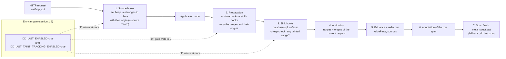
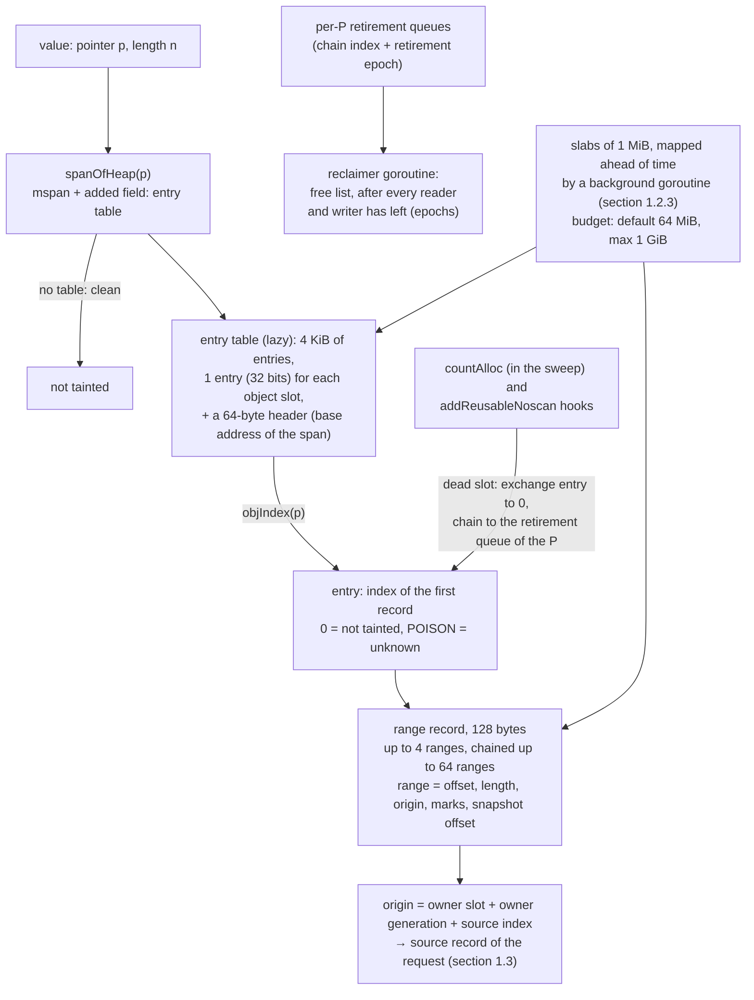
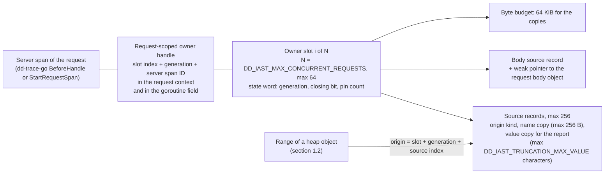
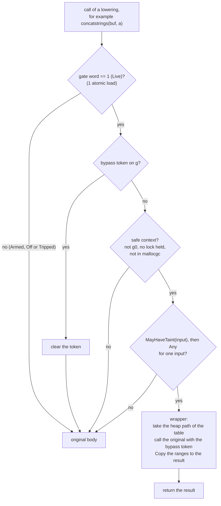
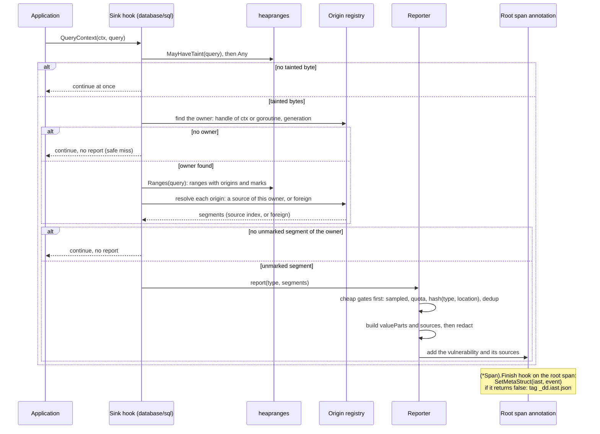
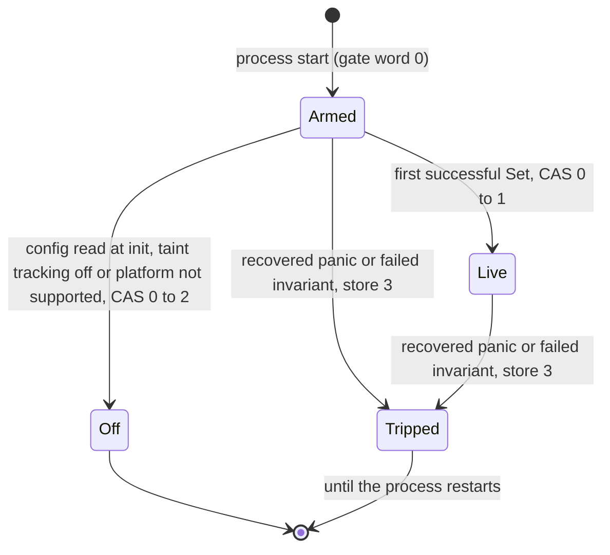
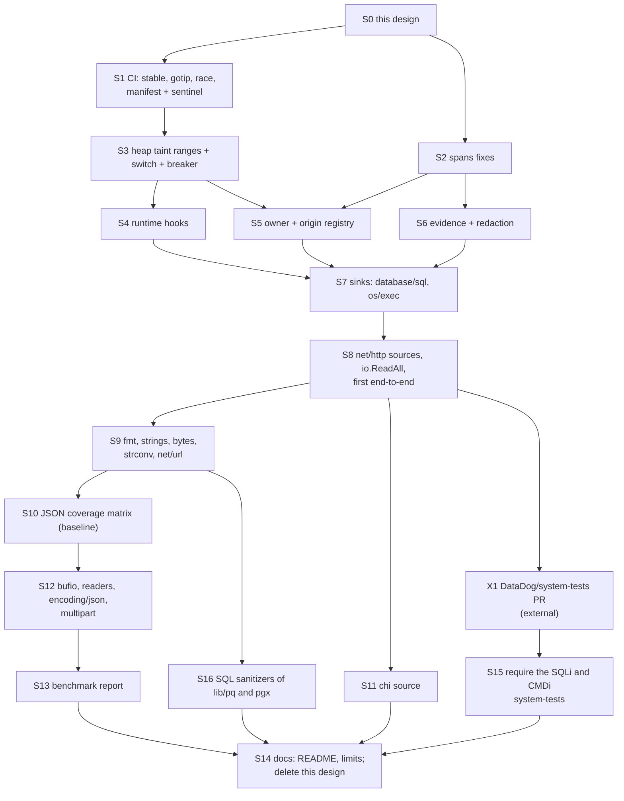

# Design: taint tracking v0 (SQL injection and command injection)

| Field | Value |
|---|---|
| Status | **Draft v10 for review.** v5 applied Romain's change request (the origin is tracked on heap address ranges, not by value); v6 to v10 fix the objections of the checks of that change, and v7 applies Romain's answers to 4 decisions. Section 12 maps each objection of the review rounds, and each decision and request of Romain, to its change. Next: approval by Romain. |
| Lifetime | This document is the contract during the implementation. It is **deleted** when the code is approved and CI is green (decision 15): the last PR of the stack (`S14`) deletes it. |
| Epic | Multica DD-69, Jira [APPSEC-70732](https://datadoghq.atlassian.net/browse/APPSEC-70732) |
| Target | The full Definition of done of the epic (decision 10: no scope cut on the basis of time estimates) |
| Base of this document | `main` at `f79d6f93` (2026-11-18) |
| Proof of concept (PoC) inputs | PR #39, PR #52, PR #58 (read only, see "Clean-room rule"), review PR #51, research notebook `carnet-de-recherches.md` |

This document is the contract for the v0 PR stack. It holds the acceptance
criteria (section 4). Each PR of the stack (section 6) says which criteria it
closes.

## How to read this document

| Section | Content | Read it when |
|---|---|---|
| [0](#0-summary) | Summary in 10 lines | Always |
| [1](#1-approach) | The design, with diagrams | You review the design |
| [2](#2-tradeoffs-and-rejected-options) | Options that we rejected, and why | You want to propose another option |
| [3](#3-constraints) | Go versions, platforms, tools, runtime risk, GC, memory, rollout | You review safety |
| [4](#4-acceptance-criteria) | Acceptance criteria, each with its check | You review a PR of the stack |
| [5](#5-review-requirements) | What each PR needs before merge | You review a PR of the stack |
| [6](#6-pr-stack) | The PR stack: order, scope, dependencies | You plan the work |
| [7](#7-answers-to-the-3-facts-to-check-in-code) | The 3 facts that the Delivery Lead asked to check | You approve the design |
| [8](#8-known-limits-and-coverage-gaps-v0) | Known limits of v0 | You write user documentation |
| [9](#9-risks) | Risks | You approve the design |
| [10](#10-decisions) | Decisions: the ones that are made, and the ones that are open for Romain | You approve the design |
| [11](#11-references) | References | You want the sources |
| [12](#12-review-history) | Each objection of the review rounds and each decision, and what changed | You review v3 |

### Clean-room rule

All v0 code is new code. We do not copy code from PR #39, PR #52 or PR #58.
We use these PRs only to learn two things: what not to do, and which
constraints apply. The facts that this document takes from them are stated as
facts (with their source), not as code. Code that is already on `main` (for
example `internal/spans`, `internal/model`, `internal/vulnerability`) is not
PoC code. The stack can change and extend it.

### Words used in this document

| Word | Meaning |
|---|---|
| Heap taint range, "range" | A tainted range of bytes of one heap object, with its origin and its marks (section 1.2). |
| Origin | The source of a range: the slot and the generation of a request owner, and the index of a source record in that owner. |
| Owner | The analysis state of one sampled HTTP request. It is bound to the root span of the request. |
| Origin registry | The external map: for each owner, its source records. An origin points into it. |
| Source record | One untrusted value of a request: its origin kind (for example `http.request.parameter`), its name, and a truncated copy of its value for the report. |
| Segment | A tainted part of a sink argument with one source (or "foreign"). |
| Foreign | Tainted bytes whose origin is not a source of the current request (another request, an ended request, or the unknown origin). They are redacted and never make a finding alone. |
| Gate word | One process-wide `uint32` in the runtime: 0 Armed, 1 Live, 2 Off, 3 Tripped (section 1.2.5). Hooks work only when it is 1. It becomes 1 at the first taint and never goes back to 0 ("sticky"). |
| Hook | Code that Orchestrion or otelc adds to a function at compile time. |
| `S1` … `S16`, `X1` | The PRs of the stack (section 6). Names, not GitHub PR numbers, and not an order: the dependency graph of section 6.1 gives the order. `X1` is the PR in the `DataDog/system-tests` repository. |
| `AC-…` | An acceptance criterion of section 4 (for example `AC-F1`). Each one has a check type and exactly one closing PR. |

## 0. Summary

1. Sources (`net/http` request data, chi `URLParam`) set heap taint ranges
   **in place** on the memory of the request values. Each range points to its
   origin: a source record (kind, name) of the request. Sources never replace a
   value that the application can see.
2. The ranges follow the memory. A sub-string or a sub-slice of a tainted value
   is tainted, with the same origin, with no hook.
3. Runtime hooks on compiler lowerings (`concatstrings`, `slicebytetostring`,
   `growslice`, …) copy the ranges **with their origins** when Go copies
   bytes. A small set of standard library hooks covers the copies that the
   compiler does inline, and maps the origins through the transforms (`fmt`,
   `strings`, `bytes`, `bufio`, `encoding/json`, `net/url`, `strconv`).
4. At a sink, the origin of each tainted byte comes from its range: no content
   matching. The owner of the current request comes from a request-scoped
   handle; ranges of another request are foreign (redacted). The same text
   from 2 sources of one request keeps 2 origins.
5. Sinks (`database/sql`, `os/exec`) first do the quick check (4 or 5 memory
   reads, no lock: it proves "clean", or says "may be tainted"), then the
   exact check of the ranges, then attribute, skip values that a SQL sanitizer of a driver marked as safe
   (`lib/pq`, `pgx`), redact, and report a standard Datadog IAST vulnerability
   (`valueParts` and `sources`) in `meta_struct.iast` on the root span, with the
   `_dd.iast.json` fallback that `main` has.
6. Taint tracking is **off by default**. The env var
   `DD_IAST_TAINT_TRACKING_ENABLED=true` turns it on. Off means: no range is
   set, no memory is mapped, and each hook costs one load and one compare.
7. Orchestrion and otelc get the same hooks, built from 3 primitives that both
   tools have. Parity is proven by the same behavior tests with both tools. A
   sentinel program fails when a tool silently skips a hook.
8. Supported: go1.26.x and go1.27.x; linux and darwin on amd64 and arm64
   (all arm64 CPUs, with and without LSE atomics). Off on other platforms, and
   with `-asan` or `-msan`. gotip runs in CI as a signal only.
9. The stack has 15 PRs in this repository and one PR in `DataDog/system-tests`
   (section 6), ordered by their dependencies. Each PR leaves `main` green,
   with the feature off by default. Each acceptance criterion has exactly one
   closing PR, and that PR comes after every PR that its test needs.
10. Section 10 lists the decisions in plain words: the ones that Romain made,
    and the one that is still open (how a label on a `[]byte` buffer that the
    application can change is trusted).

## 1. Approach

### 1.1 Overview



The design has 2 storage parts:

- **Heap taint ranges** (section 1.2) answer "is this byte tainted, and from
  which origin?". They are next to the allocator metadata, lock-free, and
  correct for any sub-string or sub-slice.
- **The origin registry** (section 1.3) holds the source records that the
  origins point to (kind, name, a truncated value for the report). It is
  bounded and per request.

The ranges are the cheap gate. The registry is read only when a sink reports.

### 1.2 Heap taint ranges

v5 (Romain's change request): the origin is tracked **on heap address
ranges**, not by value. Each tainted range of a heap object points to its
origin (the source record of a request). The hooks that copy taint also copy
the origin. One heap object can hold ranges of several origins, so the same
text from 2 sources (for example a path parameter and a query parameter) keeps
2 origins.

A range with its origin also says that the bytes are tainted, so v5 does
**not** keep the 1-bit-per-byte bitmap of v4: one structure, next to the
allocator metadata, answers both "is this byte tainted?" and "from where?".

Facts from the Go runtime (go1.26 and go1.27). PR #52 tested facts 1 to 4 for
its bitmap; they apply in the same way to range records.

1. The GC does not move heap objects. An address range stays valid until its
   object dies.
2. A Go `string` or `[]byte` value is always inside **one** heap object (an
   allocation slot of a span). `spanOfHeap(p)` finds the span, and
   `(*mspan).objIndex(p)` (`runtime/mbitmap.go:1227`) finds the slot, with no
   lock.
3. Heap memory is used again only after the sweeper frees it, or after
   `freegc` (section 1.2.1). Hooks at these points clear the ranges of dead
   objects before the memory can be allocated again.
4. Stack memory and static data are not in a heap span (`spanOfHeap` returns
   nil). They are never tainted.
5. A span has at most 1 024 objects (`MaxObjsPerSpan`,
   `internal/runtime/gc/sizeclasses.go:92`). The runtime reuses `mspan`
   structs without zeroing them (`(*mspan).init`, `runtime/mheap.go:1810`:
   "span is *not* zeroed").



**Data structure** (package `internal/taint/heapranges`, internal; the
runtime-side code is woven into the runtime):

| Part | Where | Size | Life |
|---|---|---|---|
| Entry table | An added field of `runtime.mspan` points to it. Allocated on the first taint in the span. A span with one object (a large object) uses an added inline entry instead. The field can also hold the reserved value `SPAN_POISON`: no table, and every object of the span is poisoned (section 1.2.3, rule 4). | 4 KiB of entries (1 024 entries of 32 bits) **plus** a 64-byte header (the base address of the span that it belongs to, and its state); both are counted in the budget | Stays attached to its `mspan` struct, which the runtime reuses for later spans (fact 5). Only the sweeper resets it, while it owns the span alone (section 1.2.2). |
| Entry | In the table | 32 bits: 0 = not tainted, and not private; `POISON` (all bits 1) = the taint of this object is unknown (section 1.2.3); `PRIVATE` (all bits 1 but the lowest) = no ranges, and the object is a private buffer (section 1.2.7); else the index of the first record of the chain. `POISON` and `PRIVATE` are not record indexes: no operation follows or retires them | – |
| Range record | A slot in a pool of fixed records, carved from slabs | 128 bytes: a header (range count, flags: "immutable", "private" or "exposed" memory, section 1.2.7; index of the next record) and up to 4 ranges | One record chain for each tainted object. A chain that a write replaced, or whose object died, is **retired**, and it goes back to the pool only after every reader and writer that could use it has left (section 1.2.2). |
| Range | In a record | 24 bytes: offset in the object (32 bits), length (32 bits), origin (40 bits of owner generation, 6 bits of owner slot, 8 bits of source index, 1 "sensitive" bit), marks (8 bits), flags ("conflict", "exposed path", section 1.2.7), and the offset of its **snapshot** in the owner's snapshot area (32 bits, for exposed memory, section 1.2.7) | – |
| Snapshot area | One for each owner (request), from the slabs | Up to 64 KiB of copies of labelled bytes of exposed memory (section 3.6) | Retired when its owner ends, and reused after reclamation (section 1.2.2) |

Bounds: at most 64 ranges for each object (a chain of up to 16 records).
Adjacent ranges with the same origin and marks are merged. Past 64 ranges, the
rest of the object is one range with the **unknown** origin: those bytes are
tainted, but foreign for every request (redacted, and they never make a
finding alone). Objects larger than 4 GiB − 1 are refused (`Set` and `Copy`
return false), so 32-bit offsets and lengths are always enough.

**API:**

| Function | Contract |
|---|---|
| `Enabled() bool` | The runtime is woven, the platform is supported, and taint tracking is on. |
| `Set(p, n, origin, kind) bool` | Taint `[p, p+n)` with `origin`, in place (a source: the bytes do not change). `kind` says whether the memory is immutable, private or exposed (section 1.2.7); for exposed memory, `Set` takes the snapshot. Returns false (and changes nothing) for stack, static, manual-span, user-arena or off-heap memory, for a range that is not inside one allocation slot, for an object larger than 4 GiB − 1, when the budget is used, when no record is ready, when a concurrent write wins (no wait), or when the gate is Off or Tripped. An existing range of **another live request** is not overwritten (section 1.2.7). |
| `Clear(p, n)` | Remove the ranges of `[p, p+n)`. |
| `MayHaveTaint(p, n) bool` | The quick check. **false** proves that `[p, p+n)` is clean. **true** means only "the object has ranges": the slice can still be clean (for example the first bytes of a 1 MiB array whose last byte is tainted). Safe for any address. |
| `Any(p, n) bool` | The exact check: one byte of `[p, p+n)` is in a range. |
| `Ranges(p, n, buf)` | The tainted ranges of `[p, p+n)`, with their origins and marks, into a caller buffer (bounded). For exposed memory (memory that the application can write), a range is returned with its origin only when the bytes of `[p, p+n)` in it are equal to its snapshot; else with the unknown origin (section 1.2.7). |
| `Copy(dst, src, n, kind) bool` | A hooked copy of bytes: make the ranges of `dst` equal to the trusted ranges of `src`, with their origins and marks (like `memmove`, overlap is correct). A clean `src` clears `dst`. When `dst` is exposed memory, its ranges keep the snapshots of `src`, or get new ones (section 1.2.7). |
| `Map(dst, src, mapping) bool` | For the hooks that change bytes (section 1.5): give each output byte the origin of the input bytes that the mapping names. |

**Cost of the checks:**

| Check | Work | Lock | Answer |
|---|---|---|---|
| `MayHaveTaint` (every hook does it first) | `spanOfHeap(p)` (2 or 3 loads), the entry-table field of the span (1 load), the entry of the object (1 load): **4 or 5 loads**, for any length of value | None | false: clean (no table, or entry 0 or `PRIVATE`). true: "may be tainted" (a chain, `POISON`, or a span with `SPAN_POISON`) |
| `Any` (after a true) | + the record chain of the object: 1 to 16 records of 128 bytes (2 cache lines each), at most 64 ranges compared with `[p, p+n)` | None (a critical section with preemption disabled, section 1.2.2) | exact: tainted or not |
| `Ranges` with attribution (at a sink) | + for exposed memory (memory that the application can write), a byte comparison of `[p, p+n)` with the snapshots (at most the scan budget, 64 KiB); + for each origin, a pin of the owner slot and a `TryLock` (section 1.3.3) | `TryLock` only (drop when busy) | the exact ranges, with their sources or "unknown" |

So the quick check proves "clean" in constant time. It does not prove
"tainted": a slice of an object that has ranges needs the exact check. The
v4 bitmap read 1 word for each 64 bytes of the value; `MayHaveTaint` does not
grow with the length. The benchmarks measure the 3 cases (criterion AC-B1): a
clean object, a clean slice of a tainted object, and a tainted slice.

**Rules of the runtime side:**

- **The "not on the heap" checks apply to every operation, reads included.**
  The entry points take **typed pointers** (`unsafe.Pointer`), not `uintptr`
  values: `runtime.KeepAlive` keeps an object alive, but it does not keep a
  stack address correct when the stack moves, and only a typed pointer is
  updated when Go copies a stack. The pointer stays typed until a `nosplit`
  classifier decides "inside one heap allocation slot of an in-use span"
  (where objects do not move); only then is it used as an address. The
  declarations that the hooks call have `//go:noescape` (rule 9 of section
  1.5.3), so the pointer does not make the value escape. Stack, static, manual-span (`mSpanManual`)
  and user-arena memory, and an address in no span, are "not tainted" for
  `MayHaveTaint`, `Any` and `Ranges`, and are refused by the writes. The classifier never reads
  an entry table for them.
- **Every operation that reads or writes a record chain runs as one
  "critical section":** preemption is disabled (`acquirem`, as the runtime
  does for short critical sections), and the operation announces itself in the
  slot of its P (section 1.2.2). The work in it is bounded: at most 16 records,
  64 ranges, and the scan budget of section 1.2.7.
- Entries are read and written with 32-bit atomics. Records are immutable once
  published: a write builds a new record chain, then publishes it with one CAS
  on the entry (copy-on-write), and retires the old chain that the CAS
  removed. A write that cannot publish uses an atomic exchange, and retires
  only what the exchange removed (sections 1.2.2 and 1.2.3).
- A record is never reused while a reader or a writer that started before its
  retirement is still in its critical section (section 1.2.2). So a reader can
  follow a whole chain, and a writer's CAS cannot succeed on an entry whose
  chain was freed and used again (no ABA, no version number to wrap).
- The clear hook in the sweep (a prologue of `(*mspan).countAlloc`) does not
  allocate, does not lock, cannot yield, and has a bounded cost: at most 1 024
  mark bits and entries for each span, and one append to a per-P retirement
  queue for each dead tainted object. It does not walk the finalizer and
  cleanup records.
- A slot that Go keeps alive (a finalizer revived it) has its mark bit, so it
  is not cleared (section 1.2.1).
- The feature is off in `-asan` and `-msan` builds.
- **arm64 CPUs without LSE atomics are supported** (section 1.2.6).

#### 1.2.1 Clear-before-reuse points

A freed heap slot can be allocated again only through the paths below. Each
path clears the entry of the dead slot (and retires its record chain) at the
point where Go **really** makes the slot reusable, and only then. The clear
uses **Go's own decision** about which slots are dead.

| Path | When the slot can be allocated again | Clear point | Notes |
|---|---|---|---|
| Sweep of a span (small objects and large objects) | After `(*sweepLocked).sweep` of that span computes the new free slots and stores `s.allocBits = s.gcmarkBits` | A prologue of **`(*mspan).countAlloc`**. The sweep calls it once (`runtime/mgcsweep.go:679`, the same in go1.26 and go1.27; its only other caller is `export_test.go`), **after** it has processed the specials (a finalizer that revives an object sets its mark bit, `mgcsweep.go:554–573`) and moved the inline mark bits (`moveInlineMarks`), and **before** the slots become allocatable. At this point the mark bits are Go's final liveness decision. The prologue clears every slot that has an entry and no mark bit: one exchange to 0, and the old value is retired only when it is a chain index (never `POISON` or `PRIVATE`). When the field of the span holds `SPAN_POISON` (section 1.2.3, rule 4), the prologue resets it to "no table" only when no slot of the span is marked. It reads the bits in **`s.gcmarkBits`**, as `countAlloc` does, and never through `markBitsForIndex`: with the Green Tea GC (the default in go1.26 and go1.27), `markBitsForIndex` reads the inline mark bits of small-object spans (`runtime/mgcmark_greenteagc.go:228–236`), which `moveInlineMarks` has already copied into `gcmarkBits` and reset (`:196–216`). | Bounded work: at most `nelems` (1 024) mark bits and entries; no walk of the specials, so many finalizers or cleanups on one object cost nothing more (Go permits many cleanups on one allocation, `runtime/mcleanup.go:25–27`). A span cached in an `mcache` is not swept until it is uncached (`mcache.refill` sets `sweepgen = mheap_.sweepgen + 3`, `runtime/mcache.go:214–216`). A live typed reference keeps its object marked, so the sweep never clears an object that a wrapper holds. |
| `freegc` (`GOEXPERIMENT=runtimefreegc`) | When `freegc` really gives the slot back: it calls `(*mcache).addReusableNoscan` (`runtime/malloc.go:2011`, its only call site; `runtime/mcache.go:373`) | A prologue at the start of **`(*mcache).addReusableNoscan`**, not of `freegc`: the entry of the slot goes to 0 with an exchange (a chain is retired; `POISON` and `PRIVATE` are not). In a span with `SPAN_POISON`, the new object reads as poisoned until the sweep resets the span (over-redaction, never a wrong source). `freegc` can refuse to free and return false (for example `!reusableSize(size)` for small sizes, `runtime/malloc.go:1913–1920`); then nothing is cleared. | **Off by default** in go1.26 and go1.27 (`internal/goexperiment/exp_runtimefreegc_off.go`). A CI job turns the experiment on (criterion AC-S7). |
| Finalizers | A finalizer special at **any offset** inside a slot (a tiny block can have several) makes the sweep mark the whole slot live (`runtime/mgcsweep.go:554–573`) | No separate rule: the mark bit that the sweep sets is seen by the `countAlloc` prologue | When the revived objects die again with no finalizer, a later sweep clears the slot. Cleanups (`runtime.AddCleanup`) and weak handles do not revive objects. |
| User arena chunks (`GOEXPERIMENT=arenas`) | Freed without a sweep | None: `Set` refuses user arena memory, and reads treat it as clean | Never tainted. |
| Stacks, `mSpanManual` spans | Not heap objects | None: `Set` refuses them, and reads treat them as clean | Never tainted. Their `mspan` structs can carry a detached entry table from an earlier heap span (section 1.2.2). |

**Clearing is never skipped.** The clear of an entry is one atomic exchange
(section 1.2.3), with no allocation. When the chain that it removes cannot be
retired (a full retirement queue, or a P index above the supported maximum),
only the **reuse** of that chain is lost (section 1.2.2); the slot is still
cleared before Go can reuse it.

The drift test (section 3.1) lists every runtime function that frees or reuses
heap memory, every call site of `countAlloc`, `addReusableNoscan` and
`(*mspan).init`, and the order of the specials pass, `moveInlineMarks` and
`countAlloc` in the sweep. A change in a Go release fails the test until a
human checks it.

#### 1.2.2 Memory lifetime: retirement and reuse

**Records: no reuse while a reader or a writer can still use them.**

1. **Remove exactly once.** A chain leaves an entry only through an atomic
   operation that returns what it removed: a successful CAS of a writer (it
   removes the chain that it compared with), or an **atomic exchange** (a
   poisoning write, or a clear: it removes the value that it read). The
   operation that removed a chain is the only one that retires it. So one chain
   is never retired twice, also when 2 writers race on one entry (criterion
   AC-S10).
2. **Announce.** Every operation that reads or writes a record chain is a
   critical section with preemption disabled, so it stays on one P from start
   to end. At its start it stores the current global epoch in the
   announcement slot of its P; at its end it stores 0. (A fixed array of 1 024
   slots. An operation on a P with a higher index does not read chains: a
   reader returns "unknown" for a tainted object, and a writer that changes
   bytes poisons the entry with an exchange.)
3. **Retire.** The operation that removed a chain appends it to the
   **retirement queue of its P**: one slot of 16 bytes holds the index of the
   chain and the **epoch of its retirement** (the global epoch, read after the
   removal). The queue has one producer at a time (that P, with preemption
   disabled) and one consumer (the reclaimer): an append is 2 stores and one
   atomic increment, with no retry. When the queue is full, or the P has no
   queue (its index is above the maximum), the chain is not reused: a "lost
   capacity" counter grows. The clear of the entry is never skipped.
4. **Reclaim.** A background goroutine of `heapranges` (the reclaimer), in this
   order:
   1. takes the batch: for each queue, it reads the producer index once; only
      the slots before it belong to this round;
   2. advances the global epoch;
   3. scans the announcement slots, and computes the oldest active
      announcement;
   4. moves to the free list only the chains of the batch whose retirement
      epoch is older than that announcement (the queues are in time order, so
      it stops at the first younger slot, which stays for a later round).

   A chain that is retired after step 1 is never freed with the scan of step 3
   of the same round. This is epoch-based reclamation: a chain goes back to the
   pool only after every reader and writer that could have seen it has left its
   critical section. The free-list push and its retries happen in this
   goroutine, off the request path and off the sweep path.
5. **Effects.** A reader paused in the middle of a chain keeps the chain (and
   every record of it) out of the pool until it resumes and leaves. A writer
   paused before its CAS keeps its old chain out of the pool, so the entry
   cannot come back to the same chain index while it is paused: its CAS cannot
   succeed on a reused chain. No version number is needed, so none can wrap.
6. A thread that the operating system stops in a critical section delays
   reclamation; the budget bounds the effect (writes then fail and drop, they
   never wait).

**Lost capacity is reported apart from live memory.** Telemetry reports the
live taint memory (tables, records in use, snapshots) and, as a separate
number, the capacity that full queues lost. Lost capacity stays lost until the
process restarts: repeated bursts can fill the budget with it, and then new
taint is dropped. The benchmark report and the docs say so.

**Entry tables: reset only by the sweeper, while it owns the span alone.**

- Writers never reset a table. A table is valid for a span when its header
  holds the base address of that span.
- When the `countAlloc` prologue finds that no slot of the span is marked (all
  its objects are dead), it clears all its entries (with exchanges), then
  **detaches** the table: it stores 0 in the base address of the header. The
  sweeper owns the span (`sweepLocked`) at this point.
- When a writer finds a detached table (base address 0) on a span, its entries
  are all 0, so it can attach it with one CAS of the base address from 0 to the
  base of the span; a loser of this CAS uses the result. No entry is zeroed by
  a writer.
- When a writer or a reader finds a table with **another** base address (this
  needs a free path that the sweep did not see, so it should never happen), it
  treats the span as clean and drops the write; the next sweep of the span
  resets the table, while it owns the span.

**Slabs are never unmapped** in v0. The peak stays mapped, up to
`DD_IAST_TAINT_MEMORY_LIMIT`; below the peak, memory is reused for new taint.

#### 1.2.3 Writes, failures, and never waiting

1. A write (`Set`, `Copy`, `Map`, `Clear`) reads the current chain of the
   destination object, builds the new chain (with the new ranges, merged and
   bounded), and publishes it with one CAS on the entry. When the CAS
   succeeds, the write retires the chain that it replaced (rule 1 of section
   1.2.2).
2. **A write that cannot publish never leaves old labels on new bytes.** When
   the CAS fails 4 times, or no record is ready for the new chain, and the
   write was a hooked copy or a write of new bytes (the bytes of the object
   really changed), the write stores `POISON` with one **atomic exchange** (no
   CAS loop, no spare record), and retires only the value that the exchange
   returned (when it is a chain). A poisoned object has the unknown origin for
   all its bytes: it is foreign for every request, it never makes a finding,
   and it has no mark (so no stale "safe for SQL" mark). `POISON` is
   absorbing: writes keep it, and only the sweep clears it when the object
   dies. A failed in-place source label (the bytes did not change) only drops
   the label, except in the conflict case of section 1.2.7.
3. The first write in a span attaches its entry table (section 1.2.2).
4. **A mandatory marker always has a place, with no allocation.** Some
   writes must not be lost, because without them bytes would read as clean
   that must be redacted or unknown: a write of the unknown origin or of the
   sensitive bit on new bytes (the output of a `strings.Map` callback,
   section 1.5.2; a copy or a transform of bytes that are sensitive,
   unknown, in the conflict state or poisoned). When such a write cannot
   publish its chain, it stores `POISON` without an allocation, in the first
   place of this list that exists:
   1. the entry of the object in the entry table of its span (an exchange);
   2. the inline entry of a span with one object (a large object, an
      exchange);
   3. **the entry-table field of the span itself**, when the span has no
      table and none can be allocated (the budget is full, or no slab is
      ready): one CAS from "no table" to the reserved value `SPAN_POISON`.
      Every object of that span then reads as poisoned (`MayHaveTaint` is
      true, `Ranges` gives the unknown origin for all its bytes). When the
      CAS fails because another writer attached a table at that moment, the
      write uses that table (place 1).

   When none of these is possible (the span has a table of another span,
   which section 1.2.2 treats as clean), the write **trips the circuit
   breaker** (section 1.9): the process stops reporting, with one log line
   and a telemetry counter, because a redaction that it needs may be lost.
   A write that is not mandatory (a new source label, a copy of clean or
   sensitive-free ranges into memory with no ranges) is only dropped: a
   missed finding, never clear text that should be redacted.
   `SPAN_POISON` costs no memory. It hides the taint of every object of the
   span (they are unknown: redacted, never a finding) until the sweep sees
   that no object of the span is live, and resets the field (section 1.2.1).
5. **Records and tables come from slabs that are ready before they are
   needed.** The background goroutine of `heapranges` keeps up to 2 mapped
   slabs in a lock-free ready list, within the budget. A writer takes records
   from the free list (at most 4 CAS tries), and takes a slab from the ready
   list with one CAS only when the free list is empty. When both are empty,
   the writer does **not** wait and does not map: the write fails (rule 2), a
   telemetry counter grows, and the writer sets an atomic "refill needed"
   flag (one store; no channel send, which can take a lock,
   `runtime/chan.go:205–222`).
6. The background goroutine checks the flag and the ready list on a short
   period while taint tracking is Live, and maps a new slab with
   `syscall.Mmap`, off the request path (`syscall.Mmap` takes a lock on a
   shared map, `syscall/syscall_unix.go:64–69`). At init, it maps the first
   slab. After a successful mapping, it adds the bytes to
   `memstats.other_sys` and `gcController.mappedReady` (through the
   runtime-side code), so `GOMEMLIMIT` sees them.

#### 1.2.4 Tiny allocator

The tiny allocator packs small pointer-free objects (less than 16 bytes) into
one 16-byte block. Go records the block, not the boundary of each object in it
(`runtime/malloc.go:1224–1274`). For the range records, the block is one
object with one entry. Thus:

- `Set` can check only that the range is inside the block. It cannot check
  that the range is exactly one Go value. **Callers must pass the exact range
  of one value**: sources pass the value that `net/http` made, hooks pass the
  result object that they made.
- Ranges have offsets, so two neighbours in one block keep separate ranges and
  separate origins.
- The tiny allocator never reuses a part of a block that is still live: the
  block is freed only when all its objects are dead. The ranges of a dead
  neighbour inside a live block can stay, but no new object gets them.

AC-S7 tests two verified neighbours (same block, checked by address) in a
**non-race** build.

#### 1.2.5 Gate word

One process-wide `uint32` in the runtime. All hooks read it with one atomic
load. It has 4 values:

| Value | Name | Set by | Hooks |
|---|---|---|---|
| 0 | Armed, no taint yet (also the state before the config is read) | Initial value | Do nothing |
| 1 | Live | The first successful `Set`, with `CAS(0 → 1)` | Run the clean path (the check above) |
| 2 | Off | The config at init, with `CAS(0 → 2)`, when taint tracking is off or the platform is not supported | Do nothing |
| 3 | Tripped | The circuit breaker, with a plain atomic store of 3 | Do nothing |

- Hooks run their work only when the value is exactly 1. Exception: the
  standard library wrappers that read from an `io.Reader` also run when it is
  0 (Armed), because the first taint can appear during their call (section
  1.5.3, rule 3).
- Only `CAS(0 → 1)` can make the gate Live. A `Set` that finishes after the
  breaker stored 3 cannot make it Live again: its CAS fails. Tripped and Off
  are terminal for the process.
- `Set` reads the gate before it writes: with 2 or 3, it returns false.
- When taint tracking is on, the self-test at init (section 1.10.5) taints a
  test value, so the gate is Live from the end of init: the hooks pay the
  clean-path cost from the start. Armed exists only before the config is read.

#### 1.2.6 arm64 CPUs without LSE atomics

**Question (from Romain's decision request):** the sweep hook and the writers
use atomic read-modify-write operations (CAS on the entries and on the free
list of records). On arm64 CPUs without the LSE extension
(ARMv8.0: AWS Graviton1, Raspberry Pi 4 and other Cortex-A72 and A53 boards),
Go implements these operations as a retry loop (load-exclusive,
store-exclusive, retry when the store fails). Does the sweep hook add a risk
that Go's own sweep does not have?

**Check, in the Go 1.27.4 source:**

1. On arm64, **every** atomic read-modify-write of `internal/runtime/atomic`
   (`Cas64`, `Xadd64`, `Or8`, `And8`, `Or64`, `And64`, …) tests
   `ARM64.HasATOMICS` and, without LSE, runs the same retry loop
   (`internal/runtime/atomic/atomic_arm64.s`: `Cas64` at line 238, `Xadd64`
   at line 294, `Or64` at line 444; each loop is `LDAXR` / `STLXR` /
   `CBNZ`).
2. Go's own `(*sweepLocked).sweep` runs with preemption disabled
   (`runtime/mgcsweep.go:506–511`: it throws when `m.locks == 0`), and it calls
   these atomics: `mheap_.pagesSwept.Add` on **one global counter that all
   sweepers share** (line 532), `atomic.Xadd64` on the free-count statistics
   (lines 774, 809–810), `gcController.totalFree.Add` (lines 778, 814). The
   caller `tryAcquire` uses `atomic.Cas` on `s.sweepgen` (line 351).
3. Go's mark phase also uses `atomic.Or8` on mark bits that many mark workers
   write at the same time.

**Result: the same loops, in the same place.** Go's sweep already runs the
same retry loops, with preemption disabled, on a word that is more contended
than an entry of an object (an entry is shared only by the values of one
object). Since v6 the clear hook in the sweep does no retry loop on a shared word at all: it appends to the retirement queue of its own P (section 1.2.2). The writers add no new kind of risk. **These CPUs are supported**,
like all other arm64 CPUs.

**Test:** the woven heap range tests also run on the arm64 CI runner with
`GODEBUG=cpu.atomics=off` (a Go option, `internal/cpu/cpu_arm64.go:21`), which
forces the retry loops on a CPU that has LSE (criterion AC-P11).


#### 1.2.7 Labels on storage that is shared or changed

A range label says "these bytes came from this source". It stays true only
while the bytes do not change, and while no other request uses the same
memory. Three cases need a rule. Case 1 follows the recommended answer of an
open decision (section 10.2, item 1); the other answer is written as one
small switch.

**1. Unhooked writes into memory that the application can write.** An
unhooked `copy` (or a byte-by-byte write, or a pooled buffer that is used
again) can overwrite bytes that already have a label, for example of request
B, and the label stays. Equal bytes prove the content, not who wrote it: 2
requests can write the same text.

**Memory kinds.** Each object has one kind. "Exposed" is the default, and it
needs no record: an object with no record (entry 0, or no table) is exposed.
Only "private" and "immutable" are recorded, in the header of the record
chain, or (for a private object with no ranges) in the entry value
`PRIVATE`.

- **Immutable:** a hook made it as the backing of a `string`
  (`concatstrings`, `slicebytetostring`, the rune conversions, the source
  strings of `net/http`). Go code cannot write it without `unsafe`. Its labels
  need no check. When the hook cannot record it, the string has no ranges
  (a missed taint), so nothing needs the kind.
- **Private:** only hooked standard library code writes it, and no
  application code can get a writable slice of it. Every write is observed,
  so its labels need no check. **Private status is granted only when it is
  recorded at allocation:** the wrapper that allocated the buffer records it
  before the buffer reaches any other code (the only other code that sees
  it before that is the delegated `Read`, which must not keep the slice,
  `io/io.go:85`). When the record cannot be written (no table, no record),
  the buffer stays exposed for its whole life. A later write never makes an
  object private. The private buffers of v0:
  - the buffer of a `strings.Builder` (unexported; `String` returns an
    immutable alias, `strings/builder.go:46–48`, and the `Builder` only
    appends), recorded by the `Builder` wrappers when the call allocated a
    new array;
  - the buffer of `fmt` (unexported; it is cleared when `fmt` puts its printer
    back in its pool, section 1.5.2);
  - the read buffer of a JSON decoder that the decoder allocated: v1
    `Decoder.buf` (recorded by the `refill` wrapper when `refill` allocated a
    new array, `encoding/json/stream.go:158–163` in go1.26), and the v2
    buffer of the inner decoder of `encoding/json.Decoder`, recorded by the
    `fetch` wrapper during the internal `ReadValue` call of `Decode` only
    (section 1.3.5, "Decoder buffers"; `encoding/json/jsontext/decode.go:204–229`).
    Every other `jsontext` decoder buffer is exposed. When a `jsontext`
    decoder reads from a `bytes.Buffer` directly (`jsontext.NewDecoder(bb)`),
    it takes the memory of that buffer with `bb.Next(bb.Len())`
    (`decode.go:183–190`): exposed memory. (`encoding/json.NewDecoder` hides
    a `bytes.Buffer` from `jsontext`, `encoding/json/v2_stream.go:38–44`.)
- **Exposed:** all other memory. Examples: the result of `[]byte(s)`, of
  `io.ReadAll` and of `bytes.Replace`, a `[]byte` that the application made,
  the memory of a `bytes.Buffer` (`Bytes`, `Next` and `AvailableBuffer` return
  writable slices, `bytes/buffer.go:60, 66, 358`), and the buffer of a
  `bufio.Reader` (`Peek` and `ReadSlice` return writable slices).

**Exposure is never forgotten.**

- **On the object.** An object never goes back to private or immutable while
  it lives. A hook that gives application code a writable slice of a private
  buffer makes the whole object exposed:
  - a private object with no ranges: its entry goes from `PRIVATE` to 0 with
    an exchange (no allocation);
  - a private object with ranges: a new chain with the exposed kind (with A/A,
    the ranges get snapshots of their current bytes); when this write cannot
    publish, the entry gets `POISON` with an exchange (section 1.2.3). The
    table always exists here, because the private record is in it.
  - A private object that loses its last range (a clear, or the read rule of
    case 2 before a refill) gets `PRIVATE`, so it stays private; an exposed
    object gets 0, so it stays exposed. Only the sweep (and
    `addReusableNoscan`) resets an entry, when the object dies (section
    1.2.1).
- **On each range.** Each range has an **"exposed path"** bit: its bytes were,
  at some time, in an exposed object. A range gets it when it is copied or
  mapped out of an exposed object, and when its object becomes exposed. The
  bit is kept by:
  - every hooked copy (`Copy`), also into immutable or private memory (for
    example `string(body)`);
  - every mapped transform: an output byte gets the bit when **any** of its
    contributors has it, or is in an exposed object (`Map` of section 1.2);
  - range merges: 2 adjacent ranges are merged only when their bits are equal
    (and their origins, marks and snapshots, below);
  - the ranges that the `io.ReadAll` observer records during each `Read`, and
    then sets on the result (section 1.5.2);
  - the JSON v2 string cache: the wrapper returns the cached string only when
    its ranges are equal to the ranges of the input **with** their bits; else
    it returns a new string (section 1.5.2).

**When a label is trusted.** The rule has one switch, for ordinary sinks and
for JSON together (section 10.2): **A/A** (snapshot, the default, and the
recommended answer) or **C/C** (observed writes only).

| Where the label is | A/A | C/C |
|---|---|---|
| A range in an object that is **exposed now** (at a hooked copy out of it, at a JSON producer that checks its token, at a sink that reads a `[]byte` argument) | Trusted only after a **fresh comparison**, at this use, of the requested bytes with the snapshot. A comparison at an earlier use proves nothing about the bytes now, so nothing caches it. Equal: trusted, and the copy gets the "exposed path" bit. Different, or no snapshot: unknown (for JSON: not tainted) | Never trusted: unknown (for JSON: not tainted) |
| A range in an immutable or private object, **with** the "exposed path" bit | Trusted: its bytes were compared when they left the exposed object, and they cannot change since | Never trusted: past exposure is rejected too |
| A range in an immutable or private object, **without** the bit | Trusted | Trusted |

**Why there is no mixed answer** (snapshot for one use, observed writes for
the other):

- **Ordinary C with JSON A:** `string(body)` gives the unknown origin at the
  copy, so a decoder that later reads that string cannot report it, although
  JSON A should. Keeping the answer would need a "candidate source" that
  follows every copy, and a choice of where to report: more state in every
  hook, for one combination.
- **Ordinary A with JSON C:** the same bytes report through a SQL sink, and
  are rejected through `json.Unmarshal`: the result depends on the path,
  which users cannot predict from their code.
- So v0 has one switch for both uses. It is an internal setting of
  `heapranges`, not an env var. The tests of criteria AC-S11 and AC-J5 run
  with A/A and with C/C.

**Rule A, the snapshot:**

- At a trusted write into exposed memory (a source label in place, for
  example the body `Read` hook on the bytes that the `Read` wrote; a hooked
  copy; a mapped transform, section 1.5.2), the hook copies the labelled bytes
  into the **snapshot area** of the request that it runs for (its owner), and
  the range keeps the offset of that copy. When a private object becomes
  exposed, its ranges get a snapshot of their current bytes (until then every
  write was observed).
- A hooked copy whose source range already has a snapshot of the same bytes
  keeps a reference into that snapshot, and copies no bytes.
- **Ranges are merged only when their snapshots are contiguous too.** 2
  adjacent output ranges with the same origin, marks and bits become one
  range only when the snapshot offset of the second one is the end of the
  snapshot of the first one. Else they stay separate. Example:
  `bytes.ReplaceAll(xx, x, ab)` with a labelled `ab` gives `abab`, with 2
  ranges that both point to the snapshot of `ab`; one 4-byte range would
  compare `abab` with the wrong bytes.
- Only ranges of the hook's own request get a snapshot. A range of another
  request, written into exposed memory, gets the unknown origin (it is
  foreign for this request in any case).
- **No snapshot means "unknown".** When the snapshot area of the request is
  full, or the write cannot get a record, the new range has the unknown
  origin when it is used. There is no fallback to trusting it.
- **The check reads only the requested slice.** The hook compares the bytes
  of the requested slice with the same part of the snapshot, and never reads
  the other bytes of the range: another goroutine can legally write them at
  that moment, and reading them would be a Go data race.
- Equal bytes: trusted. Different bytes, or an owner that ended: the unknown
  origin (foreign, no finding, no mark).
- The comparison is bounded by the scan budget (below). Past it, the rest is
  not verified, so it has the unknown origin.
- The snapshot area of an owner is memory of the budget (from the slabs, not
  the Go heap: 64 KiB for each request, inside `DD_IAST_TAINT_MEMORY_LIMIT`).
  When the owner ends, its area is retired like a record chain (section
  1.2.2), so no comparison can read reused memory.

**With C/C**, no snapshot is taken, the snapshot areas are not allocated, and
the checks of the table above need no comparison.

**Effects of A/A** (the wording that Romain decides on is in section 10.2):

- Findings: a value that the application did not change after the trusted
  write is detected, for example `db.Query("… " + string(body))` after
  `io.ReadAll`, and `io.ReadAll` + `json.Unmarshal`. Past the snapshot area of
  a request, labels on exposed memory are unknown (fewer findings for very
  large bodies). Immutable and private memory need no snapshot, so the
  common paths (strings, `strings.Builder`, `fmt`, `json.NewDecoder(r.Body)`)
  do not use the area.
- Wrong reports: only when the application writes, with no hook, exactly the
  bytes that the labelled source gave, taken from another place (for example
  another request). The report then names the labelled source for these
  bytes, and shows only these bytes: they are byte for byte what this source
  sent. Different data never appears with this source.
- For JSON, this is an exception to Romain's decision that a JSON string with
  bytes from 2 requests never reports (section 10.1, item 8). **It is pending
  Romain's answer** (section 10.2); the design does not count it as accepted.

**2. Buffers that the wrappers manage.** For the buffers that a hooked wrapper
fills by a delegated `Read` (`bufio.Reader`, the JSON decoder buffers,
`bytes.Buffer.ReadFrom`, the `io.ReadAll` result), the **read rule** applies:
before the delegated `Read`, the wrapper saves the ranges of the destination
(bounded) and clears them; after it, the bytes that the `Read` wrote have only
the labels (and snapshots) that a hooked source set during the call (for
example the body `Read` hook), and the saved ranges come back only on the bytes
that the `Read` did not write. So every write into these buffers by a hooked
path is accounted for. A JSON decoder buffer is private only when the
decoder allocated it (case 1); the others are exposed, so the rules of case 1
for exposed memory also apply to them (the application can write them, for
example through the slice that `bufio.Reader.Peek` returns).

**3. One memory range in 2 live requests.** HTTP/2 keeps the header values of
a connection in a dynamic table, and gives the **same string** to later
requests on that connection (`vendor/golang.org/x/net/http2/hpack/hpack.go:344–350`,
then `net/http/internal/http2/server.go:2154` copies the value into each
request's `Header`). Request A labels it; request B, on the same connection,
would label the same memory.

- A source label (`Set`, in place) never replaces a range that has a label of
  **another live request**: the range gets the **conflict** state (unknown
  origin, foreign for both), not "last writer wins".
- **Conflict is absorbing.** A third label attempt, from any request, keeps
  the conflict state; only the sweep clears it, when the object dies.
- **A conflict that cannot be written never leaves the first label trusted.**
  When the new chain with the conflict state cannot be published (no record is
  ready, or the CAS fails 4 times), the write stores `POISON` with an atomic
  exchange, which needs no record (section 1.2.3). The object then has the
  unknown origin for all its bytes.
- A label of an **ended** request (its owner generation changed) is replaced.
- Within one request, a more specific origin replaces a coarse one (section
  1.6: the path parameter replaces the path).
- A hooked copy (`Copy`, `Map`) is a real write of new bytes: it always sets
  the ranges of its source on its destination.

**Scan budget.** The snapshot comparisons and the rescans of the transforms
(section 1.5.2) read bytes; the range count does not bound that work. Each
operation has a separate budget of 64 KiB of bytes read. Past it, the rest of
the output has the unknown origin (it is never shown with a source).

### 1.3 The origin registry (external map)

The range records say **which bytes** are tainted and **which origin** each
range has. The origin is a small number: the slot and the generation of a
request owner, and the index of a source record in that owner. The origin
registry holds these owners and their source records, for each sampled
request.



#### 1.3.1 Owner lifetime and the request-scoped handle

1. **Start.** The owner starts in a wrapper of the two **exported** functions
   of `github.com/DataDog/dd-trace-go/v2/instrumentation/httptrace` that start
   a server request span:
   - `BeforeHandle(cfg, w, r)` (used by the `net/http` integration,
     `contrib/net/http/internal/wrap/trace.go:41`);
   - `StartRequestSpan(r, opts...)` (used by the chi integration,
     `contrib/go-chi/chi.v5/chi.go:60`).

   Both are public API of dd-trace-go v2 (semantic versioning), so their
   signatures do not change in a v2 minor release. The private
   `startRequestSpan` that both call is not hooked: a private function can
   change in any release, and `go.mod` gives only a minimum version, not the
   version of a customer build.
2. **One owner for each incoming request.** The wrapper calls the original
   function, then looks for an owner handle in the context of the request.
   - A handle in the context is **reused only for the same incoming request**:
     the handle records the address of the bytes of `r.RequestURI`, which the
     server allocates once for each request that it reads from the network.
     `r.WithContext`, shallow copies (`http.StripPrefix`) and `r.Clone` keep
     this address, so a chi middleware inside a traced `net/http` server
     reuses the handle. A **new** request that inherits the context (for
     example a handler that builds a request with
     `http.NewRequestWithContext(r.Context(), …)` and serves it through another
     traced handler in the same process) has other `RequestURI` bytes (or an
     empty `RequestURI`): it is a new request, and the inherited handle is not
     used.
   - Else, when the request is sampled, the wrapper makes a new owner, and puts
     its **handle** (slot index, generation, ID of the server span, address of
     the `RequestURI` bytes) into the returned context (`context.WithValue`;
     `BeforeHandle` returns the new request, `StartRequestSpan` returns the new
     context; both integrations use the returned value for the handler). This
     replaces an inherited handle of another request.
   - The handle is also stored in a field of the current goroutine (an added
     field of `runtime.g`, cleared when the goroutine exits, when Go reuses
     the `g` for a new goroutine, and when the owner closes), because the
     handler runs on the same goroutine.

   The handle identifies **the request**, not the trace: two requests under
   one parent span (a local parent, a remote parent, or an inferred proxy
   span) get two owners. (`Span.Root()` returns the root of the **trace**,
   `ddtrace/tracer/span.go:623–636`, so v2 could not use it for this.)
3. **One sampling decision** for the owner and its findings (stack PR `S2`).
   A sampled-out request gets no owner and uses no slot.
4. **Where findings go.** A finding is added to the annotation of the trace
   root of the server span (the existing WEAK_HASH path of `main`, so that
   the backend finds `meta_struct.iast` on the root span). When two requests
   share a trace root, both findings go to that root, each with the sources of
   its own owner.
5. **End.** The owner closes when **its server span** finishes (the
   `(*Span).Finish` hook that `main` has; the owner keeps the ID of its server
   span). `Finish` sets the closing bit and returns at once; the last accessor
   cleans the slot. A slot is given to a new request only after cleanup, with
   a new generation.
6. **Proof that the wrappers are installed.** The 2 wrappers cannot be tested
   at init: calling `BeforeHandle` or `StartRequestSpan` with no wrapper
   would run dd-trace-go code with a fake request. So the proof comes from the
   wrapper itself: its prologue sets an "installed" bit for its integration
   each time that it runs. The `(*Span).Finish` hook checks each finished
   server span of the `net/http` and chi integrations (by their `component`
   tag): when the span finishes and the wrapper of its integration never ran,
   the wrapper is missing (for example an untested dd-trace-go version).
   Taint tracking then goes Off, with one log line that names the wrapper, and
   a telemetry counter. This happens at the first request, before any finding
   is possible (with no owner there is no finding). The application is not
   affected. The other hooks are proven at init (section 1.10.5).

#### 1.3.2 Which owner: always the owner of the current request

There is **no search across owners**. Every read and every write of the
registry uses one owner, found like this:

| Caller | How it finds its owner |
|---|---|
| A sink with a context (`QueryContext(ctx, …)`, `CommandContext(ctx, …)`) | The handle in the context. |
| A sink with no context, or a context with no handle | The handle in the goroutine field. |
| A source hook | The handle of its request (context of `r`). |
| The body `Read` hook | The owner whose registered body object (weak pointer) is the receiver. |
| A standard library hook that sets origins (an accessor of a source, a transform with several input origins) | The handle in the goroutine field. |

Then: pin with the expected generation. When a step fails (no handle, wrong
generation, closing bit), the operation is **dropped**: no report, no record,
and a telemetry counter grows. This is a safe miss. Example: a sink with no
context, in a goroutine that the handler started.

#### 1.3.3 Rules of the registry

1. **The owner holds only small copies.** A source record keeps the origin
   kind, a copy of the name (max 256 bytes), and a copy of the value **for the
   report only**, truncated to `DD_IAST_TRUNCATION_MAX_VALUE` characters (the
   report never sends more). The owner never keeps a reference to application
   memory (the body object is a `weak.Pointer`, which cannot match a new object
   at a reused address). All copies are charged to a fixed byte budget (64 KiB
   for each owner). When the budget or the 256 records are used, a new source
   gets no record: its bytes get the unknown origin (tainted, foreign for every
   request).
2. **No content matching.** The registry never compares the bytes of a sink
   with the bytes of a source. The origin of each byte comes from its range
   (section 1.2).
3. **No blocking.** Every access pins the slot (CAS on the state word, with the
   expected generation), then calls `TryLock` on the slot mutex. A busy lock
   drops the operation. A stale handle (old generation) is refused for every
   operation, `Finish` included.
4. **An origin of an ended request is dead.** When an owner closes, its
   generation changes. A range whose origin has another generation than the
   current owner of its slot belongs to an ended request: it is foreign for
   every request. (The generation has 40 bits, so it does not wrap in the life
   of a process.)

#### 1.3.4 Attribution at a sink

The same algorithm runs for `IsTaintedString` and `IsTaintedBytes`, with the
owner of the current request.

1. `Ranges` gives the tainted ranges of the sink argument, with their origins
   and marks (bounded by the record chain, at most 64 ranges).
2. Each range is one of:
   - **a source of the reporting owner** (same slot, same generation): a
     segment with that source;
   - **foreign** (another request, an ended request, or the unknown origin):
     redacted in the evidence, and it never makes a finding.
3. A finding needs at least one segment of the reporting owner **with no mark
   for the vulnerability type of the sink** (section 1.3.6).
4. At most `DD_IAST_MAX_RANGE_COUNT` segments in the evidence. Past this bound,
   the rest is foreign (redacted).

With origins on ranges, the evidence is exact: each tainted part of the sink
value names the source that its bytes really came from. The same text from 2
sources of one request (for example `/users/42?id=42`, where `42` is both a
path parameter and a query parameter) keeps 2 sources, one for each copy of
the bytes.

#### 1.3.5 Body bytes and JSON: which request supplied them

The problem: one decoder can read the bodies of 2 requests (for example an
`io.MultiReader`, or a pooled buffer). Request A can supply half of an escaped
JSON string and request B the other half. Request A can also be a request that
APM does not keep (sampled out): then A has no owner, and A's bytes are not
tainted at all.

With origins on ranges:

1. **The body `Read` hook** sets the body origin of its owner on the bytes that
   it read (`p[:n]`).
2. **Every hooked copy keeps the origin of each byte** (the runtime copies,
   `io.ReadAll`, `bufio`, `bytes.Buffer`, the JSON v1 and v2 decoder buffers,
   their read-ahead included). Bytes of request A keep A's origin in B's
   buffers, and they are foreign for B.
3. **A transform maps each output byte to its input bytes** (section 1.5), so
   an unescaped string gets the origins of the bytes that made each output
   byte. One output byte whose input bytes have origins of 2 requests gets the
   unknown origin (foreign for both).
4. **JSON values need one request for the whole token, and every write of the
   token accounted for.** A JSON string producer (v1 `literalStore` for string
   values and `unquoteBytes`; v2 `makeString` and `jsonwire.AppendUnquote`)
   checks its raw input token. It keeps the taint of its output only when:
   - every byte of the token has an origin of the current request (a byte of
     another request, of a sampled-out request, of no request, in the
     conflict state, or in a poisoned object fails);
   - the token is in memory whose writes are all accounted for: an immutable
     object, a private buffer (a decoder buffer that the decoder allocated),
     or exposed memory that a wrapper manages (section 1.2.7, case 2:
     `bufio`, `bytes.Buffer`, the `io.ReadAll` result); and
   - the trust rule of section 1.2.7 accepts every range of the token, at
     this use. With **A/A** (recommended): a range in an object that is
     exposed **now** needs a fresh comparison of the bytes of the token with
     its snapshot (only the bytes of the token, within the scan budget); a
     range in immutable or private memory is trusted. With **C/C**: no range
     is in an object that is exposed now, and none has the "exposed path"
     bit (so `string(body)` and then a decoder on that string is not
     accepted either).

   Else the producer **clears the ranges of the output**: the value is not
   tainted, and its text never appears as a tainted part. A safe miss, never a
   wrong report. A buffer of the application that the wrappers do not manage
   (for example a `[]byte` that the code filled with `copy` before
   `json.Unmarshal`) is a safe miss for this reason.
5. The JSON v2 string cache (`makeString`) never returns a cached string whose
   ranges differ from the ranges of the input, and never changes the ranges of
   a cached string (section 1.5.2).

This keeps the rule of the decision request: a value from a body is linked to
a request only when every byte that makes it comes from that request, through
writes that the hooks saw. The ranges are the record of the reads; they are
cleared with the memory, they are not trusted after an unhooked write
(snapshots), and they are never "last writer wins" (section 1.2.7).

**Fallback (option a of the decision request) for each pattern where a carrier
of the bytes is not hooked** (for example a decompressing reader, or a custom
reader that copies bytes): the bytes reach the decoder with no ranges, so rule
4 gives a safe miss. This is the "exclusive owner" behavior for these patterns.

**Decoder buffers: when application code gets a slice of them.** A decoder
buffer stays private only while no application code can get a writable slice
of it. In go1.27, `json.NewDecoder(r.Body).Decode(&v)` itself calls the
exported `jsontext.(*Decoder).ReadValue`, then passes the slice to
`jsonv2.Unmarshal` (`encoding/json/v2_stream.go:78, 90`). So an exported call
alone does not tell an internal use from a use by the application. The rules:

1. **Which v2 buffers can be private.** Only the buffer of the inner decoder
   of an `encoding/json.Decoder`, and only the arrays that `fetch` allocates
   during the internal `ReadValue` call of `Decode`
   (`encoding/json/jsontext/decode.go:204–229`). The buffers of every other
   `jsontext` decoder (made by the application, or by `UnmarshalRead` and
   `UnmarshalDecode`) are exposed.
2. **The internal call of `Decode`.** The wrapper of
   `encoding/json.(*Decoder).Decode` stores a one-shot token in an added field
   of `runtime.g` (the goroutine): the address of its inner `jsontext.Decoder`
   (the unexported field `dec`, found by the layout check). The wrapper of the
   exported `ReadValue` **consumes the token when it starts**, when its
   receiver is that decoder, on the same goroutine, before any reader or
   callback runs. It keeps the permission only for the duration of that call
   (so `fetch` can record a new array as private), and drops it when the
   call returns. Cleanup is deferred, with no `recover`: an application panic
   goes up unchanged, and the permission is still dropped. A nested `Decode`
   (in a reader or a method of the application) saves and restores the
   outer value. The field is cleared when the goroutine exits and when Go
   reuses a `g` (Go does not zero every field of a recycled `g`,
   `runtime/proc.go:4518–4568, 5359–5364`), in the same place as the owner
   handle (section 1.3.1).
3. **Every other call of the exported `ReadValue` or `UnreadBuffer` exposes
   the buffer**: a call by application code, and the calls inside
   `jsonv2.Unmarshal` that give the slice to application code: `UnmarshalJSON`
   methods (`encoding/json/v2/arshal_methods.go:342–347`), the functions of
   `UnmarshalFunc` (`arshal_funcs.go:261`), and `UnmarshalJSONFrom` methods,
   which get the decoder and call `ReadValue` themselves (`arshal_methods.go:375`).
   Some internal calls that do not give the slice away expose the buffer too
   (for example `arshal_default.go:1943, 1983`, on rare paths): with C/C a safe
   miss, with A/A a snapshot.
4. **Application code that can run during a decode, decided on the actual
   array, just before the decode of the value.** `UnmarshalText` methods get
   `jsonwire.UnquoteMayCopy(val, …)` (`arshal_methods.go:317`; in v1,
   `literalStore` calls them with a slice of the decoder buffer): for a string
   with no escape, a slice of the buffer, with no exported call before it.
   So a check runs where the bytes of the value are final, and where the
   callbacks have not run yet:
   - in v2, in the wrapper of `jsonv2.Unmarshal(in, out, …)`, on the array of
     `in` (for `Decode`, the slice that the internal `ReadValue` returned:
     the array after every `fetch` grow of that call);
   - in v1, in the wrapper of `(*decodeState).unmarshal(v)`, on the array of
     `d.data` (for `Decode`, after `readValue` and every `refill` of that
     value, `encoding/json/stream.go:148–165` in go1.26).

   The check says "application code may run" when:
   - the type graph of the destination reaches a type with an
     `UnmarshalText`, `UnmarshalJSON` or `UnmarshalJSONFrom` method (pointer
     receivers and map keys included); or
   - the **value** of the destination has a reachable interface that is not
     nil (a struct field, a pointer, an array element, a slice element up to
     its capacity, a map value), whatever its dynamic type: the decoder can
     decode into it, and it can call a method of the application. A nil
     interface is resolved: the decoder puts a new map, slice, string,
     number or bool in it, with no method of the application; or
   - the options have unmarshal functions of the application (checked on
     each call, never cached); or
   - the check is not complete: the walk of the value stops after 1 024
     values, or a type is not in the cache and its walk stops after 1 024
     types (uncertain means "may run").

   Then the wrapper marks the actual array exposed before it calls the
   original. The answer for a type is cached (in a fixed table, filled with
   compare-and-swap) only when the walk of the type was complete; the value
   walk runs on each call when the type can hold an interface.
5. **A missing hook disables private buffers.** When the layout check, the
   supported-minor list or the self-test disables any hook of rules 2 to 4
   (the `Decode` token, the `ReadValue` and `UnreadBuffer` wrappers, the
   `Unmarshal` or `unmarshal` check), the decoder wrappers record no
   private buffer at all: every decoder buffer is exposed (safe: C/C gives a
   miss, A/A takes a snapshot).

**Romain's decision** (section 10.1, item 8): a JSON string with bytes of 2
requests is not tainted. The open decision of section 10.2 (item 1) decides
how exposed memory is trusted. With A/A, one case is an exception: the
application overwrites part of B's `io.ReadAll` buffer, with no hook, with
**exactly the same bytes** taken from request A. Then the string is tainted
with B's source, and it is byte for byte what B sent. **This exception is
pending Romain's answer.** With C/C, this case gives no finding, and neither
does `io.ReadAll` + `json.Unmarshal`.

**Tests (criteria AC-J1 and AC-J5):** one escaped JSON string split across 2 bodies
read through an `io.MultiReader`; the same, where the other request is sampled
out; a token in a buffer that already had labels of request B, where an
unhooked `copy` wrote one byte of request A; and a token in an application
buffer that the wrappers do not manage. In each case the value is not tainted,
and neither span contains the marker string of the other request.

#### 1.3.6 Marks and SQL sanitizers

Decision 13: a value that passed through a SQL sanitizer that `database/sql`
or a common driver exposes does not report SQL injection.

**Sanitizers that exist** (checked in the source):

| Package | Function | Output | Context | Evidence |
|---|---|---|---|---|
| `database/sql` | none | – | – | `database/sql` has no escape or quote function. Bound arguments are the safe API (never a finding, section 1.7). |
| `github.com/lib/pq` | `QuoteIdentifier(name string) string` | `"name"`, with `"` doubled | Identifier | `quote.go:19` (v1.12.3) |
| `github.com/lib/pq` | `BufferQuoteIdentifier(name string, buffer *bytes.Buffer)` | The same, written into `buffer` | Identifier | `quote.go:29` |
| `github.com/lib/pq` | `QuoteLiteral(literal string) string` | `'literal'` with `'` doubled; with a backslash, ` E'…'` with `\` doubled | Literal | `quote.go:50` |
| `github.com/jackc/pgx/v5` | `Identifier.Sanitize() string` (`type Identifier []string`) | `"part"."part"`, with `"` doubled and zero bytes removed | Identifier | `conn.go:94–104` (v5.11.0) |
| `github.com/jackc/pgx/v5/pgconn` | `(*PgConn).EscapeString(s string) (string, error)` | `s` with `'` doubled, **without** the quotes; **`s` itself** when `s` has no `'` (`strings.ReplaceAll` returns its input with no allocation) | Inside a literal | `pgconn/pgconn.go:2125–2134` |
| `github.com/go-sql-driver/mysql` | none exported | – | – | `escapeStringBackslash`, `escapeStringQuotes` and the byte forms are unexported (`utils.go:642–718`, v1.10.2); they serve only the driver's own argument interpolation |

**Marks are on the ranges.** Each range has a `marks` bit set, with one bit for
each vulnerability type (`constants.VulnerabilityType`). A sanitizer sets the
`SQL_INJECTION` bit on the ranges of its output. **Only verified copies keep a
mark:** an exact hooked copy (`Copy`: the runtime concatenation and
conversions, `fmt` `%s`, `strings.Builder`, `bytes.Buffer`) keeps the marks
with the origins, so `"… '" + pq.QuoteLiteral(v) + "'"`,
`fmt.Sprintf("… %s", quoted)` and `strings.Builder` keep the mark on the copied
bytes only. A transform that changes bytes (`Map`: unescape, case conversion,
`%q`, `strconv`, …) **drops** the marks: its output is no longer the
sanitizer's output. A poisoned object, a range in the conflict state, and a
range of exposed memory whose bytes differ from its snapshot have no mark
(section 1.2.7).
**A mark is never given by equal text**: it is on memory.

**Which output gets the mark.** The wrapper of a sanitizer (third-party
packages: the hook calls into dd-iast-go through a linknamed function;
dd-iast-go does not import the drivers) checks, after the original returns:

- the call succeeded (for `EscapeString`, the error is nil);
- the output is a **new** memory range: it does not overlap the memory of the
  input (for `BufferQuoteIdentifier`: the bytes that the call appended to the
  buffer). When `EscapeString` returns its input unchanged, there is no mark:
  marking it would mark the raw input;
- one byte of the output is tainted;
- the output is a `string` (immutable memory), except for
  `BufferQuoteIdentifier`, whose bytes in the buffer get a snapshot like any
  range of exposed memory.

Then it adds the `SQL_INJECTION` mark to the ranges of the output. When this
write fails, the output is poisoned (no mark, no origin; section 1.2.3), never
left with a partial mark. The output
already has its ranges and origins (the sanitizers build it with
`strings.Replace`, `+` and `strings.Join`, which propagate them).

**At a SQL sink**, a range with the `SQL_INJECTION` mark does not count for a
finding. A query whose tainted ranges are all marked does not report. When
another, unmarked range makes a finding, the marked part has `secure_marks` in
its value part (the field exists in `internal/model/evidence.go`).

**Tests (criterion AC-F14):** the code calls `EscapeString(v)` and **ignores
the result**, then uses the raw `v` in a query: a finding (with `v` with and
with no quote). Correct uses of `QuoteLiteral`, `QuoteIdentifier`,
`BufferQuoteIdentifier`, `Identifier.Sanitize`, and `EscapeString` inside
quotes give no finding. The raw value next to its sanitized copy in one query
gives a finding on the raw part only.

**Known limit:** v0 does not check the SQL context. A value that
`QuoteIdentifier` sanitized, and that the query uses inside a string literal
(or the output of `EscapeString` that the query uses with no quotes), is
treated as safe: a possible missed finding (section 8).

### 1.4 Runtime hooks (propagation without call-site instrumentation)

Decision 1: propagation uses runtime hooks only. The compiler lowers string
and slice operations to calls of these runtime functions. A hook in the
function covers every call site, in every package, with no AST rewrite.

| # | Runtime function | Go operation | Range copy (with origins and marks) | Heap path when an input is tainted |
|---|---|---|---|---|
| 1 | `concatstrings` (through `concatstring2` to `concatstring5`) | `a + b`, `s += t` | Each tainted operand, at its offset | Call the original with `buf = nil` (the function then uses `rawstring`, on the heap). When only one operand is not empty, the function returns that operand (an alias): its ranges are already there. |
| 2 | `concatbytes` (through `concatbyte2` to `concatbyte5`) | `[]byte(a + b)` | Same | Call with `buf = nil` |
| 3 | `slicebytetostring` | `string(b)`; also used by `bytes.Buffer.String`, `fmt.Sprint*`, `strconv`, `encoding/json` | Exact | Call with `buf = nil`. A 1-byte result points into the static array `staticuint64s` and cannot hold ranges (section 8). |
| 4 | `stringtoslicebyte` | `[]byte(s)` | Exact | Call with `buf = nil` |
| 5 | `stringtoslicerune` | `[]rune(s)` | Positional: each rune (4 bytes) gets the origin of its UTF-8 bytes (the first one when they differ; the unknown origin when they come from 2 requests) | Call with `buf = nil` |
| 6 | `slicerunetostring` | `string(runes)` | Positional: the UTF-8 bytes of each rune get the origin of that rune | Call with `buf = nil` |
| 7 | `growslice` | The copy of the old elements in every `append` that grows | Exact, for element types without pointers | Always on the heap |
| 8 | `growsliceBuf` | Same, when the compiler gives a stack buffer | Exact | **Call `growslice(oldPtr, newLen, oldCap, num, et)` directly.** `growsliceBuf` uses the stack buffer when `newLen <= bufLen` (`runtime/slice.go:510–520`), whatever the value of `bufPtr`, so a nil pointer is not a heap path there. |

All 8 functions are compiler lowerings: compiled code calls them, so they
change only together with the compiler (decision 5). They exist with the same
signatures in go1.26.10 and go1.27.4. In gotip of 2026-11-19, the buffer type
of `stringtoslicerune` changed (`*[tmpStringBufSize]rune` became
`*[tmpRuneBufSize]rune`). The compile-time signature checks (section 3.1)
detect this kind of change.

**Hook template** (shape only):



Rules:

- **Heap path for each lowering** (last column of the table). Stack values are
  not tracked (decision 6).
- **No `defer`, no argument kept live across the call** in the gate-off path.
  The gate-off prologue must stay as small as the original one (lesson from
  #58: gate off ≤ +2 ns).
- **Escape tags must not change.** A test compares the escape analysis of each
  hooked function, woven and not woven.
- **Context check before any call with a stack check** (`morestack` on g0 is
  fatal).
- **The gate word is sticky** (section 1.2.5). A live count of tainted objects
  would need a write on every taint and every sweep, on one shared word. After
  the first taint, all hooks pay the clean-path cost (context check +
  `MayHaveTaint`).
  The benchmark report measures it.
- **The runtime hooks need no callback into Go code.** The range copy and the
  positional rune mapping run in the runtime-side code (v4 needed callbacks for
  the rune conversions and for the address provenance; v5 has none).
- **Not hookable:** `copy`, the appended part of `append(x, y...)`, and `make`
  + `copy`. The compiler emits an inline `memmove`. In user code these lose the
  taint (section 8). In the standard library, the functions that need them get
  their own hooks (section 1.5).
- **Named types and generics.** A named string type (`type ID string`), a
  conversion between string types, and generic code with `~string` or
  `~[]byte` constraints use the same lowerings and the same memory. They are
  covered with no extra hook.

### 1.5 Standard library hooks

Some standard library functions copy bytes with `copy` or `append(x, y...)`,
or change the bytes. They need a hook.

#### 1.5.1 Wrappers, not copies of function bodies

v2 proposed "twins": complete copies of the function bodies, with the taint
operations added. A twin can be wrong for a customer who builds with another
Go patch release: the copy then runs instead of the real function, and the
application behavior changes. Neither tool can check the body of a function at
weave time.

v3 uses **wrappers** only:

1. The prologue checks the gate word (rule 3).
2. It records the state that it needs before the call (for example the length
   and the address of a buffer).
3. It calls the **original** function, with a bypass token (the same pattern as
   the runtime hooks of section 1.4). The original body always runs, unchanged.
4. After the return, it updates the ranges (with their origins and marks) from
   the state before and after the call.

Consequences:

- **The application behavior is always the behavior of the original
  function.** Application callbacks and reads run exactly once, inside the
  original. A panic of the original goes up unchanged: the wrapper has no
  `recover` around it.
- A wrapper can be wrong only about the ranges. After a change of the function
  in a Go release, the ranges can be wrong (a missed or an extra taint, or a
  wrong origin), never the result. A mapping wrapper (below) checks that its
  mapping gives the length of the real output; on a difference the output gets
  the unknown origin.
- When the range update fails or panics (it runs under the scoped `recover` of
  the circuit breaker, section 1.9), the result of the original is returned
  unchanged.

**Layout check.** A wrapper that reads unexported fields (for example the
buffer of a `json.Decoder`) does not name them in the injected code. The
injected code passes `unsafe.Pointer` of the receiver to dd-iast-go. At init,
dd-iast-go finds the offset of each field with `reflect` (unexported fields are
visible to `reflect`), and checks the name and the type. On any difference,
**that wrapper is disabled** (one log line and a telemetry counter); the
original function still runs. Thus a change of a field in a Go release never
breaks the build, and never makes a wrapper write to the wrong memory.

**Supported Go minors.** dd-iast-go has the list of the Go minors that the
drift test checked (go1.26, go1.27). On another minor (`runtime.Version()` at
init), the wrappers that depend on the internal behavior of a function (the
JSON, `bufio` and `fmt` internals) are disabled. The wrappers of exported
functions with a documented contract (for example `io.ReadAll`) stay on.

#### 1.5.2 Hook table

The table gives the **result** that each hook must produce.

| Priority | Package | Hook points | Result |
|---|---|---|---|
| P0 | `io` | `ReadAll` | The wrapper passes the reader through a small observer (from a pool, so with no allocation per call). The observer **does not keep the buffers** (an `io.Reader` must not retain `p`, `io/io.go:85`): during each `Read`, it records, by **offset in the output** (the running count of bytes read), the tainted ranges of `p[:n]` with their origins, marks and "exposed path" bits (from `Ranges`). The record is bounded (64 ranges); past the bound, the rest of the result has the unknown origin. After the original returns, the wrapper sets these ranges, with their origins, in the result. `ReadAll` builds a result of several chunks with `append(final, chunk...)` (`io/io.go:730–739`, the same in go1.26 and go1.27). The wrapper depends only on the documented contract of `ReadAll` (the result is the bytes read, in order). |
| P0 | `fmt` | `(*buffer).write`, `writeString`; `(*fmt).writePadding`; `(*fmt).fmtQ`; `(*fmt).fmtSbx`; clear in `(*pp).free` | Exact copy of every byte that `fmt` copies into its buffer. Thus: `%s` and `%v` of a **string**, and `%s` of a `[]byte`, keep their exact ranges and origins, also with width and precision (precision gives a sub-string); the output of `String()` and `Error()` keeps exactly the ranges of the string that they return; a `Formatter` that writes tainted bytes to `fmt.State` keeps them (`State.Write` goes to `(*buffer).write`); a tainted format string keeps exact ranges for its literal parts. **Mapped** for the bytes that `fmtQ` (`%q`, through `strconv.AppendQuote`, `fmt/format.go:447–457`) and `fmtSbx` (`%x`, `%X`: 2 hex digits for each input byte) generate from a tainted argument. **`%v` and `%d` of a `[]byte` are an explicit miss:** `fmt` prints the decimal value of each byte (`[104 105]`, `fmt/print.go:502–527`), with one `fmtInteger` call for each byte; the digits are not tainted. `%T`, `%p`, numbers, and a `String()` that returns a constant give clean text (lesson from #51 H8: no taint by argument identity). |
| P0 | `strings` | `(*Builder).Write`, `WriteString`, `grow`; `Repeat`; `ToUpper`, `ToLower`; `Map`; `(*Replacer).Replace` | Exact for the Builder (so `Join` is exact, for the elements **and** the separator). `WriteByte` and `WriteRune` take a value, not memory: they cannot carry taint (section 8). `ToUpper` and `ToLower`: mapped (ASCII: byte `i` of the output has the origin of byte `i` of the input, for changed and unchanged bytes; other input: each output rune has the origin of its input rune, from a scan of the input with the `unicode` tables). `Map`: only bytes that Go copied keep an origin (the identity alias and the prefix before the first change); every byte that the callback produced is unknown, also for a clean input (below). `Replace` and `ReplaceAll`: no wrapper, covered exactly by the `Builder` hooks (below). `Replacer`: the new output gets the unknown origin (a documented gap). |
| P0 | `bytes` | `(*Buffer).Write`, `WriteString`, `ReadFrom`, `grow`; `Join`, `Repeat`, `Replace`, `ToUpper`, `ToLower`, `Map` | As `strings`. `Replace` (and so `ReplaceAll`): mapped, with exact parts of `s` and copies of `new` (below). A write of clean bytes clears the ranges of the bytes that it overwrites. |
| P0 | `net/url` | `unescape`, `escape` | Mapped on the new output (`%XX` is 3 input bytes for 1 output byte, `+` is 1 for 1, the other bytes are 1 for 1; `escape` is the reverse). **When the function returns its input** (no escape: `net/url/url.go:155–157`, `:208–210`), the hook does nothing: the ranges are already exact. |
| P0 | `strconv` | `quoteWith`, `unquote`, `AppendQuote*` | Mapped (each input rune gives its quoted or unquoted output bytes) |
| P0 | `encoding/json` v1 | `(*Decoder).refill` (slide **and** grow, `encoding/json/stream.go:160–181`); `unquoteBytes`; `valueQuoted` (the `,string` option) | Exact for the slide and the grow copies. Verbatim strings are exact copies (`slicebytetostring`). Unquoted strings: mapped (each escape sequence gives its output bytes). Then the JSON rule of section 1.3.5 (one request for the whole token). |
| P0 | `encoding/json` v2 (go1.27 default) | `jsontext.(*decoderState).fetch` (slide, grow, and the `bytes.Buffer` alias, `encoding/json/jsontext/decode.go:175–241`); `jsonwire.AppendUnquote`; `v2.makeString` | Exact for slide and grow. Unquoted strings: mapped, then the JSON rule of section 1.3.5. **String cache:** the original returns the cached string when its text is equal (`encoding/json/v2/intern.go:47–53`). The wrapper compares the ranges (with origins and "exposed path" bits) of the returned string with the ranges of the input bytes. When they differ (tainted→clean, clean→tainted, different partial masks, other origins or other bits on equal text), it returns a **new** string with the ranges of the input, and it never changes the ranges of the cached string: an earlier value that shares the cached string keeps its own ranges. |
| P0 | SQL drivers | The sanitizers of section 1.3.6 (`lib/pq`, `pgx`) | The `SQL_INJECTION` mark on the ranges of a new, successful output |
| P1 | `bufio` | `(*Reader).fill`, `Read`, `ReadBytes`, `ReadSlice` copies; delegated reads use the "read rule" (a written byte never keeps old ranges; the unwritten tail keeps its ranges) | Exact |
| P1 | `bytes`, `strings` | `(*Reader).Read`, `ReadAt` | Exact |

**Mapped transforms, `strings.Map`, `Replacer`, and bytes with several origins.**

- **Mapped** (every transform of the table except `Map` and `Replacer`): the
  mapping from output bytes to input bytes is a pure function of the input
  (for example `%XX` is 3 input bytes for 1 output byte): the wrapper scans the
  input again (this runs no application code) and gives each output byte the
  origin of the input bytes that made it (`Map` of section 1.2). The output
  never covers memory that aliases an input. When the mapping does not give
  the length of the real output, or the scan budget (section 1.2.7) is used,
  the rest of the output has the unknown origin.
- **`strings.Map` and `bytes.Map`: every byte that the callback produced is
  "unknown".** The mapping function is application code, and it can return a
  rune of any value, for example of a sensitive header that it captured. A
  rune that it returns can be **equal** to the input rune and still come from
  that other value, and the input can be a **clean** constant (a placeholder)
  while the returned runes come from a sensitive value. So the wrapper never
  credits a returned rune to the input, and never leaves it clean. What Go
  does (`strings/strings.go:513–570` in go1.27, `:532–589` in go1.26;
  `bytes/bytes.go:597–611` in go1.27, `:607–621` in go1.26):
  - `strings.Map` calls the function for each rune, in order. While the
    returned rune is equal to the input rune, Go writes nothing. At the first
    change (at byte `i`), Go copies the input prefix `s[:i]` with
    `b.WriteString(s[:i])`, writes the returned rune, and from then on writes
    **the returned rune of every call** (`b.WriteByte` or `b.WriteRune`),
    also when it is equal to the input rune. When nothing changes, Go returns
    the input string itself (`:548–550` in go1.27, `:567–569` in go1.26).
  - `bytes.Map` writes the returned rune of every call into a new slice
    (`utf8.AppendRune`); it never copies input bytes.

  The wrapper passes an **observer** of the mapping function to the original.
  The observer calls the application function exactly once for each call of
  the original, and records the input rune `c` and the returned rune `r`, so
  the wrapper finds the first change with the same test as Go (`r != c`, or an
  invalid UTF-8 byte). When the gate is Live, **whether the input is tainted
  or clean**:
  - **identity:** the output aliases the input (the same data pointer and
    length). The wrapper writes nothing: the ranges, origins and marks of the
    input do not change;
  - **the copied prefix** `s[:i]` of `strings.Map` keeps the ranges, origins
    and marks of the input (a real copy; the `Builder` hook already made it);
  - **every byte that the callback produced** (all output bytes after the
    prefix, and all output bytes of `bytes.Map`): one range with the
    **unknown** origin and the sensitive bit (tainted, foreign for every
    request, always redacted, never a finding). When this write fails, the
    output is poisoned (section 1.2.3), which is also unknown.
  - No mapping function is recognized as a known transform: v0 does not
    identify a function by its code address (Go does not promise that a code
    address identifies one function, `reflect/value.go:2039–2044`).
    `strings.ToUpper`, `strings.ToLower`, `bytes.ToUpper` and `bytes.ToLower`
    keep their own mapped wrappers (table above). For non-ASCII input they
    call `Map(unicode.ToUpper, s)` (`strings/strings.go:704` in go1.27); their
    wrapper then sets the ranges of the whole output from its input, and
    **replaces** what the inner `Map` wrapper wrote: with a clean input, it
    clears the output; when the output aliases the input, it writes nothing.
  - Cost: while the gate is Live, each `Map` call that changes its input sets
    one range on its output, also for clean input. It uses records of the
    budget; it does not change the result.
- **`strings.Replacer`** (`Replace` and `WriteString`): the wrapper cannot map
  the output to the input from outside (the `Replacer` picks one of several
  algorithms). The whole new output gets the **unknown** origin (tainted,
  foreign for every request): no finding through a `Replacer`, and no report
  names a source that the `Replacer` removed. This is a documented gap,
  selected by Romain after a survey of real code (section 8.1): `Replacer` is
  rare, and it is used mostly to escape text.
- **The other replace functions, `Title`, and the templates** (checked in the
  go1.26 and go1.27 sources; the code is the same in both):

  | Function | How it builds its output | Result in v0 |
  |---|---|---|
  | `strings.Replace`, `strings.ReplaceAll` | `ReplaceAll` calls `Replace(s, old, new, -1)`. `Replace` returns `s` itself when nothing changes; else it writes the parts of `s` and the copies of `new` with `(*strings.Builder).WriteString`, and returns `b.String()`, an alias of the `Builder` buffer (`strings/strings.go:1136–1171` in go1.27, `:1138–1173` in go1.26) | **Covered, exact**, by the `Builder` hooks: each part of `s` keeps its origin, each copy of `new` keeps the origin of `new`. No wrapper. |
  | `bytes.Replace`, `bytes.ReplaceAll` | `ReplaceAll` calls `Replace(s, old, new, -1)`. `Replace` copies with the built-in `copy` into a new slice, and returns `append([]byte(nil), s...)` when nothing changes (`bytes/bytes.go:1162–1199` in go1.27, `:1155–1192` in go1.26): inline copies, with no hook | **A mapped wrapper of `bytes.Replace`** (it also covers `ReplaceAll`). The output positions are a pure function of `s`, `old`, `new` and `n`: the wrapper finds the same matches again, from left to right, and sets on each output part the ranges of the part of `s` or of `new` that it copies. The result is exposed memory, so the ranges get snapshots (section 1.2.7). |
  | `strings.Title`, `bytes.Title` (deprecated since go1.18) | They call `Map` with a closure of the package (`strings/strings.go:849–864` in go1.27, `:868` in go1.26; `bytes/bytes.go:818` and `:828`) | **A documented gap, through the `Map` rule:** only the prefix that Go copies before the first change keeps its origin; every rune that the closure returned is unknown (no finding from it). No wrapper. |
  | `text/template` | A text node is written with `s.wr.Write(node.Text)` (clean constants); a value is printed with `fmt.Fprint(s.wr, iface)` (`text/template/exec.go:286–287, 1101–1107`); the writer is the one that the application gives to `Execute` | **Covered, exact**, when the writer is a hooked type (`strings.Builder`, `bytes.Buffer`): `fmt` copies the value into its buffer, and `Write` copies it into the writer. Through a writer of the application, it is the copy gap of section 8.1. The escape functions of `text/template` return their input when nothing changes; else `html` and `js` write the parts of the input into a `strings.Builder` (`text/template/funcs.go:639–643`), and `urlquery` calls `net/url` (hooked). |
  | `html/template` | The escapers build their output with `(*strings.Builder).WriteString` and return their input when nothing changes (`html/template/html.go:144–176`), then print it through `text/template` | **Covered, exact**, like `text/template`. Its output is HTML, which is not a sink of v0. |
- **The contributors of an output byte** are only the input bytes that the
  mapping names for it (for `%41`: the 3 input bytes; for an output rune of
  `strings.ToUpper`: the bytes of its input rune). A source that the transform
  removed (for example a rune that `strings.Map` dropped) is never a
  contributor.
- **One output byte with several origins among its contributors:**
  - all of them belong to **one request**: the byte gets the first of these
    origins, in input order (the evidence then names a real source of the
    byte; section 8);
  - they belong to **2 or more requests**, or one of them is unknown, in the
    conflict state, or poisoned: the byte gets the unknown origin.
  - Clean contributors (for example a constant `%` with tainted hex digits) do
    not change this: the byte gets the origin of its tainted contributors.
- **Sensitive sources stay redacted.** An origin carries a "sensitive" bit
  when its source matches `DD_IAST_REDACTION_NAME_PATTERN` or
  `DD_IAST_REDACTION_VALUE_PATTERN`. When **any** contributor of an output byte
  is sensitive, the byte keeps the bit, also when its origin is another
  contributor: its part is redacted in the evidence.
- **Marks do not cross a transform** that changes bytes (section 1.3.6): only
  exact copies keep them.

#### 1.5.3 Rules for all standard library hooks

1. **The original function always runs** (section 1.5.1). Application code
   (callbacks, `Read` of an `io.Reader`) runs exactly once, inside it.
2. **Application panics are never caught.** The `recover` of the circuit
   breaker wraps only the range and registry work, which calls no application
   code.
3. **When the hook works.**
   - Hooks whose inputs are in memory (for example `strings.Builder.Write`)
     work only when the gate word is Live.
   - Hooks where taint can **appear during the call**, because the call reads
     from an `io.Reader` (`io.ReadAll`, `bufio.Reader.fill`,
     `bytes.Buffer.ReadFrom`, the JSON decoder buffers), work when the gate
     word is Armed **or** Live, and the goroutine has an owner. At entry the
     gate can still be Armed: the first body `Read` inside the call makes it
     Live. These hooks check the buffers that the call returned, not only the
     inputs at entry.
4. A hook imports only `heapranges` and one leaf bridge package (imports
   `sync/atomic` and `unsafe` only). The owner work goes through function
   pointers in the bridge. A test checks the import graph.
5. The analysis code never calls a hooked function, and it has a
   per-goroutine re-entry guard.
6. Each hooked function body has a golden hash for each supported Go minor
   (drift test, section 3.1).
7. Never hook a package that `runtime` imports (`internal/bytealg`,
   `internal/stringslite`).
8. **Known cost:** with one more call, some small functions stop being inlined
   (`(*strings.Builder).WriteString` measured +7.7 ns in PR #58). This cost
   exists also when taint tracking is off. The benchmark report gives it
   (decision 9: no gate).
9. **No new heap escape, or one that is measured and documented** (Romain's
   decision, section 10.1; criterion AC-R-H27).
   - **Why a hook can make a value escape.** The compiler moves a value to the
     heap when it cannot prove that a call does not keep a pointer to it. The
     analysis does not look at whether the call runs, so a call that runs only
     when taint tracking is Live still counts when it is off. The hooks add
     calls across packages, and 3 kinds of call have this effect:
     1. a call to a function with no Go body (the `//go:linkname`
        declarations that the hooks use to reach dd-iast-go): the compiler has
        no escape information for it, and it assumes that every pointer
        argument escapes;
     2. a call through a function value or an interface method (for example
        the function pointers of the bridge package, rule 4): the same effect;
     3. a function that is no longer inlined because the hook made it larger:
        a value that it returns by pointer, or a closure that it gets, can then
        escape in its callers (for example a `bytes.NewReader` result that
        stays on the stack of its caller only when `NewReader` is inlined).
   - **How the hooks avoid it.**
     - A hook passes memory to dd-iast-go as a typed pointer
       (`unsafe.Pointer`) and a length, never as a `uintptr`: only a typed
       pointer stays correct when Go moves a stack, and `runtime.KeepAlive`
       does not fix a stale stack address. The pointer stays typed until the
       non-splitting classifier of section 1.2 has decided that it points into
       the heap.
     - The functions with no Go body that the hooks call have
       `//go:noescape`, so the pointer does not make the value escape. This
       is correct only when the function never keeps the pointer. Each such
       function is in an **audited list**: a review rule and a test check
       that it keeps only heap addresses in memory that the GC does not scan
       (the range records), and never the pointer in a Go variable. No other
       function gets `//go:noescape`.
     - The prologue is small: one gate load, and a call to an out-of-line slow
       path (`//go:noinline`), so that a small hooked function can stay under
       the inlining budget.
     - A prologue has no conversion to an interface, no closure that escapes,
       and no `defer`.
   - **How a remaining escape is measured and documented.**
     - The pass rule is **"the unwoven baseline plus the approved, measured
       deltas"**.
     - The escape decisions of the compiler, built with `-gcflags=all=-m=2`
       (without `all=`, the flag applies only to the named packages, not to
       the hooked dependencies), for each hooked package and for the benchmark
       programs, are compared between a woven and an unwoven build. A new
       "escapes to heap" or "moved to heap" line in the woven build fails the
       check, until a human adds it to the list of approved deltas, with its
       reason.
     - For each approved delta, a test measures the allocations and the bytes
       for each operation (`testing.AllocsPerRun` and the benchmark) against
       the unwoven build, and checks the numbers of the list. The list, with
       the reason and the measured cost of each delta, is in the repository,
       and the user documentation copies it.

### 1.6 Sources

Sources set ranges **in place**, on the memory of the values that `net/http`
already made, each with the origin of a source record of the request. They
never write to a field, map or slice that the application can see (lessons
from #51 C12 and C13). When `Set` fails (for example a read-only interned
string), the source is dropped and a telemetry counter grows. We never replace
the value.

**More specific origins at the accessors.** At owner start, the request data
gets coarse origins (the whole path, the whole raw query, each header value).
When the application reads a value through an accessor (`Query().Get("id")`,
`PathValue("id")`, `chi.URLParam(r, "id")`, `Cookie("sid")`), the hook makes a
source record with the specific origin and name, and **sets that origin on the
range of the returned value**. When the value is a sub-string of the path or of
the raw query (the usual case), this changes the origin of that range of the
path or query memory, so later copies of it carry the specific origin.

| Origin | API | Mechanism | Record name |
|---|---|---|---|
| `http.request.path` | `Request.URL.Path`, `URL.RawPath` | Range at owner start (section 1.3.1) | (none) |
| `http.request.query` | `Request.URL.RawQuery` | Range at owner start | (none) |
| `http.request.uri` | `Request.RequestURI` | Range at owner start | (none) |
| `http.request.header` | `Request.Header` values | Range at owner start (first 64 headers, 8 KiB each) | header name |
| `http.request.cookie.value` | `(*Request).Cookie`, `Cookies` | Values are sub-strings of the `Cookie` header: they are tainted with the header origin, and the accessor sets the cookie origin on their range. | cookie name |
| `http.request.parameter` | `URL.Query()`, `url.Values.Get`, `(*Request).FormValue`, `PostFormValue`, `Form`, `PostForm` | Values are sub-strings of `RawQuery` or of the body, or `url.unescape` results (mapped, section 1.5). The accessor sets the parameter origin on their range. | parameter name |
| `http.request.path.parameter` | `(*Request).PathValue`; chi `(*Context).URLParam`, `URLParam`, `URLParamFromCtx` | Values are sub-strings of the path. The accessor sets the path parameter origin on their range. Direct reads of `chi.Context.URLParams.Values` are still detected, with origin `http.request.path`. | parameter name |
| `http.request.body` | `Request.Body` reads (see the table below) | The hook sets the body origin on `p[:n]` when the receiver is the registered body object of the owner (registered at owner start, through the `expectContinueReader` wrapper when there is one). The source record keeps the first `DD_IAST_TRUNCATION_MAX_VALUE` characters of the body for the report. Client response bodies use the same types, so the registration is required. | (none) |
| `http.request.multipart.parameter` | `(*Request).FormValue` on `multipart/form-data`, `MultipartForm.Value` | Read through `bufio` (P1 hooks). The accessor sets the multipart origin on their range. | field name |

**Example: the same value from 2 sources.** For `GET /users/42?id=42` with the
pattern `/users/{id}`: `PathValue("id")` returns the bytes `42` of the path
memory, with the path parameter origin; `Query().Get("id")` returns the bytes
`42` of the raw query memory, with the parameter origin. A query built from the
first one names the path parameter; a query built from the second one names the
query parameter; a query built from both has 2 parts with 2 sources
(criterion AC-F16).

**Body `Read` receivers depend on the Go minor:**

| Go minor | HTTP/1 | HTTP/2 (server) |
|---|---|---|
| go1.26 | `net/http.(*body).Read` (`transfer.go:831`) | `net/http.(*http2requestBody).Read` (bundled, `h2_bundle.go:6640`) |
| go1.27 | `net/http.(*body).Read` (`transfer.go:847`) | `net/http/internal/http2.(*requestBody).Read` (`server.go:2465`; the bundle is gone) |

Both tools have one rule for each receiver. A rule for a receiver that does not
exist in the current toolchain does not match. The expected-hook manifest
(section 1.10.5) lists which rules **must** match for each Go minor.

Rules:

- Values shorter than 2 bytes or longer than 64 KiB are not tainted.
- A source never replaces the label of **another live request** on the same
  memory (section 1.2.7, case 3). Example: HTTP/2 gives the same header value
  string to the requests of one connection that send an indexed header; when 2
  of them are analyzed at the same time, that range is in the conflict state
  (foreign for both), and neither report names the other's source.
- Framework hooks (chi) call into dd-iast-go through a linknamed function.
  dd-iast-go never imports chi. Thus the root `go.mod` gets no new requirement
  for a framework (no version change for users through MVS).
- Other frameworks (gin, echo, gorilla/mux) are not in scope. Their values that
  come from `net/http` APIs, or that are sub-strings of the path, are still
  detected, with the `net/http` origin, when a dd-trace-go server span exists.

### 1.7 Sinks

| Vulnerability | Public API covered | Hook points | Rule |
|---|---|---|---|
| `SQL_INJECTION` | `(*DB)` and `(*Tx)`: `Query`, `QueryContext`, `QueryRow`, `QueryRowContext`, `Exec`, `ExecContext`, `Prepare`, `PrepareContext`. `(*Conn)`: `QueryContext`, `QueryRowContext`, `ExecContext`, `PrepareContext` (`*sql.Conn` has only the context forms, `database/sql/sql.go:2027–2064`). | `QueryContext`, `ExecContext` and `PrepareContext` of `*DB`, `*Tx` and `*Conn` (9 hooks). Every other public form forwards to one of them (for example `(*DB).Query` returns `db.QueryContext(context.Background(), …)`, and `QueryRowContext` calls `QueryContext`). Thus each public call is checked exactly once. | The query string only. Bound arguments are never a finding. |
| `COMMAND_INJECTION` | `exec.Command`, `exec.CommandContext`, then `Run`, `Output`, `CombinedOutput`, `Start` | `(*Cmd).Start` (the other methods call it) | `Cmd.Path` and all `Cmd.Args` (lesson from #51 H15: a tainted `Path` that differs from `Args[0]`). One finding for each command. |

Each sink first calls `heapranges.MayHaveTaint`, then `Any`, on its arguments. With no tainted byte it
returns at once. Then it finds the owner of the current request (section
1.3.2). For SQL, ranges with the `SQL_INJECTION` mark do not count (section
1.3.6). The report location skips the sink frames for both tools (otelc does
not mark its injected code, see `internal/vulnerability/report.go`).

### 1.8 Evidence, redaction and reporting



- **Format.** The standard Datadog IAST event that `internal/model` already
  has: `vulnerabilities[]` with `type`, `evidence.valueParts[]` (`value` or
  `pattern`, `redacted`, `source` index, `truncated`), `location`, `hash`; and
  `sources[]` with `origin`, `name`, `value` or `pattern`, `redacted`.
- **Path.** The same path as WEAK_HASH on `main`: the annotation of the root
  span, written by `spans.Finished` in `meta_struct["iast"]`, with the
  `_dd.iast.json` fallback when `SetMetaStruct` returns false (decision 7).
- **Cheap gates first** (lesson from #51 H26): sampling, the per-request quota
  (`DD_IAST_VULNERABILITIES_PER_REQUEST`) and deduplication on
  `hash(type, location)` run before the evidence and redaction work.
- **SQL redaction** (lessons from #51 C9, C10, C11):
  - Each SQL dialect of `github.com/DataDog/go-sqllexer` (already an indirect
    dependency) scans the query independently. The sensitive intervals are the
    union of all dialects: string and number literals, and **comment bodies**.
  - Dialect-specific syntax (for example Oracle `q'[...]'`) is handled only in
    the scan of its dialect. No pre-scan changes the input of another dialect.
  - When a dialect lexer fails, or when the dialects disagree on a token
    boundary inside a tainted part, the evidence is redacted completely (fail
    closed).
  - A redacted value is never serialized. Its redacted representation is
    content-independent: it depends only on the length (one fixed character,
    repeated, then truncated). Two secrets of the same length give the same
    bytes (criterion AC-R-C11).
- **Command redaction.** The arguments that match `DD_IAST_REDACTION_*` are
  redacted, and the values after known secret flags.
- **Sensitive sources.** A source whose name or value matches
  `DD_IAST_REDACTION_NAME_PATTERN` or `DD_IAST_REDACTION_VALUE_PATTERN` is
  sent with `redacted: true` and a pattern, and its name is masked (lesson from
  #51 M36).
- **Fixes on `main`** (stack PR `S2`): a report after the root span finished
  must not make a new annotation or call `SetMetaStruct` on a finished span
  (#51 C14); sampled-out requests must not use annotation capacity (#51 H18);
  the capacity check must be atomic with the insertion (#51 H20).

### 1.9 Env var gate, kill switch and circuit breaker



| State (gate word) | Sources | Runtime and stdlib hooks | Sinks | Memory |
|---|---|---|---|---|
| Armed (0) | Run for sampled requests (after init) | 1 atomic load + 1 compare | Run | Owner table allocated on the first sampled request |
| Live (1) | Run | Clean path: context check + `MayHaveTaint` per input | Run | Ranges and owner copies, within their budgets |
| Off (2) | Return at once | 1 atomic load + 1 compare | Return at once | 0 bytes mapped; 8 bytes per arena and 1 byte per span (added fields) |
| Tripped (3) | Return at once | 1 atomic load + 1 compare | Return at once | Bits stay mapped (no consumer); no new mapping |

- **New env vars** (README update is part of `S3`):
  - `DD_IAST_TAINT_TRACKING_ENABLED`, Boolean, default `false`. It has an
    effect only when `DD_IAST_ENABLED` is true (default true on `main`, for
    WEAK_HASH and WEAK_CIPHER).
  - `DD_IAST_TAINT_MEMORY_LIMIT`, bytes of heap taint ranges (entry tables and records), default 64 MiB, from
    1 MiB to 1 GiB. `0` turns taint tracking off.
- **Read once.** The config is read at package init. The runtime hooks run
  before `main` and before this init: at that time the gate word is 0 (Armed,
  no taint), so they do nothing. No source can run before the init.
- **Terminal states.** Off and Tripped never go back to Armed or Live: the
  only transition to Live is `CAS(0 → 1)` (section 1.2.5). A `Set` that is in
  progress when the breaker trips cannot make the gate Live again.
- **Kill switch.** Restart the process with
  `DD_IAST_TAINT_TRACKING_ENABLED=false`. No rebuild is needed.
- **Circuit breaker.** Analysis code (sources, attribution, evidence, the range
  and registry work of the standard library wrappers) runs under a scoped
  `recover` that wraps **only** analysis code (section 1.5.3, rules 1 to 3). A
  recovered panic stores 3 in the gate word, sends one telemetry log, and the
  caller continues with the original result. Application panics are never
  caught. The runtime-side code cannot recover (a fault there is fatal): this
  is why its rules (section 1.2) forbid allocation, locks and unbounded loops.
  A mandatory marker that has no place to go (section 1.2.3, rule 4) also
  stores 3: a redaction that a report needs may be lost, so the process stops
  reporting.
- **Woven runtime when off.** An application that imports the package always
  gets the woven runtime, also when taint tracking is off (decision 14: this is
  expected and permanent). Off costs 1 atomic load and 1 compare in each hook,
  and the inlining cost of section 1.5.3.

### 1.10 Orchestrion and otelc: equal behavior

Decision 4: both tools have equal support. The repository rules
(`AGENTS.md`, "Instrumentation Back-Ends") already require one aspect for each
tool and shared Go logic. Parity means **the same behavior**, proven by the
same tests. A shared or generated rule file is not a proof.

#### 1.10.1 Only 3 primitives

v0 uses only these primitives. Both tools have them, for functions with a
receiver and without one.

| Primitive | Orchestrion | otelc (pinned version) | Used for |
|---|---|---|---|
| Add fields to a struct of another package | `struct-definition` + `add-struct-field` | `add_struct_fields` | `runtime.heapArena`, `runtime.mspan`, `runtime.g` |
| Add declarations to a package | `inject-declarations` | `add_file` (a `//go:build ignore` file) | The runtime-side code |
| A prologue at the start of a function body, with an early `return` | `function-body` + `prepend-statements` | `func` rule + `inject_code` (`raw`, default placement) | Every hook and wrapper of sections 1.2 to 1.7 |

v0 does **not** use statement-pattern placement inside a function body. The
pinned otelc has it (`tool/internal/instrument/apply_raw.go:76–126`), but
Orchestrion `prepend-statements` is not the same primitive. When a hook needs
the effect of an interior copy (for example the slide `copy` in
`json.(*Decoder).refill`), it is a **wrapper** (section 1.5.1): the prologue
calls the original with a bypass token, and updates the ranges after the return.

Unnamed results have different names (Orchestrion `__result__N`, otelc
`_unnamedRetValN`). Only the small prologue templates differ for this reason.

#### 1.10.2 One source file for the runtime-side code

The runtime-side code (entry tables, range records, classifier, sweep and `freegc` hooks,
gate word, accounting) is more than 1 000 lines. It has one Go source file.
otelc copies it with `add_file`. `go generate` writes the Orchestrion
`inject-declarations` template from the same file. A CI check fails when the
generated file is not up to date (AC-P8). This keeps the code equal; the
behavior tests (section 1.10.3) prove that the result is equal.

**This file must compile on every platform**, because otelc `add_file` drops
its build constraints. In the pinned otelc, `add_file` rules are matched
before the source files (`tool/internal/setup/match.go:165–172`), every
`//go:build` line of the file is removed (`stripBuildIgnoreTag`,
`tool/internal/instrument/apply_file.go:25–30`), and the file is given to the
compiler as it is (`apply_file.go:72–74`). Thus the file names only runtime
symbols that exist on every platform: `heapArena`, `mspan`, `spanOfHeap`,
`heapArenaOf`, `(*mspan).countAlloc`, `gcmarkBits`, `(*mcache).addReusableNoscan`, `memstats.other_sys`,
`gcController.mappedReady`, `asanenabled`, `msanenabled` (all in
platform-independent files of the runtime). It never names `mmap`, which
Windows and wasm do not have.

#### 1.10.3 Parity is proven by behavior

- Every woven test runs with both tools (unit tests through
  `go tool orchestrion go test` and `scripts/otelc-test.sh`, end-to-end tests
  in `_integration/otelc`).
- **Parity witnesses**, required in the stack PR that adds the hook, with both
  tools: one real allocator reuse (a sweep that clears the ranges of a dead object, then a new
  object at the same address, `S3`); one runtime copy (`S4`); `io.ReadAll`
  with several chunks (`S8`); the `json.(*Decoder).refill` wrapper, slide and
  grow (`S12`).
- **Woven against unwoven.** For each wrapper, a test compares the woven
  build with an unwoven build: the same results, the same sequence of reads
  and callbacks, and the same panics. Comparing the two woven builds is not
  enough: both tools would run the same wrong wrapper.
- The `_integration/otelc` suite compares the findings of the two tools,
  after it checked that each tool gave at least one finding (AC-F11).

#### 1.10.4 Platform-specific code is in an ordinary dd-iast-go package

The code that depends on the platform is **not** injected into the runtime.

- The slab allocator is in `internal/taint/heapranges`, in ordinary Go files with
  ordinary build constraints: `slab_unix.go` (`//go:build linux || darwin`)
  calls `syscall.Mmap` (anonymous, private, read and write); `slab_other.go`
  (all other platforms) has no allocator. The Go toolchain selects the file at
  compile time, for both tools, with no tool feature.
- At init, `heapranges` gives its allocator to the runtime-side code through a
  linknamed function variable. When the variable is nil (Windows, wasm, and
  the other unsupported platforms), `Set` returns false and the gate goes to
  Off.
- The runtime-side code calls the allocator only from a worker, on a user
  goroutine (never from the sweep hook, never with a runtime lock held).
  Slabs are never unmapped in v0 (section 1.2.2); `heapranges` keeps the mapped
  slices.
- The generic code also checks `GOOS`, `GOARCH`, `asanenabled` and
  `msanenabled`. Platforms that have `syscall.Mmap` but are not supported (for
  example freebsd, linux/386) compile and stay Off.
- AC-P5 builds **and runs** the feature-off tests where a runner exists, and
  only cross-builds the others. The two kinds of evidence are labeled.

#### 1.10.5 Proof that the hooks are installed, and the behavioral sentinel

A tool can skip a rule with no error. Orchestrion v1.15.0 does this on gotip
today (section 7.2). A customer can also build with a dd-trace-go or a Go
version that the stack did not test. Thus a passing build is no proof that the
hooks are there.

**A package-init marker is no proof either.** otelc applies an `add_file` rule
to a package even when the function rules of that package do not match
(`tool/internal/setup/match.go:165–176`: file rules are "always applicable").
So a marker that an added file registers at init proves only that the package
was woven, not that a hook is in its function. The proof must come from the
hook code itself.

- **Self-test at init (for the hooks that can run safely).** When taint
  tracking is on, dd-iast-go runs a short self-test at init, on values that it
  taints itself, with no owner of a request (so no report can result):
  - the heap taint ranges: `Set`, `MayHaveTaint`, `Any`, `Ranges`, `Clear` on a test object, with a test origin;
  - the runtime lowerings: a concatenation, `string(b)`, `[]byte(s)`, rune
    conversions, an `append` that grows; it checks the ranges and origins of each result;
  - the standard library wrappers: `strings.Builder`, `bytes.Buffer`,
    `fmt.Sprintf`, `url.QueryUnescape`, `io.ReadAll` of a `bytes.Reader`, and
    a JSON decode, each on a tainted test value; it checks the ranges of each
    result;
  - the sinks: each sink prologue has a probe mode (a flag that the self-test
    sets for its own goroutine). In probe mode the prologue records that it
    ran, and returns at once. The probes are safe also when the hook is
    missing: `QueryContext` on a connection of a probe SQL driver that
    dd-iast-go registers (it accepts every query and does nothing), and
    `(*exec.Cmd).Start` on a `Cmd` with no path, which returns the error
    `exec: no command` before it starts a process.

  When a probe of the engine (heap taint ranges, runtime lowerings, sinks) fails,
  taint tracking goes Off, with one log line that names the hook, and a
  telemetry counter. When a probe of one standard library wrapper fails, only
  that wrapper is disabled (as for the layout check, section 1.5.1).
- **Proof at the first request (for the dd-trace-go wrappers).** The wrappers
  of `BeforeHandle` and `StartRequestSpan` cannot run safely at init (with no
  wrapper, the original would run with a fake request). They prove themselves
  at the first server span of their integration (section 1.3.1, item 6).
- **Expected-hook manifest.** A checked-in list of the hooks that **must** be
  there, for each Go minor and each supported platform (for example the HTTP/2
  body receiver changes between go1.26 and go1.27, section 1.6). The self-test
  and the sentinel use it.
- **Behavioral sentinel.** `_integration/otelc/cmd/sentinel` is a woven
  program that exits with an error when a capability does not work. It grows
  with the stack: `S3` adds set → any → clear and a reuse check; `S4` adds a
  concatenation copy; `S7` adds sink → report; `S8` adds HTTP request → SQL
  finding; `S9`, `S12` add `fmt.Sprintf` and JSON. It never skips: in a job
  that expects a woven build, `build.Instrumented() == false` is a failure.
- **Stable jobs** (go1.26.x, go1.27.x, both tools) must pass the sentinel. They
  are required.
- **gotip jobs** (both tools) are not required (decision 3). They run 2
  independent steps: the drift test (no weaving; it fails for a minor with no
  golden file, see 3.1) and the woven sentinel. One step does not stop the
  other. A failure writes a warning for each tool in the job summary.

## 2. Tradeoffs and rejected options

Each row is an option that a reviewer can propose again. The "Evidence"
column gives the source of the reason.

| # | Option | Status | Reason | Evidence |
|---|---|---|---|---|
| T1 | Taint store keyed by `weak.Make(unsafe.StringData(s))` | Rejected | `weak.Make` throws (not a recoverable panic) on a pointer that is not heap memory: string literals, static data, stack. Go has no "is this a heap pointer?" test, so the store cannot filter these values before the call. | Notebook F4 (2026-08-24), V1 |
| T2 | One process-wide map keyed by `uintptr` address | Rejected | Heap addresses are used again after GC; stack addresses are used again; equal one-byte literals share memory. A key can thus match an unrelated value. The range records of v5 are different: they are attached to the heap object slot (through its span), the sweep and `freegc` clear them before the slot is used again, and stack and static memory are refused (section 1.2). | Notebook F5, V1 |
| T3 | Call-site instrumentation of `+` (DD-11, Orchestrion PR #881) | Rejected (decision 1) | Rewritten code was slower than the runtime hook in 22 of 33 rows of DD-11. AST rewriting changes Go semantics (#51 C4: operands that Go does not evaluate; C5: `s[:1e3]` no longer compiles) and allocates when IAST is off (#51 H27). It needs tool features that are not released. | DD-11 report; #51; notebook F10 |
| T4 | External store with exact `(pointer, length)` keys and call-site wrappers for each operation (PR #39 design) | Rejected | No taint for a sub-string unless each slicing form has a wrapper; about 15 000 lines of wrappers and bridges; the review found 15 Critical and 30 High findings. | #51 final report; PR #58 plan section 2 |
| T5 | Origins in runtime "specials" for each tainted object (option O1 of the PR #52 plan) | Rejected | Needs a span lock for each add and lookup. The per-span entry table of v5 (option O2) is lock-free. | PR #52 plan section 8 |
| T6 | A per-span side array of record indexes (option O2 of the PR #52 plan) | **Chosen in v5** (it was rejected in v1 to v4) | With origins on ranges (Romain's change request), one entry for each object slot gives a lock-free lookup, and the sweep already visits the dead objects to clear them. Cost: 4 KiB for each span that holds a tainted object (section 3.6). | PR #52 plan section 8; section 1.2 |
| T7 | Taint for stack memory (options S2 and S3 of the PR #52 plan) | Rejected for v0 | A new frame uses the memory of a dead frame and sees its taint (false taint); there is no cheap point to clear them. We use heap promotion instead (`buf = nil` in the hooks). | PR #52 plan section 8, decision S1 |
| T8 | A patched compiler or a custom SSA pass | Rejected | One patch for each Go release; prebuilt compilers are hard to ship; compiling the compiler at customer build time is too expensive. | Notebook F1, F2 |
| T9 | A live counter of tainted spans as the gate, so that the gate can go back to 0 | Rejected for v0 | No `Cas8` in `internal/runtime/atomic`; the sweep flag protocol makes a count of tainted spans wrong. The sticky gate costs one `Any` per input after the first taint; the benchmark report measures it. | PR #58 plan section 5.3 |
| T10 | Report only in the `_dd.iast.json` tag | Rejected (decision 7) | With trace protocol v1.0 the backend ignores `_dd.iast.json` and reads only `meta_struct.iast`. `main` keeps the tag only as a fallback. | Notebook F3; PR #9 |
| T11 | Lazy sources only (taint the value that an accessor returns) | Rejected as the only mechanism | Misses direct reads of fields, maps and slices (`r.Header["X"]`, `chi.Context.URLParams.Values`). We set ranges eagerly in place at owner start, and set a more specific origin and name at the accessors. | Section 1.6 |
| T12 | Replace request state with tainted clones (PR #39) | Rejected | Changes host behavior and races: the `Request.Header` map seen by the caller is replaced (#51 C12); `ParseForm` state is written again on each call (#51 C13). Bits in place do not write to application state. | #51 C12, C13 |
| T13 | Hand-written runtime code for each tool (the dd-trace-go GLS pattern) | Rejected | Two copies of more than 1 000 lines of runtime code drift apart. We generate the Orchestrion template from the same file that otelc copies (section 1.10.2). Equal code is not a proof of equal behavior: the parity witnesses and the woven-against-unwoven tests prove it (section 1.10.3). | Section 1.10 |
| T14 | Owner created at `net/http.serverHandler.ServeHTTP`, at `httptrace.BeforeHandle` only (v1), or at the private `httptrace.startRequestSpan` (v2) | Rejected | At `ServeHTTP` the dd-trace-go span does not exist yet. `BeforeHandle` alone misses the chi integration, which calls `StartRequestSpan` (`contrib/go-chi/chi.v5/chi.go:60`). The private `startRequestSpan` can change in any dd-trace-go release, and `go.mod` does not pin the version of a customer build. We wrap the 2 exported functions, which are public v2 API (section 1.3.1). | dd-trace-go v2.12.0 `instrumentation/httptrace` |
| T15 | "Exclusive owner" rule for JSON readers (PR #39 `jsonbridge`) for all patterns, segment matching against the body copy (v2), or recorded address provenance (v3, v4) | Replaced by the origins on ranges, and one rule for JSON tokens | Each byte keeps its own origin through every hooked copy, so bytes of another request stay foreign. A JSON string is tainted only when every byte of its raw token has an origin of the current request (section 1.3.5). No separate record of reads is needed: the ranges are that record. | Adversarial review rounds 2 and 3; section 1.3.5; AC-J1 |
| T16 | Report every tainted run, also with no strong source match (v1 to v4 had a strong-match rule for content matches) | Not needed in v5 | There is no content matching: each range has its exact origin, so a 1-byte tainted range is a real flow, and bytes of another request are foreign. | Section 1.3.4 |
| T17 | A pass/fail performance gate in CI | Rejected for v0 (decision 9) | v0 reports numbers only. Exception: allocation counts are deterministic, so "0 added allocations when off" is a correctness test (AC-R-H27), not a performance gate. | Decision 9 |
| T18 | At a sink, search all active owners for a matching source (v1 of this document) | Rejected | When request B uses bytes of a still-active request A, the search can find A even when B has no matching source: a finding in B's span with A's source. That is not the accepted ambiguity of equal source values. We use only the owner of the current request (section 1.3.2). | Adversarial review round 1, objection 2 |
| T19 | Statement-pattern injection inside a function body (otelc `apply_raw.go` placement) | Not used in v0 | Orchestrion has no equal primitive. A wrapper (the prologue calls the original, then updates the bits) gives the needed effect with the 3 primitives that both tools have (section 1.10.1). | otelc `tool/internal/instrument/apply_raw.go:76–126` |
| T20 | Recycle bitmap chunks when a large object dies (PR #52 design) | Not applicable in v5 | v5 has no bitmap. Records are recycled only for dead objects (no legitimate reader can hold them) or after a copy-on-write replacement (readers check the generation). | Section 1.2.2 |
| T21 | "Twins": complete copies of standard library function bodies, with taint operations (v2) | Rejected | A twin runs instead of the real function. When a customer builds with another Go patch release, a stale twin changes the application behavior, and no tool can check a function body at weave time. Wrappers run the original body, so they can only be wrong about the bits (section 1.5.1). | Adversarial review round 2, objection 6 |
| T22 | Platform-specific slab allocator injected into the runtime, next to `runtime.mmap` (v2) | Rejected | otelc `add_file` removes all build constraints and gives the file to the compiler for every platform (`apply_file.go:25–30`, `:72–74`), so the code would not compile on Windows and wasm. The allocator is in an ordinary dd-iast-go package, with ordinary build constraints (section 1.10.4). | otelc `tool/internal/setup/match.go:165–172` |
| T23 | Owner found from `Span.Root()` of the span of the context or the goroutine (v2) | Rejected | `Root()` returns the root of the **trace** (`ddtrace/tracer/span.go:623–636`). It can be an inferred proxy span or a parent that 2 requests share. A request-scoped handle in the context and in a goroutine field identifies the request (section 1.3.1). | Adversarial review round 2, objection 3 |
| T24 | arm64 CPUs without LSE atomics off (v2) | Rejected after a check | Go's own sweep runs the same retry loops, with preemption disabled, on a more contended word (section 1.2.6). | `runtime/mgcsweep.go:506–532`; `internal/runtime/atomic/atomic_arm64.s` |
| T25 | Keep the 1-bit-per-byte bitmap and add the origin links next to it (a smaller change from v4) | Rejected | Two structures to keep in step: a hook that copies the bits but cannot copy the link (a full record pool) gives tainted bytes with no origin anyway, so the bits add no information that the ranges do not have. The ranges answer "tainted?" with the same number of loads, in a time that does not grow with the length of the value. It also removes the bitmap chunks, their lifetime rule, the span flag protocol and the 2-phase multi-chunk writes. | Section 1.2 |
| T26 | Content matching at the sinks (v1 to v4: copies of the source values, address locate and content match, tie rule, strong-match rule) | Rejected in v5 | The same text from 2 sources of one request cannot be told apart (for example a path parameter and a query parameter); equal text from another request can match by chance; it needs copies of the source values (up to 64 KiB each) and of the body. Origins on ranges give the exact source of each byte (Romain's change request). | Romain's change request; section 1.3.4 |

## 3. Constraints

### 3.1 Go versions and drift tests

| Toolchain | Status | CI (after `S1`) |
|---|---|---|
| go1.26.x (`oldstable`, `go.mod` says `go 1.26.6`) | Required | Unit and integration tests, Orchestrion and otelc, linux/amd64 |
| go1.27.x (`stable`) | Required | Same as go1.26.x |
| gotip | Signal only (decision 3) | One job for each tool, not required by "Green CI": drift test and woven sentinel as 2 independent steps (section 1.10.5), with a warning for each tool in the job summary |
| go1.25 and older | Not supported | None |

Today the CI of `main` runs only `oldstable` (`.github/workflows/ci.yml`).
`S1` adds `stable` and gotip.

The hooks use unexported runtime and standard library code. Three layers
detect a change in a new Go version:

1. **Compile-time checks in the injected code.** The runtime-side code assigns
   each runtime function and field that it uses to a variable of the expected
   type, for example `var _ func(uintptr) *mspan = spanOfHeap`. A rename or a
   type change makes the woven build fail with a clear message. A silent wrong
   hook is worse than a build failure.
2. **Drift test, one golden file for each supported Go minor.** A normal
   `go test` (no weaving) parses `$(go env GOROOT)/src`, and compares with
   `testdata/runtime-go1.26.golden` and `...go1.27.golden`:
   - a hash of the body of each hooked runtime and standard library function;
   - all call sites of the runtime functions that free or reuse memory
     (`freeSpan`, `freeManual`, `freegc`, `addReusableNoscan`,
     `freeUserArenaChunk`, writers of `freeindex` and `allocBits`), and the
     finalizer revival loop of the sweep;
   - the `_KindSpecial*` constants, the mark bit layout, the `sysAlloc`
     accounting, the `mmap` definitions with a Go body.
   A new minor version with no golden file fails the test. A human then reads
   the new runtime code and adds the golden file. The test forces this review;
   it is not a proof.
3. **Expected-hook manifest and behavioral sentinel** (section 1.10.5). The
   stable jobs must pass the sentinel. The gotip jobs run the drift test and
   the sentinel as 2 independent steps: Orchestrion v1.15.0 skips the
   injection on a type-check error and the build still passes (section 7.2),
   so a build result alone proves nothing. The existing
   `_integration/otelc/cmd/app` witnesses only the weak crypto hooks; the
   sentinel witnesses each taint capability as the stack adds it.

### 3.2 Platforms

| Platform | Heap taint ranges | Tests in CI |
|---|---|---|
| linux/amd64 | On | All jobs (required) |
| linux/arm64 | On (with and without LSE atomics, section 1.2.6) | All woven tests (`ubuntu-24.04-arm`). The positive heap range tests also run on a baseline build (`GOARM64=v8.0`, so the compiler emits no LSE instruction) with `GODEBUG=cpu.atomics=off` (so the runtime takes the retry-loop path) |
| darwin/arm64 | On | Woven heap range and runtime hook tests (`macos-latest`) |
| darwin/amd64 | On | In CI if a hosted Intel macOS runner is available. Else **manual evidence**: one recorded run in `S3` (not CI) |
| windows/amd64 | Off | Feature-off tests **executed** on `windows-latest` |
| js/wasm, linux/386, freebsd/amd64, other `GOOS`/`GOARCH` | Off | **Cross-build only** (no execution); labeled as such |
| linux/amd64 with `-asan` | Off | Feature-off tests executed (gcc with libasan) |
| linux/amd64 with `-msan` | Off | Feature-off tests executed (`CC=clang`, `-msan`) |
| any, with `-race` | On | Woven `-race` job. Note: the race detector does not instrument package `runtime`, so this job does not prove that the runtime-side code has no race. The atomics rules (section 1.2) and the stress tests cover it. |

Platform code is selected at compile time (section 1.10.4). The generic code
also checks `GOOS`, `GOARCH`, `asanenabled`, `msanenabled` and
`cpu.ARM64.HasATOMICS`. The generated-code check disassembles the woven
prologues for each supported ABI (linux/amd64, linux/arm64, darwin/arm64).

### 3.3 Orchestrion and otelc: equal support

- Every hook has an Orchestrion rule and an otelc rule, built from the 3
  primitives of section 1.10.1. A difference is a defect, unless the PR gives
  the reason why one tool cannot do it (repository `AGENTS.md`).
- Parity is proven by behavior: the same tests with both tools, and the parity
  witnesses of section 1.10.3. A generated or shared rule file is not a proof.
- Decision 4: a new feature can be otelc only when Orchestrion lacks it. The
  reverse is not allowed.
- Each PR runs its tests with both tools, on go1.26.x and go1.27.x.
- The `_integration/otelc` suite compares the findings of the two tools
  (type, location, evidence, sources).
- Known differences today: otelc gives a different location for reports
  inside packages that otelc changes (`_integration/otelc/doc.go`, otelc PR
  #1499). The sinks of v0 are in `database/sql` and `os/exec`, which otelc
  changes, so `S7` must check the reported location with both tools.
- Orchestrion v1 reaches end of life at the end of Q4 2026 (notebook V15).
  This does not change v0: both tools stay supported.

### 3.4 Runtime-internal risk

Decision 5 accepts hooks on unexported runtime functions. The risk is not the
same for all of them:

| Kind | Symbols | Why it can change | Risk |
|---|---|---|---|
| Compiler lowerings | `concatstrings`, `concatbytes`, `slicebytetostring`, `stringtoslicebyte`, `stringtoslicerune`, `slicerunetostring`, `growslice`, `growsliceBuf` | Only together with the compiler that calls them | Low. Signature checks catch a change (example: the `stringtoslicerune` buffer type in gotip). |
| Allocator internals | `mspan` (fields `nelems`, `elemsize`, `divMul`, `specials`, `isUserArenaChunk`, `limit`, `state`), `spanOfHeap`, `(*mspan).objIndex`, `(*mspan).init` (it does not zero the struct), `(*sweepLocked).sweep` (the order of its specials pass, `moveInlineMarks` and `(*mspan).countAlloc`), `freegc` and `(*mcache).addReusableNoscan`, `acquirem`/`releasem`, `memstats.other_sys`, `gcController.mappedReady`, `gcmarkBits`, `markBitsForIndex`, `MaxObjsPerSpan` | Any Go release can change them: the allocator changed a lot in recent releases (for example the Green Tea GC and the size-specialized `mallocgc`) | **Medium to high.** The drift test (3.1) lists every memory reuse path. A missed reuse path gives a stale range (a false taint, with the origin of an ended request, so foreign: no finding), not a crash. |
| Standard library internals | Unexported fields and functions used by the wrappers (`bytes.Buffer.buf`, `bytes.Buffer.off`, `fmt.pp.buf`, `bufio.Reader.r` and `w`, `json.Decoder.buf` and `scanp`, the JSON v2 decoder buffer) | Any release | Medium, for the ranges only: a wrapper runs the original function, so a change can give wrong ranges or origins, never a wrong result. Golden hashes of each hooked body (CI); layout check by `reflect` at init and the list of supported Go minors (customer builds), which disable a wrapper instead of breaking the build (section 1.5.1). JSON v2 already broke every woven build once (#51 C1). |

A fault in the runtime-side code (for example in the sweep hook) is fatal for
the host: it cannot be recovered. This is the main reason for the rules of
section 1.2 and for "off by default".

### 3.5 Concurrency and GC

1. Entries: 32-bit atomics. Records: immutable once published; a write
   publishes a new record chain with one CAS on the entry (copy-on-write).
2. **Reuse only after every user has left** (section 1.2.2): every operation
   on a chain is a critical section with preemption disabled that announces an
   epoch in the slot of its P; retired chains go back to the pool only after
   every operation that started before their retirement has left. No version
   number can wrap; a writer's CAS cannot succeed on a reused chain.
3. The clear hook in the sweep (`countAlloc`, for the slots with no mark bit) and the `addReusableNoscan` hook (for a
   slot that `freegc` really frees) touch only the entries of dead slots;
   writers touch only the entries of live objects (every wrapper keeps its
   object alive). They never write the same entry.
4. The clear hook in the sweep runs with no allocation, no lock, no yield, no
   retry loop, and bounded work: at most 1 024 mark bits and entries for each
   span (it does not walk the finalizer and cleanup records, so many cleanups
   on one object cost nothing more), one atomic exchange for each dead tainted
   slot, and one append to the retirement queue of its own P (2 stores and one
   atomic increment). Its target cost is at most 20 µs for one span in the
   worst-case benchmark; the benchmark report gives the number (no gate).
5. Only the sweeper resets an entry table, while it owns the span; writers only
   attach a detached table with one CAS (section 1.2.2).
6. All work of an operation is bounded: at most 16 records, 64 ranges, 4 CAS
   tries on the entry, 4 tries on the free list, and the scan budget of
   64 KiB (section 1.2.7). No preemption checkpoint is needed in package
   `runtime`.
7. A write that cannot publish after a real change of the bytes poisons the
   entry with one store (section 1.2.3). Nothing waits.
8. The free-list pushes and their retries, and the slab mapping, run only in
   the background goroutine of `heapranges`. The writers signal it with an
   atomic flag (no channel send).
9. `nosplit` classifiers: the entry points get typed pointers, and a pointer
   to a stack value is refused, for reads and writes, before the stack can
   move. CI checks the generated code (`-S`)
   and runs a test with
   `-gcflags=all=-d=maymorestack=runtime.mayMoreStackMove`.
10. The gate word can become Live only with `CAS(0 → 1)` (section 1.2.5), so a
    trip is never undone by a concurrent `Set`.
11. Origin registry: pin + `TryLock`, generation check on every access
    (`Finish` included), no wait; `Finish` never blocks; the last accessor
    cleans the slot. No access to another owner (section 1.3.2).
12. `checklocks` annotations on all registry state (the CI lint job already
    runs `go tool checklocks ./...`).
13. No hook calls application code while it holds a registry pin or is in a
    range critical section.
14. `-race` is an oracle for the Go registry code. It is **not** an oracle for
    the runtime-side range code (the race detector does not instrument package
    `runtime`); the stress tests and forced interleavings are.

### 3.6 Memory budget

| Item | Size | Limit | When the limit is reached |
|---|---|---|---|
| Entry tables | For each `mspan` struct that held a tainted object: 4 KiB of entries (1 024 entries of 32 bits) **and** a 64-byte header, counted separately (4 160 bytes in total); an inline entry for a span with one object | `DD_IAST_TAINT_MEMORY_LIMIT` (shared with the records), default 64 MiB, max 1 GiB | `Set` returns false; the taint is dropped; telemetry counter |
| Range records | 128 bytes for each tainted object with up to 4 ranges; a chain of up to 16 records for up to 64 ranges | The same budget. Records go back to the pool after reclamation (section 1.2.2). | The same; past 64 ranges in one object, the rest is one range with the unknown origin |
| Retirement queues | One queue for each P, 1 024 slots of 16 bytes (the chain index and the **retirement epoch**): 16 KiB for each P, from the first retirement on that P | The same budget | The chain is not reused: "lost capacity", reported apart from live memory. The clear of the entry is never skipped. |
| Announcement slots | 1 024 slots of 8 bytes, in the runtime BSS (8 KiB) | Fixed | An operation on a P with a higher index reads no chain (a reader gets the unknown origin for a tainted object; a writer that changes bytes poisons the entry). A clear still happens; its chain is lost capacity. |
| Slabs | 1 MiB each, mapped ahead of time (up to 2 ready); never unmapped in v0 | The same budget (1 024 slab descriptors in the runtime BSS, 16 KiB) | No ready slab: the write fails (section 1.2.3), the refill flag is set |
| Added runtime fields | 8 bytes per `mspan` struct (entry table pointer, inline entry), the gate word, the epoch, 2 fields of `runtime.g` (the owner handle, and the internal-call token of `json.Decoder.Decode`, section 1.3.5) | Fixed | – |
| Owner copies | Source names (max 256 bytes) and values truncated to `DD_IAST_TRUNCATION_MAX_VALUE` characters, for the report | 64 KiB per owner; owners ≤ `DD_IAST_MAX_CONCURRENT_REQUESTS` (default 2, clamped to 64): 128 KiB by default, 4 MiB max | New sources get no record: their bytes get the unknown origin (foreign) |
| Snapshot areas | Copies of the labelled bytes of exposed memory (section 1.2.7, answer A/A) | 64 KiB per owner, from the slabs, in the same budget: 128 KiB by default, 4 MiB max; not allocated with C/C | New labels on exposed memory get no snapshot: they have the unknown origin when they are used (never trusted without a snapshot) |
| Owner table | Fixed records per slot | Allocated on the first sampled request | – |
| Annotation | Existing `internal/spans` store | `DD_IAST_MAX_CONCURRENT_REQUESTS` | Existing behavior, with the `S2` fixes |

All slab memory is charged to `OtherSys` and to `GOMEMLIMIT`. Nothing blocks
when a budget is used: data is dropped (repository `AGENTS.md`).

### 3.7 Rollout and recovery

| Step | What | Who |
|---|---|---|
| 1 | Each PR of the stack merges with taint tracking off by default. `main` never has the feature on by default during v0. | Delivery squad |
| 2 | Design partners build with Orchestrion or otelc, and set `DD_IAST_TAINT_TRACKING_ENABLED=true`. | Design partner |
| 3 | They give feedback on findings, false positives and cost. | Design partner, Romain |
| Recovery A | Kill switch: restart with `DD_IAST_TAINT_TRACKING_ENABLED=false`. Same binary. | Design partner |
| Recovery B | Automatic: the circuit breaker trips on a recovered panic (section 1.9) and taint tracking stops for the process. Telemetry tells us. | Automatic |
| Recovery C | Automatic: a required hook is missing, or a wrapper's layout check fails (an untested dd-trace-go or Go version). Taint tracking (or that wrapper) is off, with a log line. The build does not break (section 1.10.5). | Automatic |

No release tag is needed for v0. If a tag is made during the stack, its notes
say that taint tracking is experimental and off by default.

### 3.8 Host safety rules (from the repository `AGENTS.md`)

1. Never panic the host. All analysis code runs under a scoped `recover` and
   the circuit breaker (section 1.9). The runtime-side code has no panic path
   (explicit bounds checks; a bad index gives a missed taint).
2. Never block. `TryLock` only; drop under contention. No system call that can wait on the request path: slabs are mapped ahead of time by a background goroutine, and a `Set` with no ready slab drops the taint (section 1.2.3).
3. Bounded memory (section 3.6).
4. A cheap check before expensive work: the gate word, then `MayHaveTaint`, then `Any`, then the
   registry.
5. No allocation added when taint tracking is off, and no allocation added on
   the clean path of the runtime hooks (AC-R-H27).
6. Hooks that run before `main` (package init) do nothing until the config is
   loaded (gate word is 0) (AC-R-C8).

## 4. Acceptance criteria

### 4.0 Check types and closing rules

| Tag | Meaning | When it is closed |
|---|---|---|
| `unit` | A Go test in the package. Woven when it needs the hooks. Runs with both tools. | Its CI job runs it and it passes. |
| `integration` | An end-to-end test in `_integration/...`: a woven application with a real traced HTTP server (dd-trace-go integration), a fake SQL driver and real `os/exec`. Runs with both tools, on go1.26.x and go1.27.x. Also used for CI jobs ("integration (CI)"). | Its CI job runs it and it passes. |
| `system-test` | `DataDog/system-tests`, run by `.github/workflows/system-tests.yml`. | The workflow runs on `main` with a **nonzero** number of executed Go cases for each criterion. |
| `benchmark` | A measured artifact in the benchmark report. Report only: no pass/fail threshold (decision 9). | The report, with its raw outputs and commands, is merged. |
| `doc` | A reviewed statement in `README.md` or `_docs/`. | The reviewed document is merged. |

Rules:

1. **Each criterion has exactly one closing PR.** Earlier PRs can have
   prerequisite checks (column "Prerequisites"); they do not close the
   criterion.
2. **A negative test is valid only with a positive control.** A test that
   expects no finding first shows, in the same binary and with the same
   source, sink, owner and report path, that a finding is made.
3. **Both tools give a finding before they are compared.** Two equal empty
   reports are not parity.
4. The PR description lists the criteria that it closes, with the test names
   and the CI job.

### 4.1 Functional criteria

| ID | Criterion and oracle | Check | Closes | Prerequisites |
|---|---|---|---|---|
| AC-F1 | **SQLi end to end from `net/http`.** A real traced HTTP/1 server, and a real TLS HTTP/2 server (negotiated `h2`), with the dd-trace-go `net/http` integration. A tainted value of each source kind reaches `(*sql.DB).QueryContext` through `+`, and gives exactly one `SQL_INJECTION` for each public call. Its `valueParts` mark the tainted part with the right `source` index; its `sources` entry has the right `origin`, `name` and value. Source kinds: query parameter (`URL.Query().Get`, `FormValue`), header, cookie, URL path, `PathValue`, urlencoded form, raw body through `io.ReadAll` (one chunk, and more than 8 KiB for several chunks). A bound argument does not report. | `integration` | S8 | S5, S6, S7 unit tests |
| AC-F2 | **chi.** A chi router with **only** the dd-trace-go chi middleware (no outer `net/http` tracer). `chi.URLParam`, `URLParamFromCtx` and `(*Context).URLParam` give origin `http.request.path.parameter` and the key as name. A direct read of `URLParams.Values` gives origin `http.request.path`. A chi router **inside** a traced `net/http` server: the request has one owner (the handle is reused), and its finding is reported once. | `integration` | S11 | S8 |
| AC-F3 | **Multipart.** A multipart form field gives origin `http.request.multipart.parameter`. | `integration` | S12 | S8 |
| AC-F4 | **SQL sinks.** Each public method of section 1.7 (`*DB`, `*Tx`: 8 methods each; `*sql.Conn`: the 4 context methods) reports a tainted query **exactly once**, also when it forwards to another method. Bound arguments (`?`, `$1`) do not report. | `integration` | S7 | – |
| AC-F5 | **Command sinks.** `exec.Command` and `exec.CommandContext` with a tainted name or argument report one `COMMAND_INJECTION` through `Start`, `Run`, `Output` and `CombinedOutput`. | `integration` | S7 | – |
| AC-F6 | **Runtime propagation in a report.** Sub-strings and sub-slices; `+` and `+=`; `string(b)`, `[]byte(s)`, `[]rune(s)`, `string(runes)`; `append` growth (heap and `growsliceBuf` stack cases); `io.ReadAll` with one chunk and with several chunks (the observer keeps no buffer: a test reader fails the test when a buffer that it returned is read or written after its `Read` returned), and with more tainted ranges than the bound (the rest has the unknown origin); named types and generic functions with `~string` and `~[]byte`; values that mix clean and tainted ranges. The report has the exact tainted ranges, and the source of each range. | `integration` | S8 | S4 woven unit tests of the bits of each lowering (mixed ranges, heap and stack controls) |
| AC-F7 | **Standard library text propagation in a report.** `strings.Builder` and `bytes.Buffer` (also a clean overwrite of tainted bytes); `fmt.Sprintf` with `%s`, `%v`, width and precision clipping, `%q`, `%x`, a `Stringer` that returns tainted bytes, a `Formatter` that writes tainted bytes to `fmt.State`, a tainted format string; `strings.Join` with tainted elements **and** a tainted separator; `ToUpper` and `ToLower` with changed and unchanged ASCII bytes, and Unicode input (mapped by rune); `strings.Map` that drops all the runes of source A and keeps source B (the output names only B); **`strings.Map` with a callback that returns runes of another, sensitive value** (a password header), on the input `ax` from a query parameter: the callback changes `a` to `A`, then ignores `x` and returns an `x` taken from the sensitive value. Both output runes have the unknown origin, they are redacted, and the `x` is not credited to the query parameter although it is equal to the input rune (**the equal-rune case**); the input `xa` with the same callback: the `x` that Go copied before the first change keeps its source; `strings.Map(unicode.ToUpper, s)` called by the application, a closure that calls `unicode.ToUpper`, and a bound method: the runes after the first change are unknown (no function is recognized); `strings.ToUpper` and `bytes.ToLower` of non-ASCII input keep the origin of each input rune (their own wrapper replaces what the inner `Map` wrote), and of a clean non-ASCII input give a clean output; the **identity map**: `strings.Map` returns its input itself, and its ranges, origins and marks do not change (a sanitized value keeps its mark); `bytes.Map` with any callback: every output rune is unknown; **with the budget full** (test knob) before the span of the `Map` output has a table: the span is poisoned, and the serialized report shows those bytes redacted; **a clean placeholder and a sensitive header:** `strings.Map` over a clean constant `"XXXX"` with a callback that returns the runes of the `Authorization` header, concatenated into a query with a tainted query parameter: the finding is reported for the query parameter, and the **serialized report** (`meta_struct.iast`) shows the 4 bytes that the callback produced as redacted, never the header text; `strings.Replacer` (the output has the unknown origin: no finding); a mapped byte with a sensitive contributor (redacted); `strings.ToUpper` of a sanitized value (the mark is dropped: a finding); `url.QueryUnescape` and `PathUnescape` with escapes, with no escape (the alias keeps its exact ranges, no widening) and with an invalid escape; `strconv.Quote` and `Unquote`. **Separately from `%s`:** `%v` and `%d` of a tainted `[]byte` give no taint (explicit miss, section 1.5.2), with a positive control. Values are tainted with the test source API under a real span. | `integration` | S9 | S4, S5, S7 |
| AC-F8 | **JSON in a report.** JSON v1 (go1.26, and go1.27 with `GOEXPERIMENT=nojsonv2`) and JSON v2 (go1.27 default). `json.Unmarshal` and `(*json.Decoder).Decode` into struct fields, maps, slices and `any`. v1: `refill` slide **and** grow (documents larger than 512 bytes, read-ahead). v2: `fetch` slide, grow and the `bytes.Buffer` alias. Escaped strings (mapped: each escape sequence gives the origin of its input bytes) and verbatim strings (exact). v2 string cache: tainted→clean, clean→tainted, and different partial masks on equal text; **both live strings** are checked: the new value has the ranges and origins of its input, and the earlier value that shares the cached string keeps its own. | `integration` | S12 | S10 baseline |
| AC-F9 | **Negative controls** (each with a positive control, rule 2): constants; clean values; `strconv.Atoi` then `Itoa`; prepared statements with bound arguments; a `String()` that returns a constant; `%T`, `%p`, `%.0s` of a tainted value (#51 H8). | `integration` | S9 | S8 |
| AC-F10 | **Transport.** The finding is in `meta_struct["iast"]` of the root span (serialized with msgpack), with `_dd.iast.enabled=1` and manual keep. With a test agent that does not report `span_meta_structs`, `_dd.iast.json` has the same event. | `integration` | S8 | S6 unit tests |
| AC-F11 | **Parity.** For every scenario of the `_integration/otelc` suite, each tool gives at least one finding (rule 3), and the two tools give the same findings: type, location (file and line), evidence and sources. | `integration` | S12 | Runs in every PR from S7 |
| AC-F12 | **Limits.** `DD_IAST_VULNERABILITIES_PER_REQUEST`, deduplication, `DD_IAST_MAX_RANGE_COUNT` and `DD_IAST_TRUNCATION_MAX_VALUE` are respected, each tested alone. | `unit` | S6 | – |
| AC-F13 | **Sensitive sources.** A source whose name or value matches `DD_IAST_REDACTION_*` is serialized with no raw value, and its name is masked too (#51 M36). | `unit` | S6 | – |
| AC-F14 | **SQL sanitizers** (decision 13, section 1.3.6). (1) Correct uses: a tainted value through `pq.QuoteLiteral`, `pq.QuoteIdentifier`, `pq.BufferQuoteIdentifier`, `pgx.Identifier.Sanitize`, or `(*pgconn.PgConn).EscapeString` inside quotes, then copied into a query (`+`, `fmt.Sprintf`, `strings.Builder`): **no** finding. (2) **Ignored result:** the code calls `EscapeString(v)`, ignores the result, and puts the raw `v` in the query: a finding, for a `v` with a quote and for a `v` with none (then `EscapeString` returns `v` itself). (3) Equal text: the raw value is equal to an earlier sanitized output of the same request: a finding. (4) A query with the raw value and its sanitized copy: one finding, on the raw part only; the sanitized part has `secure_marks: [SQL_INJECTION]`. (5) Positive control: the same value with no sanitizer gives a finding. The sanitizer wrappers add no allocation when taint tracking is off. | `integration` | S16 | S9 |
| AC-F15 | **One owner for each incoming request** (section 1.3.1). Each case checks the sources and the findings of every span: a server span with an inferred proxy parent; a server span with a remote parent (trace headers); 2 requests under one local parent span (a client and a server in the same process); a request that is sampled out next to a sampled one; **a new request that inherits the context of an analyzed request** (built with `http.NewRequestWithContext(r.Context(), …)` and served by another traced handler in the same process): it gets its own owner (or none when sampled out), never the inherited one; and **the same request through a nested traced handler** (`r.WithContext`, `r.Clone`): it keeps its owner. No span gets a source of another request. | `integration` | S8 | S5 |
| AC-F16 | **The same value from 2 sources of one request** (Romain's change request). `GET /users/42?id=42` on a `net/http` `ServeMux` with the pattern `/users/{id}`. Sink 1 uses `r.PathValue("id")`: its finding names the source `http.request.path.parameter` `id`. Sink 2 uses `r.URL.Query().Get("id")`: its finding names `http.request.parameter` `id`. Sink 3 concatenates both: its `valueParts` have 2 tainted parts with 2 different sources. The same with values that pass through `fmt.Sprintf` and `strings.ToUpper` (the origins stay). | `integration` | S9 | S8 |
| AC-F17 | **Replace functions and templates** (section 1.5.2). A query built with `strings.ReplaceAll("SELECT * FROM t WHERE a = '{A}' AND b = '{B}'", "{A}", a)` and then `"{B}"` with `b`, where `a` is a query parameter and `b` a header: the finding has 2 tainted parts, each with its correct source, and the constant parts are clean. The same with `strings.Replace` (`n = 1`), with `bytes.ReplaceAll` and `bytes.Replace` (the mapped wrapper), with a tainted template and a constant `new`, and with an empty `old`. `strings.Replace` with no match returns its input, and its ranges do not change. `strings.ReplaceAll(v, "'", "''")` still reports (a custom escaper, section 8.3). `strings.Title` of a tainted value: the prefix that Go copied before the first change keeps its source, and the other runes are unknown (a documented gap). `bytes.Replace` edge cases: no match and `n = 0` (a fresh copy with exact ranges), an empty `old` at UTF-8 boundaries, a rescan that reaches the scan budget (the rest is unknown), and `bytes.ReplaceAll(xx, x, ab)` with a labelled `ab`: `abab` has 2 separate ranges that point to the same snapshot, and a sink trusts both. `text/template` and `html/template` that execute into a `strings.Builder` and a `bytes.Buffer` with a tainted value: exact ranges; into a writer of the application: no taint (the copy gap). | `integration` | S9 | S8 |

### 4.2 Criteria from the PR #51 findings (C8 to C15, H1 to H5)

Each finding of the review of PR #39 is one criterion with its own test. Where
possible, the test is written from the reproducer of the finding. The oracles
include the corrections of the round-1 AC audit.

| ID | Finding (short) | Criterion and oracle | Check | Closes | Prerequisites |
|---|---|---|---|---|---|
| AC-R-C8 | Hooks panic in package init, before `main` | `_integration/otelc/cmd/app` keeps its **original** init-time crypto initializers. A separate package, initialized independently and with no import that forces the reporter or the tracer to initialize first, calls each sink (`db.QueryContext`, `exec.Command(...).Start`), a concatenation and a `string(b)` in package-level initializers and in `init()`. The program exits with 0, with taint tracking on and off, for both tools. Then a later call in `main` gives a normal finding. | `integration` | S7 | S4 |
| AC-R-C9 | SQL comment bodies are not redacted | Synthetic sensitive markers in comment bodies (`--`, `#`, `/* */`, nested `/* /* */ */`), next to tainted content and next to untainted literals. No marker is in the serialized `valueParts` or `sources`, with both transports (`meta_struct` and `_dd.iast.json`). An unclassifiable comment makes the evidence fully redacted. Table test plus a fuzz campaign with an independent oracle; the PR records the fuzz command and its duration (plain `go test` runs only the seed corpus). | `unit` | S6 | – |
| AC-R-C10 | The Oracle q-quote pre-scan desynchronizes the other dialects | Same oracle as C9, with Oracle `q'[...]'` forms, mixed with the syntax of the other dialects. The scan of each dialect is independent. When dialects disagree on a boundary inside a tainted part, the evidence is fully redacted. | `unit` | S6 | – |
| AC-R-C11 | The redaction pattern can equal the secret | **Privacy invariant:** a redacted source or part never has a raw value field, and its redacted representation is content-independent: it depends only on the length (one fixed character, repeated, then truncated). Test: for many random secrets of the same length, the serialized redacted items are byte-for-byte equal; no `value` field is present. (v1 asked for "a different character at every position", which no fixed mask can give for every input.) | `unit` | S6 | – |
| AC-R-C12 | Eager header tainting replaces the caller-visible `Request.Header` map | The same handler sequence runs in an unwoven build and in woven builds with taint tracking on, off and sampled out. The **changes** that the caller sees are the same: identity of `Header`, `Form`, `PostForm`, `MultipartForm`, `URL`; their entries; aliases that the caller holds; a handler change to the header map is visible to the caller. (Go itself makes the form maps, so the oracle compares changes with unwoven behavior, not "before" with "after".) | `integration` | S8 | – |
| AC-R-C13 | `ParseForm` advice writes the form state again on each parse (data race) | Parse once. Then concurrent **re**-parses and reads (`ParseForm`, `ParseMultipartForm`, `FormValue`) under `-race`, with taint tracking on, off and sampled out: no race report, and the same state as unwoven. (Concurrent **first** parses race in plain Go, `net/http/request.go:1350–1377`, `:1393–1423`; they are not tested.) | `integration` (`-race`) | S8 | – |
| AC-R-C14 | A late report brings back the annotation of a finished root, and races `SetMetaStruct` | Real tracer. Deterministic barriers around close and publish. A report after the root span finished makes no annotation, no `SetMetaStruct` call on the finished span, and uses no capacity; a "dropped" counter grows. Two `Finish` calls do not race. The serialized payload of the first `Finish` is checked. | `unit` (`-race`) + `integration` | S2 | – |
| AC-R-C15 | Data race on a slot index of the request manager | Real tracer, deterministic barriers, 2 owner slots, 10 000 requests. A lookup from a detached goroutine runs while its slot is reused. No race report; the lookup gets the old owner or none, never the new one. | `unit` (`-race`) | S5 | – |
| AC-R-H1 | A `strings.Builder` view brings back stale or cross-request taint after GC address reuse | **GC address reuse:** a tainted value dies; a clean value gets the same address (the test asserts that the address is equal). It has no range and it makes no finding. **Builder reuse:** a `strings.Builder` reused across 2 requests gives no finding with the old source. | `integration` | S9 | S3 raw-bit reuse test (AC-S7) |
| AC-R-H2 | A `bytes.Buffer` over a recycled slice inherits the source of another receiver | A **still-live** backing array (the sweep cannot clear it) of request A is reused by request B: once through a hooked `bytes.Buffer.Write` (the ranges are cleared), and once through an unhooked `copy` (the ranges of A stay, with A's origin). The test asserts that the backing array is the same. Overlapping copies and clean rewrites of equal length. The raw ranges and origins are checked; B's span has no finding and no source of A (A's bytes are foreign for B). | `integration` | S9 | – |
| AC-R-H3 | A pooled `io.ReadAll` body slice attributes A's body to concurrent request B | A **deterministic handoff of one backing array** between request A and request B, with 2 carriers: a `*bytes.Buffer` from a single-slot pool, filled with `Reset` then `ReadFrom(r.Body)`; and a `[]byte` from a single-slot pool, filled with `io.ReadFull(r.Body, p)`. The test asserts that B's carrier uses the **same backing array** as A's (`unsafe.SliceData`). Values: distinct, partly equal, and a clean B (control). The serialized payloads of **both spans** are checked: each has only the sources (names and values) of its own request. (The multi-chunk `io.ReadAll` check is a separate test, in AC-F6: assigning a `ReadAll` result to a pooled variable does not reuse its old array.) | `integration` (`-race`) | S8 | – |
| AC-R-H4 | Reset or pooled reader wrappers keep the old owner | A `bufio.Reader` from a single-slot pool is `Reset` from A's body to B's body (same object asserted). A `json.Decoder` is kept across documents on one switchable reader (A's documents, then B's), with read-ahead (`encoding/json.Decoder` has no `Reset`). Distinct and partly equal values, and a clean control. Both spans checked. | `integration` | S12 | – |
| AC-R-H5 | A stale owner handle writes into the next owner of the slot | A barrier pauses a pinned accessor across `Finish`. The slot is not given to a new request until the accessor unpins. Then a stale **write** and a stale **`Finish`** against the next owner are both refused. | `unit` (`-race`) | S5 | – |

**Criteria added by the Planner** (other lessons of #51; Romain kept all of
them, section 10.1, item 9):

| ID | Lesson | Criterion and oracle | Check | Closes | Prerequisites |
|---|---|---|---|---|---|
| AC-R-H18 | Sampled-out requests fill the annotation store | A controllable sampler and capacity (2 slots): sampled requests really compete with sampled-out requests. Sampled-out requests use no owner slot and no annotation slot; sampled requests still report. | `unit` + `integration` | S5 | S2 |
| AC-R-H20 | The capacity check is not atomic with the insertion | Under 64 concurrent first reports, the annotation store never holds more entries than its capacity. | `unit` (`-race`) | S2 | – |
| AC-R-H26 | The report path does its expensive work before its gates | A counter of evidence builds: with a quota of 2, 40 tainted sink calls give at most 2 builds. | `unit` | S6 | – |
| AC-R-H27 | Woven wrappers allocate when IAST is off | For each hooked runtime function and each standard library wrapper, with the woven build (Off, Armed, Live with clean inputs) and a matched **unwoven** baseline: **the woven build passes when it equals the baseline plus the approved, measured deltas.** (1) Allocations and bytes for each operation (`testing.AllocsPerRun` and the benchmark; some operations allocate by nature). (2) Escape analysis (Romain's decision, rule 9 of section 1.5.3): the escape decisions of the compiler, built with `-gcflags=all=-m=2` (so that the hooked dependencies are compiled with the flag too), for the hooked packages and the benchmark programs; a new "escapes to heap" or "moved to heap" line fails, unless it is in the approved list. Each approved delta has its reason and its measured extra allocations and bytes, and the test checks these numbers. A negative control: a test hook that passes a pointer to a function with no body and no `//go:noescape` makes the check fail. | `unit` (woven) | S12 | S4 (runtime lowerings), S9 (text wrappers) |
| AC-R-H15 | A tainted `Cmd.Path` that differs from `Args[0]` is not inspected | It reports. | `integration` | S7 | – |
| AC-R-C4C5 | AST rewriting changes semantics | `len([1]string{a+b})` does not evaluate its operand, and `s[:1e3]` compiles and behaves as in an unwoven build. | `integration` | S4 | – |

### 4.3 JSON coverage matrix

| ID | Criterion and oracle | Check | Closes | Prerequisites |
|---|---|---|---|---|
| AC-J1 | **The matrix test.** Rows: `json.NewDecoder(r.Body).Decode`; `io.ReadAll` + `json.Unmarshal`; `http.MaxBytesReader`; `bufio.NewReader`; `io.TeeReader`; `io.MultiReader`; `gzip.NewReader`; one decoder reused for several documents. Columns: `net/http` `ServeMux` with the dd-trace-go `net/http` integration; a chi router with only the chi middleware; `github.com/go-chi/render` `DecodeJSON`. JSON modes: v1 on go1.26, v2 on go1.27, v1 on go1.27 with `nojsonv2`. **Each scenario has 3 required checks:** a positive control in the same binary (a query parameter gives a finding), a clean negative, and an owner check with 2 concurrent requests A and B (distinct content, partly equal content, an `io.MultiReader` that mixes A's and B's bodies, read-ahead, a pooled buffer with a clean overwrite, **one escaped JSON string split across A's and B's bodies**, the same split where A is **sampled out** (A's bytes have no taint and no owner), and a token of B with one byte that an unhooked copy wrote (no origin); in these 3 cases the value must have no taint). The payloads of both spans are checked: neither span may contain the marker string of the other request. Each cell result is "detected" or "safe miss", and is kept in a golden file. **A false positive or a cross-request disclosure fails the test; it is never a golden update.** | `integration` | S10 | S8 |
| AC-J2 | **Baseline published.** The S10 results (with the runtime hooks, the text wrappers, the body source and `io.ReadAll`, before the JSON and `bufio` wrappers) are a table in `_docs/` and in the S10 description, before the JSON hooks are final. With it, the Planner proposes the list of **supported patterns** (the cells that must be "detected" at the end of S12). | `doc` | S10 | – |
| AC-J3 | **Supported patterns approved.** Romain approves (or changes) the list of supported patterns. The approval is recorded in the S12 plan. | `doc` | S12 | AC-J2 |
| AC-J5 | **JSON on memory that the application can write** (sections 1.2.7 and 1.3.5). Each case runs with A/A and with C/C, and checks the serialized reports of both requests (source and redaction), not only the count of findings. (1) **Identical-byte overwrite:** request B reads its body with `io.ReadAll`; an unhooked `copy` writes into half of a JSON string of that buffer exactly the same bytes, taken from a value of request A; `json.Unmarshal`: with A/A, the string is tainted with B's source, and it is byte for byte what B sent (the exception that is pending Romain's answer); with C/C, it is not tainted. (2) **A `bytes.Buffer` changed through `Bytes()` before a JSON v2 decode:** the body is written into a `bytes.Buffer` (hooked); the application changes some bytes of a JSON string through `bb.Bytes()`; then `jsonv2.UnmarshalDecode(jsontext.NewDecoder(bb), &v)` on go1.27 (the `jsontext` decoder takes the memory with `bb.Next`; the test does not use `encoding/json.NewDecoder(bb)`, which hides the `bytes.Buffer`, `encoding/json/v2_stream.go:38–44`): with **different** bytes, the string is not tainted (A/A and C/C); with the **same** bytes, tainted with A/A, not tainted with C/C. (3) `json.NewDecoder(r.Body).Decode` into a plain struct, on go1.26 (v1) and go1.27 (v2): tainted with A/A and with C/C (a private decoder buffer; on go1.27, the internal `ReadValue` call of `Decode` consumes its token). (4) `string(body)` after `io.ReadAll`, then a decoder on `strings.NewReader` of that string: tainted with A/A; not tainted with C/C (the "exposed path" bit). (5) **The internal call and a real handoff in the same woven binary, built with Orchestrion and with otelc:** handler 1 runs `json.NewDecoder(r.Body).Decode` (private, as in 3); handler 2 runs `jsontext.NewDecoder(r.Body).ReadValue()` and then `json.Unmarshal` of the slice (exposed: tainted with A/A when unchanged, not tainted with C/C); handler 3 decodes into a type with an `UnmarshalJSON` method, and handler 4 into a type with an `UnmarshalText` method, each of which changes its slice (the buffer is exposed: no finding from the changed bytes with either answer); a nested `Decode` inside a method sets and clears its own token. (6) With each hook of the decoder rules disabled in turn (test knob: the `Decode` token, the `ReadValue` wrapper, the `Unmarshal` check), no decoder buffer is recorded private, and handler 1 gives the C/C or A/A result of an exposed buffer. (7) **A pre-filled `any` field:** the same `struct{ Field any }` is decoded with `Field` nil (a string, no method runs: the buffer stays private) and with `Field` set to a pointer to a type with an `UnmarshalText` method that changes its slice (the buffer is exposed before the decode of the value: no finding from the changed bytes, and no wrong source), with `json.Unmarshal` and with `json.NewDecoder(r.Body).Decode`, on go1.26 and go1.27. (8) **Growth before the callback:** a body larger than the first decoder buffer, so that `refill` (go1.26) or `fetch` (go1.27) allocates a new array before the method runs: the array that the method gets is the one that the check exposed. | `integration` | S12 | S10 |
| AC-J4 | **Final matrix.** Every approved pattern is "detected" in every column and JSON mode; all other cells are "safe miss"; no false positive and no cross-request disclosure. The S12 delta against the S10 baseline is published. | `integration` | S12 | AC-J3 |
| AC-J6 | **The internal-call token of `Decode`** (section 1.3.5, rule 2). The token is consumed when the matching `ReadValue` starts, before any reader or callback runs. A panic forced between the store of the token and its use (in the body reader): the panic reaches the application unchanged (no `recover`), and after the application recovers, a direct `ReadValue` on the same goroutine exposes the buffer (no stale permission). A nested `Decode` in a reader and in an `UnmarshalJSON` method restores the outer value. A goroutine that ends with a token set, and a new goroutine that reuses its `g`: the field is clear. With Orchestrion and with otelc, on each supported Go minor: the woven `g` field and the decoder layout pass the layout check, and the witness of criterion AC-J5 (5) runs with each hook disabled in turn. | `unit` (woven) | S12 | S10 |
| AC-J7 | **The check of the destination** (section 1.3.5, rule 4). Types with an unmarshal method on a pointer receiver, as a map key, in a recursive type, and behind a pointer; a type with an interface field (the value walk runs on each call; a nil interface is resolved, a non-nil one exposes); unmarshal options of the application (checked on each call, never cached); concurrent lookups of one type from many goroutines (one cached answer, race detector clean); a full type table (the check still runs, with no cache); a type walk and a value walk that stop at their bounds (exposed). | `unit` (woven) | S12 | S10 |

### 4.4 Platform and toolchain criteria

| ID | Criterion and oracle | Check | Closes | Prerequisites |
|---|---|---|---|---|
| AC-P1 | **Required matrix.** CI runs the unit and integration tests on go1.26.x and go1.27.x, with Orchestrion and otelc, on linux/amd64, including both JSON modes on go1.27 where a test needs them. These jobs are required by "Green CI". | `integration` (CI) | S1 | – |
| AC-P2 | **gotip.** One job for each tool, not required by "Green CI". The drift test and the woven sentinel are 2 independent steps: a drift failure does not stop the sentinel. A failure writes a warning for each tool in the job summary. | `integration` (CI) | S1 | – |
| AC-P3 | **Woven `-race` job.** | `integration` (CI) | S1 | – |
| AC-P4 | **Supported platforms run.** CI has linux/arm64 and darwin/arm64 jobs that run **every woven test of the stack** (each later PR adds its tests to them, review rule of section 5.1). darwin/amd64: CI if a hosted Intel macOS runner exists, else a recorded **manual** run. | `integration` (CI) | S3 | – |
| AC-P5 | **Unsupported platforms stay off.** Feature-off tests are **executed** on windows/amd64, linux/amd64 `-asan` and linux/amd64 `-msan`. js/wasm, linux/386 and freebsd/amd64 are **cross-built only** (labeled). | `integration` (CI) + `unit` | S3 | – |
| AC-P6 | **Drift test.** Golden files for go1.26 and go1.27; a minor with no golden file fails. S3 adds the mechanism and the runtime goldens; every later hooking PR adds its bodies (review rule, section 5.1). | `unit` | S3 | – |
| AC-P7 | **Compile-time and generated-code checks.** Every runtime symbol that the injected code uses has a compile-time check. The disassembly of the **woven** prologues, for each supported ABI, proves that each entry point is `nosplit` and calls only `nosplit` code before the decision. | `unit` | S3 | – |
| AC-P8 | **Generated template is up to date.** The Orchestrion runtime template is equal to the output of `go generate` (a code check, not a behavior test). | `integration` (CI) | S3 | – |
| AC-P9 | **Manifest and sentinel.** The expected-hook manifest and the woven sentinel exist; the stable jobs require them; in a job that expects a woven build, `build.Instrumented() == false` is a failure, not a skip. Every later PR extends them (review rule, section 5.1). | `integration` (CI) | S1 | – |
| AC-P10 | **Parity witnesses** (section 1.10.3) pass with both tools: allocator reuse (S3), runtime copy (S4), `io.ReadAll` multi-chunk (S8), `json.(*Decoder).refill` slide and grow (S12). | `integration` | S12 | S3, S4, S8 |
| AC-P11 | **arm64 without LSE atomics** (section 1.2.6). The positive woven heap range tests (set, copy, clear, reuse, concurrent neighbours) pass on the arm64 runner, on a baseline build `GOARM64=v8.0` run with `GODEBUG=cpu.atomics=off`, which forces the retry-loop atomics. | `integration` (CI) | S3 | – |
| AC-P12 | **Wrappers never change behavior** (section 1.5.1). For each standard library wrapper: the woven build and an unwoven build give the same results, the same sequence of reads and callbacks, and the same panics. A test knob that makes the layout check fail disables the wrapper, logs it, and keeps the original behavior. | `unit` (woven) + `integration` | S12 | S8 (`io.ReadAll`), S9 (text wrappers) |
| AC-P13 | **Proof that the hooks are installed** (section 1.10.5). (1) Test builds where one hook does not apply, for each kind: a runtime lowering, a standard library wrapper, a sink, and a dd-trace-go server wrapper. In each build the package is still woven (its added files are there). The self-test at init (or, for the server wrapper, the check at the first server span) detects the missing hook: taint tracking goes Off (or only that wrapper is disabled), with one log line that names the hook; the application and the weak crypto detections work. (2) The probes are safe with no hook: the probe SQL driver gets the query and does nothing, and the probe `Cmd` returns `exec: no command` and starts no process. | `integration` | S9 | S5, S7, S8 |

### 4.5 Safety criteria

| ID | Criterion and oracle | Check | Closes | Prerequisites |
|---|---|---|---|---|
| AC-S1 | **Off by default.** A subprocess with no env var: no range is set, the mapped taint memory is 0 (`OtherSys` does not grow), sources and sinks have no effect, WEAK_HASH and WEAK_CIPHER report as before. | `integration` | S8 | S3 |
| AC-S2 | **Kill switch.** Subprocesses with `DD_IAST_TAINT_TRACKING_ENABLED=false`, and with `DD_IAST_ENABLED=false`, behave as AC-S1. | `integration` | S8 | – |
| AC-S3 | **Circuit breaker.** One subprocess for each state (Armed, Live, Tripped). A failure is injected **only in analysis code** (test knob), before and after an application callback. The return values and side effects are the same as unwoven; an application panic still reaches the caller; the gate goes to Tripped and never goes back to Live, also when the trip races an in-flight first `Set`. | `unit` | S9 | S3, S5, S8 |
| AC-S4 | **Taint memory and no waiting.** The peak of mapped memory (entry tables and records) is at most `DD_IAST_TAINT_MEMORY_LIMIT` and is charged to `OtherSys`. Records of dead objects are reused (a test taints, frees and taints again many objects, and the mapped memory does not grow). With the refiller paused (test knob) and the ready list and the free list empty, `Set` returns false at once (it does not wait and does not call `mmap`), the drop counter grows, and the refiller maps a slab after it is resumed. **Lost capacity:** with a full retirement queue (test knob) and with an operation on a P index above the maximum (test knob), entries are still cleared (no old label stays), and telemetry reports the lost capacity as a separate number from the live memory (tables, records in use, snapshot areas). | `unit` (woven) | S3 | – |
| AC-S5 | **Hostile input.** No panic, bounded work: 10 000 query parameters, 1 000 headers, invalid UTF-8, a 1 GiB streamed body, a 64 KiB SQL query full of quotes and comments. | `unit` (fuzz) + `integration` | S8 | S6 fuzz |
| AC-S6 | **Unsafe contexts.** Runtime hooks on g0, on the signal stack, with a lock held, or in `mallocgc` take the original path. | `unit` (woven) | S4 | – |
| AC-S7 | **GC and memory reuse.** The test proves that reuse happened (equal addresses). Default build: sweep reuse for 10 sizes from 8 B to 1 MiB, 2 000 objects each. A woven job with `GOEXPERIMENT=runtimefreegc`: a `freegc` that really frees clears the slot; a `freegc` that **refuses** (a small size) clears nothing, and a tainted neighbour in the same span keeps its ranges. Finalizers: a tiny block with a finalizer at an **interior** offset that revives it keeps the ranges of every object in the block (the clear hook in `countAlloc` sees the mark bit that the sweep set). Many cleanups on one live object: the object keeps its ranges, and a dead neighbour is cleared (see AC-S12 for the cost). A span whose objects all die and whose `mspan` struct is reused: the sweeper detaches its table, and the next span starts clean; a forced stale table (test knob) is treated as clean by readers and writers, then reset by the next sweep. An object larger than 4 GiB − 1 is refused by `Set` and `Copy`. Reads (`Any`, `Ranges`) on stack, static, manual-span and user-arena memory return clean and touch no table. A stack buffer is refused with `maymorestack=mayMoreStackMove`. **Inline mark bits (Green Tea GC, the default in go1.26 and go1.27):** small objects in spans that use inline mark bits, with live and dead tainted objects in one span: the live objects keep their ranges and the dead ones are cleared (the clear hook reads `s.gcmarkBits`, which `moveInlineMarks` filled, not `markBitsForIndex`, which reads the inline bits that were already reset); the same test in a job with `GOEXPERIMENT=nogreenteagc`. A random model test: no missed live range, no inherited dead range, every range keeps its origin. Each hook has a negative control that proves the test can fail. | `unit` (woven) | S3 | – |
| AC-S13 | **Reserved entry values and the span marker** (sections 1.2.1, 1.2.3, 1.2.7). `PRIVATE` and `POISON` are never followed as a record index and never enter a retirement queue (the queues are inspected). `PRIVATE` is kept across a sweep in which the object is live, a clear of its last range, and a refill. When the object dies, the sweep resets the entry to 0, and so does `addReusableNoscan` (the `runtimefreegc` job); the next object at the same address starts clean. **A span that never had a table:** with the budget full (test knob) before the first table of a span, a mandatory write (a copy of a sensitive range into an object of that span) stores `SPAN_POISON` with no allocation; every object of the span reads as poisoned; a non-mandatory write is dropped; a decoder buffer allocated in that span is never private; the sweep resets the span only when none of its objects is live, and the next span on the same `mspan` struct starts clean. A large object uses its inline entry. A mandatory write on a span with the table of another span (test knob) trips the circuit breaker. | `unit` (woven) | S3 | – |
| AC-S8 | **Telemetry counters** for: dropped taint (budget, `Set` refused, owner full, no owner found), executed sources and sinks, tainted requests, circuit breaker trips. | `unit` | S8 | S3, S5 |
| AC-S9 | **Registry bounds.** Owner copies are at most 64 KiB for each owner; source values are truncated to `DD_IAST_TRUNCATION_MAX_VALUE` characters; at most 256 source records. Past a bound, new sources get the unknown origin (deterministic counters). Drop, never block. | `unit` | S5 | – |
| AC-S10 | **Record lifetime under concurrency** (section 1.2.2). Forced interleavings with test knobs: (1) a reader paused in the **middle of a chain** while the chain is replaced, retired and the pool is cycled: no record of the chain is reused before the reader leaves, and it reads the old chain whole; (2) a writer paused before its CAS while its old chain is retired and its record indexes would be reused **more than 256 times** (more than any 8-bit version): no reuse happens before the writer leaves, and its CAS fails cleanly; (3) **two writers on one entry:** writer 1 replaces chain R by S with its CAS and retires R; writer 2, which read R before, fails 4 times and poisons the entry with an exchange: it retires S (what its exchange removed), never R again; the test counts that each chain is retired exactly once, and that no record is in 2 chains after the pool is cycled; (4) **the batch is taken before the scan:** a chain retired after the reclaimer took its batch, and before it scanned the announcements, is not freed in that round, also when the scan finds no active operation; (5) a full retirement queue: the chain is lost for reuse and counted, never reused early, and the entry is cleared; (6) concurrent `Set`, `Copy`, `Clear` and sweeps under load: the free list stays consistent, and every chain is retired once. | `unit` (woven) | S3 | – |
| AC-S11 | **Labels on storage that is shared or changed** (section 1.2.7). (1) **A destination that already has a label:** a `[]byte` buffer with ranges of request B; an unhooked `copy` writes **other** bytes of request A into it; a sink in B that uses these bytes gives no finding with B's source (the bytes differ from the snapshot: unknown origin), and the report has no source of A. (2) **An identical-byte overwrite from another request:** request B reads its body with `io.ReadAll`; an unhooked `copy` writes into half of that buffer exactly the same bytes, taken from a value of request A; then B runs `db.Query("… " + string(body))`. With A/A: the finding names B's source, and the evidence shows only these bytes (the documented effect). With C/C: no finding. **Both reports are checked:** the serialized report of B has only B's source and B's own bytes, and the report of A (its own sink, run at the same time) has no source and no bytes of B; the redacted parts are redacted in both. (2b) **A second overwrite:** the body is copied (hooked) into a `bytes.Buffer`; a first sink use gives a finding; then the application changes the token through `bb.Bytes()`; a second sink use does a fresh comparison and gives no finding (A/A). (2c) **A transformed copy into immutable memory:** `strings.ToUpper(string(body))` and `url.QueryUnescape(string(body))`: the output has the "exposed path" bit; with A/A it reports (the bytes were compared when they left the buffer); with C/C it does not; the same after an overwrite of the buffer: no finding with either. (2d) **Private status needs its record:** a decoder buffer that was exposed, then cleared and refilled by its decoder, stays exposed (entry 0), and the decoder wrapper cannot make it private again; a private buffer that loses its last range stays private (entry `PRIVATE`); with the budget full when the decoder allocates its buffer, the buffer is never private, also after the budget has room again. (3) **Only the requested slice is compared:** a goroutine writes the second half of a labelled buffer while a sink reads the first half; the first half keeps its source, and the test counts that no byte of the second half was read (race detector clean). (4) **Memory kinds:** a `string`, a `strings.Builder` buffer and a `fmt` buffer get no snapshot; an `io.ReadAll` result, `[]byte(s)` and a `bytes.Buffer` get one. A private buffer whose slice a hooked API gives to the application becomes exposed, and stays exposed. With the snapshot area full (test knob), a new label on exposed memory has the unknown origin when it is used. The tests run with A/A and with C/C. (5) **A failed update:** with the pool empty (test knob), a hooked copy into a labelled destination fails: the entry is poisoned with an exchange; a later sink has no finding from it, and no old source and no old "safe for SQL" mark remains. (6) **One string in 2 live requests:** 2 HTTP/2 requests on one connection send the same indexed header (the same string memory): the range is in the conflict state; neither span names the other's source; the result does not depend on which request labels first (not "last writer wins"). A **third** request on the connection labels it again: it stays in the conflict state. With the pool empty (test knob) when the second request labels it: the object is poisoned, and the first request's label is not trusted (no finding with its source). (7) A label of an ended request is replaced by a new request. | `integration` | S8 | S3, S5 |
| AC-S12 | **Bounded runtime work** (sections 1.2.1, 1.2.2, 1.2.3, 1.2.7). The clear hook in the sweep does no free-list push and no retry loop (a test counts the operations for a span with 1 024 dead tainted objects). **One slot with many cleanups:** an object with 10 000 `runtime.AddCleanup` records and a tainted neighbour in the same span: the work of the clear hook for that span is the same as with no cleanup (counted operations), the dead neighbour is cleared, and the live object keeps its ranges. The writers never send on a channel: the refill signal is an atomic flag. The rescans of the mapped transforms and the snapshot comparisons stop at the scan budget (an input of 1 MiB with variable-width escapes): the rest of the output has the unknown origin. | `unit` (woven) | S9 | S3 |

### 4.6 Benchmark report

| ID | Criterion | Check | Closes | Prerequisites |
|---|---|---|---|---|
| AC-B1 | The report gives, for both tools, on linux/amd64 (CI runner) and on one named developer machine: Off against an unwoven control; Armed with no taint; Live with clean inputs ("taint live elsewhere"); tainted concatenation and conversion; a tainted SQL sink in a loop; `HTTPRoundTrip` sampled and sampled out; allocation churn and full GC with 25 % tainted objects; the clear hook worst case for one span; the **3 cases of the check** on objects of 16 B, 4 KiB and 1 MiB: a clean object (`MayHaveTaint` false), a clean slice of a tainted object (`MayHaveTaint` true, `Any` false), and a tainted slice (`Any` true, then `Ranges` with attribution); the comparison of exposed memory with its snapshot at the scan budget. | `benchmark` | S13 | Workloads start in S3, S4 |
| AC-B2 | It also gives the binary size, and the build time and peak memory of a woven build for each tool (lessons of #51 C1 and notebook V10). | `benchmark` | S13 | – |
| AC-B3 | The commands, the configurations and the raw outputs are attached, so that the numbers can be measured again. | `doc` | S13 | – |

### 4.7 Documentation criteria

| ID | Criterion | Check | Closes | Prerequisites |
|---|---|---|---|---|
| AC-D1 | `README.md`: the env vars (type, default, range, effect); how to turn on and off (kill switch); supported Go versions and platforms; SQL injection and command injection marked as implemented, with their packages. | `doc` | S14 | S3 and S8 update the env var rows (repository rule) |
| AC-D2 | Known limits, coverage gaps and known false positives (all items of section 8, updated with the results of S10 and S12). | `doc` | S14 | – |
| AC-D3 | `DD_IAST_DB_ROWS_TO_TAINT` is documented as not implemented (#51 M8). | `doc` | S14 | – |
| AC-D4 | **This design document is deleted** (decision 15) in the last PR of the stack, after the code of all other PRs is approved and CI is green. Its user-facing content is in `README.md` and the limits document. | `doc` | S14 | All other PRs |

### 4.8 System-test criteria

| ID | Criterion | Check | Closes | Prerequisites |
|---|---|---|---|---|
| AC-ST1 | The SQL injection and command injection system-tests run for the Go weblog with `DD_IAST_TAINT_TRACKING_ENABLED=true`, with a nonzero number of executed Go cases, and pass. The dd-iast-go workflow checks that they ran. | `system-test` | S15 | X1 (the `DataDog/system-tests` PR, section 6.2) |

The existing WEAK_HASH, WEAK_CIPHER and deduplication system-tests must keep
passing in every PR. This is a review rule (section 5.1), not a criterion with
one closing PR.

## 5. Review requirements

### 5.1 For every PR of the stack

1. **Plan.** A PR with a significant feature (S3, S4, S5, S6, S8, S9, S12, S16)
   starts with a plan in `_docs/plans/<slug>.md`, reviewed by a critic and by
   Romain, committed as `wip(plan): …`, and deleted when the PR is done
   (repository `AGENTS.md`, "Plans"). The plan refers to this document and
   lists the criteria that the PR closes.
2. **Multi-agent code review** (`code-review` skill): at least 3 specialized,
   read-only reviewers in parallel, chosen from the table in 5.2. One general
   review is not sufficient. The PR fixes or answers every finding before it
   leaves draft.
3. **Adversarial review** for the high-risk PRs: S3, S4, S5, S6, S8, S9, S12.
4. **Approval by Romain** before merge (every PR).
5. **Parity check** (repository `AGENTS.md`): the reviewer compares the
   Orchestrion and otelc rules (targets, sink counts, reported data). A
   difference with no stated reason is a defect.
6. **Clean-room check.** The PR description has the sentence "No code in this
   PR is copied from PR #39, #52 or #58." A reviewer runs a similarity scan of
   the diff against the 3 PoC branches (`romain.marcadier/taint-tracking`,
   `romain.marcadier/allocator-taint-bits`, `romain.marcadier/heapbits-sqli-cmdi`)
   and reports any run of 8 or more equal non-trivial lines.
7. **Criteria evidence.** The PR description lists the criteria (section 4)
   that it closes, with the test names and the CI job that runs them.
8. **Both tools, both Go versions.** The tests of the PR run with Orchestrion
   and otelc, on go1.26.x and go1.27.x (after S1).
9. **Off by default.** The PR shows that `main` keeps taint tracking off by
   default (AC-S1 stays true).
10. **Validation before commit** (repository `AGENTS.md`): `gofmt`,
    `go tool checklocks ./...`, `go vet`, and the linters are clean.
11. **Drift goldens.** A PR that hooks a runtime or standard library function
    adds its body to the golden files of go1.26 and go1.27 (AC-P6).
12. **Manifest and sentinel.** A PR that adds a hook adds it to the
    expected-hook manifest, and adds its capability to the sentinel (AC-P9).
13. **Existing system-tests.** The WEAK_HASH, WEAK_CIPHER and deduplication
    system-tests keep passing.

### 5.2 Reviewer specialties

| Specialty | Looks for | Required for |
|---|---|---|
| Runtime internals | Reads the go1.26 and go1.27 source of each hooked symbol; `nosplit` chain; preemption; GC and sweep invariants; `mmap` accounting; compile-time checks; drift goldens | S3, S4, S12 (JSON internals) |
| Concurrency | Atomics, pin and generation protocol, `TryLock` paths, `checklocks` annotations, `-race` stress results | S2, S3, S5, S8 |
| Security and privacy | Redaction (C9, C10, C11), fail-closed paths, no secret in logs or telemetry, sensitive source names | S6, S7, S8 |
| Host safety | Panic paths, `recover` scope (only analysis code), application code runs once, circuit breaker, init-time behavior (C8), no write to application state (C12, C13) | S3, S4, S5, S7, S8, S9, S12 |
| Performance | Gate-off cost, allocations against unwoven baselines, inlining loss (`-gcflags=-m`), escape tags, benchmark protocol | S3, S4, S9, S12, S13 |
| Tool parity | Orchestrion and otelc rules, generated runtime template, location differences | every PR with hooks |
| Test oracle | The tests can fail (negative controls, positive controls before a negative, proof that reuse happened); the JSON matrix expectations are justified | S3, S8, S9, S10, S12 |
| Report format | The event matches the Datadog IAST schema (`valueParts`, `sources`) and the system-tests | S6, S13 |

### 5.3 Specific checks for each PR

| PR | Specific checks |
|---|---|
| S1 | The gotip jobs are not required by "Green CI"; the drift and sentinel steps are independent; an empty sentinel fails when the build is not woven. |
| S2 | The C14 and H20 tests fail on `main` before the fix (shown in the PR). |
| S3 | Generated-code check output for each ABI; negative controls of the sweep and `freegc` hooks fail when the hooks are off; the `runtimefreegc` job observes a real `freegc` reuse; the tiny-block test asserts the same block; forced interleavings of AC-S10 (a reader paused mid-chain, a writer paused across many reuses, 2 writers on one entry, a retirement after the batch was taken, a full queue); `POISON` on failed writes; the refused `freegc` with a tainted neighbour; records of dead objects are reused after reclamation; the Windows build compiles with no `mmap`; the darwin/amd64 evidence is labeled (CI or manual). |
| S4 | Escape-tag and frame comparison for each hooked body; the `growsliceBuf` heap path; allocations against an unwoven baseline; g0 and signal-stack tests. |
| S5 | Stale-handle barrier test (stale write and stale `Finish`); detached lookup during slot reuse; no access to another owner; work bounds; the handle in the context and in the goroutine field; the self-check of the required hooks. |
| S6 | The fuzz command and its duration for C9 and C10 in the PR; the fuzz oracle does not reuse the code under test; both transports inspected; C11 content-independence test. |
| S7 | Location of the report with both tools (otelc location difference, section 3.3); one report for each public SQL call; C8 init-time test with the original crypto initializers. |
| S8 | C12 (changes against unwoven), C13 (re-parse after one parse), H3 (asserted buffer reuse, both spans); HTTP/1 and TLS HTTP/2 fixtures; the HTTP/2 receiver for each Go minor in the manifest; `io.ReadAll` multi-chunk; no new requirement in the root `go.mod`. |
| S9 | Inlining report of the hooked functions; the escape-analysis golden of the text wrappers; `%T`, `%p`, a constant `String()` and `%v` of a `[]byte` are clean; `fmtQ` and `fmtSbx` output is mapped; the `url` alias is not widened; only proven contributors name a source; `strings.Map` keeps only the identity alias and the copied prefix, and every byte that the callback produced is unknown (the equal-rune case and clean inputs included); `strings.ReplaceAll` and `bytes.ReplaceAll` give exact parts; `Replacer` output is unknown; application callbacks run once; application panics reach the caller; the layout check disables a wrapper. |
| S10 | Each expected cell has a one-line reason in the golden file; each scenario has its positive control, clean negative and owner check; no false positive is accepted as a result. |
| S11 | No chi import in the root module; chi-only middleware fixture; tie rule (`path.parameter` wins over `path`). |
| S12 | JSON v1 and v2 variant selection on go1.26 and go1.27; peak memory of a woven go1.27 build (lesson of #51 C1); the matrix delta against S10; the approved list of supported patterns; the JSON token rule (one request for the whole token); the split escaped string gives a safe miss; woven-against-unwoven comparison of each wrapper. |
| S16 | No import of `lib/pq` or `pgx` in the root module; each sanitizer has a positive control; the mark reaches `secure_marks`. |
| S13 | Raw benchmark outputs and configurations attached. |
| S14 | Every item of section 8 is in the user documentation; this design document is deleted; all other PRs are merged. |
| X1 | It merges only after S8; it enables only tests that pass on dd-iast-go `main`. |
| S15 | The executed Go case count is nonzero for SQLi and for CMDi. |

## 6. PR stack

### 6.1 Order and dependencies

The stack is ordered by its dependencies only (decision 10: the target is the
full Definition of done, with no scope cut on the basis of time). The PR names
(`S1` to `S16`, `X1`) are names, not an order: the graph gives the order.



Every PR merges with taint tracking off by default, and with `main` green.
Until S8, no production source exists: the new code runs only in tests.

**Rule for the closing PRs:** the closing PR of a criterion (section 4) comes
after every PR that its test needs, and after every PR in its "Prerequisites"
column. This is checked with a script on this document (section 12).

### 6.2 Scope of each PR

"Closes" lists the criteria of section 4 for which this PR is the closing PR
(each criterion has exactly one).

| PR | Title (conventional commit) | Scope | Depends on | Verified alone by | Closes |
|---|---|---|---|---|---|
| S1 | `ci: test on Go stable and gotip with both tools` | Go matrix `[oldstable, stable]` for the unit and integration jobs; gotip jobs for each tool (not required; drift and sentinel as independent steps); woven `-race` job; the expected-hook manifest format and the empty sentinel program (section 1.10.5) | S0 | The CI run of the PR | AC-P1, AC-P2, AC-P3, AC-P9 |
| S2 | `fix(spans): keep findings and capacity correct around root span finish` | Closed tombstone for finished roots; no slot for sampled-out decisions; atomic capacity reservation; one sampling decision API for S5 | S0 | Unit tests with a real tracer, `-race` | AC-R-C14, AC-R-H20 |
| S3 | `feat(taint): add heap taint ranges with origins` | `internal/taint/heapranges`: runtime fields (entry table pointer, inline entry), entry tables (reset only by the sweeper), range records with origins, marks and snapshot references (immutable, private and exposed memory, the comparison of the requested slice), copy-on-write writes published with CAS, `POISON` with an exchange on failed writes, epoch-based reclamation (announcement slots, per-P retirement queues with the retirement epoch, a reclaimer that takes its batch before it scans), lost-capacity telemetry, the record free list, slabs (allocator in an ordinary package, section 1.10.4, with a background refiller and a ready list, so no request waits), budget, clear-before-reuse hooks (`countAlloc` in the sweep, `addReusableNoscan`), the reserved values `POISON`, `PRIVATE` and `SPAN_POISON` and the mandatory markers (section 1.2.3, rule 4), gate word, API of section 1.2 (`Set`, `Clear`, `MayHaveTaint`, `Any`, `Ranges`, `Copy`, `Map`); one source file for both tools + generator; drift test and runtime goldens; stack probe; negative controls; generated-code check for each ABI; platform jobs (linux/arm64, and a baseline `GOARM64=v8.0` build with `GODEBUG=cpu.atomics=off`, darwin/arm64, windows, `-asan`, `-msan`, cross-builds, `runtimefreegc`); config `DD_IAST_TAINT_TRACKING_ENABLED`, `DD_IAST_TAINT_MEMORY_LIMIT`; circuit breaker; self-test at init of the heap bits; sentinel: set, any, clear, reuse; micro benchmarks of the 3 cases of the check | S1 | Woven unit tests, both tools, all platform jobs | AC-P4, AC-P5, AC-P6, AC-P7, AC-P8, AC-P11, AC-S4, AC-S7, AC-S10, AC-S13 |
| S4 | `feat(taint): propagate heap taint ranges through runtime string and slice operations` | The 8 runtime hooks with the heap path of each lowering (section 1.4), which copy the ranges with their origins (positional for the rune conversions); bypass token; self-test of the lowerings; escape, frame, g0 and signal-stack tests; goldens; allocation tests against an unwoven baseline; sentinel: concatenation copy; runtime micro benchmarks | S3 | Woven tests that taint with a test-only helper and check the bits of each result | AC-R-C4C5, AC-S6 |
| S5 | `feat(taint): add the request owner and the origin registry` | Wrappers of `httptrace.BeforeHandle` and `httptrace.StartRequestSpan`, with their proof at the first server span; request-scoped owner handle (context and goroutine field), reused only for the same incoming request; one sampling decision (S2); slots and generations, pin + `TryLock`, no cross-owner access; source records (kind, name, truncated value for the report) and the origins that point to them; the snapshot area of each owner (section 1.2.7), retired when the owner ends; budgets; attribution from the ranges (section 1.3.4); public `taint` API (`TaintString`, `TaintBytes`, `IsTaintedString`, `IsTaintedBytes`) used as the test source API; telemetry | S2, S3 | Unit tests with a fake bit oracle, woven unit tests, `-race` stress | AC-R-C15, AC-R-H5, AC-R-H18, AC-S9 |
| S6 | `feat(iast): build tainted evidence with SQL and command redaction` | Evidence builder (its input type is defined here, so it does not wait for S5); SQL redaction on `go-sqllexer` dialects with fail closed; content-independent redacted representation; command redaction; sensitive sources; `secure_marks` in value parts; report path with cheap gates first | S2 | Unit, property and fuzz tests | AC-F12, AC-F13, AC-R-C9, AC-R-C10, AC-R-C11, AC-R-H26 |
| S7 | `feat(iast): detect SQL and command injection at database/sql and os/exec` | The 9 SQL hook points and `(*Cmd).Start` (section 1.7), both tools; `Cmd.Path` and `Args`; owner lookup (section 1.3.2); marks at SQL sinks; probe mode and the probe SQL driver for the self-test; report location with both tools; init-time safety; sentinel: sink → report | S4, S5, S6 | Integration tests with the test source API | AC-F4, AC-F5, AC-R-C8, AC-R-H15 |
| S8 | `feat(iast): taint net/http request data` | Sources of section 1.6 except multipart and chi; body `Read` hooks for HTTP/1 and for the HTTP/2 receiver of each Go minor, with the body origin; the accessors that set specific origins; the `io.ReadAll` wrapper (offset records with origins, no kept buffer); first end-to-end SQLi and CMDi with HTTP/1 and TLS HTTP/2 fixtures, both tools; owner binding tests; README env var rows; sentinel: HTTP request → SQL finding | S7 | End-to-end integration tests | AC-F1, AC-F6, AC-F10, AC-F15, AC-R-C12, AC-R-C13, AC-R-H3, AC-S1, AC-S2, AC-S5, AC-S8, AC-S11 |
| S9 | `feat(iast): propagate taint through strings, bytes, fmt, strconv and net/url` | P0 text wrappers of section 1.5 (`fmt`, `strings`, `bytes`, `strconv`, `net/url`), with exact copies, mapped transforms, the mapped wrapper of `bytes.Replace`, the observer of `strings.Map` and `bytes.Map` (only the identity alias and the copied prefix keep an origin; every byte that the callback produced is unknown), the unknown origin for `Replacer`, the sensitive bit, and the scan budget (section 1.5.2); the escape-analysis check (rule 9 of section 1.5.3); layout check and supported-minor list; self-test of the wrappers; drift goldens; sentinel: `fmt.Sprintf` | S8 | Integration tests with the test source API, real sources and real sinks | AC-F7, AC-F9, AC-F16, AC-F17, AC-R-H1, AC-R-H2, AC-S3, AC-S12, AC-P13 |
| S10 | `test(iast): add the JSON coverage matrix` | The matrix of AC-J1, with its golden file and its generated table in `_docs/`; the proposed list of supported patterns. It measures the result **before** the JSON and `bufio` wrappers of S12. | S9 | The matrix test itself | AC-J1, AC-J2 |
| S11 | `feat(iast): taint chi route parameters` | chi records (origin `http.request.path.parameter`); a chi-only middleware fixture; a chi router inside a traced `net/http` server; no chi import in the root module | S8 | End-to-end test with a chi router | AC-F2 |
| S16 | `feat(iast): recognize the SQL sanitizers of lib/pq and pgx` | Wrappers of the sanitizers of section 1.3.6 (no import of the drivers in the root module): the `SQL_INJECTION` mark on the ranges of a distinct, successful output (copies keep it); test fixtures with both drivers | S9 | Integration tests with the drivers and a fake SQL server or driver | AC-F14 |
| S12 | `feat(iast): propagate taint through bufio, readers and encoding/json` | P0 JSON v1 and v2 wrappers (the JSON token rule of section 1.3.5, the rules of decoder buffers: private only when recorded at allocation, the internal-call token of `Decode` in a `runtime.g` field, the check of the destination type and value on the actual array), P1 `bufio` and reader wrappers, multipart forms; drift goldens; matrix update to the approved patterns; parity witness `refill`; sentinel: JSON | S10 | Matrix and end-to-end tests | AC-F3, AC-F8, AC-F11, AC-J3, AC-J4, AC-J5, AC-J6, AC-J7, AC-R-H4, AC-R-H27, AC-P10, AC-P12 |
| S13 | `docs: report the taint tracking benchmarks` | Benchmark workloads and the report, with raw outputs | S12 | The report | AC-B1, AC-B2, AC-B3 |
| X1 | (in `DataDog/system-tests`) `golang: run IAST SQLi and CMDi tests on the dd-iast-go weblog` | Weblog endpoints and manifest for SQL injection and command injection on the `net-http-orchestrion` weblog; scenario env `DD_IAST_TAINT_TRACKING_ENABLED=true` | S8 merged on dd-iast-go `main` | The system-tests CI | – (a prerequisite, not a closing PR) |
| S15 | `ci(system-tests): require the SQLi and CMDi system-tests` | Add the SQLi and CMDi tests to the "expected IAST tests executed" check of `.github/workflows/system-tests.yml`, with a nonzero count of executed Go cases; record the tested system-tests commit | X1 merged | The system-tests workflow on the PR | AC-ST1 |
| S14 | `docs: document taint tracking and remove the design document` | README; known limits, gaps and false positives; **delete `_docs/design/taint-tracking-v0.md`** (decision 15). The last PR: it merges when the code of all other PRs is approved and CI is green. | S11, S13, S15, S16 | Review | AC-D1, AC-D2, AC-D3, AC-D4 |

**X1, the `DataDog/system-tests` PR.** The repository is `DataDog/system-tests`;
`romain.marcadier/dd-iast-go` is its branch that the dd-iast-go workflow uses
(`.github/workflows/system-tests.yml` checks out this repository and ref). The
Delivery Lead assigns X1 to the squad's Implementer, as its own sub-issue.
Romain owns the branch and approves X1. Merge order: **S8 → X1 → S15.** X1
must not merge before S8: the workflow follows the branch (it is not pinned),
so enabling the tests earlier would break the dd-iast-go CI. S15 records the
system-tests commit that it tested. Moving the tests to the `main` branch of
system-tests is a separate decision for Romain, after v0.

### 6.3 Sub-issues

The Delivery Lead makes one sub-issue for each PR (S1 to S16, and X1). Each
sub-issue links to this document and copies the "Closes" column of its row.

## 7. Answers to the 3 facts to check in code

### 7.1 Fact 1: are the PR #51 findings C9 to C11 fixed?

**No. They are not fixed on any branch. `main` has no SQL redaction code.**

| Branch | `internal/taint/redaction/sql.go` | C9 (comments) | C10 (q-quote pre-scan) | C11 (pattern) |
|---|---|---|---|---|
| Reviewed commit `2e23b46` (PR #39, the #51 review base) | hash `9465bb1b789d` | Leak | Leak | Leak |
| PR #39 head `059007b0` | **same file** (no commit changed it after `2e23b46`) | Leak | Leak | Leak |
| PR #58 head `a2896e22` | **same file** | Leak | Leak | Leak |
| `main` `f79d6f93` | no redaction package | – | – | – |

Evidence (PR #58 head):

- C9: `sqlSensitiveToken` returns sensitive intervals only for string,
  dollar-quoted, number, boolean and null tokens. There is no case for comment
  tokens. `internal/taint/redaction/analyzer_test.go` still expects the
  comment to stay visible: `SELECT column -- secret` gives
  `SELECT column -- secret`.
- C10: `AnalyzeSQL` still calls `scanOracleQuotes(query)` (a context-free
  scan for `q'`) before the 6 dialect lexers, and cuts the input of every
  dialect at the spans that it found.
- C11: `alphanumericPattern(length)` is unchanged in the 3 commits (same
  hash): the pattern is `abc…` by position, so the password `abc` gives the
  pattern `abc`.

Effect on v0: none on the plan, because all code is clean-room (decision 2).
C9, C10 and C11 are criteria AC-R-C9, AC-R-C10 and AC-R-C11 of `S6`.

### 7.2 Fact 2: can otelc build against gotip?

**No, not today. Orchestrion cannot weave gotip either, and it fails
silently.** Verified on 2026-11-19 on darwin/arm64:

- gotip: `golang/go` master at `32e2dcc` (2026-11-19), built with
  `make.bash` (`go version go1.28-devel_c02a13cbc3`).
- otelc: the version in `go.mod`, `v1.2.1-0.20261017145842-4ffef19ce088`.
- Orchestrion: `v1.15.0`.
- Test: build `_integration/otelc/cmd/app` with each tool, then run it. The
  app panics when it was not woven.

| Toolchain | Tool | Build | Run |
|---|---|---|---|
| go1.27.4 | otelc | Pass | Pass (`tool="otelc" weak_hash_sinks=4 weak_cipher_sinks=3`) |
| go1.27.4 | Orchestrion | Pass | Pass (`tool="orchestrion" weak_hash_sinks=4 weak_cipher_sinks=3`) |
| gotip | otelc | **Fail**: `could not import context (not the start of an archive file …)` in each woven package | – |
| gotip | Orchestrion | Pass, **with warnings only**: `Skipping injectrion due to type checking error … binary export format "p" is unsupported (compiler private)`, also for package `runtime` | **Fail**: `panic: the application was not built with otelc or Orchestrion, or no sink was instrumented` |

Cause: the Go development compiler writes a new export data format. Neither
tool can read it yet. This needs a fix in each tool (upstream), not in
dd-iast-go.

Effect on v0:

1. The gotip jobs of S1 are red for both tools until the tools are fixed.
   They are a signal only (decision 3), so they do not block a merge.
2. A build result proves nothing: the Orchestrion job would be green with no
   hook at all. The gotip jobs run the woven sentinel and the expected-hook
   manifest (section 1.10.5), as a step that is independent of the drift
   test (AC-P2, AC-P9).
3. Risk R7 (section 9).

Commands to measure it again (from `_integration/otelc`, with gotip first in
`PATH`, and a separate `GOCACHE` for each tool):

```console
GOTOOLCHAIN=local go tool otelc go build -o /tmp/app-otelc ./cmd/app
GOTOOLCHAIN=local go tool orchestrion go build -o /tmp/app-orch ./cmd/app && /tmp/app-orch
```

### 7.3 Fact 3: the `_dd.iast.json` fallback

**`main` has the fallback. Whether the backend fix for `_dd.iast.json` is in
production cannot be checked in code; it does not block v0 (Romain).**

- `internal/spans/orchestrion.go`, function `Finished`: when the annotation
  has vulnerabilities, it sets manual keep, then calls
  `span.SetMetaStruct("iast", &ann.Event)`. When that returns false, it
  marshals the event to JSON and sets the tag `_dd.iast.json`.
- In dd-trace-go v2.12.0, `(*Span).SetMetaStruct` returns false when there is
  no tracer, or when the agent `/info` endpoint does not report
  `span_meta_structs: true` (`ddtrace/tracer/span.go`, `option.go`). So the
  fallback is used only with agents that do not support `meta_struct`.
- The constants are in `internal/spans/constants.go`: `SpanTagMetaStruct =
  "iast"` and `SpanTagJson = "_dd.iast.json"`.
- v0 uses this path with no change, except the S2 fixes (C14: no
  `SetMetaStruct` on a finished span).

## 8. Known limits and coverage gaps (v0)

These limits are accepted for v0. `S14` copies them into the user
documentation (AC-D2). The JSON matrix (`S10`, `S12`) gives the real JSON
limits.

### 8.1 Propagation gaps (taint is lost: a missed finding)

1. `copy`, the appended part of `append(x, y...)`, and `make` + `copy` in user
   code (inline `memmove`, no hook).
2. Stack copies of tainted values (`var a [64]byte; copy(a[:], s)`), and
   byte-by-byte writes into a slice (`b[i] = s[i]`).
3. Standard library functions with inline copies that v0 does not hook (for
   example `encoding/base64`, `encoding/hex`, `unicode/utf8.AppendRune`).
4. `%v` and `%d` of a `[]byte` in `fmt` (decimal digits of each byte).
5. JSON: third-party decoders (`jsoniter`, `sonic`, `goccy/go-json`,
   `easyjson`); custom `UnmarshalJSON` and `UnmarshalText`; the JSON v2
   streaming APIs (`jsontext.Decoder`, `UnmarshalRead`, `UnmarshalDecode`);
   strings from `(*json.Decoder).Token`.
6. Decompressed bodies (`compress/gzip` and others): the output bytes are new
   bytes.
7. JSON: a decoded string is tainted only when every byte of its raw token
   has an origin of the current request, in memory whose writes are all
   accounted for, with bytes equal to their snapshots in exposed memory
   (section 1.3.5). Mixed
   tokens (2 requests, a sampled-out request, a byte that an unhooked copy
   wrote) and tokens in an application buffer that the wrappers do not manage
   are a safe miss (Romain's decision, section 10.1).
8. Byte and rune values: `WriteByte`, `WriteRune`, `string(r)` and the
   1-byte results of `string(b)` (they point into a static array) carry no
   taint.
9. A standard library wrapper that the layout check or the supported-minor list
   disables (an untested Go version) loses the propagation of its function.
10. `strings.Replacer` output has the unknown origin (section 1.5.2): it never
    makes a finding. Romain selected this gap after a survey of real code
    (the Go standard library, grpc, protobuf, x/net, gin, echo, chi,
    gorilla/mux, and 8 public web services): `strings.NewReplacer` appears 47
    times in the 8 services, against 293 calls of `strings.Replace` and
    `ReplaceAll` (which v0 covers); almost all replacers escape or clean text
    (HTML, quotes, shell, newlines); 1 case was found where request values
    reach a SQL filter through a replacer (placeholders, with values quoted
    first). Giving the output the origins of the whole input would report
    escaped values as vulnerable (false positives on code that is written to
    be safe).
11. Objects larger than 4 GiB − 1 are never tainted.
12. Labels on exposed memory (section 1.2.7) past the snapshot area of a
    request (64 KiB) have the unknown origin when they are used.
13. `strings.Map`, `bytes.Map`, `strings.Title` and `bytes.Title`: every
    rune that the mapping function returned has the unknown origin (no
    finding from it), also when it is equal to the input rune. Only the input
    string that Go returns unchanged, and the prefix that Go copies before the
    first change, keep their source (section 1.5.2). `strings.ToUpper` and
    `ToLower` (and their `bytes` forms) are not affected: they have their own
    wrappers.
14. `text/template` and `html/template` that write to a writer of the
    application (not a `strings.Builder` or a `bytes.Buffer`): the copy gap of
    item 1.
15. JSON: a decode whose destination can run application code (an unmarshal
    method in its type, a non-nil interface in its value, or unmarshal
    options) exposes the decoder buffer (section 1.3.5). With C/C, the
    strings of that decode give no finding; with A/A, they need snapshots.
16. When the memory limit is reached and a mandatory marker has no table to
    go into, the whole span is poisoned (section 1.2.3, rule 4): all its
    objects are unknown (redacted, no finding) until none of them is live.

### 8.2 Attribution limits

1. One output byte of a transform made from input bytes of several sources of
   **one** request gets the first of these sources (section 1.5.2): the
   evidence names one real source of that byte, not all of them.
   `strings.Replacer` output has the unknown origin: it never makes a finding.
2. One output byte made from input bytes of **2 requests** gets the unknown
   origin: it is redacted and makes no finding.
3. Bounds: more than 64 ranges in one object, more than
   `DD_IAST_MAX_RANGE_COUNT` segments in one evidence, or more than 256
   source records (or 64 KiB of copies) for one request: the rest has the
   unknown origin (foreign) or is not reported.
4. A source value in the report is truncated to `DD_IAST_TRUNCATION_MAX_VALUE`
   characters (as the other tracers do); for the body, it is the beginning of
   the body.
5. One memory range that 2 analyzed requests share (for example an HTTP/2
   header value that the connection gives to both) is in the conflict state:
   neither request gets a finding from it.
6. A range of exposed memory that an unhooked write changed has the unknown
   origin (its bytes differ from its snapshot). An unhooked write of exactly
   the same bytes keeps the label: the evidence then shows only the bytes that
   the labelled source gave (section 1.2.7, and the open decision of section
   10.2).

(v1 to v4 also had the limit "equal content from 2 sources is ambiguous". With
origins on ranges it is gone: each copy of the bytes keeps its own source.)

### 8.3 Scope and lifetime

1. A tainted value used after its request ended (for example in a goroutine
   that outlives the request) makes no finding.
2. Servers and middlewares that dd-trace-go does not support are out of scope
   (decision 12). The instrumentation weaves the dd-trace-go HTTP server
   integration; the owner starts in its `BeforeHandle` or `StartRequestSpan`.
3. A sink must find the owner of the current request (section 1.3.2): from
   the handle in its context argument, or in the goroutine field. A sink with
   no context in a goroutine that the handler started is a safe miss.
4. With much taint that stays live at the same time, the taint memory can
   reach `DD_IAST_TAINT_MEMORY_LIMIT` (section 1.2.2): new taint is then
   dropped. Memory of dead objects is reused; the peak stays mapped.
5. Sampled-out requests (`DD_IAST_REQUEST_SAMPLING`, default 30 %) and
   requests above `DD_IAST_MAX_CONCURRENT_REQUESTS` (default 2) are not
   analyzed.
6. Values whose memory `Set` refuses (read-only or interned strings) are not
   tainted.
7. After the first taint in a process, all hooks pay the clean-path cost
   (sticky gate word).
8. A full retirement queue (or a P with an index above 1 023) loses the chain
   for reuse: "lost capacity", reported apart from live memory, and not
   reused until the process restarts. The entry is still cleared. Repeated
   bursts can fill the budget with lost capacity; then new taint is dropped. A thread that the operating system stops in a
   range critical section delays the reuse of records; the budget bounds the
   effect.

### 8.4 Out of scope for v0

1. `database/sql` rows as a source (`DD_IAST_DB_ROWS_TO_TAINT` is not
   implemented).
2. Other frameworks (gin, echo, fiber, gorilla/mux, httprouter): only their
   values that come from `net/http` APIs, or that are sub-strings of the path,
   are detected, and only on a server that dd-trace-go traces. fasthttp (not
   `net/http`): not detected.
3. h2c servers from `golang.org/x/net/http2`.
4. Sanitizers other than the SQL sanitizers of section 1.3.6. **Known false
   positive class:** input that the application escapes or validates with its
   own code (for example `strings.ReplaceAll(v, "'", "''")`) still reports.
5. The SQL context of a sanitizer: an identifier sanitizer used for a literal
   (or `EscapeString` output used with no quotes) is treated as safe (a
   possible missed finding).
6. A sanitizer mark is on the ranges of the output, and moves only with exact
   hooked copies. A transform that changes bytes drops it (for example
   `strings.ToUpper(pq.QuoteLiteral(v))` reports: a possible false positive). A
   sanitized value that an unhooked copy moved loses its taint too, so it does
   not report.
7. Vulnerability types other than `SQL_INJECTION` and `COMMAND_INJECTION`.

### 8.5 Platforms and toolchains

1. Off on windows, wasm, 386 and the other unsupported targets, and with
   `-asan` or `-msan`.
2. go1.25 and older are not supported. gotip is not supported: today neither
   tool can weave it (section 7.2).
3. The woven runtime code stays in the binary when taint tracking is off
   (decision 14), and some hooked standard library functions are no longer
   inlined.
4. A new Go minor that changes a runtime internal that the runtime-side code
   names can break the woven build (decision 5; the compile-time checks give
   a clear message). The standard library wrappers never break the build
   (section 1.5.1).
5. Orchestrion skips the injection with a warning (and the build passes) when
   it cannot type-check a package for a new toolchain; the self-check of
   section 1.10.5 then turns taint tracking off.
6. Memory of user arenas (`GOEXPERIMENT=arenas`) is never tainted.

## 9. Risks

| Risk | Effect | Mitigation | PR |
|---|---|---|---|
| One tool cannot express one hook with the 3 primitives (for example a JSON v2 hook point), or a tool skips a rule with no error | No parity, or a gap for both tools | The 3 primitives (section 1.10.1); parity witnesses; manifest, self-check and sentinel; upstream change in the tool; else drop the hook for both tools and document it (decision 4 allows otelc-only, not Orchestrion-only) | S3, S12 |
| A Go minor changes an allocator internal that the runtime-side code names | The woven build fails (decision 5), or a missed memory reuse path leaves a stale range (its origin belongs to an ended request, so it is foreign and makes no finding) | Compile-time checks with a clear message, drift goldens, CI on the latest patch of each minor, gotip jobs | S3, S4 |
| A Go release changes a standard library function that a wrapper observes | Wrong ranges (missed or extra taint, or a wrong origin), never a wrong result | Wrappers run the original (section 1.5.1); layout check and supported-minor list; drift goldens; woven-against-unwoven tests | S9, S12 |
| A fault in the runtime-side code | Fatal error of the host (cannot recover) | Rules of section 1.2; stress, negative-control and generated-code tests; off by default | S3, S4 |
| The range records are new runtime-side code (v5, v6) | More code where a fault is fatal: the record pool, the copy-on-write writes, the epoch reclamation, the sweep clearing | Bounded work, no allocation and no lock in the runtime; forced interleavings and random model tests (AC-S7, AC-S10); off by default | S3 |
| The woven build is too slow or uses too much memory (#51 C1: 17 to 24 GB; notebook V10: 40 GB) | Customer builds fail | Build time and peak memory in the benchmark report (AC-B2); small injected code; one woven go1.27 build in S12 | S3, S12, S13 |
| The false-positive rate is unknown | Bad first impression for design partners | Strong-match rule, owner checks, negative controls, the JSON matrix, the SQL sanitizers, known false positives documented, feedback loop | S8 to S16 |
| gotip jobs stay red (neither tool can weave gotip today) | No early signal for the next Go minor | Non-blocking jobs; follow the tool releases; the drift test still runs on gotip with no weaving | S1 |
| A customer builds with a dd-trace-go version where the owner wrappers do not apply | No owner: no taint | The 2 wrapped functions are public v2 API; the self-check turns taint tracking off with a log line (AC-P13) | S5 |
| Range work with heavy taint (values built from many sources) | Hook and sink latency | At most 64 ranges for each object and 10 records; adjacent ranges with the same origin are merged; work only on the tainted path; benchmarks "tainted concatenation" and "tainted SQL sink in a loop" | S3, S13 |
| Taint memory is not given back to the system in v0 | With much taint that stays live at the same time, the limit is reached and new taint is dropped | Records of dead objects are reused; telemetry counters for live memory and, apart, for lost capacity; limit up to 1 GiB; unmapping slabs is a later improvement (accepted by Romain, section 10.1) | S3 |
| Sinks with no context, on a goroutine with no owner handle | Missed findings (safe misses) | Telemetry counter "no owner"; documented (section 8.3); end-to-end tests measure it | S7, S8 |

## 10. Decisions

Each item says what it means, why, and what changes for users. No item needs
another part of this document to be understood.

### 10.1 Decisions that Romain made

1. **The target is the full Definition of done.**
   - Meaning: the stack delivers everything that the epic's Definition of
     done lists. Scope is not cut because of time estimates.
   - Why: agent time estimates are not reliable.
   - For users: no reduced preview; the stack is ordered by dependencies only
     (section 6).
2. **Env var names: `DD_IAST_TAINT_TRACKING_ENABLED` and
   `DD_IAST_TAINT_MEMORY_LIMIT`.**
   - Meaning: the first one turns taint tracking on (default: off). The second
     one limits the memory of the taint ranges (default 64 MiB, from 1 MiB to
     1 GiB, `0` turns taint tracking off).
   - Why: most other Datadog tracers use the same names.
   - For users: one env var to set to try taint tracking.
3. **The dd-trace-go HTTP server integration is always woven, and other
   servers are out of scope.**
   - Meaning: taint tracking follows a request from the moment that
     dd-trace-go starts the server span. Servers and middlewares that
     dd-trace-go does not support are not analyzed.
   - Why: the request needs an owner, and the server span is where the
     instrumentation can make one safely (section 1.3.1).
   - For users: with Orchestrion or otelc and dd-trace-go, nothing to do.
     Unsupported servers give no finding.
4. **SQL sanitizers of `database/sql` and common drivers are in scope.**
   - Meaning: a value that passed through a sanitizer that the driver exposes
     does not report SQL injection. The check found these: `lib/pq`
     (`QuoteLiteral`, `QuoteIdentifier`, `BufferQuoteIdentifier`) and `pgx`
     (`Identifier.Sanitize`, `PgConn.EscapeString`). `database/sql` and
     `go-sql-driver/mysql` export none (section 1.3.6).
   - Why: sanitized values are not vulnerabilities; reporting them would be
     false positives.
   - For users: fewer false positives with PostgreSQL drivers. Escaping with
     the application's own code still reports.
5. **Applications that import the package always get the woven runtime, also
   when taint tracking is off.**
   - Meaning: the hooks are in every build that uses the package. When off,
     each hook costs one atomic load and one compare, and some standard
     library functions are no longer inlined.
   - Why: this is the design of compile-time instrumentation; it is expected
     and permanent.
   - For users: turning taint tracking on or off needs no rebuild.
6. **This design document is deleted when the code is approved and CI is
   green.**
   - Meaning: the last PR of the stack (`S14`) deletes
     `_docs/design/taint-tracking-v0.md`; the user documentation keeps what
     users need.
   - Why: the project workflow says so.
   - For users: nothing.
7. **The system-tests PR.** Unless Romain disagrees: the squad's Implementer
   makes a PR in the `DataDog/system-tests` repository, on Romain's branch
   `romain.marcadier/dd-iast-go` (the branch that the dd-iast-go workflow
   uses). It turns on the SQL injection and command injection system-tests
   for the Go weblog. It waits until the first PR with end-to-end detection
   (HTTP request → SQL or command sink → report) is merged on `main`. Romain
   approves it.
8. **A JSON string with bytes from 2 requests is not tainted.**
   - Meaning: a decoded JSON string is tainted only when every byte of its raw
     token has an origin of the current request, and every write of the token
     is accounted for. Else it is not tainted, and there is no finding
     (section 1.3.5). Equal text is never accepted as proof.
   - Why: a report built on another user's data is worse than a miss. The
     mixed case is rare (one decoder fed by 2 requests, for example with a
     pooled buffer or `io.MultiReader`), and is usually an application bug.
   - For users: `json.NewDecoder(r.Body).Decode(&v)` and `io.ReadAll` +
     `json.Unmarshal` report; mixed cases give no finding, never a wrong one.
9. **The 6 extra tests from the review of the proof of concept are kept, with
   a rule for escape analysis.**
   - Meaning: v0 must pass the 6 tests: sampled-out requests use no
     request-tracking slot; the report store never grows past its limit under
     many reports; rate limits are checked before the evidence is built; the
     hooked functions allocate no more memory when taint tracking is off than
     with no instrumentation; a tainted program path is checked also when it
     differs from the first argument; `len([1]string{a+b})` does not run
     `a+b`, and `s[:1e3]` still compiles.
   - The rule for the allocation test: the hooks add calls across packages,
     and such calls can make the compiler move some values to the heap. The
     hooks avoid new escapes where possible (`//go:noescape` on audited
     functions that never keep the pointer, small prologues). The check passes
     on "the unwoven baseline plus the approved, measured deltas": each
     remaining escape is in a list with its reason and its cost, measured
     against an unwoven build (rule 9 of section 1.5.3, criterion AC-R-H27).
   - For users: each test protects against a defect that the review found;
     each remaining allocation is documented with its cost.
10. **Taint memory is reused, but not given back to the system in v0.**
    - Meaning: the memory of the taint of a dead object is reused for new
      taint. The 1 MiB blocks stay mapped until the process stops, up to
      `DD_IAST_TAINT_MEMORY_LIMIT` (default 64 MiB). Above the limit, new
      taint is dropped (fewer findings, and a telemetry counter).
    - Why: unmapping a block needs proof that no goroutine still reads a
      record in it, which adds complexity to the most delicate code.
    - For users: a fixed maximum memory cost. Telemetry reports the live
      memory and, apart, the capacity that full retirement queues lost
      (section 1.2.2).
11. **`strings.Replacer` is a documented gap.**
    - Meaning: the output of a `Replacer` has the unknown origin, so it never
      makes a finding (section 1.5.2). `strings.Replace` and
      `strings.ReplaceAll`, which are about 6 times more common, are covered
      with exact origins, and so are `bytes.Replace` and `bytes.ReplaceAll`.
    - Why: Romain's rule was "if uncommon, a documented gap". The survey
      found `Replacer` rare, and used mostly to escape text (section 8.1,
      item 10).
    - For users: no finding through a `Replacer`, and no false positive on
      text that a `Replacer` escaped.

### 10.2 Decisions that are still open

The design is written for the recommended answer. The other answer is one
small switch (section 1.2.7).

1. **When is a taint label on a `[]byte` buffer that the application can
   change trusted?** One answer for both places: ordinary sinks (a SQL query
   or a command built from the buffer) and JSON decoded from the buffer.
   - **The problem.** The application owns some `[]byte` buffers. The main
     example is `body, _ := io.ReadAll(r.Body)`. The hooks label these bytes
     with their source (the request body). The application can then change
     the bytes with plain writes or with `copy`, and the hooks do not see
     that. So when the buffer is used later, its label can be out of date.
     Strings, and the buffers that only the standard library writes
     (`strings.Builder`, `fmt`, a JSON decoder's own buffer), do not have this
     problem.
   - **A/A (recommended): snapshot.**
     - When a hook labels such a buffer, it keeps a copy of the labelled
       bytes. Each time the buffer is used, the label is trusted only when the
       bytes of the part that is used are still equal to the copy. Else the
       bytes are "unknown", which gives no finding.
     - Findings: `io.ReadAll` and then a use (a SQL query, or
       `json.Unmarshal`) gives findings when the bytes did not change. If the
       bytes changed, there is no finding.
     - Risk, and a change to an earlier decision: the application overwrites
       body bytes, with no hook, with **exactly the same bytes** taken from
       another request. Then a value can report with this request as its
       source, also a JSON string (Romain's earlier decision, section 10.1,
       item 8, says that a JSON string with bytes from 2 requests never
       reports).
       The text in the report is still exactly what this request sent, so no
       data that this request did not contain is shown. **This exception is
       pending Romain's answer.**
     - Cost: one copy for each labelled buffer, at most 64 KiB for each
       request, inside the 64 MiB taint memory limit, and one comparison for
       each use. When the 64 KiB of a request are used, or the memory limit
       is reached, a new label is "unknown" (no finding); it is never trusted
       without a copy.
   - **C/C: observed writes only.**
     - A label is trusted only when every write to the buffer went through the
       hooks, and the application never held the buffer in a form that it
       could write.
     - Findings: `io.ReadAll` followed by any use gives **no finding**, for
       SQL and for JSON.
     - Risk: no out-of-date label, and no wrong source. Cost: the lowest (no
       copies).
   - **Not affected:** `json.NewDecoder(r.Body).Decode(&v)` gives findings
     with both answers: the application never holds the decoder's buffer. On
     go1.27 this needs the rule for the internal call of `Decode` (section
     1.3.5).
   - **Why one answer for both places:** a mixed answer loses findings on
     paths like `string(body)` followed by a decode, or gives different
     results for the same bytes on 2 paths (section 1.2.7).
   - What changes with C/C: the switch of section 1.2.7. No copy is taken,
     and the snapshot areas are not allocated. The tests of criteria AC-S11
     and AC-J5 run with both answers.
   - For users: with A/A, a value from a request body reports when the
     application did not change it, also through JSON; a buffer that the
     application reused with different data gives no finding, never a wrong
     one.

### 10.3 The check that Romain asked for: older arm64 CPUs

- The question: on arm64 CPUs without the "LSE" instructions (AWS Graviton1,
  Raspberry Pi 4 and other Cortex-A72 or A53 boards), Go does atomic
  operations as a retry loop. The hook that clears taint during the GC sweep,
  and the writers of taint, use such operations. Is this a new risk?
- **Result: no. Go's own sweep uses the same retry loops in the same place.**
  The sweep function runs with preemption disabled and updates a counter that
  all sweepers share with the same kind of atomic operation (section 1.2.6
  gives the source lines). The entry of one object, and the head of the
  record free list, are not more contended than that counter.
- Change: these CPUs are **supported**, like all other arm64 CPUs. A CI job
  forces the retry loops on a newer arm64 CPU (`GODEBUG=cpu.atomics=off`) to
  test that path.
- For users: taint tracking works on all arm64 CPUs.

## 11. References

- Epic: Multica DD-69; Jira [APPSEC-70732](https://datadoghq.atlassian.net/browse/APPSEC-70732), [APPSEC-68815](https://datadoghq.atlassian.net/browse/APPSEC-68815), [APPSEC-70739](https://datadoghq.atlassian.net/browse/APPSEC-70739).
- PoC PRs (read only): [#39](https://github.com/DataDog/dd-iast-go/pull/39), [#52](https://github.com/DataDog/dd-iast-go/pull/52), [#58](https://github.com/DataDog/dd-iast-go/pull/58). Review: [#51](https://github.com/DataDog/dd-iast-go/pull/51) (`.omo/review/FINAL-REPORT.md` on branch `eliottness/taint-tracking-review`).
- Reporting: [#9](https://github.com/DataDog/dd-iast-go/pull/9) (`meta_struct`). otelc support: [#66](https://github.com/DataDog/dd-iast-go/pull/66).
- Adversarial review round 1 of this document, and its AC audit (`ac-audit.md`): comments on Multica DD-69 (2026-11-19).
- Plans in history: [`allocator-taint-bits.md`](https://github.com/DataDog/dd-iast-go/blob/5572e9a94212b19e00be9486344a7f4aa63a5d73/_docs/plans/allocator-taint-bits.md), [`heapbits-sqli-cmdi.md`](https://github.com/DataDog/dd-iast-go/blob/eb75b5197be4d94799df3fcfe1c09d154c1b8fe0/_docs/plans/heapbits-sqli-cmdi.md), [`runtime-operator-hooks.md`](https://github.com/DataDog/dd-iast-go/blob/2ef001df361369ce54e1b6e9fe92cb75f50d3693/_docs/plans/runtime-operator-hooks.md), [`encoding-json-v2.md`](https://github.com/DataDog/dd-iast-go/blob/2ef001df361369ce54e1b6e9fe92cb75f50d3693/_docs/plans/encoding-json-v2.md); on `main`: [`taint-tracking-basic-api.md`](https://github.com/DataDog/dd-iast-go/blob/main/_docs/plans/taint-tracking-basic-api.md).
- Research notebook: [`carnet-de-recherches.md`](https://drive.google.com/file/d/1fUgw85ZVSHF7zJtjp0IL5RPF6d7HnFxg/view) (entries F1 to F17, V1 to V15).
- Related finished work: Multica DD-11 (call-site `+`, performance verdict FAIL) and DD-52 (survey of `+` use).
- Sources and sinks catalog: `_docs/sources-and-sinks/net-http.md`, `_docs/sources-and-sinks/chi.md`.
- Datadog IAST: [documentation](https://docs.datadoghq.com/security/code_security/iast/), [dd-trace-java `ARCHITECTURE.md`](https://github.com/DataDog/dd-trace-java/blob/master/ARCHITECTURE.md).

## 12. Review history

### 12.1 Round 1, and the changes in v2

Adversarial review, round 1 (2026-11-19): 5 blocking and 2 major objections,
3 minor remarks, and an AC audit. Each objection was checked against the Go
1.26.10 and 1.27.4 sources and dd-trace-go v2.12.0. All of them were correct.

| Objection | Verified evidence | What changed | Sections |
|---|---|---|---|
| **1 (blocking).** Bitmap lifetime: chunk reuse under a paused worker, clear-before-reuse points, `freegc`, finalizers, all-or-nothing multi-chunk `Set`, tiny allocator, `growsliceBuf` | `growsliceBuf` uses the stack buffer when `newLen <= bufLen` (`runtime/slice.go:510–520`); `runtimefreegc` is off by default in both minors; tiny blocks record 16 bytes, not each object | Table of clear-before-reuse points; chunks and directories never recycled in v0; 2-phase writes with no undo; tiny guarantee narrowed to exact caller ranges; a heap path for each lowering (`growsliceBuf` calls `growslice`); 4-state gate word | 1.2.1 to 1.2.5, 1.4, 3.5, T20, AC-S7, AC-S10, D7 |
| **2 (blocking).** Attribution cannot choose the reporting request; JSON provenance | v1 searched all active owners: a finding in B's span could show A's source | The owner of the current request comes from the span (context or goroutine), its annotation and its generation; no search across owners; no owner means no report. The JSON provenance check: an attributed body segment must be in the body copy of the reporting owner. The matrix has 2-request owner checks, and a false positive fails it | 1.3.2, 1.3.4, T15, T18, AC-J1, D2, D3 |
| **3 (blocking).** chi and HTTP/2 entry points | chi calls `httptrace.StartRequestSpan` (`contrib/go-chi/chi.v5/chi.go:60`); both it and `BeforeHandle` call the private `startRequestSpan`; go1.27 has `net/http/internal/http2.(*requestBody).Read` (`server.go:2465`) and no bundle | Owner bound at `startRequestSpan`, root server spans only; one HTTP/2 rule for each Go minor, listed in the manifest; chi-only and TLS HTTP/2 fixtures | 1.3.1, 1.6, T14, AC-F1, AC-F2, R8 |
| **4 (major).** Propagation table does not cover the promised copies | `io.ReadAll` uses `append(final, chunk...)` (`io/io.go:730–739`, both minors); `%q` uses `strconv.AppendQuote` in `fmtQ` (`fmt/format.go:447–457`); `url.unescape` and `escape` return their input with no escape (`url.go:155–157`, `:208–210`) | Hooks specified by result: `io.ReadAll` twin (S8), `fmtQ`/`fmtSbx` coarse, `Formatter` through `State.Write`, `url` alias not widened, `strconv` P0, ASCII case positional, JSON v1 slide and grow, v2 fetch and cache rule. Twins run application code once, never catch application panics, and keep a correct result after a failed analysis. Tripped is terminal (`CAS(0 → 1)` is the only way to Live) | 1.4, 1.5, 1.2.5, 1.9, AC-F6 to AC-F8, AC-S3 |
| **5 (major).** A row for each #51 finding, but not a valid test; AC audit | C11 as written is impossible for a fixed mask; concurrent first parses race in plain Go (`net/http/request.go:1350–1377`); `io.ReadAll` takes no destination; `encoding/json.Decoder` has no `Reset` | All #51 rows rewritten with the audit oracles (C11 privacy invariant; C12 changes against unwoven; C13 re-parse after one parse; H3/H4 asserted reuse, both spans; H5 stale `Finish`); positive-control and parity rules; closing rules per check type; H27 against unwoven baselines; H18 with a controllable sampler | 4.0 to 4.8 |
| **6 (blocking).** A generated rule or one woven package is not parity; platform stubs; gotip witness | otelc has statement-pattern placement (`apply_raw.go:76–126`), Orchestrion does not; the runtime has no Go `mmap` on Windows and wasm; `cmd/app` witnesses only weak crypto | Only 3 primitives that both tools have (twins instead of interior injection); parity witnesses with both tools; platform code injected next to `mmap`, selected at compile time; expected-hook manifest and a growing sentinel, required on stable; gotip drift and sentinel as independent signal-only steps | 1.10, 3.1, 3.2, 3.3, T13, T19, AC-P2, AC-P9, AC-P10 |
| **7 (blocking).** The milestone cut and the closing PRs | The cut did not give the Definition of done, and some criteria had no single closing PR | v2: each criterion got exactly one closing PR, and X1 got an owner, a target branch and a merge order (S8 → X1 → S15). (v2 also proposed milestone options; v3 removed them, decision 10.) | 4, 6.2 |
| Remark: `*sql.Conn` methods | `*sql.Conn` has only the context forms (`sql.go:2027–2064`) | Listed exactly; only the 9 context hook points, so each public call is checked once | 1.7, AC-F4 |
| Remark: Intel macOS, cross-builds | – | Manual evidence labeled; executed feature-off tests separated from cross-builds; `-msan` job added | 3.2, AC-P4, AC-P5 |
| Remark: benchmarks report-only | – | Kept: no pass/fail threshold | 4.0, 4.6 |

### 12.2 Round 2 and Romain's decisions, and the changes in v3

Adversarial review, round 2: 1 objection resolved (bitmap lifetime), 6 partly
resolved. Romain's answers are decisions 10 to 15 of the issue. Each claim of
the review was checked in the source; all were correct.

| Item | Verified evidence | What changed | Sections |
|---|---|---|---|
| JSON provenance | Segment matching alone can give A's bytes B's source, through a transform such as an unescape | Option c of Romain's decision request: fills record which request filled each body range and move with the bytes; every transform checks that all its tainted input belongs to the current request, else the output is not tainted; exact copies match byte by byte and foreign bytes are redacted; the exclusive-owner behavior is the fallback for unhooked carriers. The JSON matrix splits one escaped string across 2 bodies | 1.3.4, 1.3.5, 1.5.2, T15, AC-J1 |
| Owner binding | `Span.Root()` returns the trace root (`ddtrace/tracer/span.go:623–636`); `go.mod` is a minimum version, not a pin | Wrappers of the exported `BeforeHandle` and `StartRequestSpan` (public v2 API); a request-scoped handle in the request context and in a goroutine field; the owner closes when its own server span finishes; a self-check turns taint tracking off when a wrapper does not apply | 1.3.1, 1.3.2, T14, T23, AC-F15, AC-P13 |
| Tool parity: `add_file` and twins | otelc `add_file` drops every build constraint and compiles the file on every platform (`match.go:165–172`, `apply_file.go:25–30`, `:72–74`); no tool can check a function body at weave time | The slab allocator moves to an ordinary package with build constraints; the runtime-side file names only symbols that exist on every platform. Twins are replaced by wrappers that run the original function; a layout check by `reflect` at init and a list of supported Go minors disable a wrapper instead of breaking the build; woven-against-unwoven tests | 1.5.1, 1.10.2, 1.10.4, 1.10.5, T21, T22, AC-P12 |
| `io.ReadAll` and `%v` of `[]byte` | Taint can first appear inside `r.Read` of `ReadAll` (`io/io.go:709–739`); `%v` of a `[]byte` prints decimal digits (`fmt/print.go:502–527`) | The `ReadAll` wrapper observes the buffers that each `Read` returns, and works when the gate is Armed or Live; `%v` and `%d` of a `[]byte` are an explicit miss, tested separately | 1.5.2, 1.5.3, AC-F6, AC-F7, 8.1 |
| C11 text and H3 test | Section 1.8 still asked for a different character at every position; assigning a `ReadAll` result to a pooled variable does not reuse its array | Section 1.8 states the content-independent invariant; H3 asserts a real handoff of one backing array with 2 carriers, and both span payloads | 1.8, AC-R-H3 |
| Closing-PR order | Platform, allocation and negative-control criteria closed before the PRs that they need | S9 depends on S8, the matrix baseline comes after S9, the allocation and wrapper criteria close in S12, the platform criterion is about the jobs; a script checks that each prerequisite is an ancestor of the closing PR (69 criteria) | 4, 6.1, 6.2 |
| Decision 10: full Definition of done | – | All hour estimates, dates, the milestone options and the preview-notes PR are removed; the stack is ordered by dependencies only | 0, 6 |
| Decision 11: env vars | – | Confirmed in section 10.1 | 1.9, 10.1 |
| Decision 12: server integration | – | Unsupported servers and middlewares are out of scope | 8.3, 10.1 |
| Decision 13: SQL sanitizers | `lib/pq` `quote.go:19,29,50` (v1.12.3); `pgx` `conn.go:94–104` and `pgconn/pgconn.go:2125` (v5.11.0); `go-sql-driver/mysql` escapes are unexported (`utils.go:642–718`, v1.10.2); `database/sql` has none | Marks in the external map, a `SQL_INJECTION` mark set by wrappers of the sanitizers, marked segments do not count at SQL sinks; new PR S16 and criterion AC-F14 | 1.3.6, 1.5.2, 1.7, AC-F14 |
| Decision 14: woven runtime when off | – | Stated as expected and permanent; the "revisit before GA" note and the build-level removal are removed | 1.9, 10.1 |
| Decision 15: document lifetime | – | The last PR (S14) deletes this document when the code is approved and CI is green (AC-D4) | Header, 6.2, 10.1 |
| Romain's question: older arm64 CPUs | `mgcsweep.go:506–511` (sweep runs with preemption disabled) and `:532` (`pagesSwept.Add`); `atomic_arm64.s:238, 294, 444` (the same retry loops) | Supported: Go's own sweep uses the same loops; a CI job forces them with `GODEBUG=cpu.atomics=off` (AC-P11) | 1.2.6, 3.2, 10.3, T24 |
| Section 10 | – | Rewritten as self-contained items in plain words | 10 |


### 12.3 Round 3, and the changes in v4

Adversarial check round 3: 3 items resolved (regression tests, tool parity,
PR dependencies), 2 blocking and 3 major items left, 1 minor remark. Each claim
was checked in the source; all were correct.

| Item | Verified evidence | What changed | Sections |
|---|---|---|---|
| JSON ownership | A sampled-out request has no owner, so its bytes have no taint; v3 checked only the tainted bytes and credited the whole string to the other request. An evicted read record left bytes with no provenance, and equal text was accepted. | A value has the body origin only when **every** contributing byte is in an address range of the same request. Provenance moves with hooked copies by address (also the runtime copies, through a callback that runs only when the request has address ranges). Body bytes never match by content. Tests: a string split with a sampled-out request, and an evicted range | 1.3.4, 1.3.5, AC-J1, 8.1 |
| Request ownership | A new request can inherit the context of another request; otelc applies `add_file` rules also when a function rule misses (`tool/internal/setup/match.go:165–176`) | A handle is reused only for the same incoming request (the address of the `RequestURI` bytes, kept by `WithContext` and `Clone`). The proof that a hook is installed comes from the hook code: a self-test at init with safe probes (probe SQL driver, `Cmd` with no path), and a check at the first server span for the dd-trace-go wrappers | 1.3.1, 1.10.5, AC-F15, AC-P13 |
| Propagation | An `io.Reader` must not retain `p` (`io/io.go:85`); the v2 cache returns the existing string on equal text (`encoding/json/v2/intern.go:47–53`) | The `io.ReadAll` observer records bounded tainted ranges and owners by output offset, and keeps no buffer. The cache wrapper returns a new string on a bit mismatch and never changes the bits of the cached string; both live strings are tested | 1.5.2, AC-F6, AC-F8 |
| SQL marks | `EscapeString` returns its input when it has no quote (`pgconn/pgconn.go:2134`, `strings.Replace` returns `s`) | A mark only on a distinct (non-overlapping), successful output, and on its copies by address; never by equal text. Tests: an ignored `EscapeString` result, with and with no quote; equal text; raw and sanitized parts in one query | 1.3.6, AC-F14, 8.4 |
| Slab allocation | `syscall.Mmap` locks a shared map (`syscall/syscall_unix.go:64–69`) | A background goroutine maps slabs ahead of time into a lock-free ready list; a `Set` with no ready slab returns false at once and wakes the refiller with a non-blocking send | 1.2, 1.2.3, 3.8, AC-S4 |
| Older arm64 (minor) | A contradictory sentence said that arm64 with no LSE is off | Removed. The positive heap bits tests also run on a `GOARM64=v8.0` build with `GODEBUG=cpu.atomics=off` | 3.2, AC-P5, AC-P11 |

### 12.4 Romain's change request, and the changes in v5

Romain asked to track the origin on heap address ranges instead of by value,
because content matching cannot tell apart the same text from 2 sources of one
request (for example a path parameter and a query parameter).

| Item | What changed | Sections |
|---|---|---|
| The storage | One structure answers "tainted?" and "from where?": an entry table for each span that holds a tainted object (one 32-bit entry for each object slot) and copy-on-write range records with origins and marks, from a recycled pool. The 1-bit-per-byte bitmap is removed, with its chunks, its chunk lifetime rule, its span flag protocol and its 2-phase multi-chunk writes. | 1.2, T6, T25 |
| Clearing and lifetime | The same clear-before-reuse points (sweep prologue, `freegc`, finalizer revival). Records of dead objects are reused; entry tables stay with their `mspan` struct and check the base address of their span. | 1.2.1, 1.2.2 |
| Concurrency and never waiting | 32-bit atomic entries, immutable published records, generation checks for readers, a lock-free free list with a tagged head, 4 CAS tries then drop, slabs mapped ahead of time | 1.2, 1.2.3, 3.5 |
| Sinks and evidence | No content matching: each tainted range gives its source, or is foreign. The copies of the source values (up to 64 KiB each), the body copy, the derived table, the tie rule, the strong-match rule and the address-provenance lists are removed. Source records keep a truncated value for the report only. | 1.3, T26 |
| Transforms | Mapped when the mapping is a pure function of the input (URL, `strconv`, JSON unescape, `%q`, `%x`, Unicode case); coarse only for `strings.Map`, `bytes.Map` and `Replacer`. One output byte with several origins of one request gets the first; with origins of 2 requests, the unknown origin. | 1.5.2 |
| JSON | The rule stays (a decoded string is tainted only when every byte of its token has an origin of the current request), and it is checked on the ranges of the raw token: no separate record of reads | 1.3.5 |
| Marks | On the ranges, so they follow every hooked copy of a sanitizer output | 1.3.6 |
| Known limits | "Equal content from 2 sources is ambiguous" is removed | 8.2 |
| Criteria | New: the same value as a path parameter and a query parameter (AC-F16). Changed: memory and no waiting (AC-S4), record lifetime under concurrency (AC-S10, it replaces the chunk lifetime), registry bounds (AC-S9), GC reuse (AC-S7), and the JSON matrix case "a byte that an unhooked copy wrote" (AC-J1). | 4 |
| PRs | S3 builds the range records instead of the bitmap; S4 copies ranges with origins; S5 has no content matching; S9 maps the transforms and closes AC-F16; S12 and S16 use the ranges. No PR is added or removed. | 6.2 |

### 12.5 The check of the v5 data model, and the changes in v6

Adversarial check of the v5 change: keep origins on ranges; 3 blocking and 2
major objections about storage that is reused or changed, and 2 minor
remarks. Each claim was checked in the source; all were correct.

| Item | Verified evidence | What changed | Sections |
|---|---|---|---|
| Recycled records | An 8-bit version wraps after 256 reuses; the tag on the pool head protects only the pool | Epoch-based reclamation: every operation on a chain is a critical section with preemption disabled that announces an epoch in the slot of its P; retired chains go to a per-P ring; a background reclaimer reuses a chain only after every reader and writer that started before its retirement has left. No version number is needed. Tests: a reader paused mid-chain, a writer paused across more than 256 reuses, a full ring | 1.2, 1.2.2, 3.5, AC-S10 |
| Clear only what Go frees | `freegc` returns false for sizes that it does not reuse (`runtime/malloc.go:1913–1920`); the slot is made reusable only in `(*mcache).addReusableNoscan` (`malloc.go:2011`, `mcache.go:373`); the sweep keeps the whole slot when a finalizer at any offset revives it (`mgcsweep.go:554–573`) | The `freegc` clear point moves to the prologue of `addReusableNoscan`; the sweep prologue uses the same finalizer rule for the whole slot; only the sweeper resets or detaches an entry table, while it owns the span, and writers only attach a detached table; objects larger than 4 GiB − 1 are refused | 1.2.1, 1.2.2, AC-S7 |
| Old labels on new bytes | An unhooked `copy` can overwrite labelled bytes; a failed update after a real write can leave an old origin or mark; HTTP/2 gives one header string to several requests (`hpack.go:344–350`, `net/http/internal/http2/server.go:2154`) | A failed write after a real change poisons the entry with one store (no spare record); ranges of mutable memory have fingerprints that are checked before a label is trusted; the buffers that the wrappers fill use the read rule; JSON trusts only tokens whose writes are all accounted for; a source label never replaces a label of another live request (conflict state, not last-writer-wins) | 1.2.3, 1.2.7, 1.3.5, 1.6, AC-S11, AC-J1 |
| Transforms | `strings.Map` can drop all of source A and keep only source B | Only proven contributors of an output byte can name its source; `strings.Map` and `bytes.Map` are mapped through an observer of the mapping function (it calls the application function once per rune, in order); `Replacer` output has the unknown origin; a "sensitive" bit on origins keeps a part redacted when any contributor is sensitive; marks do not cross a transform that changes bytes | 1.5.2, 1.3.6, AC-F7 |
| Bounded runtime work | A non-blocking channel send takes the channel lock when the channel is not full (`runtime/chan.go:205–222`); a free-list push can retry; 64 ranges do not bound the bytes scanned | The sweep appends to a per-P ring (one store, one atomic increment); free-list pushes run only in the reclaimer goroutine; the refill signal is an atomic flag; a separate scan budget of 64 KiB for each operation bounds rescans and fingerprints | 1.2.2, 1.2.3, 1.2.7, 3.5, AC-S12 |
| Minor remarks | – | The not-on-the-heap checks apply to reads too; the 64-byte table header is counted separately from the 4 KiB of entries | 1.2, 3.6, AC-S7 |


### 12.6 The check of v6, Romain's answers, and the changes in v7

Adversarial check of v6: 1 objection of the v5 check is resolved (clear only
what Go frees); 4 are still open (2 blocking, 2 major), with a non-blocking
remark and a remark about the quick check. Romain answered 4 decisions. Each
claim was checked in the go1.26.10 and go1.27.4 sources; all were correct.

| Item | Verified evidence | What changed | Sections |
|---|---|---|---|
| A chain retired twice | A writer that read chain R, then fails and stores `POISON` with a plain store, retires R again after the winner of the CAS retired it | A chain leaves an entry only through a successful CAS or an atomic exchange, and only that operation retires it (what the exchange returned). The reclaimer takes its batch before it scans the announcements. Each queue slot keeps the chain index and the retirement epoch (16 bytes), counted in the budget | 1.2.2, 1.2.3, 3.6, AC-S10 |
| Old labels on new bytes | A checksum match does not prove who wrote the bytes (same text, or a collision); hashing the whole range reads bytes that another goroutine can legally write | Labels on memory that the application can write are trusted only against a snapshot taken at a hooked write, and only the requested slice is compared. Strings and the private buffers of `strings.Builder`, `fmt` and the JSON decoders (`strings/builder.go:46–48`, `encoding/json/stream.go:97–98`, `encoding/json/jsontext/decode.go:672–673, 1153`) need no snapshot. 3 options for Romain | 1.2, 1.2.7, 1.3.5, 3.6, 10.2, AC-S11 |
| Shared HTTP/2 headers | A conflict that cannot be written left the first request's label trusted | Conflict is absorbing (a third label keeps it); when the conflict cannot be written, the object is poisoned with an exchange, which needs no record | 1.2.7, AC-S11 |
| `strings.Map` | The observer knows which rune was dropped, not where a new rune came from; the identity map returns the input string (`strings/strings.go:548–550` in go1.27, `:567–569` in go1.26) | Only proven copies (`r == c`, valid UTF-8) keep their origin; every other output rune of a tainted input is unknown; the identity map writes nothing | 1.5.2, AC-F7 |
| Bounded sweep work | Go permits many cleanups on one allocation (`runtime/mcleanup.go:25–27`); the specials walk is not bounded by the slot count (`runtime/mgcsweep.go:554–573`) | The clear point moves to a prologue of `(*mspan).countAlloc`, which only the sweep calls (`runtime/mgcsweep.go:679`), after the specials pass and `moveInlineMarks` (`:656`), and before the slots become reusable (`:697`): it uses Go's final mark bits, and does not walk the specials | 1.2.1, 3.5, AC-S7, AC-S12 |
| The quick check | In a 1 MiB array whose last byte is tainted, the first bytes share a nonzero entry | `MayHaveTaint` (4 or 5 loads, proves "clean") and the exact `Any`; a table of the cost of each check; 3 benchmarks | 0, 1.2, AC-B1 |
| Lost capacity | A full queue loses reusable capacity for good | A full queue or an unsupported P index skips only the reuse, never the clear; telemetry reports lost capacity apart from live memory | 1.2.1, 1.2.2, 3.6, 8.3, AC-S4 |
| Romain: JSON with 2 requests | – | Recorded as decided (not tainted, no finding) | 10.1 |
| Romain: the 6 extra tests | – | Kept; the allocation test has an escape-analysis rule: what makes a value escape, how the hooks avoid it, and how a remaining escape is measured and documented | 1.5.3, 10.1, AC-R-H27 |
| Romain: taint memory | – | Recorded as decided (reused, not given back, 64 MiB limit) | 10.1 |
| Romain: `strings.Replacer` | Survey of the standard library, 7 modules and 8 web services: rare, mostly escaping | Documented gap (unknown origin) | 1.5.2, 8.1, 10.1 |
| `strings.Replace` and the other replace functions | `strings.Replace` writes with `(*strings.Builder).WriteString` (`strings/strings.go:1136–1171` in go1.27, `:1138–1173` in go1.26); `bytes.Replace` uses the built-in `copy` (`bytes/bytes.go:1162–1199`, `:1155–1192`); `Title` calls `Map`; `text/template` prints with `fmt.Fprint` (`text/template/exec.go:1107`); `html/template` escapers use a `strings.Builder` (`html/template/html.go:144–176`) | `strings.Replace` and `ReplaceAll`: covered by the `Builder` hooks; `bytes.Replace` and `ReplaceAll`: a new mapped wrapper; `Title`: the `Map` rule; templates: covered through `fmt` and the writers that are hooked. New criterion AC-F17 | 1.5.2, 8.1, AC-F17, 6.2 |

### 12.7 The check of v7, and the changes in v8

Adversarial check of v7: record reuse, bounded sweep work and the quick check
are resolved. Labels on changeable bytes (blocking) and `strings.Map` (major)
are not; 4 implementation remarks. Each claim was checked in the go1.26.10 and
go1.27.4 sources; all were correct.

| Item | Verified evidence | What changed | Sections |
|---|---|---|---|
| `strings.Map` | After the first change, Go writes the rune that the callback returned for every later call, also when it is equal to the input rune (`strings/strings.go:513–570` in go1.27, `:532–589` in go1.26); `bytes.Map` never copies input bytes (`bytes/bytes.go:597–611`, `:607–621`) | Only the identity alias and the prefix that Go copied keep their origin; every rune that the callback returned is unknown, except for the known transforms `unicode.ToUpper`, `ToLower` and `ToTitle`, which the wrapper recognizes by the code pointer of the function value. `Title` is now a documented gap. Test of the equal-rune case | 1.5.2, 8.1, AC-F7, AC-F17 |
| Labels on changeable bytes: the options | Equal bytes prove the content, not who wrote it; the checksum reads bytes outside the slice (a Go data race) | Section 10.2 gives only A (snapshot) and C (observed writes), for ordinary sinks and for JSON separately; the design is written for A in both places, and C is a switch for each use | 1.2.7, 1.3.5, 10.2 |
| Exposure across aliases and copies | The JSON v2 decoder takes the memory of a `bytes.Buffer` with `bb.Next(bb.Len())` (`encoding/json/jsontext/decode.go:183–190`); `Bytes`, `Next` and `AvailableBuffer` return writable slices (`bytes/buffer.go:60, 66, 358`) | Memory kinds are per object; only the wrapper that allocated a buffer can make it private; exposed is absorbing; an "exposed path" bit on ranges follows every later copy, so the JSON switch on C can see it | 1.2, 1.2.7, 1.3.5 |
| Snapshot budget, slice reads, merged ranges | – | A new range with no snapshot is unknown (no fallback); only the requested slice is read; 2 ranges are merged only when their snapshots are contiguous (`bytes.ReplaceAll(xx, x, ab)`) | 1.2.7, 3.6, AC-F17 |
| Tests of the 2 cases | – | An identical-byte overwrite from another request in an `io.ReadAll` buffer (AC-S11 for sinks, AC-J5 for JSON, named AC-J4 in v8); a `bytes.Buffer` changed through `Bytes()` before a JSON v2 decode (AC-J5). Each test runs with both values of its switch | 4 |
| Sweep clear and Green Tea | `markBitsForIndex` reads the inline mark bits of small-object spans (`runtime/mgcmark_greenteagc.go:228–236`), which `moveInlineMarks` has reset (`:196–216`) | The clear hook reads `s.gcmarkBits`, as `countAlloc` does; a test with inline mark bits, and a job with `GOEXPERIMENT=nogreenteagc` | 1.2.1, AC-S7 |
| Escape check | Without `all=`, `-gcflags` applies only to the named packages | Pass rule: "the unwoven baseline plus the approved, measured deltas"; built with `-gcflags=all=-m=2` | 1.5.3, 10.1, AC-R-H27 |
| Pointers into dd-iast-go | `runtime.KeepAlive` keeps an object alive, not a stack address | Typed pointers until the non-splitting classifier; `//go:noescape` only on an audited list of functions that never keep the pointer | 1.2, 1.5.3, 3.5 |

### 12.8 The check of v8, and the changes in v9

Adversarial check of the v8 changes: 1 blocking and 3 major objections, and
non-blocking remarks. Each claim was checked in the go1.27.4 source (and
go1.26.10 where the code differs); all were correct.

| Item | Verified evidence | What changed | Sections |
|---|---|---|---|
| `strings.Map` callbacks | A callback can emit text of a sensitive value over a clean placeholder; Go does not promise that a code address identifies one function (`reflect/value.go:2039–2044`) | Every byte that a callback produced is unknown (with the sensitive bit), also for clean input; no function is recognized by its code address; `strings.ToUpper` and `ToLower` keep their own wrappers, which replace what the inner `Map` wrote (`strings/strings.go:704`). Test of the serialized report | 1.5.2, 8.1, AC-F7 |
| Past exposure is not a check | With v8, the "exposed path" bit alone could make JSON trust bytes that changed after the check | With A/A, every range in an object that is exposed now needs a fresh comparison at each use; with C/C, current and past exposure are rejected. The bit follows copies, mapped transforms (OR of the contributors), merges, the `io.ReadAll` observer and the JSON v2 string cache. A new entry value `EXPOSED` keeps the exposure of an object whose last range was cleared. Tests of a second overwrite and of a transformed copy into immutable memory | 1.2, 1.2.7, 1.3.5, 1.5.2, AC-S11 |
| Mixed answers | With ordinary C and JSON A, `string(body)` loses the origin before a later decode | One switch for both places: A/A (default) or C/C; the mixed answers are removed, with the reason. Tests with A/A and C/C | 1.2.7, 10.2 |
| Streaming JSON on go1.27 | `Decode` calls the exported `ReadValue`, then `jsonv2.Unmarshal` (`encoding/json/v2_stream.go:78, 90`); `UnmarshalJSON` and `UnmarshalFunc` get slices from exported calls (`v2/arshal_methods.go:342–347`, `v2/arshal_funcs.go:261`); `UnmarshalText` gets `UnquoteMayCopy`, an alias, with no exported call (`arshal_methods.go:317`) | A one-shot token (a new field of `runtime.g`) marks the internal call of `Decode`; every other exported call exposes the buffer; the decode entry points expose the buffer when the destination type reaches an unmarshal method (cached check for each type). A pre-filled interface field is a documented limit. Test of both paths in one woven binary, with each tool | 1.3.5, 3.6, 8.1, AC-J5 |
| Non-blocking | – | The overwrite tests check the source and the redaction in the reports of both requests; the new JSON criterion is AC-J5 (AC-J4 stays the final matrix), and the stack check now refuses duplicate names; the exception to the decision on mixed JSON strings is recorded only as "pending Romain's answer" | 1.2.7, 1.3.5, 4, 10.2 |

### 12.9 The check of v9, and the changes in v10

Adversarial check of the v9 changes: `strings.Map` and the one switch are
resolved; 2 gaps block approval; the other points become criteria of their
PRs. Each claim was checked in the go1.27.4 source (and go1.26.10 where the
code differs); all were correct.

| Item | Verified evidence | What changed | Sections |
|---|---|---|---|
| A required marker with no place to write it | A span gets its table on its first taint; "no table" reads as clean; with the budget full, neither `EXPOSED` nor `POISON` could be stored | Private status is granted only when it is recorded at allocation; exposed is the default and needs no record, so `EXPOSED` is replaced by `PRIVATE` (a private object with no ranges). A mandatory marker (unknown or sensitive bytes) always has a place with no allocation: the entry, the inline entry, or `SPAN_POISON` in the table field of the span; when none is possible, the circuit breaker stops reporting | 1.2, 1.2.1, 1.2.3, 1.2.7, 1.9, 8.1, AC-S13, AC-F7 |
| A destination type does not prove that no application code runs | A pre-filled `any` field calls `UnmarshalText` with an alias of the buffer; `refill` (`encoding/json/stream.go:148–165`, go1.26) and `fetch` (`encoding/json/jsontext/decode.go:204–229`) can allocate a new array during the decode | Every non-nil reachable interface of the destination value counts as "may run application code" (a nil one is resolved); uncertain means "may run"; the check runs where the array of the value is final and before any callback (the v2 `Unmarshal` wrapper, the v1 `(*decodeState).unmarshal` wrapper), on the actual array. Only the inner decoder of `encoding/json.Decoder` can have a private v2 buffer, recorded during its internal `ReadValue`. A missing hook disables private buffers. The limit of v9 is removed | 1.2.7, 1.3.5, 8.1, AC-J5 |
| Token of `Decode` | Go reuses `g` structs without zeroing every field (`runtime/proc.go:4518–4568, 5359–5364`) | Consumed when `ReadValue` starts; deferred cleanup with no `recover`; cleared on goroutine exit and `g` reuse; new criterion AC-J6 | 1.3.1, 1.3.5, AC-J6 |
| Type cache | – | Only complete answers are cached; options are checked on each call; new criterion AC-J7; the alias test uses `jsontext.NewDecoder(bb)` (`encoding/json/v2_stream.go:38–44` hides a `bytes.Buffer`) | 1.3.5, AC-J5, AC-J7 |
| Reserved values and the sweep | – | `POISON` and `PRIVATE` are never followed or retired; kept while the object lives; reset on death by the sweep and by `addReusableNoscan`; new criterion AC-S13 | 1.2, 1.2.1, AC-S13 |
