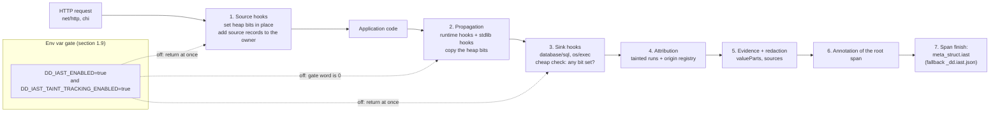
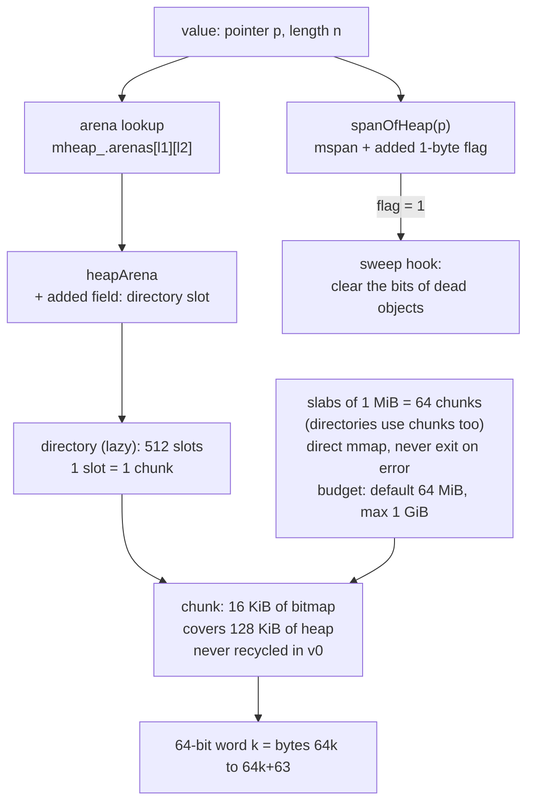
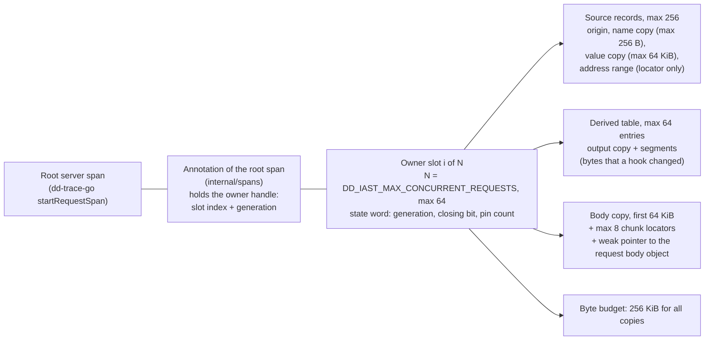
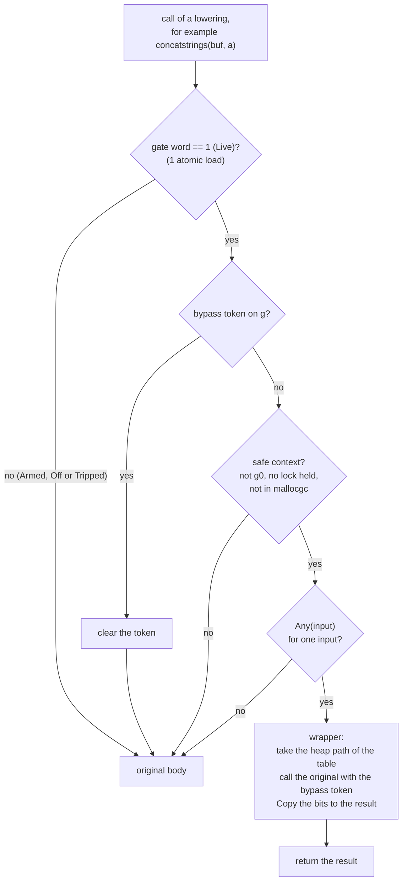
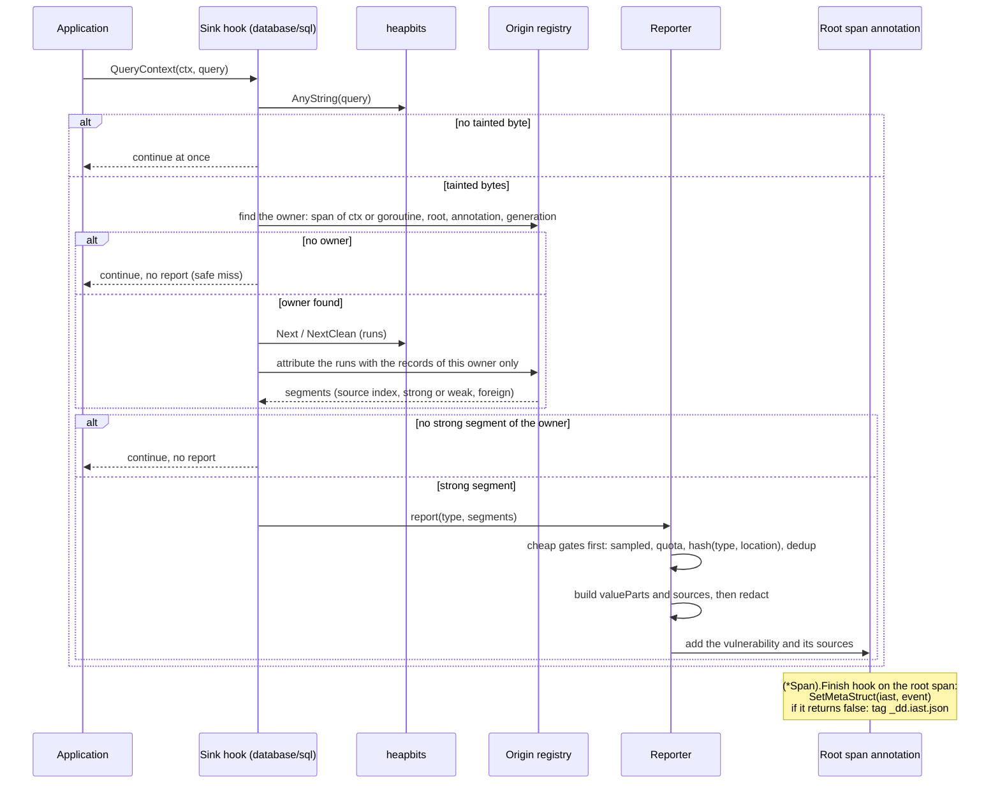
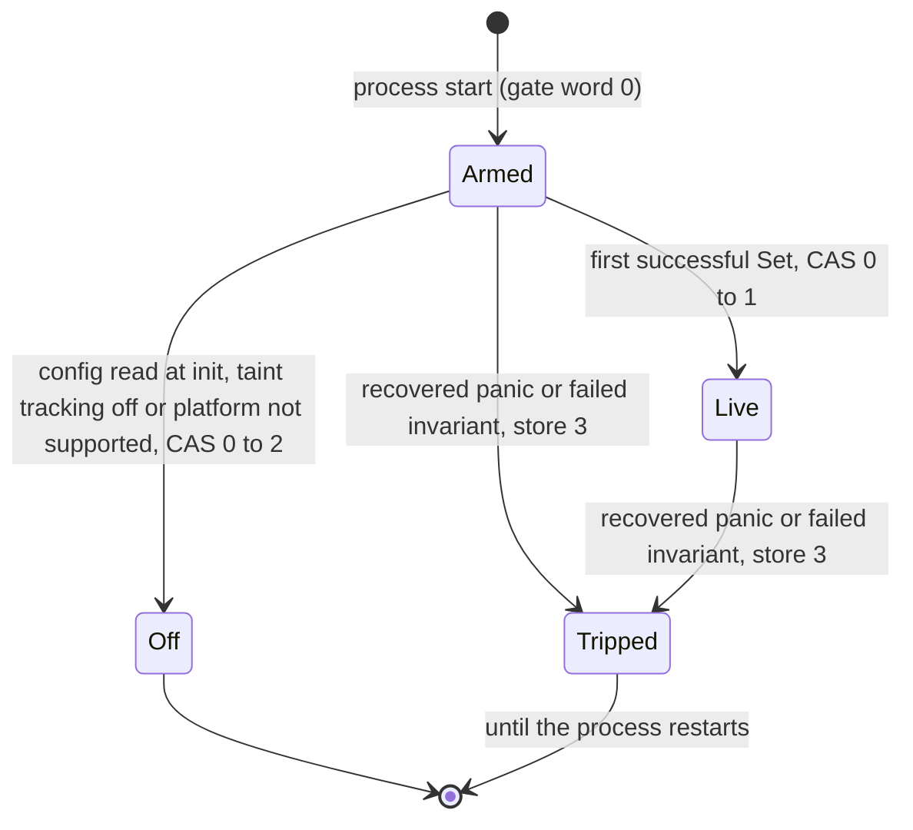
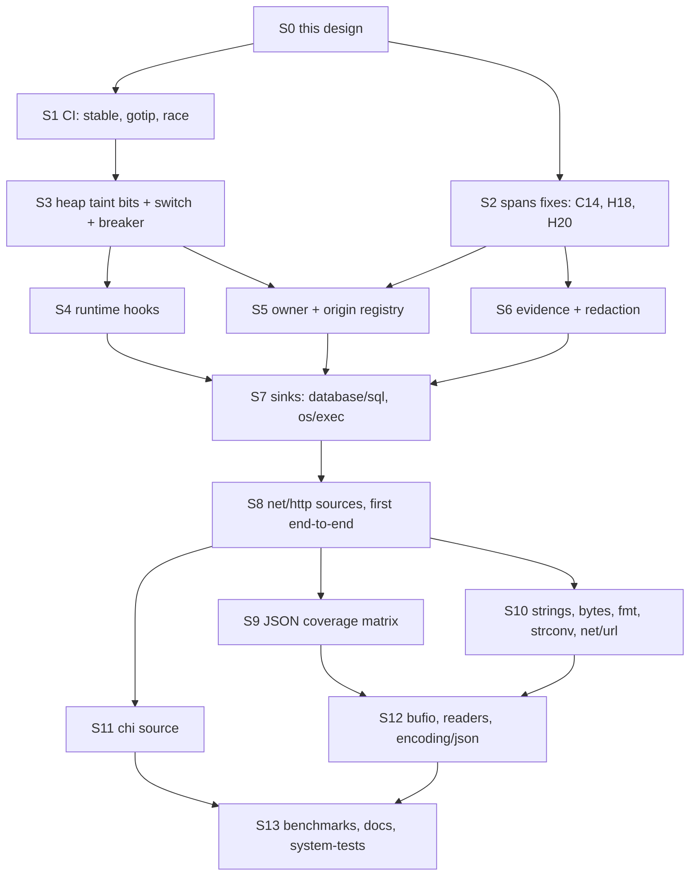

# Design: taint tracking v0 (SQL injection and command injection)

| Field | Value |
|---|---|
| Status | **Draft v2 for review.** v1 got 5 blocking and 2 major objections in the adversarial review (Mission A, round 1). Section 12 maps each objection to its change. Next: round 2, then approval by Romain. |
| Epic | Multica DD-69, Jira [APPSEC-70732](https://datadoghq.atlassian.net/browse/APPSEC-70732) |
| Milestone | "Go IAST PoC on the main branch, available to design partners and early adopters", **2026-12-03** |
| Base of this document | `main` at `f79d6f93` (2026-11-18) |
| Proof of concept (PoC) inputs | PR #39, PR #52, PR #58 (read only, see "Clean-room rule"), review PR #51, research notebook `carnet-de-recherches.md` |

This document is the contract for the v0 PR stack. It holds the acceptance
criteria (section 4). Each PR of the stack (section 6) says which criteria it
closes.

## How to read this document

| Section | Content | Read it when |
|---|---|---|
| [0](#0-summary) | Summary in 10 lines | Always |
| [1](#1-approach) | The design, with diagrams | You review the design |
| [2](#2-tradeoffs-and-rejected-options) | Options that we rejected, and why | You want to propose another option |
| [3](#3-constraints) | Go versions, platforms, tools, runtime risk, GC, memory, rollout | You review safety |
| [4](#4-acceptance-criteria) | Acceptance criteria, each with its check | You review a PR of the stack |
| [5](#5-review-requirements) | What each PR needs before merge | You review a PR of the stack |
| [6](#6-pr-stack) | The PR stack: order, scope, dependencies, estimates | You plan the work |
| [7](#7-answers-to-the-3-facts-to-check-in-code) | The 3 facts that the Delivery Lead asked to check | You approve the design |
| [8](#8-known-limits-and-coverage-gaps-v0) | Known limits of v0 | You write user documentation |
| [9](#9-risks) | Risks | You approve the design |
| [10](#10-decisions-to-confirm-and-open-questions) | Decisions to confirm and open questions for Romain | You approve the design |
| [11](#11-references) | References | You want the sources |

### Clean-room rule

All v0 code is new code. We do not copy code from PR #39, PR #52 or PR #58.
We use these PRs only to learn two things: what not to do, and which
constraints apply. The facts that this document takes from them are stated as
facts (with their source), not as code. Code that is already on `main` (for
example `internal/spans`, `internal/model`, `internal/vulnerability`) is not
PoC code. The stack can change and extend it.

### Words used in this document

| Word | Meaning |
|---|---|
| Heap taint bits, "bits" | One bit for each byte of heap memory. 1 = the byte is tainted. |
| Owner | The analysis state of one sampled HTTP request. It is bound to the root span of the request. |
| Origin registry | The external map: for each owner, the source records, derived entries and body copy. It gives the origin of tainted bytes. |
| Source record | One untrusted value: origin (for example `http.request.parameter`), name, a copy of the value, and the address range of the value. |
| Run | A sequence of adjacent tainted bytes in a sink argument. |
| Segment | A part of a run that is attributed to one source (or that is "foreign"). |
| Foreign | Tainted bytes that do not match a source of the owner. They are redacted and never make a finding alone. |
| Gate word | One process-wide `uint32` in the runtime: 0 Armed, 1 Live, 2 Off, 3 Tripped (section 1.2.5). Hooks work only when it is 1. It becomes 1 at the first taint and never goes back to 0 ("sticky"). |
| Hook | Code that Orchestrion or otelc adds to a function at compile time. |
| `S1` … `S13` | The PRs of the stack (section 6). Not GitHub PR numbers. |

## 0. Summary

1. Sources (`net/http` request data, chi `URLParam`) set heap taint bits **in
   place** on the bytes of the request values. They never replace a value that
   the application can see.
2. The bits follow the memory. A sub-string or a sub-slice of a tainted value is
   tainted with no hook.
3. Runtime hooks on compiler lowerings (`concatstrings`, `slicebytetostring`,
   `growslice`, …) copy the bits when Go copies bytes. A small set of standard
   library hooks covers the copies that the compiler does inline (`fmt`,
   `strings.Builder`, `bytes.Buffer`, `bufio`, `encoding/json`, `net/url`).
4. The bits do not say which source or which request a byte comes from. The
   **origin registry** of each request keeps bounded copies of the source
   values. At the sink, we find the owner of the current request from its span,
   and match the tainted runs to the copies **of that owner only**.
5. Sinks (`database/sql`, `os/exec`) check the bits first (a few nanoseconds),
   then attribute, redact, and report a standard Datadog IAST vulnerability
   (`valueParts` and `sources`) in `meta_struct.iast` on the root span, with the
   `_dd.iast.json` fallback that `main` has.
6. Taint tracking is **off by default**. The env var
   `DD_IAST_TAINT_TRACKING_ENABLED=true` turns it on. Off means: no bit is
   set, no memory is mapped, and each hook costs one load and one branch.
7. Orchestrion and otelc get the same hooks. The runtime-side code has one
   source file; the rules of both tools are generated from it or copy it.
8. Supported: go1.26.x and go1.27.x; linux and darwin on amd64 and arm64.
   Off on other platforms, and with `-asan` or `-msan`. gotip runs in CI as a
   signal only.
9. The stack has 13 PRs (section 6). Each PR leaves `main` green, with the
   feature off by default.
10. The milestone (2026-12-03) is at risk: the critical path is about 123 hours
    of agent work. Section 10 asks Romain which PRs the milestone needs.

## 1. Approach

### 1.1 Overview



The design has 2 storage parts:

- **Heap taint bits** (section 1.2) answer "is this byte tainted?". They are
  fast, lock-free, and correct for any sub-string or sub-slice.
- **The origin registry** (section 1.3) answers "which source is this byte
  from?". It is bounded, per request, and it holds only copies.

The bits are the cheap gate. The registry is used only after a bit is found
at a sink, or in a hook that changes bytes (section 1.5).

### 1.2 Heap taint bits

Facts from the Go runtime (go1.26 and go1.27). PR #52 tested each fact. We
re-implement the design from these facts.

1. The heap is divided into arenas (64 MiB on 64-bit linux and darwin). Each
   arena has a metadata record `heapArena`, found from a pointer in 2 or 3
   loads.
2. The GC does not move heap objects. A bit for each address is thus a bit for
   each byte of a live object.
3. Heap memory is used again only after the sweeper frees it, or after
   `freegc` (section 1.2.1). Hooks at these points clear the bits of dead
   objects before the memory can be allocated again.
4. Stack memory and static data are not in a heap span (`spanOfHeap` returns
   nil). The bits refuse them. Their bits are always 0.



**API** (package `internal/taint/heapbits`, internal):

| Function | Contract |
|---|---|
| `Enabled() bool` | The runtime is woven, the platform is supported, and taint tracking is on. |
| `Set(p, n) bool` | Taint `[p, p+n)`. All or nothing (section 1.2.3). Returns false for stack, static, user-arena or off-heap memory, for a range that is not inside one allocation slot, when the budget is used, when another goroutine allocates a chunk that the range needs (no wait), or when the gate is Off or Tripped. |
| `Clear(p, n)` | Remove the taint. Never allocates. |
| `Any(p, n) bool` | One byte or more is tainted. Safe for any address. |
| `Next(p, n, from)`, `NextClean(p, n, from)` | Offset of the next tainted (or clean) byte. They give the runs. |
| `Copy(dst, src, n) bool` | Make the bits of `dst` equal to the bits of `src` (like `memmove`, overlap is correct). A clean `src` clears `dst`. All or nothing for `dst`. |

**Rules of the runtime side** (constraints that PR #52 found):

- The entry points take `uintptr` values, so that the checked values do not
  escape to the heap. The Go wrappers call `runtime.KeepAlive` after the call.
- Each entry point has 2 parts. A `nosplit` classifier decides "inside one
  heap allocation slot" or "not heap" before the stack can move. A normal
  worker then does the bitmap work, with a preemption checkpoint every 512
  work units.
- All bitmap accesses are 64-bit atomics (`Load64`, `Store64`, `Or64`,
  `And64`, `Cas64`). A neighbour object can share a word.
- Span flag protocol: a write sets the bits, then the flag. The sweep clears
  the flag, clears dead objects, checks live objects, and sets the flag again
  if a bit is left. A concurrent `Set` is never lost.
- The sweep hook does not allocate, does not lock, cannot yield, and has a
  bounded cost (at most 80 KiB of small objects for each span; large objects
  at most 64 MiB, which is the largest span that `Set` accepts).
- Slabs come from a direct `mmap` call that returns nil on error (`sysAlloc`
  can exit the process). The mapped bytes are added to `memstats.other_sys`
  and `gcController.mappedReady`, so `GOMEMLIMIT` sees them. Directories are
  chunks from the same slabs, so they are in the same budget.
- The feature is off on arm64 CPUs without LSE atomics (no bounded `Or64`;
  decision D6 in section 10), and in `-asan` and `-msan` builds.

#### 1.2.1 Clear-before-reuse points

A freed heap slot can be allocated again only through the paths below. Each
path clears the bits of the dead object **before** the slot can be allocated.

| Path | When the slot can be allocated again | Clear point | Notes |
|---|---|---|---|
| Sweep of a span of small objects | After `(*sweepLocked).sweep` of that span computes the new free slots | A prologue at the start of `(*sweepLocked).sweep`. At this point the mark bits of the cycle are final, and no slot of the span is free for allocation yet. | A span that is cached in an `mcache` is not swept until it is uncached (`mcache.refill` sets `sweepgen = mheap_.sweepgen + 3`, `runtime/mcache.go:214–216`). Its dead objects are thus cleared by the sweep that runs before the reuse, as for any span. |
| Sweep of a large-object span | When the sweep frees the span to the heap | Same prologue | The whole object range is cleared (at most 64 MiB, see above). |
| `freegc` (`GOEXPERIMENT=runtimefreegc`) | At once: the slot goes back to the P (`runtime/malloc.go:1913–2025`) | A prologue at the start of `freegc`, before the slot is published | **Off by default** in go1.26 and go1.27 (`internal/goexperiment/exp_runtimefreegc_off.go`). A CI job turns the experiment on (AC-S7). |
| Objects with a finalizer | The finalizer can make the object live again | The sweep prologue **skips** a dead object that has a `_KindSpecialFinalizer` special | When the revived object dies again with no finalizer, a later sweep clears it. Cleanups (`runtime.AddCleanup`) and weak handles do not revive objects, so they need no exception. |
| User arena chunks (`GOEXPERIMENT=arenas`) | Freed without a sweep | None: `Set` refuses user arena memory | Their bits are always 0. |
| Stacks, `mSpanManual` spans | Not heap objects | None: `Set` refuses them | Their bits are always 0. |

The drift test (section 3.1) lists every runtime function that frees or reuses
heap memory. A new path in a Go release fails the test until a human checks
it.

#### 1.2.2 Chunk lifetime

**v0 never recycles a chunk or a directory once it is published.** The
bitmap memory stays mapped until the process exits. The budget bounds it.

Reason: a 128 KiB chunk can cover several spans. A worker can load a chunk
pointer, be preempted, and continue later. If chunks were recycled, the worker
could write into a chunk that now describes other memory, and atomics on the
words would not prevent this. With no recycling, a loaded chunk pointer always
stays valid, and it always describes the same 128 KiB of address space.

Cost: with much taint in many arenas, the budget can be reached and new taint
is dropped (telemetry counter). A later version can add recycling with an
epoch rule.

#### 1.2.3 All-or-nothing writes

`Set` and `Copy` have 2 phases:

1. **Ensure.** Get every chunk that the destination range needs (directory
   slot CAS from 0 to "claimed", then a chunk from a slab). On any failure
   (budget, refill busy, CAS limit, `mmap` error), return false. No bit was
   written. Chunks that were already obtained stay mapped and empty, and stay
   charged.
2. **Write.** Write the bits, then the span flag.

No bit is ever undone after a failure. Thus a failed `Set` never clears the
bits that another writer set in the same words.

#### 1.2.4 Tiny allocator

The tiny allocator packs small pointer-free objects (less than 16 bytes) into
one 16-byte block. Go records the block, not the boundary of each object in it
(`runtime/malloc.go:1224–1274`). Thus:

- `Set` can check only that the range is inside one allocation slot (for tiny
  objects: inside one 16-byte block). It cannot check that the range is
  exactly one Go value.
- The guarantee is narrowed: **callers must pass the exact range of one
  value.** Sources pass the value that `net/http` made. Hooks pass the result
  object that they made. No caller passes a range that it computed from a
  neighbour.
- Bits are per byte, so two neighbours in one block keep separate bits.
- The tiny allocator never reuses a part of a block that is still live: the
  block is freed only when all its objects are dead. Thus the bits of a dead
  neighbour inside a live block can stay, but no new object gets them.

AC-S7 tests two verified neighbours (same block, checked by address) in a
**non-race** build.

#### 1.2.5 Gate word

One process-wide `uint32` in the runtime. All hooks read it with one atomic
load. It has 4 values:

| Value | Name | Set by | Hooks |
|---|---|---|---|
| 0 | Armed, no taint yet (also the state before the config is read) | Initial value | Do nothing |
| 1 | Live | The first successful `Set`, with `CAS(0 → 1)` | Run the clean path (context check + `Any`) |
| 2 | Off | The config at init, with `CAS(0 → 2)`, when taint tracking is off or the platform is not supported | Do nothing |
| 3 | Tripped | The circuit breaker, with a plain atomic store of 3 | Do nothing |

- Hooks run their work only when the value is exactly 1.
- Only `CAS(0 → 1)` can make the gate Live. A `Set` that finishes after the
  breaker stored 3 cannot make it Live again: its CAS fails. Tripped and Off
  are terminal for the process.
- `Set` reads the gate before it writes: with 2 or 3, it returns false.

### 1.3 The origin registry (external map)

The bits say **that** a byte is tainted, not **from which source**, and not
**for which request**. Decision 6 asks for the origin of each tainted range.
The origin registry keeps this information, for each sampled request.



#### 1.3.1 Owner lifetime

1. **One owner for each sampled request, bound to its root server span.** The
   owner starts at the exit of `instrumentation/httptrace.startRequestSpan` in
   dd-trace-go. This private function is the common point of all dd-trace-go
   HTTP server integrations: `BeforeHandle` calls it (`before_handle.go:99`,
   used by the `net/http` integration), and `StartRequestSpan` calls it
   (`httptrace.go:53–64`, used by the chi integration
   `contrib/go-chi/chi.v5/chi.go:60`). At this point the span exists and the
   request is parsed.
2. **Only for a root server span.** When the new span has a parent server span
   of the same request (for example a chi middleware inside a traced
   `net/http` server), no new owner is made: the root span already has one.
3. **One sampling decision** for the owner and the annotation (stack PR `S2`).
   A sampled-out request gets no owner and no annotation slot (lesson from #51
   H18).
4. **The owner handle is in the annotation** of the root span: slot index and
   generation. This is the only way to find the owner.
5. The owner ends when the root span finishes (the `(*Span).Finish` hook that
   `main` already has). `Finish` sets the closing bit and returns at once; the
   last accessor cleans the slot. A slot is given to a new request only after
   cleanup, with a new generation.

#### 1.3.2 Which owner: always the owner of the current request

There is **no search across owners**. Every read and every write of the
registry uses one owner, found like this:

| Caller | How it finds its owner |
|---|---|
| A sink | The span of the context argument (`QueryContext(ctx, …)`, `CommandContext(ctx, …)`); else the active span of the goroutine (the dd-trace-go goroutine-local storage, woven by both tools). Then its root span, its annotation, the owner handle, and a pin with the expected generation. |
| A source hook | The request: the owner bound to the request when the span started. |
| The body `Read` hook | The owner whose registered body object (weak pointer) is the receiver. |
| A standard library hook that writes a derived entry | The active span of the goroutine, as for a sink. |

When a step fails (no span, no annotation, no owner, wrong generation, closing
bit), the operation is **dropped**: no report, no record, and a telemetry
counter grows. This is a safe miss. Examples: a sink in a goroutine that the
handler started with no context; a sink that runs after the request ended.

#### 1.3.3 Rules of the registry

1. **The owner holds only copies.** It never keeps a reference to application
   memory (the body object is a `weak.Pointer`, which cannot match a new object
   at a reused address). All copies are charged to a fixed byte budget
   (256 KiB for each owner). When the budget is used, new records are dropped
   (telemetry counter); their bits stay, and their bytes become foreign at the
   sink.
2. **Addresses only locate.** A source record keeps the `(address, length)` of
   the original value, as a `uintptr`. An address match is accepted only when
   the sink bytes are equal to the owner copy at the same offset. A reused
   address with other bytes fails the check. This is why this design is not
   the rejected process-wide `uintptr` map (section 2).
3. **No blocking.** Every access pins the slot (CAS on the state word, with
   the expected generation), then calls `TryLock` on the slot mutex. A busy
   lock drops the operation. A stale handle (old generation) is refused for
   every operation, `Finish` included (lessons from #51 C15 and H5).
4. **Bounded work.** One sink call inspects at most 64 KiB of the sink value,
   does at most 4096 candidate checks, and compares at most 1 MiB of bytes in
   total. When a bound stops the loop, the rest of the tainted bytes are
   foreign (redacted), never shown as clean.
5. **Marks.** Each record has a `marks` bitmask, so that a later version can
   add sanitizers. v0 sets no mark (no sanitizer is in scope).

#### 1.3.4 Attribution at a sink

The same algorithm runs for `IsTaintedString` and `IsTaintedBytes`, with the
owner of the current request.

1. `Next` / `NextClean` give the tainted runs of the sink argument.
2. For each run, from left to right, cut segments, **using only the records of
   the reporting owner**:
   1. **Address locate.** Find a record whose address range contains the start
      of the rest of the run. Check the bytes against the owner copy. The
      segment is the longest equal part.
   2. **Content match.** Else, find the copy (derived entries, then sources,
      then the body copy) that contains the longest prefix of the rest of the
      run.
   3. **Tie rule.** Address match first; then the longest segment; then the
      shortest record (so `http.request.path.parameter` wins over
      `http.request.path` for the same bytes); then the last record.
   4. Else the byte is **foreign**. Adjacent foreign bytes merge.
3. **Strong-match rule.** A finding needs at least one strong segment: an
   address match (any length), or a content match of at least
   `min(4, length of the record copy)` bytes. Short content matches are weak:
   equal bytes from elsewhere (for example a `-`) can match by chance.
4. **At most `DD_IAST_MAX_RANGE_COUNT` segments.** Past this bound, the rest is
   foreign.

**What this gives:**

- Bytes of request A in a sink of request B are foreign for B: they are not in
  B's records. Alone, they make no finding for B, and the report of B never
  shows a source of A. (Before v2, the design searched all owners; the
  reviewer showed that this could report A's source in B's sink.)
- A JSON document that a decoder in request B reads from a reader that mixes
  A's and B's bodies (`io.MultiReader`): only the bytes that are in B's body
  copy are attributed to B. This is the provenance check that replaces the
  PR #39 "exclusive owner" rule for JSON: an attributed body segment is always
  checked against the bytes that **this** request's own registered body object
  produced (section 2, T15).

**Accepted limit (decision 6).** Content match cannot separate equal bytes.
When request B's sink holds bytes from elsewhere that are equal to a source of
B (at least 4 bytes), they are attributed to B's source.

### 1.4 Runtime hooks (propagation without call-site instrumentation)

Decision 1: propagation uses runtime hooks only. The compiler lowers string
and slice operations to calls of these runtime functions. A hook in the
function covers every call site, in every package, with no AST rewrite.

| # | Runtime function | Go operation | Bit copy | Heap path when an input is tainted |
|---|---|---|---|---|
| 1 | `concatstrings` (through `concatstring2` to `concatstring5`) | `a + b`, `s += t` | Each tainted operand, at its offset | Call the original with `buf = nil` (the function then uses `rawstring`, on the heap). When only one operand is not empty, the function returns that operand (an alias): its bits are already there. |
| 2 | `concatbytes` (through `concatbyte2` to `concatbyte5`) | `[]byte(a + b)` | Same | Call with `buf = nil` |
| 3 | `slicebytetostring` | `string(b)`; also used by `bytes.Buffer.String`, `fmt.Sprint*`, `strconv`, `encoding/json` | Exact | Call with `buf = nil`. A 1-byte result points into the static array `staticuint64s` and cannot hold bits (section 8). |
| 4 | `stringtoslicebyte` | `[]byte(s)` | Exact | Call with `buf = nil` |
| 5 | `stringtoslicerune` | `[]rune(s)` | A rune is tainted when one of its UTF-8 bytes is tainted, plus a derived entry | Call with `buf = nil` |
| 6 | `slicerunetostring` | `string(runes)` | The UTF-8 bytes of a tainted rune are tainted, plus a derived entry | Call with `buf = nil` |
| 7 | `growslice` | The copy of the old elements in every `append` that grows | Exact, for element types without pointers | Always on the heap |
| 8 | `growsliceBuf` | Same, when the compiler gives a stack buffer | Exact | **Call `growslice(oldPtr, newLen, oldCap, num, et)` directly.** `growsliceBuf` uses the stack buffer when `newLen <= bufLen` (`runtime/slice.go:510–520`), whatever the value of `bufPtr`, so a nil pointer is not a heap path there. |

All 8 functions are compiler lowerings: compiled code calls them, so they
change only together with the compiler (decision 5). They exist with the same
signatures in go1.26.10 and go1.27.4. In gotip of 2026-11-19, the buffer type
of `stringtoslicerune` changed (`*[tmpStringBufSize]rune` became
`*[tmpRuneBufSize]rune`). The compile-time signature checks (section 3.1)
detect this kind of change.

**Hook template** (shape only):



Rules:

- **Heap path for each lowering** (last column of the table). Stack values are
  not tracked (decision 6).
- **No `defer`, no argument kept live across the call** in the gate-off path.
  The gate-off prologue must stay as small as the original one (lesson from
  #58: gate off ≤ +2 ns).
- **Escape tags must not change.** A test compares the escape analysis of each
  hooked function, woven and not woven.
- **Context check before any call with a stack check** (`morestack` on g0 is
  fatal).
- **The gate word is sticky** (section 1.2.5). A live counter is not possible
  (no `Cas8` in `internal/runtime/atomic`, and the sweep flag protocol makes a
  count of tainted spans wrong). After the first taint, all hooks pay the
  clean-path cost (context check + `Any`). The benchmark report measures it.
- **Not hookable:** `copy`, the appended part of `append(x, y...)`, and `make`
  + `copy`. The compiler emits an inline `memmove`. In user code these lose the
  taint (section 8). In the standard library, the functions that need them get
  their own hooks (section 1.5).
- **Named types and generics.** A named string type (`type ID string`), a
  conversion between string types, and generic code with `~string` or
  `~[]byte` constraints use the same lowerings and the same memory. They are
  covered with no extra hook.

### 1.5 Standard library hooks

Some standard library functions copy bytes with `copy` or `append(x, y...)`,
or change the bytes. They need a hook. The hook is a **twin**: an entry
prologue checks the gate and `Any` on the inputs (or the destination). When
they are clean, the original body runs. Else the twin does the same work as the
original body, with the bit operations added, and returns its result.

The table gives the **result** that each hook must produce, not only the
function name.

| Priority | Package | Hook points | Result |
|---|---|---|---|
| P0 | `io` | `ReadAll` | Exact bits in the final slice. `ReadAll` builds a multi-chunk result with `append(final, chunk...)` (`io/io.go:730–739`, the same in go1.26 and go1.27), which `growslice` does not cover. A short body (one chunk) needs no hook. |
| P0 | `fmt` | `(*buffer).write`, `writeString`; `(*fmt).writePadding`; `(*fmt).fmtQ`; `(*fmt).fmtSbx`; clear in `(*pp).free` | Exact copy of every byte that `fmt` copies into its buffer. Thus: `%s` and `%v` of a string or `[]byte` keep exact bits, also with width and precision (precision gives a sub-string); the output of `String()` and `Error()` keeps exactly the bits of the string that they return; a `Formatter` that writes tainted bytes to `fmt.State` keeps them (`State.Write` goes to `(*buffer).write`); a tainted format string keeps exact bits for its literal parts. **Coarse** only for the bytes that `fmtQ` (`%q`, through `strconv.AppendQuote`, `fmt/format.go:447–457`) and `fmtSbx` (`%x`, `%X`) generate from a tainted argument. `%T`, `%p`, `%d` and `%v` of numbers, and a `String()` that returns a constant, give clean text (lesson from #51 H8: no taint by argument identity). |
| P0 | `strings` | `(*Builder).Write`, `WriteString`, `grow`; `Repeat`; `ToUpper`, `ToLower`; `Map`; `(*Replacer).Replace` | Exact for the Builder (so `Join` is exact, for the elements **and** the separator). `WriteByte` and `WriteRune` take a value, not memory: they cannot carry taint (section 8). `ToUpper`/`ToLower` on ASCII input: positional, byte `i` of the output has the bit of byte `i` of the input (changed and unchanged bytes). Non-ASCII, `Map`, `Replacer`: coarse on the new output. |
| P0 | `bytes` | `(*Buffer).Write`, `WriteString`, `ReadFrom`, `grow`; `Join`, `Repeat`, `Replace`, `ToUpper`, `ToLower`, `Map` | As `strings`. A write with clean bytes clears the bits of the bytes that it overwrites. |
| P0 | `net/url` | `unescape`, `escape` | Coarse on the new output. **When the function returns its input** (no escape: `net/url/url.go:155–157`, `:208–210`), the hook does nothing: the bits are already exact, and a whole-output `Set` would widen them. |
| P0 | `strconv` | `quoteWith`, `unquote`, `AppendQuote*` | Coarse on the new bytes |
| P0 | `encoding/json` v1 | `(*Decoder).refill` (slide **and** grow, `encoding/json/stream.go:160–181`), `unquoteBytes`, `valueQuoted` | Exact for the slide and the grow copies; coarse for unquoted strings with escapes |
| P0 | `encoding/json` v2 (go1.27 default) | `jsontext.(*decoderState).fetch` (slide, grow, and the `bytes.Buffer` alias, `encoding/json/jsontext/decode.go:175–241`); `jsonwire.AppendUnquote`; `v2.makeString` | Exact for slide and grow; coarse for unquote; **string cache:** a cache hit is used only when the bits of the cached string are equal to the bits of the input bytes (tainted→clean, clean→tainted and different partial masks on equal bytes all miss the cache) |
| P1 | `bufio` | `(*Reader).fill`, `Read`, `ReadBytes`, `ReadSlice` copies; delegated reads use the "read rule" (a written byte never keeps old bits; the unwritten tail keeps its bits) | Exact |
| P1 | `bytes`, `strings` | `(*Reader).Read`, `ReadAt` | Exact |

"Coarse" means: `Set` the whole **new** output (never memory that aliases an
input), and add a derived entry with the first contributing source of the
owner of the current request (section 1.3.2). The output bytes are not equal
to the input bytes, so the derived entry is the only way to find their origin.

Rules for all standard library hooks:

1. **Application code runs exactly once.** A twin calls each application
   callback (for example the mapping function of `strings.Map`) and each
   reader (`Read` of an `io.Reader`) exactly once, as the original body does.
   A twin never runs the original body after it called application code.
2. **Application panics are never caught.** The `recover` of the circuit
   breaker (section 1.9) wraps only analysis code that calls no application
   code. A panic from application code goes up unchanged.
3. **After a failed analysis, the result is still correct.** When the bit work
   or the registry work fails or panics, the twin finishes the data work with
   no bits (taint is lost, the result is the same as the original).
4. A hook imports only `heapbits` and one leaf bridge package (imports
   `sync/atomic` and `unsafe` only). The owner work goes through function
   pointers in the bridge. A test checks the import graph.
5. The analysis code never calls a hooked function, and it has a
   per-goroutine re-entry guard.
6. Each hooked function body has a golden hash for each supported Go minor
   (drift test, section 3.1), and compile-time checks of the unexported fields
   that the twin uses.
7. Never hook a package that `runtime` imports (`internal/bytealg`,
   `internal/stringslite`).
8. **Known cost:** with one more call, some small functions stop being inlined
   (`(*strings.Builder).WriteString` measured +7.7 ns in PR #58). This cost
   exists also when taint tracking is off. The benchmark report gives it
   (decision 9: no gate).

### 1.6 Sources

Sources set bits **in place**, on the memory of the values that `net/http`
already made. They never write to a field, map or slice that the application
can see (lessons from #51 C12 and C13). When `Set` fails (for example a
read-only interned string), the source is dropped and a telemetry counter
grows. We never replace the value.

| Origin | API | Mechanism | Record name |
|---|---|---|---|
| `http.request.path` | `Request.URL.Path`, `URL.RawPath` | Bits at owner start (section 1.3.1) | (none) |
| `http.request.query` | `Request.URL.RawQuery` | Bits at owner start | (none) |
| `http.request.uri` | `Request.RequestURI` | Bits at owner start | (none) |
| `http.request.header` | `Request.Header` values | Bits at owner start (first 64 headers, 8 KiB each) | header name |
| `http.request.cookie.value` | `(*Request).Cookie`, `Cookies` | Values are sub-strings of the `Cookie` header: bits are free. A record is added at the accessor. | cookie name |
| `http.request.parameter` | `URL.Query()`, `url.Values.Get`, `(*Request).FormValue`, `PostFormValue`, `Form`, `PostForm` | Values are sub-strings of `RawQuery` or of the body (bits are free), or `url.unescape` results (coarse hook, section 1.5). A record is added at the accessor. | parameter name |
| `http.request.path.parameter` | `(*Request).PathValue`; chi `(*Context).URLParam`, `URLParam`, `URLParamFromCtx` | Values are sub-strings of the path (bits are free). A record is added at the accessor. Direct reads of `chi.Context.URLParams.Values` are still detected, with origin `http.request.path`. | parameter name |
| `http.request.body` | `Request.Body` reads (see the table below) | The hook sets the bits on `p[:n]` when the receiver is the registered body object of the owner (registered at owner start, through the `expectContinueReader` wrapper when there is one). The owner keeps a copy of the first 64 KiB. Client response bodies use the same types, so the registration is required. | (none) |
| `http.request.multipart.parameter` | `(*Request).FormValue` on `multipart/form-data`, `MultipartForm.Value` | Read through `bufio` (P1 hooks). A record is added at the accessor. | field name |

**Body `Read` receivers depend on the Go minor:**

| Go minor | HTTP/1 | HTTP/2 (server) |
|---|---|---|
| go1.26 | `net/http.(*body).Read` (`transfer.go:831`) | `net/http.(*http2requestBody).Read` (bundled, `h2_bundle.go:6640`) |
| go1.27 | `net/http.(*body).Read` (`transfer.go:847`) | `net/http/internal/http2.(*requestBody).Read` (`server.go:2465`; the bundle is gone) |

Both tools have one rule for each receiver. A rule for a receiver that does not
exist in the current toolchain does not match. The expected-hook manifest
(section 3.1) lists which rules **must** match for each Go minor, so that a
missing match fails the stable jobs.

Rules:

- Values shorter than 2 bytes or longer than 64 KiB are not tainted.
- Framework hooks (chi) call into dd-iast-go through a linknamed function.
  dd-iast-go never imports chi. Thus the root `go.mod` gets no new requirement
  for a framework (no version change for users through MVS).
- Other frameworks (gin, echo, gorilla/mux) are not in scope. Their values that
  come from `net/http` APIs, or that are sub-strings of the path, are still
  detected, with the `net/http` origin, when a dd-trace-go server span exists.

### 1.7 Sinks

| Vulnerability | Public API covered | Hook points | Rule |
|---|---|---|---|
| `SQL_INJECTION` | `(*DB)` and `(*Tx)`: `Query`, `QueryContext`, `QueryRow`, `QueryRowContext`, `Exec`, `ExecContext`, `Prepare`, `PrepareContext`. `(*Conn)`: `QueryContext`, `QueryRowContext`, `ExecContext`, `PrepareContext` (`*sql.Conn` has only the context forms, `database/sql/sql.go:2027–2064`). | `QueryContext`, `ExecContext` and `PrepareContext` of `*DB`, `*Tx` and `*Conn` (9 hooks). Every other public form forwards to one of them (for example `(*DB).Query` returns `db.QueryContext(context.Background(), …)`, and `QueryRowContext` calls `QueryContext`). Thus each public call is checked exactly once. | The query string only. Bound arguments are never a finding. |
| `COMMAND_INJECTION` | `exec.Command`, `exec.CommandContext`, then `Run`, `Output`, `CombinedOutput`, `Start` | `(*Cmd).Start` (the other methods call it) | `Cmd.Path` and all `Cmd.Args` (lesson from #51 H15: a tainted `Path` that differs from `Args[0]`). One finding for each command. |

Each sink first calls `heapbits.Any` on its arguments. With no tainted byte it
returns at once. Then it finds the owner of the current request (section
1.3.2). The report location skips the sink frames for both tools (otelc does
not mark its injected code, see `internal/vulnerability/report.go`).

### 1.8 Evidence, redaction and reporting



- **Format.** The standard Datadog IAST event that `internal/model` already
  has: `vulnerabilities[]` with `type`, `evidence.valueParts[]` (`value` or
  `pattern`, `redacted`, `source` index, `truncated`), `location`, `hash`; and
  `sources[]` with `origin`, `name`, `value` or `pattern`, `redacted`.
- **Path.** The same path as WEAK_HASH on `main`: the annotation of the root
  span, written by `spans.Finished` in `meta_struct["iast"]`, with the
  `_dd.iast.json` fallback when `SetMetaStruct` returns false (decision 7).
- **Cheap gates first** (lesson from #51 H26): sampling, the per-request quota
  (`DD_IAST_VULNERABILITIES_PER_REQUEST`) and deduplication on
  `hash(type, location)` run before the evidence and redaction work.
- **SQL redaction** (lessons from #51 C9, C10, C11):
  - Each SQL dialect of `github.com/DataDog/go-sqllexer` (already an indirect
    dependency) scans the query independently. The sensitive intervals are the
    union of all dialects: string and number literals, and **comment bodies**.
  - Dialect-specific syntax (for example Oracle `q'[...]'`) is handled only in
    the scan of its dialect. No pre-scan changes the input of another dialect.
  - When a dialect lexer fails, or when the dialects disagree on a token
    boundary inside a tainted part, the evidence is redacted completely (fail
    closed).
  - A redaction `pattern` is made from the length and position only. It never
    has the same character as the secret at the same position.
- **Command redaction.** The arguments that match `DD_IAST_REDACTION_*` are
  redacted, and the values after known secret flags.
- **Sensitive sources.** A source whose name or value matches
  `DD_IAST_REDACTION_NAME_PATTERN` or `DD_IAST_REDACTION_VALUE_PATTERN` is
  sent with `redacted: true` and a pattern, and its name is masked (lesson from
  #51 M36).
- **Fixes on `main`** (stack PR `S2`): a report after the root span finished
  must not make a new annotation or call `SetMetaStruct` on a finished span
  (#51 C14); sampled-out requests must not use annotation capacity (#51 H18);
  the capacity check must be atomic with the insertion (#51 H20).

### 1.9 Env var gate, kill switch and circuit breaker



| State (gate word) | Sources | Runtime and stdlib hooks | Sinks | Memory |
|---|---|---|---|---|
| Armed (0) | Run for sampled requests (after init) | 1 atomic load + 1 compare | Run | Owner table allocated on the first sampled request |
| Live (1) | Run | Clean path: context check + `Any` per input | Run | Bits and owner copies, within their budgets |
| Off (2) | Return at once | 1 atomic load + 1 compare | Return at once | 0 bytes mapped; 8 bytes per arena and 1 byte per span (added fields) |
| Tripped (3) | Return at once | 1 atomic load + 1 compare | Return at once | Bits stay mapped (no consumer); no new mapping |

- **New env vars** (README update is part of `S3`):
  - `DD_IAST_TAINT_TRACKING_ENABLED`, Boolean, default `false`. It has an
    effect only when `DD_IAST_ENABLED` is true (default true on `main`, for
    WEAK_HASH and WEAK_CIPHER).
  - `DD_IAST_TAINT_MEMORY_LIMIT`, bytes of heap bits, default 64 MiB, from
    1 MiB to 1 GiB. `0` turns taint tracking off.
- **Read once.** The config is read at package init. The runtime hooks run
  before `main` and before this init: at that time the gate word is 0 (Armed,
  no taint), so they do nothing. No source can run before the init.
- **Terminal states.** Off and Tripped never go back to Armed or Live: the
  only transition to Live is `CAS(0 → 1)` (section 1.2.5). A `Set` that is in
  progress when the breaker trips cannot make the gate Live again.
- **Kill switch.** Restart the process with
  `DD_IAST_TAINT_TRACKING_ENABLED=false`. No rebuild is needed.
- **Circuit breaker.** Analysis code (sources, attribution, evidence, the bit
  and registry work of the standard library twins) runs under a scoped
  `recover` that wraps **only** analysis code (section 1.5, rules 1 to 3). A
  recovered panic stores 3 in the gate word, sends one telemetry log, and the
  caller continues with the original result. Application panics are never
  caught. The runtime-side code cannot recover (a fault there is fatal): this
  is why its rules (section 1.2) forbid allocation, locks and unbounded loops.
- **Build-level removal.** Code woven into the runtime stays in the binary when
  taint tracking is off. To remove it, build without the taint packages: with
  otelc, import only the detection packages that you need (for example
  `iast/crypto/hash`, as `_integration/otelc/setups/hashonly` does); with
  Orchestrion, remove the taint imports from `orchestrion.tool.go`.

### 1.10 Orchestrion and otelc: equal behavior

Decision 4: both tools have equal support. The repository rules
(`AGENTS.md`, "Instrumentation Back-Ends") already require one aspect for each
tool and shared Go logic. Parity means **the same behavior**, proven by the
same tests. A shared or generated rule file is not a proof.

#### 1.10.1 Only 3 primitives

v0 uses only these primitives. Both tools have them, for functions with a
receiver and without one.

| Primitive | Orchestrion | otelc (pinned version) | Used for |
|---|---|---|---|
| Add fields to a struct of another package | `struct-definition` + `add-struct-field` | `add_struct_fields` | `runtime.heapArena`, `runtime.mspan`, `runtime.g` |
| Add declarations to a package | `inject-declarations` | `add_file` (a `//go:build ignore` file) | The runtime-side code, the twins |
| A prologue at the start of a function body, with an early `return` | `function-body` + `prepend-statements` | `func` rule + `inject_code` (`raw`, default placement) | Every hook of sections 1.2 to 1.7 |

v0 does **not** use statement-pattern placement inside a function body. The
pinned otelc has it (`tool/internal/instrument/apply_raw.go:76–126`), but
Orchestrion `prepend-statements` is not the same primitive. When a hook needs
to act in the middle of a function (for example after the slide `copy` in
`json.(*Decoder).refill`), it is a **twin** instead: the prologue runs a
complete copy of the function with the bit operations, and returns (section
1.5). This is one design for both tools.

Unnamed results have different names (Orchestrion `__result__N`, otelc
`_unnamedRetValN`). Only the small prologue templates differ for this reason.

#### 1.10.2 One source file for the runtime-side code

The runtime-side code (bitmap, classifier, worker, sweep and `freegc` hooks,
gate word) is more than 1 000 lines. It has one Go source file. otelc copies
it with `add_file`. `go generate` writes the Orchestrion `inject-declarations`
template from the same file. A CI check fails when the generated file is not up
to date (AC-P8). This keeps the code equal; the behavior tests (1.10.3) prove
that the result is equal.

#### 1.10.3 Parity is proven by behavior

- Every woven test runs with both tools (unit tests through
  `go tool orchestrion go test` and `scripts/otelc-test.sh`, end-to-end tests
  in `_integration/otelc`).
- **Parity witnesses**, required in the stack PR that adds the hook, with both
  tools: one real allocator reuse (a sweep that clears dead bits, then a new
  object at the same address, `S3`); one runtime copy (`S4`); one standard
  library twin with an interior copy (`json.(*Decoder).refill` slide and grow,
  `S12`; before it, `io.ReadAll` multi-chunk, `S8`).
- The `_integration/otelc` suite compares the findings of the two tools, after
  it checked that each tool gave at least one finding (AC-F11).

#### 1.10.4 Platform-specific code is selected at compile time

Some runtime symbols exist only on some platforms. For example the runtime has
a Go `mmap` function only in `mmap.go`, `cgo_mmap.go`, `sys_darwin.go`,
`sys_openbsd.go`, `os2_aix.go` and `os3_solaris.go`; Windows and wasm have
none. Injected code that names `mmap` would not compile there. A check in a
runtime `init` is too late.

Rule:

- The platform-specific code (the slab allocator that calls `mmap`, the CPU
  feature check) is injected **next to the Go definition of `mmap`**, so that
  it has the build constraints of that file. It sets a function variable in an
  injected `init` of the same file.
- The generic code calls the platform code only through this variable. When
  the variable is nil (no `mmap` definition: Windows, wasm), `Set` returns
  false and the gate goes to Off.
- The generic code names only symbols that exist on every platform.
- The list of supported platforms is also checked in the generic code
  (`GOOS`, `GOARCH`, `asanenabled`, `msanenabled`, `cpu.ARM64.HasATOMICS`).
  Platforms that have `mmap` but are not supported (for example freebsd,
  linux/386) compile and stay Off.
- AC-P5 builds **and runs** the feature-off tests where a runner exists, and
  only cross-builds the others. The two kinds of evidence are labeled.

#### 1.10.5 Expected-hook manifest and behavioral sentinel

A tool can skip a rule with no error. Orchestrion v1.15.0 does this on gotip
today (section 7.2). Thus a passing build is no proof that the hooks are there.

- **Expected-hook manifest.** Each injected hook registers itself at package
  init, in a fixed bit set of the runtime (no allocation). A checked-in
  manifest lists the hooks that **must** be there, for each Go minor and each
  supported platform (for example the HTTP/2 body receiver changes between
  go1.26 and go1.27, section 1.6).
- **Behavioral sentinel.** `_integration/otelc/cmd/sentinel` is a woven
  program that exits with an error when a capability does not work. It grows
  with the stack: `S3` adds set → any → clear and a reuse check; `S4` adds a
  concatenation copy; `S7` adds sink → report; `S8` adds HTTP request →
  SQL finding; `S9`, `S12` add `fmt.Sprintf` and JSON. It also compares the
  registered hooks with the manifest. It never skips: in a job that expects a
  woven build, `build.Instrumented() == false` is a failure.
- **Stable jobs** (go1.26.x, go1.27.x, both tools) must pass the sentinel. They
  are required.
- **gotip jobs** (both tools) are not required (decision 3). They run 2
  independent steps: the drift test (no weaving; it fails for a minor with no
  golden file, see 3.1) and the woven sentinel. One step does not stop the
  other. A failure writes a warning for each tool in the job summary.

## 2. Tradeoffs and rejected options

Each row is an option that a reviewer can propose again. The "Evidence"
column gives the source of the reason.

| # | Option | Status | Reason | Evidence |
|---|---|---|---|---|
| T1 | Taint store keyed by `weak.Make(unsafe.StringData(s))` | Rejected | `weak.Make` throws (not a recoverable panic) on a pointer that is not heap memory: string literals, static data, stack. Go has no "is this a heap pointer?" test, so the store cannot filter these values before the call. | Notebook F4 (2026-08-24), V1 |
| T2 | One process-wide map keyed by `uintptr` address | Rejected | Heap addresses are used again after GC; stack addresses are used again; equal one-byte literals share memory. A key can thus match an unrelated value. Our origin registry is different: it is per request, it holds copies, an address only locates a candidate, and the bytes are always checked against the copy (section 1.3). | Notebook F5, V1 |
| T3 | Call-site instrumentation of `+` (DD-11, Orchestrion PR #881) | Rejected (decision 1) | Rewritten code was slower than the runtime hook in 22 of 33 rows of DD-11. AST rewriting changes Go semantics (#51 C4: operands that Go does not evaluate; C5: `s[:1e3]` no longer compiles) and allocates when IAST is off (#51 H27). It needs tool features that are not released. | DD-11 report; #51; notebook F10 |
| T4 | External store with exact `(pointer, length)` keys and call-site wrappers for each operation (PR #39 design) | Rejected | No taint for a sub-string unless each slicing form has a wrapper; about 15 000 lines of wrappers and bridges; the review found 15 Critical and 30 High findings. | #51 final report; PR #58 plan section 2 |
| T5 | Origins in runtime "specials" for each tainted object (option O1 of the PR #52 plan) | Deferred | Needs a span lock for each add and lookup, and more runtime code to maintain for each Go release. The per-request registry is sufficient for v0. A later version can revisit it. | PR #52 plan section 8 |
| T6 | A per-span side array of record indexes (option O2) | Rejected for v0 | More runtime surface, 4 bytes for each object of a tainted span. | PR #52 plan section 8 |
| T7 | Taint bits for stack memory (options S2 and S3) | Rejected for v0 | A new frame uses the memory of a dead frame and sees its bits (false taint); there is no cheap point to clear them. We use heap promotion instead (`buf = nil` in the hooks). | PR #52 plan section 8, decision S1 |
| T8 | A patched compiler or a custom SSA pass | Rejected | One patch for each Go release; prebuilt compilers are hard to ship; compiling the compiler at customer build time is too expensive. | Notebook F1, F2 |
| T9 | A live counter of tainted spans as the gate, so that the gate can go back to 0 | Rejected for v0 | No `Cas8` in `internal/runtime/atomic`; the sweep flag protocol makes a count of tainted spans wrong. The sticky gate costs one `Any` per input after the first taint; the benchmark report measures it. | PR #58 plan section 5.3 |
| T10 | Report only in the `_dd.iast.json` tag | Rejected (decision 7) | With trace protocol v1.0 the backend ignores `_dd.iast.json` and reads only `meta_struct.iast`. `main` keeps the tag only as a fallback. | Notebook F3; PR #9 |
| T11 | Lazy sources only (taint the value that an accessor returns) | Rejected as the only mechanism | Misses direct reads of fields, maps and slices (`r.Header["X"]`, `chi.Context.URLParams.Values`). We set bits eagerly in place at owner start, and add records lazily at the accessors for a better origin and name. | Section 1.6 |
| T12 | Replace request state with tainted clones (PR #39) | Rejected | Changes host behavior and races: the `Request.Header` map seen by the caller is replaced (#51 C12); `ParseForm` state is written again on each call (#51 C13). Bits in place do not write to application state. | #51 C12, C13 |
| T13 | Hand-written runtime code for each tool (the dd-trace-go GLS pattern) | Rejected | Two copies of more than 1 000 lines of runtime code drift apart. We generate the Orchestrion template from the same file that otelc copies (section 1.10.2). Equal code is not a proof of equal behavior: the parity witnesses prove it (section 1.10.3). | Section 1.10 |
| T14 | Owner created at `net/http.serverHandler.ServeHTTP`, or at `httptrace.BeforeHandle` (v1 of this document) | Rejected | At `ServeHTTP` the dd-trace-go span does not exist yet: two sampling decisions (the class of #51 H18), and no binding of a report to a span. `BeforeHandle` misses the chi integration, which calls `StartRequestSpan` (`contrib/go-chi/chi.v5/chi.go:60`). We bind at the private `startRequestSpan`, which both call (section 1.3.1). | dd-trace-go v2.12.0 `instrumentation/httptrace` |
| T15 | "Exclusive owner" rule for JSON readers (PR #39 `jsonbridge`) | Replaced by an equivalent provenance check | The rule exists because the PR #39 store keys values by identity and must not attribute a document to the wrong request. With bits, the bytes that `body.Read` writes carry their taint through the readers and the decoders. The provenance check is: an attributed body segment must be in the body copy of the **reporting** owner, which holds only the bytes that this request's own registered body object produced (section 1.3.4). Bytes of another request are foreign and make no finding. The JSON matrix (`S10`, `S12`) tests mixed readers, read-ahead, pooled buffers, and distinct and equal content of 2 concurrent requests, and checks both spans. A cross-request disclosure fails the test; it is never accepted as a golden result. | Section 1.3.4; AC-J1 |
| T16 | Report every tainted run, also with no strong source match | Rejected | Bits that stay on reused memory, and chance matches of 1 to 3 bytes, would make false positives. A finding needs one strong segment of an active owner. | PR #58 plan section 4.5.2 |
| T17 | A pass/fail performance gate in CI | Rejected for v0 (decision 9) | v0 reports numbers only. Exception: allocation counts are deterministic, so "0 added allocations when off" is a correctness test (AC-R-H27), not a performance gate. | Decision 9 |
| T18 | At a sink, search all active owners for a matching source (v1 of this document) | Rejected | When request B uses bytes of a still-active request A, the search can find A even when B has no matching source: a finding in B's span with A's source. That is not the accepted ambiguity of equal source values. We use only the owner of the current request (section 1.3.2). | Adversarial review round 1, objection 2 |
| T19 | Statement-pattern injection inside a function body (otelc `apply_raw.go` placement) | Not used in v0 | Orchestrion has no equal primitive. A twin (a complete copy of the function, called from the prologue) gives the same result with the 3 primitives that both tools have (section 1.10.1). | otelc `tool/internal/instrument/apply_raw.go:76–126` |
| T20 | Recycle bitmap chunks when a large object dies (PR #52 design) | Deferred | A chunk covers several spans; a paused worker can hold a chunk pointer across a recycle and write into memory that now describes other addresses. v0 keeps every published chunk; the budget bounds the memory (section 1.2.2). | Adversarial review round 1, objection 1 |

## 3. Constraints

### 3.1 Go versions and drift tests

| Toolchain | Status | CI (after `S1`) |
|---|---|---|
| go1.26.x (`oldstable`, `go.mod` says `go 1.26.6`) | Required | Unit and integration tests, Orchestrion and otelc, linux/amd64 |
| go1.27.x (`stable`) | Required | Same as go1.26.x |
| gotip | Signal only (decision 3) | One job for each tool, not required by "Green CI": drift test and woven sentinel as 2 independent steps (section 1.10.5), with a warning for each tool in the job summary |
| go1.25 and older | Not supported | None |

Today the CI of `main` runs only `oldstable` (`.github/workflows/ci.yml`).
`S1` adds `stable` and gotip.

The hooks use unexported runtime and standard library code. Three layers
detect a change in a new Go version:

1. **Compile-time checks in the injected code.** The runtime-side code assigns
   each runtime function and field that it uses to a variable of the expected
   type, for example `var _ func(uintptr) *mspan = spanOfHeap`. A rename or a
   type change makes the woven build fail with a clear message. A silent wrong
   hook is worse than a build failure.
2. **Drift test, one golden file for each supported Go minor.** A normal
   `go test` (no weaving) parses `$(go env GOROOT)/src`, and compares with
   `testdata/runtime-go1.26.golden` and `...go1.27.golden`:
   - a hash of the body of each hooked runtime and standard library function;
   - all call sites of the runtime functions that free or reuse memory
     (`freeSpan`, `freeManual`, `freegc`, `freeUserArenaChunk`, writers of
     `freeindex` and `allocBits`);
   - the `_KindSpecial*` constants, the mark bit layout, the `sysAlloc`
     accounting, the `mmap` definitions with a Go body.
   A new minor version with no golden file fails the test. A human then reads
   the new runtime code and adds the golden file. The test forces this review;
   it is not a proof.
3. **Expected-hook manifest and behavioral sentinel** (section 1.10.5). The
   stable jobs must pass the sentinel. The gotip jobs run the drift test and
   the sentinel as 2 independent steps: Orchestrion v1.15.0 skips the
   injection on a type-check error and the build still passes (section 7.2),
   so a build result alone proves nothing. The existing
   `_integration/otelc/cmd/app` witnesses only the weak crypto hooks; the
   sentinel witnesses each taint capability as the stack adds it.

### 3.2 Platforms

| Platform | Heap bits | Tests in CI |
|---|---|---|
| linux/amd64 | On | All jobs (required) |
| linux/arm64 | On (only with LSE atomics, see section 1.2) | Woven heap bits and runtime hook tests (`ubuntu-24.04-arm`) |
| darwin/arm64 | On | Woven heap bits and runtime hook tests (`macos-latest`) |
| darwin/amd64 | On | In CI if a hosted Intel macOS runner is available. Else **manual evidence**: one recorded run in `S3` (not CI) |
| windows/amd64 | Off | Feature-off tests **executed** on `windows-latest` |
| js/wasm, linux/386, freebsd/amd64, other `GOOS`/`GOARCH` | Off | **Cross-build only** (no execution); labeled as such |
| linux/amd64 with `-asan` | Off | Feature-off tests executed (gcc with libasan) |
| linux/amd64 with `-msan` | Off | Feature-off tests executed (`CC=clang`, `-msan`) |
| any, with `-race` | On | Woven `-race` job. Note: the race detector does not instrument package `runtime`, so this job does not prove that the runtime-side code has no race. The atomics rules (section 1.2) and the stress tests cover it. |

Platform code is selected at compile time (section 1.10.4). The generic code
also checks `GOOS`, `GOARCH`, `asanenabled`, `msanenabled` and
`cpu.ARM64.HasATOMICS`. The generated-code check disassembles the woven
prologues for each supported ABI (linux/amd64, linux/arm64, darwin/arm64).

### 3.3 Orchestrion and otelc: equal support

- Every hook has an Orchestrion rule and an otelc rule, built from the 3
  primitives of section 1.10.1. A difference is a defect, unless the PR gives
  the reason why one tool cannot do it (repository `AGENTS.md`).
- Parity is proven by behavior: the same tests with both tools, and the parity
  witnesses of section 1.10.3. A generated or shared rule file is not a proof.
- Decision 4: a new feature can be otelc only when Orchestrion lacks it. The
  reverse is not allowed.
- Each PR runs its tests with both tools, on go1.26.x and go1.27.x.
- The `_integration/otelc` suite compares the findings of the two tools
  (type, location, evidence, sources).
- Known differences today: otelc gives a different location for reports
  inside packages that otelc changes (`_integration/otelc/doc.go`, otelc PR
  #1499). The sinks of v0 are in `database/sql` and `os/exec`, which otelc
  changes, so `S7` must check the reported location with both tools.
- Orchestrion v1 reaches end of life at the end of Q4 2026 (notebook V15).
  This does not change v0: both tools stay supported.

### 3.4 Runtime-internal risk

Decision 5 accepts hooks on unexported runtime functions. The risk is not the
same for all of them:

| Kind | Symbols | Why it can change | Risk |
|---|---|---|---|
| Compiler lowerings | `concatstrings`, `concatbytes`, `slicebytetostring`, `stringtoslicebyte`, `stringtoslicerune`, `slicerunetostring`, `growslice`, `growsliceBuf` | Only together with the compiler that calls them | Low. Signature checks catch a change (example: the `stringtoslicerune` buffer type in gotip). |
| Allocator internals | `heapArena`, `mspan` (fields `nelems`, `elemsize`, `specials`, `isUserArenaChunk`, `limit`), `heapArenaOf`, `spanOfHeap`, `(*sweepLocked).sweep`, `freegc`, `mmap`, `memstats.other_sys`, `gcController.mappedReady`, `_KindSpecialFinalizer`, `markBitsForIndex` | Any Go release can change them: the allocator changed a lot in recent releases (for example the Green Tea GC and the size-specialized `mallocgc`) | **Medium to high.** The drift test (3.1) lists every memory reuse path. A missed reuse path gives a false taint, not a crash; the strong-match rule (1.3) limits the effect. |
| Standard library internals | Unexported fields and functions used by the twins (`bytes.Buffer.buf`, `bytes.Buffer.off`, `fmt.pp.buf`, `bufio.Reader.r` and `w`, `json.Decoder.buf` and `scanp`, the JSON v2 decoder buffer) | Any release | Medium. Golden hashes of each hooked body; compile-time field checks. JSON v2 already broke every woven build once (#51 C1). |

A fault in the runtime-side code (for example in the sweep hook) is fatal for
the host: it cannot be recovered. This is the main reason for the rules of
section 1.2 and for "off by default".

### 3.5 Concurrency and GC

1. Bitmap words: 64-bit atomics only. `Set`, `Copy` and the sweep can run at
   the same time on neighbour objects in one word.
2. Span flag protocol (section 1.2): a concurrent `Set` on a live object is
   never lost.
3. The sweep hook runs with no allocation, no lock, no yield, and bounded
   work. Its target cost is at most 20 µs for one span in the worst-case
   benchmark; the benchmark report gives the number (no gate).
4. Workers in user goroutines yield every 512 work units, because a loop in
   package `runtime` is not an asynchronous preemption point.
5. `nosplit` classifiers: a `uintptr` to a stack value is refused before the
   stack can move. CI checks the generated code (`-S`) and runs a test with
   `-gcflags=all=-d=maymorestack=runtime.mayMoreStackMove`.
6. Memory reuse: the clear-before-reuse points of section 1.2.1. Chunks and
   directories are never recycled in v0 (section 1.2.2), so a paused worker
   always holds a valid chunk.
7. `Set` and `Copy` write in 2 phases (section 1.2.3): a failure writes no bit
   and undoes no bit.
8. The gate word can become Live only with `CAS(0 → 1)` (section 1.2.5), so a
   trip is never undone by a concurrent `Set`.
9. Origin registry: pin + `TryLock`, generation check on every access
   (`Finish` included), no wait; `Finish` never blocks; the last accessor
   cleans the slot. No access to another owner (section 1.3.2).
10. `checklocks` annotations on all registry state (the CI lint job already
    runs `go tool checklocks ./...`).
11. No hook calls application code while it holds a registry pin.
12. `-race` is an oracle for the Go registry code. It is **not** an oracle for
    the runtime-side bitmap code (the race detector does not instrument
    package `runtime`); the stress tests and forced interleavings are.

### 3.6 Memory budget

| Item | Size | Limit | When the limit is reached |
|---|---|---|---|
| Heap bits | 1 bit per heap byte, only in 128 KiB chunks that held a tainted byte (12.5 % of these chunks), plus the directories (one chunk each). Chunks are never recycled in v0 (section 1.2.2). | `DD_IAST_TAINT_MEMORY_LIMIT`, default 64 MiB, max 1 GiB (1 024 slab descriptors in the runtime BSS, 16 KiB). Slabs and directories are both in this budget. | `Set` returns false; the source or propagation is dropped; telemetry counter |
| Added runtime fields | 8 bytes per arena, 1 byte per span | Fixed | – |
| Owner copies | Source names and values, derived entries, body copy; the work of one sink call is also bounded (section 1.3.3: 64 KiB inspected, 1 MiB compared) | 256 KiB per owner; owners ≤ `DD_IAST_MAX_CONCURRENT_REQUESTS` (default 2, clamped to 64): 512 KiB by default, 16 MiB max | Record dropped; its bytes become foreign |
| Owner table | Fixed records per slot | Allocated on the first sampled request | – |
| Annotation | Existing `internal/spans` store | `DD_IAST_MAX_CONCURRENT_REQUESTS` | Existing behavior, with the `S2` fixes |

All heap bit memory is charged to `OtherSys` and to `GOMEMLIMIT`. Nothing
blocks when a budget is used: data is dropped (repository `AGENTS.md`).

### 3.7 Rollout and recovery

| Step | What | Who |
|---|---|---|
| 1 | Each PR of the stack merges with taint tracking off by default. `main` never has the feature on by default during v0. | Delivery squad |
| 2 | Design partners build with Orchestrion or otelc, and set `DD_IAST_TAINT_TRACKING_ENABLED=true`. | Design partner |
| 3 | They give feedback on findings, false positives and cost. | Design partner, Romain |
| Recovery A | Kill switch: restart with `DD_IAST_TAINT_TRACKING_ENABLED=false`. Same binary. | Design partner |
| Recovery B | Automatic: the circuit breaker trips on a recovered panic (section 1.9) and taint tracking stops for the process. Telemetry tells us. | Automatic |
| Recovery C | Rebuild without the taint packages (section 1.9), for a build failure or a runtime fault. | Design partner |

No release tag is needed for v0. If a tag is made during the stack, its notes
say that taint tracking is experimental and off by default.

### 3.8 Host safety rules (from the repository `AGENTS.md`)

1. Never panic the host. All analysis code runs under a scoped `recover` and
   the circuit breaker (section 1.9). The runtime-side code has no panic path
   (explicit bounds checks; a bad index gives a missed taint).
2. Never block. `TryLock` only; drop under contention.
3. Bounded memory (section 3.6).
4. A cheap check before expensive work: the gate word, then `Any`, then the
   registry.
5. No allocation added when taint tracking is off, and no allocation added on
   the clean path of the runtime hooks (AC-R-H27).
6. Hooks that run before `main` (package init) do nothing until the config is
   loaded (gate word is 0) (AC-R-C8).

## 4. Acceptance criteria

**Check types** (the tag in each row):

| Tag | Meaning |
|---|---|
| `unit` | A Go test in the package. Woven when it needs the hooks (it then skips with `build.Instrumented()` only when not woven). Runs with both tools. |
| `integration` | An end-to-end test in `_integration/...` (a woven application with an HTTP server, a fake SQL driver and real `os/exec`). Runs with both tools, on go1.26.x and go1.27.x. Also used for CI jobs ("integration (CI)"). |
| `system-test` | `DataDog/system-tests`, run by `.github/workflows/system-tests.yml`. |
| `benchmark` | A number in the benchmark report. Report only: no pass/fail gate (decision 9). |
| `doc` | A documented statement in `README.md` or `_docs/`. |

Each row gives the PR of the stack that closes it (section 6). A PR closes a
criterion only when its test runs in CI and passes.

### 4.1 Functional criteria

| ID | Criterion | Check | PR |
|---|---|---|---|
| AC-F1 | A tainted value from each source kind reaches `(*sql.DB).QueryContext` through `+`, and gives exactly one `SQL_INJECTION`. Its `valueParts` mark the tainted part with the right `source` index, and its `sources` entry has the right `origin` and `name`. Source kinds: query parameter (`URL.Query().Get`, `FormValue`), header, cookie, URL path, `PathValue`, urlencoded form, raw body (`io.ReadAll`). | `integration` | S8 |
| AC-F2 | Same as AC-F1 for chi `URLParam` (origin `http.request.path.parameter`) and for a multipart form field (origin `http.request.multipart.parameter`). | `integration` | S11, S12 |
| AC-F3 | Each SQL sink of section 1.7 reports a tainted query. A tainted value passed as a bound argument (`?`, `$1`) does not report. | `integration` | S7 |
| AC-F4 | `exec.Command` and `exec.CommandContext` with a tainted name or argument report one `COMMAND_INJECTION` at `Start` (also through `Run`, `Output`, `CombinedOutput`). | `integration` | S7 |
| AC-F5 | Propagation tests (Definition of done), each with the exact tainted range and source in the report: sub-strings and sub-slices; `+` and `+=`; `string(b)`, `[]byte(s)`, `[]rune(s)`; `append` growth; `io.ReadAll`. | `integration` | S4, S8 |
| AC-F6 | Propagation tests (Definition of done): `strings.Builder` and `bytes.Buffer`; `fmt.Sprintf` with `%s`, `%v`, `%q`, `%d` of a `[]byte`, and a value with a `String()` method; `strings.Join`; `strings.ToUpper` and `ToLower` (ASCII exact, Unicode coarse); URL decoding (`url.QueryUnescape`, `PathUnescape`, query values with `%` and `+`). | `integration` | S10 |
| AC-F7 | Propagation tests (Definition of done): JSON v1 (go1.26, and go1.27 with `GOEXPERIMENT=nojsonv2`) and JSON v2 (go1.27 default), with `json.Unmarshal` and `(*json.Decoder).Decode`, into struct fields, maps, slices and `any`; escaped and verbatim strings. | `integration` | S12 |
| AC-F8 | Named string types (`type ID string`) and generic functions with `~string` and `~[]byte` constraints propagate taint (issue scope). | `integration` | S4, S10 |
| AC-F9 | Negative controls: constants, clean values, a number round trip (`strconv.Atoi` then `Itoa`), and prepared statements with bound arguments do not report. In `fmt`: a `String()` method that returns a constant, `%T`, `%p` and `%.0s` of a tainted value do not report (#51 H8). | `integration` | S8, S10 |
| AC-F10 | The finding is in `meta_struct["iast"]` of the root span, with `_dd.iast.enabled=1` and manual keep. When the agent has no `meta_struct` support, `_dd.iast.json` has the same event. | `integration` | S6, S8 |
| AC-F11 | The `_integration/otelc` suite gives the same findings with Orchestrion and with otelc: type, location (file and line), evidence and sources. | `integration` | S8 to S12 |
| AC-F12 | Limits are respected: `DD_IAST_VULNERABILITIES_PER_REQUEST`, deduplication, `DD_IAST_MAX_RANGE_COUNT`, `DD_IAST_TRUNCATION_MAX_VALUE`. | `unit` | S6 |
| AC-F13 | Redaction of sensitive sources and evidence follows `DD_IAST_REDACTION_*`, and a sensitive source has its name masked too (#51 M36). | `unit` | S6 |

### 4.2 Criteria from the PR #51 findings (C8 to C15, H1 to H5)

Each finding of the review of PR #39 is one criterion with its own test. The
test must fail on a design that has the defect (where possible, it is written
from the reproducer of the finding).

| ID | Finding (short) | Criterion for the clean-room code | Check | PR |
|---|---|---|---|---|
| AC-R-C8 | Hooks panic in package init, before `main` | A woven application calls each sink (`db.Query`, `exec.Command(...).Start`), a concatenation and a `string(b)` conversion in package-level variable initializers and in `init()`. It starts with no panic, with taint tracking on and off. Extends `_integration/otelc/cmd/app`. | `integration` | S4, S7 |
| AC-R-C9 | SQL comment bodies are not redacted | Comment bodies (`--`, `#`, `/* */`, nested `/* /* */ */`) are redacted in every dialect. A comment that cannot be classified makes the evidence fully redacted. The test of `admin' --` followed by a literal shows no literal. | `unit` (table + fuzz) | S6 |
| AC-R-C10 | The Oracle q-quote pre-scan desynchronizes the other dialects | The scan of each dialect is independent. Oracle `q'[...]'` syntax changes only the Oracle scan. A fuzz test with an independent oracle finds no literal byte left visible. When dialects disagree on a boundary inside a tainted part, the evidence is fully redacted. | `unit` (fuzz) | S6 |
| AC-R-C11 | The redaction pattern can equal the secret | For every redacted value `v` and its pattern `p`: `len(p)` equals the length of `v`, and `p[i] != v[i]` at every position. Property test and fuzz. The password `abc` does not give the pattern `abc`. | `unit` (property + fuzz) | S6 |
| AC-R-C12 | Eager header tainting replaces the caller-visible `Request.Header` map | Sources never write to application-visible request state. Test: the identity of `Request.Header`, `Form`, `PostForm`, `MultipartForm`, `URL`, and the entries of these maps, are the same before and after the hooks; a handler change to the header map is visible to the caller. | `integration` | S8 |
| AC-R-C13 | `ParseForm` advice writes the form state again on each parse (data race) | Repeated and concurrent `ParseForm` and `ParseMultipartForm` calls, with taint tracking on, sampled out, and off, give no data race under `-race`, and the same form state as an unwoven build. | `integration` (`-race`) | S8 |
| AC-R-C14 | A late report brings back the annotation of a finished root, and races `SetMetaStruct` | A report after the root span finished does not make a new annotation, does not call `SetMetaStruct` on the finished span, and uses no capacity. It increments a "dropped" telemetry counter. Two `Finish` calls do not race. Tested with a real tracer. | `unit` (`-race`) + `integration` | S2 |
| AC-R-C15 | Data race on a slot index of the request manager | Owner start, finish, source registration and sink lookups from other goroutines run under `-race` with no race report (stress test, 64 owners, 10 000 requests). | `unit` (`-race`) | S5 |
| AC-R-H1 | A `strings.Builder` view brings back stale or cross-request taint after GC address reuse | A tainted value dies; a clean value later uses the same address (forced reuse in the test). It is never reported. The negative control (sweep hook off, test knob) finds false taint. Same test through a `strings.Builder` reused across 2 requests. | `unit` (woven) + `integration` | S3, S10 |
| AC-R-H2 | A `bytes.Buffer` over a recycled slice inherits the source of another receiver | Request B writes clean data into a `bytes.Buffer` whose backing array held request A's tainted bytes. B's sink gives no finding, and no evidence of B shows a source of A. | `integration` | S10 |
| AC-R-H3 | A pooled `io.ReadAll` body slice attributes A's body to concurrent request B | Concurrent requests A and B read their bodies into buffers from one `sync.Pool`. Each report has only the sources of its own request; bytes of A in a sink of B are foreign and make no finding for B. | `integration` (`-race`) | S8 |
| AC-R-H4 | Reset or pooled reader wrappers keep the old owner | A `bufio.Reader` and a `json.Decoder` move from A's body to B's reader (`Reset`, pool). B's values are attributed only to B, or are clean when B's input is clean. | `integration` | S12 |
| AC-R-H5 | A stale owner handle writes into the next owner of the slot | A deterministic test holds a handle across `Finish` and the reuse of the slot: its writes are refused (generation check). A stress test with a small slot count finds no cross-owner record. | `unit` (`-race`) | S5 |

**Criteria added by the Planner** (other lessons of #51; Romain can remove
them at approval):

| ID | Lesson | Criterion | Check | PR |
|---|---|---|---|---|
| AC-R-H18 | Sampled-out requests fill the annotation store | Sampled-out requests use no owner slot and no annotation slot. With sampling 30 %, capacity 2 and 50 concurrent requests, sampled requests still report. | `unit` + `integration` | S2, S5 |
| AC-R-H20 | The capacity check is not atomic with the insertion | Under 64 concurrent first reports, the annotation store never holds more entries than its capacity. | `unit` (`-race`) | S2 |
| AC-R-H26 | The report path does its expensive work before its gates | Sampling, quota and deduplication run before the evidence and redaction work. A test counts the evidence builds: 2 reports allowed means at most 2 builds. | `unit` | S6 |
| AC-R-H27 | Woven wrappers allocate when IAST is off | With taint tracking off, and on with clean inputs, the hooked runtime functions add 0 allocations (`testing.AllocsPerRun`). | `unit` (woven) | S4, S10 |
| AC-R-H15 | A tainted `Cmd.Path` that differs from `Args[0]` is not inspected | It reports. | `integration` | S7 |
| AC-R-C4C5 | AST rewriting changes semantics | Regression test: `len([1]string{a+b})` does not evaluate its operand, and `s[:1e3]` compiles and behaves as in an unwoven build. (No AST rewriting exists in this design; the test keeps it so.) | `integration` | S4 |

### 4.3 JSON coverage matrix

| ID | Criterion | Check | PR |
|---|---|---|---|
| AC-J1 | A matrix test exists. Rows: `json.NewDecoder(r.Body).Decode`; `io.ReadAll` + `json.Unmarshal`; `http.MaxBytesReader`; `bufio.NewReader`; `io.TeeReader`; `io.MultiReader`; `gzip.NewReader`; one decoder reused for several documents. Columns: `net/http` `ServeMux`; chi router; one framework helper (`github.com/go-chi/render` `DecodeJSON`). Each cell runs with JSON v1 and JSON v2. Each cell result is "detected", "safe miss" or "false positive", and is kept in a golden file. The test fails when a result changes and the golden file does not. | `integration` | S9 |
| AC-J2 | The matrix is published as a table in `_docs/` and in the description of `S9`, **before `S12` (JSON hooks) is final**. Each later PR that changes a cell updates the table. Romain uses it to accept or reject the JSON limits. | `doc` | S9, S12 |
| AC-J3 | At the end of `S12`, no cell is "false positive", or each one is a documented known false positive with its reason. | `integration` + `doc` | S12 |

### 4.4 Platform and toolchain criteria

| ID | Criterion | Check | PR |
|---|---|---|---|
| AC-P1 | CI runs the unit and integration tests on go1.26.x and go1.27.x, with Orchestrion and otelc, on linux/amd64. These jobs are required by "Green CI". | `integration` (CI) | S1 |
| AC-P2 | CI has one gotip job for each tool. It is not required by "Green CI". It fails when the build fails **or** when the binary is not woven. It writes a warning in the job summary. | `integration` (CI) | S1 |
| AC-P3 | CI has a woven `-race` job. | `integration` (CI) | S1 |
| AC-P4 | The woven heap bits and runtime hook tests pass on linux/arm64 and darwin/arm64 in CI, and on darwin/amd64 (CI or one recorded manual run). | `integration` (CI) | S3, S4 |
| AC-P5 | The feature is off, and the build and the feature-off tests pass, for windows/amd64, js/wasm, linux/386 (cross builds), `-asan` and `-msan`, and arm64 with no LSE atomics (test knob). | `integration` (CI) + `unit` | S3 |
| AC-P6 | The drift test has golden files for go1.26 and go1.27 for every hooked runtime and standard library body, and fails for a minor version with no golden file. | `unit` | S3, S4, S10, S12 |
| AC-P7 | The injected runtime code has compile-time checks for every runtime symbol that it uses. The generated-code check (`-S`) proves that each entry point is `nosplit` and that its only call before the decision is to `nosplit` code. | `unit` | S3 |
| AC-P8 | The generated Orchestrion runtime template is equal to the output of `go generate` from the shared source file (CI check). | `integration` (CI) | S3 |

### 4.5 Safety criteria

| ID | Criterion | Check | PR |
|---|---|---|---|
| AC-S1 | Off by default: with `DD_IAST_TAINT_TRACKING_ENABLED` unset, no bit is set, 0 bytes are mapped, sources and sinks do nothing, and WEAK_HASH and WEAK_CIPHER work as before. | `unit` + `integration` | S3, S8 |
| AC-S2 | Kill switch: the same binary with `DD_IAST_TAINT_TRACKING_ENABLED=false` behaves as AC-S1. `DD_IAST_ENABLED=false` turns it off too. | `integration` | S8 |
| AC-S3 | Circuit breaker: a panic injected in the analysis code (test knob) is recovered; taint tracking goes to Tripped for the process; one telemetry log is sent; the request completes with the original result. | `unit` | S3, S5 |
| AC-S4 | Memory: the peak of mapped heap bit memory is at most `DD_IAST_TAINT_MEMORY_LIMIT`, and it is charged to `OtherSys` (`runtime.ReadMemStats`). Owner copies are at most 256 KiB for each owner. When a budget is used, data is dropped, a counter grows, and nothing blocks. | `unit` | S3, S5 |
| AC-S5 | Hostile input gives no panic and bounded work: 10 000 query parameters, 1 000 headers, invalid UTF-8, a 1 GiB streamed body, a 64 KiB SQL query full of quotes and comments. | `unit` (fuzz) + `integration` | S6, S8 |
| AC-S6 | Runtime hooks in an unsafe context (g0, signal stack, lock held, `mallocing`) take the original path. | `unit` (woven) | S4 |
| AC-S7 | GC and memory reuse: no new object gets old taint (10 sizes from 8 B to 1 MiB, 2 000 objects each, with sweep and `freegc` reuse); an object revived by a finalizer keeps its taint; tiny allocator neighbours keep separate bits; a stack buffer is refused even when the stack moves. Each hook has a negative control that proves the test can fail. | `unit` (woven) | S3 |
| AC-S8 | Telemetry counters exist for: dropped taint (budget, `Set` refused, owner full), executed sources and sinks, tainted requests, circuit breaker trips. | `unit` | S3, S5, S8 |

### 4.6 Benchmark report

| ID | Criterion | Check | PR |
|---|---|---|---|
| AC-B1 | The report gives, for both tools, on linux/amd64 (CI runner) and on one named developer machine: taint tracking off against an unwoven control; armed with no taint; active with clean inputs ("taint live elsewhere"); tainted concatenation and conversion; a tainted SQL sink in a loop; `HTTPRoundTrip` sampled and sampled out; allocation churn and full GC with 25 % tainted objects; the sweep hook worst case for one span. | `benchmark` | S13 (workloads start in S3, S4) |
| AC-B2 | The report also gives the binary size and the build time and peak memory of a woven build for each tool (lessons of #51 C1 and notebook V10). | `benchmark` | S13 |
| AC-B3 | The commands and the raw outputs are in the PR, so that the numbers can be measured again. | `doc` | S13 |

### 4.7 Documentation criteria

| ID | Criterion | Check | PR |
|---|---|---|---|
| AC-D1 | `README.md`: the new env vars (type, default, range, effect); how to turn on, how to turn off (kill switch and build-level removal); supported Go versions and platforms; SQL injection and command injection marked as implemented, with their packages. | `doc` | S3, S8, S13 |
| AC-D2 | A known limits and coverage gaps document (all items of section 8), with the known false positives. | `doc` | S13 |
| AC-D3 | `DD_IAST_DB_ROWS_TO_TAINT` is documented as not implemented (#51 M8). | `doc` | S13 |
| AC-D4 | The JSON matrix table (AC-J2). | `doc` | S9, S12 |

### 4.8 System-test criteria

| ID | Criterion | Check | PR |
|---|---|---|---|
| AC-ST1 | The SQL injection and command injection system-tests pass for the Go weblog with `DD_IAST_TAINT_TRACKING_ENABLED=true`, and the dd-iast-go workflow checks that they ran. This needs a PR in `DataDog/system-tests` (weblog endpoints and manifest). | `system-test` | S13 |
| AC-ST2 | The existing WEAK_HASH, WEAK_CIPHER and deduplication system-tests still pass. | `system-test` | every PR |

## 5. Review requirements

### 5.1 For every PR of the stack

1. **Plan.** A PR with a significant feature (S3, S4, S5, S6, S8, S10, S12)
   starts with a plan in `_docs/plans/<slug>.md`, reviewed by a critic and by
   Romain, committed as `wip(plan): …`, and deleted when the PR is done
   (repository `AGENTS.md`, "Plans"). The plan refers to this document and
   lists the criteria that the PR closes.
2. **Multi-agent code review** (`code-review` skill): at least 3 specialized,
   read-only reviewers in parallel, chosen from the table in 5.2. One general
   review is not sufficient. The PR fixes or answers every finding before it
   leaves draft.
3. **Adversarial review** for the high-risk PRs: S3, S4, S5, S6, S8, S12.
4. **Approval by Romain** before merge (every PR).
5. **Parity check** (repository `AGENTS.md`): the reviewer compares the
   Orchestrion and otelc rules (targets, sink counts, reported data). A
   difference with no stated reason is a defect.
6. **Clean-room check.** The PR description has the sentence "No code in this
   PR is copied from PR #39, #52 or #58." A reviewer runs a similarity scan of
   the diff against the 3 PoC branches (`romain.marcadier/taint-tracking`,
   `romain.marcadier/allocator-taint-bits`, `romain.marcadier/heapbits-sqli-cmdi`)
   and reports any run of 8 or more equal non-trivial lines.
7. **Criteria evidence.** The PR description lists the criteria (section 4)
   that it closes, with the test names and the CI job that runs them.
8. **Both tools, both Go versions.** The tests of the PR run with Orchestrion
   and otelc, on go1.26.x and go1.27.x (after S1).
9. **Off by default.** The PR shows that `main` keeps taint tracking off by
   default (AC-S1 stays true).
10. **Validation before commit** (repository `AGENTS.md`): `gofmt`,
    `go tool checklocks ./...`, `go vet`, and the linters are clean.

### 5.2 Reviewer specialties

| Specialty | Looks for | Required for |
|---|---|---|
| Runtime internals | Reads the go1.26 and go1.27 source of each hooked symbol; `nosplit` chain; preemption; GC and sweep invariants; `mmap` accounting; compile-time checks; drift goldens | S3, S4, S12 (JSON internals) |
| Concurrency | Atomics, pin and generation protocol, `TryLock` paths, `checklocks` annotations, `-race` stress results | S2, S3, S5, S8 |
| Security and privacy | Redaction (C9, C10, C11), fail-closed paths, no secret in logs or telemetry, sensitive source names | S6, S7, S8 |
| Host safety | Panic paths, `recover` scope, circuit breaker, init-time behavior (C8), no write to application state (C12, C13) | S3, S4, S5, S7, S8, S10, S12 |
| Performance | Gate-off cost, allocations, inlining loss (`-gcflags=-m`), escape tags, benchmark protocol | S3, S4, S10, S12, S13 |
| Tool parity | Orchestrion and otelc rules, generated runtime template, location differences | every PR with hooks |
| Test oracle | The tests can fail (negative controls); the JSON matrix expectations are justified | S3, S9, S12 |
| Report format | The event matches the Datadog IAST schema (`valueParts`, `sources`) and the system-tests | S6, S13 |

### 5.3 Specific checks for each PR

| PR | Specific checks |
|---|---|
| S1 | The gotip jobs are not required by "Green CI"; they fail when the binary is not woven. |
| S2 | C14, H18, H20 tests fail on `main` before the fix (shown in the PR). |
| S3 | Generated-code check output; negative controls of the sweep and `freegc` hooks fail when the hooks are off; the otelc feasibility result (section 1.10) is in the PR; darwin/amd64 manual run recorded. |
| S4 | Escape-tag and frame comparison for each hooked body; 0-allocation evidence (AC-R-H27); g0 and signal-stack tests. |
| S5 | H5 seam test, C15 stress test under `-race`, budget tests. |
| S6 | Fuzz corpus and run time for C9, C10, C11 in the PR; the fuzz oracle does not reuse the code under test. |
| S7 | Location of the report with both tools (otelc location difference, section 3.3); C8 init-time test. |
| S8 | C12, C13, H3 tests; HTTP/2 body path; no new requirement in the root `go.mod`. |
| S9 | Each expected cell has a one-line reason in the golden file. |
| S10 | Inlining report of the hooked functions; H8 (methods and generated `fmt` text are coarse). |
| S11 | No chi import in the root module; tie rule (`path.parameter` wins over `path`). |
| S12 | JSON v1 and v2 variant selection on go1.26 and go1.27; peak memory of a woven go1.27 build (lesson of #51 C1); updated matrix. |
| S13 | Raw benchmark outputs attached; system-tests PR linked. |

## 6. PR stack

### 6.1 Order and dependencies



Every PR merges with taint tracking off by default, and with `main` green.
Until S8, no production source exists: the new code runs only in tests.

### 6.2 Scope of each PR

Estimates are agent work hours, with tests, before review. They do not include
the wait for reviews.

| PR | Title (conventional commit) | Scope | Depends on | Verified alone by | Closes | Estimate |
|---|---|---|---|---|---|---|
| S1 | `ci: test on Go stable and gotip with both tools` | Go matrix `[oldstable, stable]` for the unit and integration jobs; one gotip job for each tool (not required, checks weaving with `cmd/app`); a woven `-race` job | S0 | The CI run of the PR | AC-P1, AC-P2, AC-P3 | 3 h |
| S2 | `fix(spans): keep findings and capacity correct around root span finish` | Closed tombstone for finished roots (C14); no slot for sampled-out decisions (H18); atomic capacity reservation (H20); one sampling decision API that S5 uses | S0 | Unit tests with a real tracer, `-race` | AC-R-C14, AC-R-H18 (part), AC-R-H20 | 6 h |
| S3 | `feat(taint): add allocator-backed heap taint bits` | `internal/taint/heapbits`: runtime fields, bitmap, slabs, budget, sweep and `freegc` hooks, platform gate, `Set`/`Clear`/`Any`/`Next`/`NextClean`/`Copy`; one source file for both tools + generator; drift test and goldens; stack probe; negative controls; generated-code check; platform jobs (linux/arm64, darwin/arm64, cross builds, `-asan`); config `DD_IAST_TAINT_TRACKING_ENABLED` and `DD_IAST_TAINT_MEMORY_LIMIT`; circuit breaker; README; micro benchmarks | S1 | Woven unit tests, both tools, all platform jobs | AC-P4 (part), AC-P5, AC-P6 (part), AC-P7, AC-P8, AC-S1 (part), AC-S3 (part), AC-S4 (part), AC-S7, AC-R-H1 (part), AC-D1 (part) | 30 h |
| S4 | `feat(taint): propagate heap taint bits through runtime string and slice operations` | The 8 runtime hooks (section 1.4): gate word, context check, heap promotion, bypass token, rune derived callback (no-op until S5); escape, frame and g0 tests; goldens; 0-allocation tests; runtime micro benchmarks | S3 | Woven tests that taint with a test-only helper and check the bits of each result | AC-F5 (part), AC-F8 (part), AC-P6 (part), AC-R-C4C5, AC-R-C8 (part), AC-R-H27 (part), AC-S6 | 14 h |
| S5 | `feat(taint): add the request owner and the origin registry` | Owner bound to the dd-trace-go server span (`httptrace.BeforeHandle`), one sampling decision (S2), slots and generations, pin + `TryLock`, source records, derived table, body copy, budget, attribution (section 1.3), public `taint` API (`TaintString`, `TaintBytes`, `IsTaintedString`, `IsTaintedBytes`); telemetry | S2, S3 | Unit tests with a fake bit oracle, woven unit tests, `-race` stress | AC-R-C15, AC-R-H5, AC-R-H18 (part), AC-S3 (part), AC-S4 (part), AC-S8 (part) | 18 h |
| S6 | `feat(iast): build tainted evidence with SQL and command redaction` | Evidence builder (input: value, segments, source records; defined in this PR, so that it does not wait for S5); SQL redaction on `go-sqllexer` dialects with fail closed; command redaction; sensitive sources; report path with cheap gates first; `valueParts` and `sources` in the event | S2 | Unit, property and fuzz tests | AC-F10 (part), AC-F12, AC-F13, AC-R-C9, AC-R-C10, AC-R-C11, AC-R-H26, AC-S5 (part) | 14 h |
| S7 | `feat(iast): detect SQL and command injection at database/sql and os/exec` | Sinks of section 1.7, both tools; `Cmd.Path` and `Args`; location with both tools; init-time safety | S4, S5, S6 | Integration tests with values tainted by the test API (`taint.TaintString` in a test owner) | AC-F3, AC-F4, AC-R-C8 (part), AC-R-H15 | 8 h |
| S8 | `feat(iast): taint net/http request data` | Sources of section 1.6 except multipart and chi; body `Read` hooks (HTTP/1, bundled HTTP/2); first end-to-end SQLi and CMDi in `_integration/otelc`, both tools; README rows | S7 | End-to-end integration tests | AC-F1, AC-F5 (part), AC-F9 (part), AC-F10, AC-F11 (part), AC-R-C12, AC-R-C13, AC-R-H3, AC-S1, AC-S2, AC-S5 (part), AC-S8 (part), AC-D1 (part) | 14 h |
| S9 | `test(iast): add the JSON coverage matrix` | The matrix of AC-J1 (8 patterns × 3 columns × JSON v1/v2) with its golden file and its generated table in `_docs/`. It measures what works with the runtime hooks and the body source only, **before** the JSON hooks of S12. | S8 | The matrix test itself | AC-J1, AC-J2 (part), AC-D4 (part) | 6 h |
| S10 | `feat(iast): propagate taint through strings, bytes, fmt, strconv and net/url` | P0 standard library hooks of section 1.5 except JSON; derived entries; drift goldens | S8 | End-to-end propagation tests | AC-F6, AC-F8 (part), AC-F9 (part), AC-P6 (part), AC-R-H1 (part), AC-R-H2, AC-R-H27 (part) | 18 h |
| S11 | `feat(iast): taint chi route parameters` | chi `URLParam`, `URLParamFromCtx`, `(*Context).URLParam` records (origin `http.request.path.parameter`); no chi import in the root module | S8 | End-to-end test with a chi router | AC-F2 (part) | 4 h |
| S12 | `feat(iast): propagate taint through bufio, readers and encoding/json` | P0 JSON v1 and v2 hooks, P1 `bufio` and reader hooks, multipart forms; drift goldens; matrix update | S9, S10 | Matrix delta and end-to-end tests | AC-F2 (part), AC-F7, AC-J2, AC-J3, AC-P6 (part), AC-R-H4, AC-D4 | 22 h |
| S13 | `docs: report taint tracking benchmarks, limits and coverage` | Benchmark workloads and report; README; known limits, gaps and false positives; enable the SQLi and CMDi system-tests (with a `DataDog/system-tests` PR); set the status of this document to "Implemented" | S11, S12 | Report, docs, system-tests run | AC-B1, AC-B2, AC-B3, AC-D1, AC-D2, AC-D3, AC-ST1 | 10 h |

**Total:** about 167 hours of agent work, plus review rounds.

### 6.3 Critical path and the milestone

- **Critical path:** S1 → S3 → S5 → S7 → S8 → S10 → S12 → S13 =
  3 + 30 + 18 + 8 + 14 + 18 + 22 + 10 = **123 hours** of agent work.
- **Parallel lanes:** S2 and S6 can start now; S4 runs next to S5; S9 and
  S11 run next to S10.
- **Milestone (2026-12-03):** 10 working days from 2026-11-19. With 8 hours
  of agent work each day and no wait for reviews, the critical path needs
  about 15 working days. The milestone is at risk.
- **Proposed milestone cut** (question Q1 in section 10): S1 to S11. The
  critical path to S11 is S1 → S3 → S5 → S7 → S8 → S10 = **91 hours**. That
  gives end-to-end SQLi and CMDi from `net/http` and chi, with concatenation,
  conversions, `append`, `fmt.Sprintf`, `strings.Join`, case conversion, URL
  decoding, and the JSON matrix data. S12 (JSON hooks, `bufio`, multipart)
  and S13 (benchmark report, full docs, system-tests) follow in the next week.

### 6.4 Sub-issues

The Delivery Lead makes one sub-issue for each PR (S1 to S13). Each
sub-issue links to this document and copies the "Closes" column of its row.

## 7. Answers to the 3 facts to check in code

### 7.1 Fact 1: are the PR #51 findings C9 to C11 fixed?

**No. They are not fixed on any branch. `main` has no SQL redaction code.**

| Branch | `internal/taint/redaction/sql.go` | C9 (comments) | C10 (q-quote pre-scan) | C11 (pattern) |
|---|---|---|---|---|
| Reviewed commit `2e23b46` (PR #39, the #51 review base) | hash `9465bb1b789d` | Leak | Leak | Leak |
| PR #39 head `059007b0` | **same file** (no commit changed it after `2e23b46`) | Leak | Leak | Leak |
| PR #58 head `a2896e22` | **same file** | Leak | Leak | Leak |
| `main` `f79d6f93` | no redaction package | – | – | – |

Evidence (PR #58 head):

- C9: `sqlSensitiveToken` returns sensitive intervals only for string,
  dollar-quoted, number, boolean and null tokens. There is no case for comment
  tokens. `internal/taint/redaction/analyzer_test.go` still expects the
  comment to stay visible: `SELECT column -- secret` gives
  `SELECT column -- secret`.
- C10: `AnalyzeSQL` still calls `scanOracleQuotes(query)` (a context-free
  scan for `q'`) before the 6 dialect lexers, and cuts the input of every
  dialect at the spans that it found.
- C11: `alphanumericPattern(length)` is unchanged in the 3 commits (same
  hash): the pattern is `abc…` by position, so the password `abc` gives the
  pattern `abc`.

Effect on v0: none on the plan, because all code is clean-room (decision 2).
C9, C10 and C11 are criteria AC-R-C9, AC-R-C10 and AC-R-C11 of `S6`.

### 7.2 Fact 2: can otelc build against gotip?

**No, not today. Orchestrion cannot weave gotip either, and it fails
silently.** Verified on 2026-11-19 on darwin/arm64:

- gotip: `golang/go` master at `32e2dcc` (2026-11-19), built with
  `make.bash` (`go version go1.28-devel_c02a13cbc3`).
- otelc: the version in `go.mod`, `v1.2.1-0.20261017145842-4ffef19ce088`.
- Orchestrion: `v1.15.0`.
- Test: build `_integration/otelc/cmd/app` with each tool, then run it. The
  app panics when it was not woven.

| Toolchain | Tool | Build | Run |
|---|---|---|---|
| go1.27.4 | otelc | Pass | Pass (`tool="otelc" weak_hash_sinks=4 weak_cipher_sinks=3`) |
| go1.27.4 | Orchestrion | Pass | Pass (`tool="orchestrion" weak_hash_sinks=4 weak_cipher_sinks=3`) |
| gotip | otelc | **Fail**: `could not import context (not the start of an archive file …)` in each woven package | – |
| gotip | Orchestrion | Pass, **with warnings only**: `Skipping injectrion due to type checking error … binary export format "p" is unsupported (compiler private)`, also for package `runtime` | **Fail**: `panic: the application was not built with otelc or Orchestrion, or no sink was instrumented` |

Cause: the Go development compiler writes a new export data format. Neither
tool can read it yet. This needs a fix in each tool (upstream), not in
dd-iast-go.

Effect on v0:

1. The gotip jobs of S1 are red for both tools until the tools are fixed.
   They are a signal only (decision 3), so they do not block a merge.
2. A gotip job must check that weaving happened, not only that the build
   passed (AC-P2). Without this check, the Orchestrion job would be green with
   no hook at all.
3. Risk R7 (section 9).

Commands to measure it again (from `_integration/otelc`, with gotip first in
`PATH`, and a separate `GOCACHE` for each tool):

```console
GOTOOLCHAIN=local go tool otelc go build -o /tmp/app-otelc ./cmd/app
GOTOOLCHAIN=local go tool orchestrion go build -o /tmp/app-orch ./cmd/app && /tmp/app-orch
```

### 7.3 Fact 3: the `_dd.iast.json` fallback

**`main` has the fallback. Whether the backend fix for `_dd.iast.json` is in
production cannot be checked in code; it does not block v0 (Romain).**

- `internal/spans/orchestrion.go`, function `Finished`: when the annotation
  has vulnerabilities, it sets manual keep, then calls
  `span.SetMetaStruct("iast", &ann.Event)`. When that returns false, it
  marshals the event to JSON and sets the tag `_dd.iast.json`.
- In dd-trace-go v2.12.0, `(*Span).SetMetaStruct` returns false when there is
  no tracer, or when the agent `/info` endpoint does not report
  `span_meta_structs: true` (`ddtrace/tracer/span.go`, `option.go`). So the
  fallback is used only with agents that do not support `meta_struct`.
- The constants are in `internal/spans/constants.go`: `SpanTagMetaStruct =
  "iast"` and `SpanTagJson = "_dd.iast.json"`.
- v0 uses this path with no change, except the S2 fixes (C14: no
  `SetMetaStruct` on a finished span).

## 8. Known limits and coverage gaps (v0)

These limits are accepted for v0. `S13` copies them into the user
documentation (AC-D2). The JSON matrix (`S9`, `S12`) gives the real JSON
limits.

### 8.1 Propagation gaps (taint is lost: a missed finding)

1. `copy`, the appended part of `append(x, y...)`, and `make` + `copy` in user
   code (inline `memmove`, no hook).
2. Stack copies of tainted values (`var a [64]byte; copy(a[:], s)`), and
   byte-by-byte writes into a slice (`b[i] = s[i]`).
3. Standard library functions with inline copies that v0 does not hook (for
   example `encoding/base64`, `encoding/hex`, `unicode/utf8.AppendRune`).
4. JSON: third-party decoders (`jsoniter`, `sonic`, `goccy/go-json`,
   `easyjson`); custom `UnmarshalJSON` and `UnmarshalText`; the JSON v2
   streaming APIs (`jsontext.Decoder`, `UnmarshalRead`, `UnmarshalDecode`);
   strings from `(*json.Decoder).Token`.
5. Decompressed bodies (`compress/gzip` and others): the output bytes are new
   bytes.

### 8.2 Attribution limits

1. Equal content from two requests can be attributed to the wrong request
   (decision 6).
2. Body bytes after the first 64 KiB keep their bits but are foreign: alone,
   they make no finding.
3. Coarse transforms (escapes, Unicode case, `%q`, URL encoding) taint the
   whole output with the first source: the evidence range is wider than the
   real one.
4. A content match of 1 to 3 bytes of a longer source is weak: a short
   fragment alone makes no finding.
5. Bounds: more than `DD_IAST_MAX_RANGE_COUNT` segments, more than 256 source
   records, or more than 256 KiB of copies for one request: the rest is
   foreign or dropped.

### 8.3 Scope and lifetime

1. A tainted value used after its request ended (for example in a goroutine
   that outlives the request) makes no finding.
2. The owner needs the dd-trace-go HTTP server integration (a server span).
   With Orchestrion or otelc and the dd-trace-go rules, it is automatic.
3. Sampled-out requests (`DD_IAST_REQUEST_SAMPLING`, default 30 %) and
   requests above `DD_IAST_MAX_CONCURRENT_REQUESTS` (default 2) are not
   analyzed.
4. Values whose memory `Set` refuses (read-only or interned strings) are not
   tainted.
5. After the first taint in a process, all hooks pay the clean-path cost
   (sticky gate word).

### 8.4 Out of scope for v0

1. `database/sql` rows as a source (`DD_IAST_DB_ROWS_TO_TAINT` is not
   implemented).
2. Other frameworks (gin, echo, fiber, gorilla/mux, httprouter): only the
   values that come from `net/http` APIs, or that are sub-strings of the path,
   are detected. fasthttp (not `net/http`): not detected.
3. h2c servers from `golang.org/x/net/http2`.
4. Sanitizers and marks. **Known false positive class:** input that the
   application escapes or validates (for example
   `strings.ReplaceAll(v, "'", "''")`) still reports.
5. Vulnerability types other than `SQL_INJECTION` and `COMMAND_INJECTION`.

### 8.5 Platforms and toolchains

1. Off on windows, wasm, 386 and the other unsupported targets, with `-asan`
   or `-msan`, and on arm64 CPUs without LSE atomics.
2. go1.25 and older are not supported. gotip is not supported: today neither
   tool can weave it (section 7.2).
3. The woven runtime code stays in the binary when taint tracking is off, and
   some hooked standard library functions are no longer inlined.
4. Orchestrion skips the injection with a warning (and the build passes) when
   it cannot type-check a package for a new toolchain.
5. Memory of user arenas (`GOEXPERIMENT=arenas`) is never tainted.

## 9. Risks

| ID | Risk | Effect | Mitigation | PR |
|---|---|---|---|---|
| R1 | The milestone of 2026-12-03 is not met | Design partners wait | Milestone cut S1 to S11 (Q1); parallel lanes (section 6.3) | all |
| R2 | otelc cannot express one hook (runtime struct field, prologue with `return`, JSON v2 hook points) | No parity, or a gap for both tools | Feasibility check at the start of S3; upstream otelc change; else drop the hook for both tools and document it (decision 4 allows otelc-only, not Orchestrion-only) | S3, S12 |
| R3 | A Go release (minor or patch) changes an allocator internal | Woven build fails, or a missed memory reuse path gives false taint | Compile-time checks, drift goldens, CI on the latest patch of each minor, gotip job, strong-match rule | S3, S4 |
| R4 | A fault in the runtime-side code | Fatal error of the host (cannot recover) | Rules of section 1.2; stress, negative-control and generated-code tests; off by default; design partners only | S3, S4 |
| R5 | The woven build is too slow or uses too much memory (#51 C1: 17 to 24 GB; notebook V10: 40 GB) | Customer builds fail | Build time and peak memory in the benchmark report (AC-B2); small injected code; one woven go1.27 build in S12 | S3, S12, S13 |
| R6 | False-positive rate is unknown | Bad first impression for design partners | Strong-match rule, negative controls, JSON matrix, known false positives documented, feedback loop | S8 to S13 |
| R7 | gotip jobs stay red (both tools cannot weave gotip today) | No early signal for go1.28 | Non-blocking jobs; follow the tool releases; drift test still runs on gotip without weaving | S1 |
| R8 | The dd-trace-go hook point for the owner (`httptrace.BeforeHandle`) changes | No owner: no taint | Pin by the dd-trace-go version in `go.mod`; compile-time check in the rule; integration test with the dd-trace-go version of `go.mod` | S5 |
| R9 | Applications that import the root package get the woven runtime also when taint tracking is off | A Go version that is not supported breaks their build; inlining cost | Clear build error message; README; build-level removal (section 1.9); Q2 | S3 |
| R10 | Attribution cost with heavy taint (long values, many sources) | Sink latency | Fixed check budget (4096), bounded copies, work only on the tainted path; benchmark "tainted SQL sink in a loop" | S5, S13 |

## 10. Decisions to confirm and open questions

### 10.1 Decisions that the Planner made (Romain: correct them if wrong)

| ID | Decision | Section |
|---|---|---|
| D1 | Env var names: `DD_IAST_TAINT_TRACKING_ENABLED` (default `false`) and `DD_IAST_TAINT_MEMORY_LIMIT` (default 64 MiB). | 1.9 |
| D2 | The owner is bound to the dd-trace-go server span (`httptrace.BeforeHandle`). Taint tracking thus needs the dd-trace-go HTTP server integration. | 1.3, T14 |
| D3 | The "exclusive owner" rule of the issue's known limits is a PR #39 concept. With bits, it is not needed; the JSON matrix gives the real JSON limits. | T15, 8.1 |
| D4 | No sanitizer or mark in v0: escaped input still reports (known false positive class). | 1.3, 8.4 |
| D5 | The criteria marked "added by the Planner" in section 4.2 (H18, H20, H26, H27, H15, C4/C5) are part of v0. | 4.2 |

### 10.2 Open questions for Romain

| ID | Question | Options | Recommendation |
|---|---|---|---|
| Q1 | Which PRs must be on `main` for the milestone of 2026-12-03? | A: S1 to S11 (91 h critical path). B: all 13 (123 h, at risk). C: another cut. | A |
| Q2 | Applications that import the root package get the woven runtime also when taint tracking is off (R9). Accept for v0? | A: accept for v0, revisit before GA. B: move the taint rules behind an opt-in import before S3 merges (for otelc this needs a separate rule package that the root does not load). | A |
| Q3 | Who makes the `DataDog/system-tests` PR (Go weblog endpoints and manifest for SQLi and CMDi, AC-ST1)? Is it in the milestone? | A: the squad, after S8, not in the milestone. B: the squad, in the milestone. C: someone else. | A |
| Q4 | What happens to this document after v0? | A: keep it in `_docs/design/` as the reference, with status "Implemented". B: delete it, like the plans. | A |

## 11. References

- Epic: Multica DD-69; Jira [APPSEC-70732](https://datadoghq.atlassian.net/browse/APPSEC-70732), [APPSEC-68815](https://datadoghq.atlassian.net/browse/APPSEC-68815), [APPSEC-70739](https://datadoghq.atlassian.net/browse/APPSEC-70739).
- PoC PRs (read only): [#39](https://github.com/DataDog/dd-iast-go/pull/39), [#52](https://github.com/DataDog/dd-iast-go/pull/52), [#58](https://github.com/DataDog/dd-iast-go/pull/58). Review: [#51](https://github.com/DataDog/dd-iast-go/pull/51) (`.omo/review/FINAL-REPORT.md` on branch `eliottness/taint-tracking-review`).
- Reporting: [#9](https://github.com/DataDog/dd-iast-go/pull/9) (`meta_struct`). otelc support: [#66](https://github.com/DataDog/dd-iast-go/pull/66).
- Plans in history: [`allocator-taint-bits.md`](https://github.com/DataDog/dd-iast-go/blob/5572e9a94212b19e00be9486344a7f4aa63a5d73/_docs/plans/allocator-taint-bits.md), [`heapbits-sqli-cmdi.md`](https://github.com/DataDog/dd-iast-go/blob/eb75b5197be4d94799df3fcfe1c09d154c1b8fe0/_docs/plans/heapbits-sqli-cmdi.md), [`runtime-operator-hooks.md`](https://github.com/DataDog/dd-iast-go/blob/2ef001df361369ce54e1b6e9fe92cb75f50d3693/_docs/plans/runtime-operator-hooks.md), [`encoding-json-v2.md`](https://github.com/DataDog/dd-iast-go/blob/2ef001df361369ce54e1b6e9fe92cb75f50d3693/_docs/plans/encoding-json-v2.md); on `main`: [`taint-tracking-basic-api.md`](https://github.com/DataDog/dd-iast-go/blob/main/_docs/plans/taint-tracking-basic-api.md).
- Research notebook: [`carnet-de-recherches.md`](https://drive.google.com/file/d/1fUgw85ZVSHF7zJtjp0IL5RPF6d7HnFxg/view) (entries F1 to F17, V1 to V15).
- Related finished work: Multica DD-11 (call-site `+`, performance verdict FAIL) and DD-52 (survey of `+` use).
- Sources and sinks catalog: `_docs/sources-and-sinks/net-http.md`, `_docs/sources-and-sinks/chi.md`.
- Datadog IAST: [documentation](https://docs.datadoghq.com/security/code_security/iast/), [dd-trace-java `ARCHITECTURE.md`](https://github.com/DataDog/dd-trace-java/blob/master/ARCHITECTURE.md).
