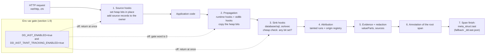
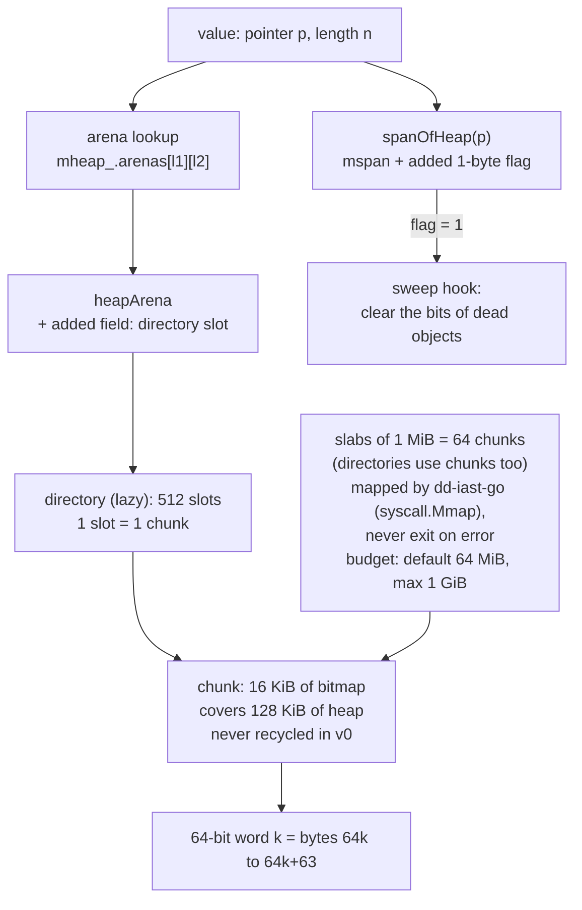
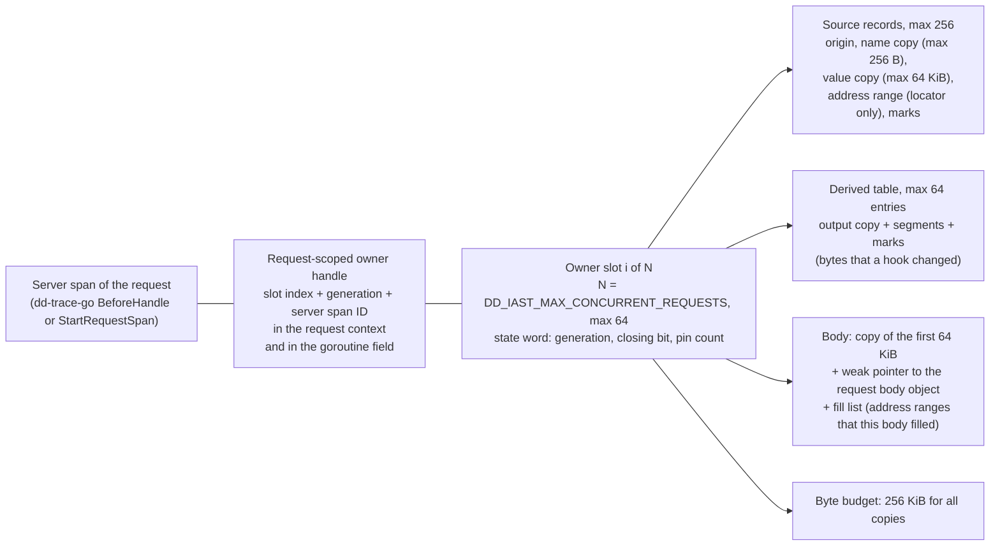
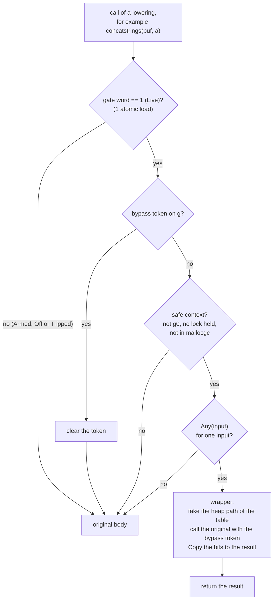
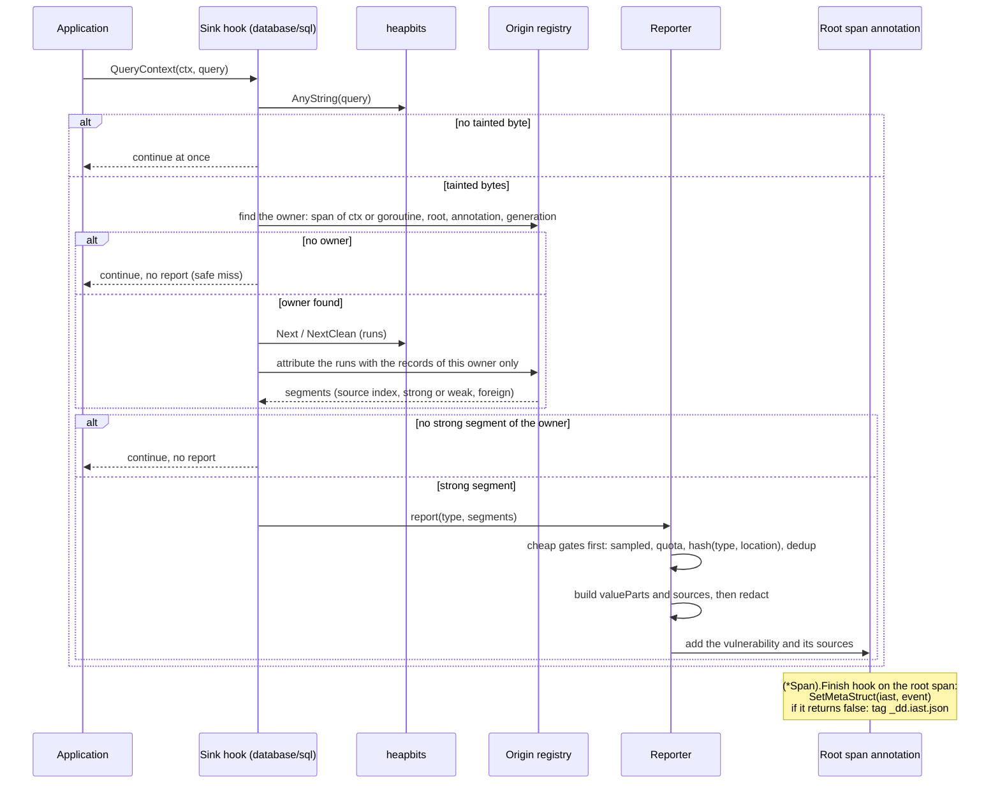
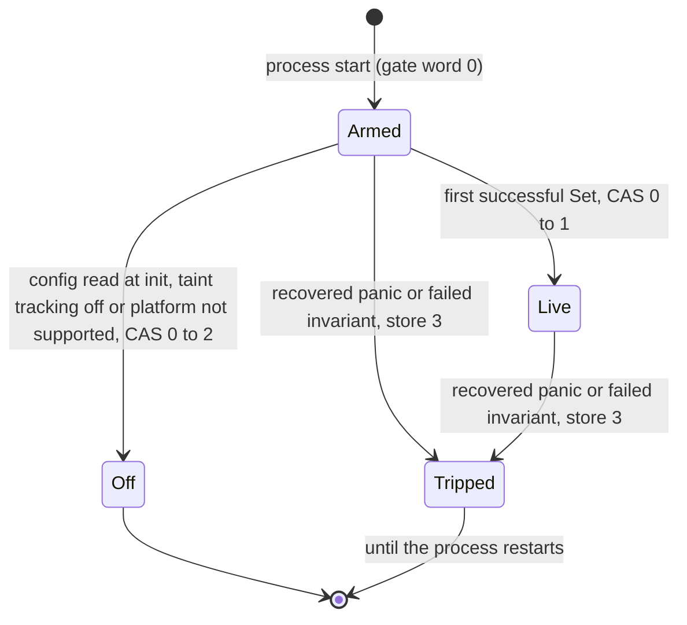

# Design: taint tracking v0 (SQL injection and command injection)

| Field | Value |
|---|---|
| Status | **Draft v3 for review.** Section 12 maps each objection of the 2 adversarial review rounds, and each decision of Romain, to its change. Next: one short check round, then approval by Romain. |
| Lifetime | This document is the contract during the implementation. It is **deleted** when the code is approved and CI is green (decision 15): the last PR of the stack (`S14`) deletes it. |
| Epic | Multica DD-69, Jira [APPSEC-70732](https://datadoghq.atlassian.net/browse/APPSEC-70732) |
| Target | The full Definition of done of the epic (decision 10: no scope cut on the basis of time estimates) |
| Base of this document | `main` at `f79d6f93` (2026-11-18) |
| Proof of concept (PoC) inputs | PR #39, PR #52, PR #58 (read only, see "Clean-room rule"), review PR #51, research notebook `carnet-de-recherches.md` |

This document is the contract for the v0 PR stack. It holds the acceptance
criteria (section 4). Each PR of the stack (section 6) says which criteria it
closes.

## How to read this document

| Section | Content | Read it when |
|---|---|---|
| [0](#0-summary) | Summary in 10 lines | Always |
| [1](#1-approach) | The design, with diagrams | You review the design |
| [2](#2-tradeoffs-and-rejected-options) | Options that we rejected, and why | You want to propose another option |
| [3](#3-constraints) | Go versions, platforms, tools, runtime risk, GC, memory, rollout | You review safety |
| [4](#4-acceptance-criteria) | Acceptance criteria, each with its check | You review a PR of the stack |
| [5](#5-review-requirements) | What each PR needs before merge | You review a PR of the stack |
| [6](#6-pr-stack) | The PR stack: order, scope, dependencies | You plan the work |
| [7](#7-answers-to-the-3-facts-to-check-in-code) | The 3 facts that the Delivery Lead asked to check | You approve the design |
| [8](#8-known-limits-and-coverage-gaps-v0) | Known limits of v0 | You write user documentation |
| [9](#9-risks) | Risks | You approve the design |
| [10](#10-decisions) | Decisions: the ones that are made, and the ones that are open for Romain | You approve the design |
| [11](#11-references) | References | You want the sources |
| [12](#12-review-history) | Each objection of the review rounds and each decision, and what changed | You review v3 |

### Clean-room rule

All v0 code is new code. We do not copy code from PR #39, PR #52 or PR #58.
We use these PRs only to learn two things: what not to do, and which
constraints apply. The facts that this document takes from them are stated as
facts (with their source), not as code. Code that is already on `main` (for
example `internal/spans`, `internal/model`, `internal/vulnerability`) is not
PoC code. The stack can change and extend it.

### Words used in this document

| Word | Meaning |
|---|---|
| Heap taint bits, "bits" | One bit for each byte of heap memory. 1 = the byte is tainted. |
| Owner | The analysis state of one sampled HTTP request. It is bound to the root span of the request. |
| Origin registry | The external map: for each owner, the source records, derived entries and body copy. It gives the origin of tainted bytes. |
| Source record | One untrusted value: origin (for example `http.request.parameter`), name, a copy of the value, and the address range of the value. |
| Run | A sequence of adjacent tainted bytes in a sink argument. |
| Segment | A part of a run that is attributed to one source (or that is "foreign"). |
| Foreign | Tainted bytes that do not match a source of the owner. They are redacted and never make a finding alone. |
| Gate word | One process-wide `uint32` in the runtime: 0 Armed, 1 Live, 2 Off, 3 Tripped (section 1.2.5). Hooks work only when it is 1. It becomes 1 at the first taint and never goes back to 0 ("sticky"). |
| Hook | Code that Orchestrion or otelc adds to a function at compile time. |
| `S1` … `S16`, `X1` | The PRs of the stack (section 6). Names, not GitHub PR numbers, and not an order: the dependency graph of section 6.1 gives the order. `X1` is the PR in the `DataDog/system-tests` repository. |
| `AC-…` | An acceptance criterion of section 4 (for example `AC-F1`). Each one has a check type and exactly one closing PR. |

## 0. Summary

1. Sources (`net/http` request data, chi `URLParam`) set heap taint bits **in
   place** on the bytes of the request values. They never replace a value that
   the application can see.
2. The bits follow the memory. A sub-string or a sub-slice of a tainted value is
   tainted with no hook.
3. Runtime hooks on compiler lowerings (`concatstrings`, `slicebytetostring`,
   `growslice`, …) copy the bits when Go copies bytes. A small set of standard
   library hooks covers the copies that the compiler does inline (`fmt`,
   `strings.Builder`, `bytes.Buffer`, `bufio`, `encoding/json`, `net/url`).
4. The bits do not say which source or which request a byte comes from. The
   **origin registry** of each request keeps bounded copies of the source
   values. At the sink, we find the owner of the current request from a
   request-scoped handle, and match the tainted runs to the copies **of that
   owner only**. Body bytes need a recorded provenance (which request filled
   them), so that 2 requests that share a decoder never mix.
5. Sinks (`database/sql`, `os/exec`) check the bits first (a few nanoseconds),
   then attribute, skip values that a SQL sanitizer of a driver marked as safe
   (`lib/pq`, `pgx`), redact, and report a standard Datadog IAST vulnerability
   (`valueParts` and `sources`) in `meta_struct.iast` on the root span, with the
   `_dd.iast.json` fallback that `main` has.
6. Taint tracking is **off by default**. The env var
   `DD_IAST_TAINT_TRACKING_ENABLED=true` turns it on. Off means: no bit is
   set, no memory is mapped, and each hook costs one load and one compare.
7. Orchestrion and otelc get the same hooks, built from 3 primitives that both
   tools have. Parity is proven by the same behavior tests with both tools. A
   sentinel program fails when a tool silently skips a hook.
8. Supported: go1.26.x and go1.27.x; linux and darwin on amd64 and arm64
   (all arm64 CPUs, with and without LSE atomics). Off on other platforms, and
   with `-asan` or `-msan`. gotip runs in CI as a signal only.
9. The stack has 15 PRs in this repository and one PR in `DataDog/system-tests`
   (section 6), ordered by their dependencies. Each PR leaves `main` green,
   with the feature off by default. Each acceptance criterion has exactly one
   closing PR, and that PR comes after every PR that its test needs.
10. Section 10 lists the decisions in plain words: the ones that Romain made,
    and the 3 that are still open (JSON provenance, extra tests from the
    PR #51 review, taint memory that is never given back).

## 1. Approach

### 1.1 Overview



The design has 2 storage parts:

- **Heap taint bits** (section 1.2) answer "is this byte tainted?". They are
  fast, lock-free, and correct for any sub-string or sub-slice.
- **The origin registry** (section 1.3) answers "which source is this byte
  from?". It is bounded, per request, and it holds only copies.

The bits are the cheap gate. The registry is used only after a bit is found
at a sink, or in a hook that changes bytes (section 1.5).

### 1.2 Heap taint bits

Facts from the Go runtime (go1.26 and go1.27). PR #52 tested each fact. We
re-implement the design from these facts.

1. The heap is divided into arenas (64 MiB on 64-bit linux and darwin). Each
   arena has a metadata record `heapArena`, found from a pointer in 2 or 3
   loads.
2. The GC does not move heap objects. A bit for each address is thus a bit for
   each byte of a live object.
3. Heap memory is used again only after the sweeper frees it, or after
   `freegc` (section 1.2.1). Hooks at these points clear the bits of dead
   objects before the memory can be allocated again.
4. Stack memory and static data are not in a heap span (`spanOfHeap` returns
   nil). The bits refuse them. Their bits are always 0.



**API** (package `internal/taint/heapbits`, internal):

| Function | Contract |
|---|---|
| `Enabled() bool` | The runtime is woven, the platform is supported, and taint tracking is on. |
| `Set(p, n) bool` | Taint `[p, p+n)`. All or nothing (section 1.2.3). Returns false for stack, static, user-arena or off-heap memory, for a range that is not inside one allocation slot, when the budget is used, when another goroutine allocates a chunk that the range needs (no wait), or when the gate is Off or Tripped. |
| `Clear(p, n)` | Remove the taint. Never allocates. |
| `Any(p, n) bool` | One byte or more is tainted. Safe for any address. |
| `Next(p, n, from)`, `NextClean(p, n, from)` | Offset of the next tainted (or clean) byte. They give the runs. |
| `Copy(dst, src, n) bool` | Make the bits of `dst` equal to the bits of `src` (like `memmove`, overlap is correct). A clean `src` clears `dst`. All or nothing for `dst`. |

**Rules of the runtime side** (constraints that PR #52 found):

- The entry points take `uintptr` values, so that the checked values do not
  escape to the heap. The Go wrappers call `runtime.KeepAlive` after the call.
- Each entry point has 2 parts. A `nosplit` classifier decides "inside one
  heap allocation slot" or "not heap" before the stack can move. A normal
  worker then does the bitmap work, with a preemption checkpoint every 512
  work units.
- All bitmap accesses are 64-bit atomics (`Load64`, `Store64`, `Or64`,
  `And64`, `Cas64`). A neighbour object can share a word.
- Span flag protocol: a write sets the bits, then the flag. The sweep clears
  the flag, clears dead objects, checks live objects, and sets the flag again
  if a bit is left. A concurrent `Set` is never lost.
- The sweep hook does not allocate, does not lock, cannot yield, and has a
  bounded cost (at most 80 KiB of small objects for each span; large objects
  at most 64 MiB, which is the largest span that `Set` accepts).
- Slabs come from a slab allocator in an ordinary dd-iast-go package, not in
  the runtime (section 1.10.4). It calls `syscall.Mmap`, which returns an
  error instead of exiting (`sysAlloc` can exit the process). The runtime-side
  code calls it through a function variable, only from a worker on a user
  goroutine, never from the sweep hook. After a successful mapping, the
  runtime-side code adds the bytes to `memstats.other_sys` and
  `gcController.mappedReady`, so `GOMEMLIMIT` sees them. Directories are
  chunks from the same slabs, so they are in the same budget.
- The feature is off in `-asan` and `-msan` builds.
- **arm64 CPUs without LSE atomics are supported** (section 1.2.6).

#### 1.2.1 Clear-before-reuse points

A freed heap slot can be allocated again only through the paths below. Each
path clears the bits of the dead object **before** the slot can be allocated.

| Path | When the slot can be allocated again | Clear point | Notes |
|---|---|---|---|
| Sweep of a span of small objects | After `(*sweepLocked).sweep` of that span computes the new free slots | A prologue at the start of `(*sweepLocked).sweep`. At this point the mark bits of the cycle are final, and no slot of the span is free for allocation yet. | A span that is cached in an `mcache` is not swept until it is uncached (`mcache.refill` sets `sweepgen = mheap_.sweepgen + 3`, `runtime/mcache.go:214–216`). Its dead objects are thus cleared by the sweep that runs before the reuse, as for any span. |
| Sweep of a large-object span | When the sweep frees the span to the heap | Same prologue | The whole object range is cleared (at most 64 MiB, see above). |
| `freegc` (`GOEXPERIMENT=runtimefreegc`) | At once: the slot goes back to the P (`runtime/malloc.go:1913–2025`) | A prologue at the start of `freegc`, before the slot is published | **Off by default** in go1.26 and go1.27 (`internal/goexperiment/exp_runtimefreegc_off.go`). A CI job turns the experiment on (AC-S7). |
| Objects with a finalizer | The finalizer can make the object live again | The sweep prologue **skips** a dead object that has a `_KindSpecialFinalizer` special | When the revived object dies again with no finalizer, a later sweep clears it. Cleanups (`runtime.AddCleanup`) and weak handles do not revive objects, so they need no exception. |
| User arena chunks (`GOEXPERIMENT=arenas`) | Freed without a sweep | None: `Set` refuses user arena memory | Their bits are always 0. |
| Stacks, `mSpanManual` spans | Not heap objects | None: `Set` refuses them | Their bits are always 0. |

The drift test (section 3.1) lists every runtime function that frees or reuses
heap memory. A new path in a Go release fails the test until a human checks
it.

#### 1.2.2 Chunk lifetime

**v0 never recycles a chunk or a directory once it is published.** The
bitmap memory stays mapped until the process exits. The budget bounds it.

Reason: a 128 KiB chunk can cover several spans. A worker can load a chunk
pointer, be preempted, and continue later. If chunks were recycled, the worker
could write into a chunk that now describes other memory, and atomics on the
words would not prevent this. With no recycling, a loaded chunk pointer always
stays valid, and it always describes the same 128 KiB of address space.

Cost: with much taint in many arenas, the budget can be reached and new taint
is dropped (telemetry counter). A later version can add recycling with an
epoch rule.

#### 1.2.3 All-or-nothing writes

`Set` and `Copy` have 2 phases:

1. **Ensure.** Get every chunk that the destination range needs (directory
   slot CAS from 0 to "claimed", then a chunk from a slab). On any failure
   (budget, refill busy, CAS limit, `mmap` error), return false. No bit was
   written. Chunks that were already obtained stay mapped and empty, and stay
   charged.
2. **Write.** Write the bits, then the span flag.

No bit is ever undone after a failure. Thus a failed `Set` never clears the
bits that another writer set in the same words.

#### 1.2.4 Tiny allocator

The tiny allocator packs small pointer-free objects (less than 16 bytes) into
one 16-byte block. Go records the block, not the boundary of each object in it
(`runtime/malloc.go:1224–1274`). Thus:

- `Set` can check only that the range is inside one allocation slot (for tiny
  objects: inside one 16-byte block). It cannot check that the range is
  exactly one Go value.
- The guarantee is narrowed: **callers must pass the exact range of one
  value.** Sources pass the value that `net/http` made. Hooks pass the result
  object that they made. No caller passes a range that it computed from a
  neighbour.
- Bits are per byte, so two neighbours in one block keep separate bits.
- The tiny allocator never reuses a part of a block that is still live: the
  block is freed only when all its objects are dead. Thus the bits of a dead
  neighbour inside a live block can stay, but no new object gets them.

AC-S7 tests two verified neighbours (same block, checked by address) in a
**non-race** build.

#### 1.2.5 Gate word

One process-wide `uint32` in the runtime. All hooks read it with one atomic
load. It has 4 values:

| Value | Name | Set by | Hooks |
|---|---|---|---|
| 0 | Armed, no taint yet (also the state before the config is read) | Initial value | Do nothing |
| 1 | Live | The first successful `Set`, with `CAS(0 → 1)` | Run the clean path (context check + `Any`) |
| 2 | Off | The config at init, with `CAS(0 → 2)`, when taint tracking is off or the platform is not supported | Do nothing |
| 3 | Tripped | The circuit breaker, with a plain atomic store of 3 | Do nothing |

- Hooks run their work only when the value is exactly 1. Exception: the standard library wrappers that read from an `io.Reader` also run when it is 0 (Armed), because the first taint can appear during their call (section 1.5.3, rule 3).
- Only `CAS(0 → 1)` can make the gate Live. A `Set` that finishes after the
  breaker stored 3 cannot make it Live again: its CAS fails. Tripped and Off
  are terminal for the process.
- `Set` reads the gate before it writes: with 2 or 3, it returns false.

#### 1.2.6 arm64 CPUs without LSE atomics

**Question (from Romain's decision request):** the sweep hook uses atomic
`Or64` and `And64` on bitmap words. On arm64 CPUs without the LSE extension
(ARMv8.0: AWS Graviton1, Raspberry Pi 4 and other Cortex-A72 and A53 boards),
Go implements these operations as a retry loop (load-exclusive,
store-exclusive, retry when the store fails). Does the sweep hook add a risk
that Go's own sweep does not have?

**Check, in the Go 1.27.4 source:**

1. On arm64, **every** atomic read-modify-write of `internal/runtime/atomic`
   (`Cas64`, `Xadd64`, `Or8`, `And8`, `Or64`, `And64`, …) tests
   `ARM64.HasATOMICS` and, without LSE, runs the same retry loop
   (`internal/runtime/atomic/atomic_arm64.s`: `Cas64` at line 238, `Xadd64`
   at line 294, `Or64` at line 444; each loop is `LDAXR` / `STLXR` /
   `CBNZ`).
2. Go's own `(*sweepLocked).sweep` runs with preemption disabled
   (`runtime/mgcsweep.go:506–511`: it throws when `m.locks == 0`), and it calls
   these atomics: `mheap_.pagesSwept.Add` on **one global counter that all
   sweepers share** (line 532), `atomic.Xadd64` on the free-count statistics
   (lines 774, 809–810), `gcController.totalFree.Add` (lines 778, 814). The
   caller `tryAcquire` uses `atomic.Cas` on `s.sweepgen` (line 351).
3. Go's mark phase also uses `atomic.Or8` on mark bits that many mark workers
   write at the same time.

**Result: the same loops, in the same place.** Go's sweep already runs the
same retry loops, with preemption disabled, on a word that is more contended
than any bitmap word (a bitmap word is shared only by the objects of one 64-byte
range). The sweep hook adds no new kind of risk. **These CPUs are supported**,
like all other arm64 CPUs.

**Test:** the woven heap bits tests also run on the arm64 CI runner with
`GODEBUG=cpu.atomics=off` (a Go option, `internal/cpu/cpu_arm64.go:21`), which
forces the retry loops on a CPU that has LSE (criterion AC-P11).

### 1.3 The origin registry (external map)

The bits say **that** a byte is tainted, not **from which source**, and not
**for which request**. Decision 6 asks for the origin of each tainted range.
The origin registry keeps this information, for each sampled request.



#### 1.3.1 Owner lifetime and the request-scoped handle

1. **Start.** The owner starts in a wrapper of the two **exported** functions
   of `github.com/DataDog/dd-trace-go/v2/instrumentation/httptrace` that start
   a server request span:
   - `BeforeHandle(cfg, w, r)` (used by the `net/http` integration,
     `contrib/net/http/internal/wrap/trace.go:41`);
   - `StartRequestSpan(r, opts...)` (used by the chi integration,
     `contrib/go-chi/chi.v5/chi.go:60`).

   Both are public API of dd-trace-go v2 (semantic versioning), so their
   signatures do not change in a v2 minor release. The private
   `startRequestSpan` that both call is not hooked: a private function can
   change in any release, and `go.mod` gives only a minimum version, not the
   version of a customer build.
2. **One owner for each server request.** The wrapper calls the original
   function, then looks for an owner handle in the context of the request.
   - When there is one, the request is already analyzed (for example a chi
     middleware inside a traced `net/http` server): the wrapper reuses it.
   - Else, when the request is sampled, the wrapper makes a new owner, and puts
     its **handle** (slot index, generation, ID of the server span) into the
     returned context (`context.WithValue`; `BeforeHandle` returns the new
     request, `StartRequestSpan` returns the new context; both integrations
     use the returned value for the handler).
   - The handle is also stored in a field of the current goroutine (an added
     field of `runtime.g`, cleared when the goroutine exits and when the owner
     closes), because the handler runs on the same goroutine.

   The handle identifies **the request**, not the trace: two requests under
   one parent span (a local parent, a remote parent, or an inferred proxy
   span) get two owners. (`Span.Root()` returns the root of the **trace**,
   `ddtrace/tracer/span.go:623–636`, so v2 could not use it for this.)
3. **One sampling decision** for the owner and its findings (stack PR `S2`).
   A sampled-out request gets no owner and uses no slot.
4. **Where findings go.** A finding is added to the annotation of the trace
   root of the server span (the existing WEAK_HASH path of `main`, so that
   the backend finds `meta_struct.iast` on the root span). When two requests
   share a trace root, both findings go to that root, each with the sources of
   its own owner.
5. **End.** The owner closes when **its server span** finishes (the
   `(*Span).Finish` hook that `main` has; the owner keeps the ID of its server
   span). `Finish` sets the closing bit and returns at once; the last accessor
   cleans the slot. A slot is given to a new request only after cleanup, with
   a new generation.
6. **Version guard.** If a customer builds with a dd-trace-go version where
   one of the 2 wrappers does not apply, the expected-hook manifest (section
   1.10.5) shows it at init: taint tracking goes Off, with one log line and a
   telemetry counter. The application is not affected.

#### 1.3.2 Which owner: always the owner of the current request

There is **no search across owners**. Every read and every write of the
registry uses one owner, found like this:

| Caller | How it finds its owner |
|---|---|
| A sink with a context (`QueryContext(ctx, …)`, `CommandContext(ctx, …)`) | The handle in the context. |
| A sink with no context, or a context with no handle | The handle in the goroutine field. |
| A source hook | The handle of its request (context of `r`). |
| The body `Read` hook | The owner whose registered body object (weak pointer) is the receiver. |
| A standard library hook that writes a derived entry or moves fills | The handle in the goroutine field. |

Then: pin with the expected generation. When a step fails (no handle, wrong
generation, closing bit), the operation is **dropped**: no report, no record,
and a telemetry counter grows. This is a safe miss. Example: a sink with no
context, in a goroutine that the handler started.

#### 1.3.3 Rules of the registry

1. **The owner holds only copies.** It never keeps a reference to application
   memory (the body object is a `weak.Pointer`, which cannot match a new object
   at a reused address). All copies are charged to a fixed byte budget
   (256 KiB for each owner). When the budget is used, new records are dropped
   (telemetry counter); their bits stay, and their bytes become foreign at the
   sink.
2. **Addresses only locate.** A record keeps the `(address, length)` of the
   original value, as a `uintptr`. An address match is accepted only when the
   sink bytes are equal to the owner copy at the same offset. A reused address
   with other bytes fails the check. This is why this design is not the
   rejected process-wide `uintptr` map (section 2).
3. **No blocking.** Every access pins the slot (CAS on the state word, with the
   expected generation), then calls `TryLock` on the slot mutex. A busy lock
   drops the operation. A stale handle (old generation) is refused for every
   operation, `Finish` included.
4. **Bounded work.** One sink call inspects at most 64 KiB of the sink value,
   does at most 4 096 candidate checks, and compares at most 1 MiB of bytes in
   total. When a bound stops the loop, the rest of the tainted bytes are
   foreign (redacted), never shown as clean.

#### 1.3.4 Attribution at a sink

The same algorithm runs for `IsTaintedString` and `IsTaintedBytes`, with the
owner of the current request.

1. `Next` / `NextClean` give the tainted runs of the sink argument.
2. For each run, from left to right, cut segments, **using only the records of
   the reporting owner**:
   1. **Address locate.** Find a record whose address range contains the start
      of the rest of the run. Check the bytes against the owner copy. The
      segment is the longest equal part.
   2. **Content match.** Else, find the copy (derived entries, then sources)
      that contains the longest prefix of the rest of the run.
   3. **Body bytes.** Bytes that are an exact copy of body bytes match by
      address in the fill list of the owner, or by content against the body
      copy of the owner, byte by byte: a byte that does not match is foreign
      (redacted). Bytes that a hook **changed** (for example an unescaped JSON
      string) have the origin `http.request.body` only through a derived
      entry, which the hook made after its owner check (section 1.3.5).
   4. **Tie rule.** Address match first; then the longest segment; then the
      shortest record (so `http.request.path.parameter` wins over
      `http.request.path` for the same bytes); then the last record.
   5. Else the byte is **foreign**. Adjacent foreign bytes merge.
3. **Strong-match rule.** A finding needs at least one strong segment **with
   no mark for the sink's vulnerability type** (section 1.3.6): an address
   match (any length), or a content match of at least
   `min(4, length of the record copy)` bytes.
4. **At most `DD_IAST_MAX_RANGE_COUNT` segments.** Past this bound, the rest is
   foreign.

Bytes of request A in a sink of request B are foreign for B: alone, they make
no finding for B, and B's report never shows a source of A.

**Accepted limit (decision 6).** Content match cannot separate equal bytes:
bytes from elsewhere that are equal to a non-body source of B (at least
4 bytes) are attributed to that source.

#### 1.3.5 JSON: which request supplied a decoded value

The problem: one decoder can read the bodies of 2 requests (for example an
`io.MultiReader`, or a pooled buffer). Request A can supply half of an escaped
JSON string and request B the other half. A content match against B's body
then puts A's bytes in B's evidence. The bits cannot prevent this: they do not
record the request.

Two cases are different:

- **Exact copies** (a verbatim JSON string, `string(body)`): each byte is
  matched alone at the sink (section 1.3.4). A's bytes in B's sink do not match
  B's records: they are foreign and redacted. A's data never shows in B's
  evidence. (Equal bytes are the accepted limit of decision 6; the fills below
  remove it for bytes that are still in a hooked buffer.)
- **Changed bytes** (an unescaped JSON string, a URL-decoded value): the output
  bytes are not equal to the input bytes, so they can be attributed only
  through a derived entry. If the hook made the entry with "the first
  contributing source", A's bytes could get B's source. This is the case to
  prevent.

**Design (option c of Romain's decision request): record the request on each
read, and check the owner at each transform.**

1. **Fills.** The body `Read` hook knows its owner. After each read, it adds a
   fill `(address, length, body offset)` of `p[:n]` to the fill list of that
   owner (bounded: 64 fills; when full, the oldest fill is dropped and its
   bytes lose this provenance).
2. **Fills move with the bytes.** Every wrapper that moves body bytes also
   moves their fills: `io.ReadAll` assembly, `bufio.Reader` fill and copies,
   `bytes.Buffer.ReadFrom` and growth, the JSON v1 `Decoder.refill` slide and
   grow, and the JSON v2 `jsontext` buffer fetch, slide and grow. Each wrapper
   knows the source and destination ranges of its copy, and the owner comes
   from the fill that it moves. These buffers include the read-ahead of the
   decoders.
3. **Every transform checks the owner of its input.** Before a hook that
   changes bytes makes a derived entry (the "coarse" hooks of section 1.5.2:
   JSON `unquoteBytes` and `jsonwire.AppendUnquote`, `url.unescape`,
   `strconv.unquote`, case conversion, …), it finds the owner of **every
   tainted byte of its input**: by the fills, when the input is in a buffer
   that has fills; else by attribution against the records of the owner of the
   current request (section 1.3.4).
   - **All tainted input bytes belong to the owner of the current request:**
     the hook makes the derived entry for that owner.
   - **One tainted input byte belongs to another owner, or to no owner:** the
     hook **clears the bits of the output**, makes no derived entry, and
     counts a "mixed provenance" event. The value is not tainted: a safe miss,
     never a wrong report.
4. The JSON v2 string cache (`makeString`) never returns a cached string whose
   bits differ from the bits of the input (section 1.5.2).

**Fallback (option a of the decision request) for each pattern where a carrier
of the bytes is not hooked** (for example a decompressing reader, or a custom
reader that copies bytes): no fill reaches the transform, and its input is not
attributable to the current owner, so rule 3 gives a safe miss. This is the
"exclusive owner" behavior for these patterns.

**If Romain picks option a for all patterns:** rule 3 also requires that every
fill of the decoder or reader, since its creation, has one owner. The rest
stays.

**If Romain picks option b:** rule 3 is removed (a transform uses the first
contributing source), and the fills are not needed. Then A's bytes can get
B's source in B's evidence (Romain's decision request explains it).

The JSON matrix (criteria AC-J1 to AC-J4) tests the split escaped string: one
escaped value in 2 bodies, read through an `io.MultiReader`. Neither span may
export the marker of the other request.

#### 1.3.6 Marks and SQL sanitizers

Decision 13: a value that passed through a SQL sanitizer that `database/sql`
or a common driver exposes does not report SQL injection.

**Sanitizers that exist** (checked in the source):

| Package | Function | Output | Context | Evidence |
|---|---|---|---|---|
| `database/sql` | none | – | – | `database/sql` has no escape or quote function. Bound arguments are the safe API (never a finding, section 1.7). |
| `github.com/lib/pq` | `QuoteIdentifier(name string) string` | `"name"`, with `"` doubled | Identifier | `quote.go:19` (v1.12.3) |
| `github.com/lib/pq` | `BufferQuoteIdentifier(name string, buffer *bytes.Buffer)` | The same, written into `buffer` | Identifier | `quote.go:29` |
| `github.com/lib/pq` | `QuoteLiteral(literal string) string` | `'literal'` with `'` doubled; with a backslash, ` E'…'` with `\` doubled | Literal | `quote.go:50` |
| `github.com/jackc/pgx/v5` | `Identifier.Sanitize() string` (`type Identifier []string`) | `"part"."part"`, with `"` doubled and zero bytes removed | Identifier | `conn.go:94–104` (v5.11.0) |
| `github.com/jackc/pgx/v5/pgconn` | `(*PgConn).EscapeString(s string) (string, error)` | `s` with `'` doubled, **without** the quotes | Inside a literal | `pgconn/pgconn.go:2125` |
| `github.com/go-sql-driver/mysql` | none exported | – | – | `escapeStringBackslash`, `escapeStringQuotes` and the byte forms are unexported (`utils.go:642–718`, v1.10.2); they serve only the driver's own argument interpolation |

**Marks in the external map.** Each source record and each derived entry has a
`marks` bit set, with one bit for each vulnerability type
(`constants.VulnerabilityType`). The sanitizers set the `SQL_INJECTION` bit.

**Hooks.** A wrapper of each sanitizer of the table (third-party packages:
the hook calls into dd-iast-go through a linknamed function; dd-iast-go does
not import the drivers). After the original returns, when an input byte is
tainted, the wrapper writes a derived entry for the output (for
`BufferQuoteIdentifier`: the bytes that it appended to the buffer) with the
same segments as the input and the `SQL_INJECTION` mark. The output already
has its bits (the sanitizers build it with `strings.Replace`, `+` and
`strings.Join`, which propagate them).

**At a SQL sink**, a segment whose record has the `SQL_INJECTION` mark does not
count for the strong-match rule. A query that has only marked tainted
segments does not report. The marks reach the report as `secure_marks` of a
value part (the field exists in `internal/model/evidence.go`) when another,
unmarked segment makes a finding.

**Known limit:** v0 does not check the SQL context. A value that
`QuoteIdentifier` sanitized, and that the query uses inside a string literal
(or the output of `EscapeString` that the query uses with no quotes), is
treated as safe: a possible missed finding (section 8).

### 1.4 Runtime hooks (propagation without call-site instrumentation)

Decision 1: propagation uses runtime hooks only. The compiler lowers string
and slice operations to calls of these runtime functions. A hook in the
function covers every call site, in every package, with no AST rewrite.

| # | Runtime function | Go operation | Bit copy | Heap path when an input is tainted |
|---|---|---|---|---|
| 1 | `concatstrings` (through `concatstring2` to `concatstring5`) | `a + b`, `s += t` | Each tainted operand, at its offset | Call the original with `buf = nil` (the function then uses `rawstring`, on the heap). When only one operand is not empty, the function returns that operand (an alias): its bits are already there. |
| 2 | `concatbytes` (through `concatbyte2` to `concatbyte5`) | `[]byte(a + b)` | Same | Call with `buf = nil` |
| 3 | `slicebytetostring` | `string(b)`; also used by `bytes.Buffer.String`, `fmt.Sprint*`, `strconv`, `encoding/json` | Exact | Call with `buf = nil`. A 1-byte result points into the static array `staticuint64s` and cannot hold bits (section 8). |
| 4 | `stringtoslicebyte` | `[]byte(s)` | Exact | Call with `buf = nil` |
| 5 | `stringtoslicerune` | `[]rune(s)` | A rune is tainted when one of its UTF-8 bytes is tainted, plus a derived entry | Call with `buf = nil` |
| 6 | `slicerunetostring` | `string(runes)` | The UTF-8 bytes of a tainted rune are tainted, plus a derived entry | Call with `buf = nil` |
| 7 | `growslice` | The copy of the old elements in every `append` that grows | Exact, for element types without pointers | Always on the heap |
| 8 | `growsliceBuf` | Same, when the compiler gives a stack buffer | Exact | **Call `growslice(oldPtr, newLen, oldCap, num, et)` directly.** `growsliceBuf` uses the stack buffer when `newLen <= bufLen` (`runtime/slice.go:510–520`), whatever the value of `bufPtr`, so a nil pointer is not a heap path there. |

All 8 functions are compiler lowerings: compiled code calls them, so they
change only together with the compiler (decision 5). They exist with the same
signatures in go1.26.10 and go1.27.4. In gotip of 2026-11-19, the buffer type
of `stringtoslicerune` changed (`*[tmpStringBufSize]rune` became
`*[tmpRuneBufSize]rune`). The compile-time signature checks (section 3.1)
detect this kind of change.

**Hook template** (shape only):



Rules:

- **Heap path for each lowering** (last column of the table). Stack values are
  not tracked (decision 6).
- **No `defer`, no argument kept live across the call** in the gate-off path.
  The gate-off prologue must stay as small as the original one (lesson from
  #58: gate off ≤ +2 ns).
- **Escape tags must not change.** A test compares the escape analysis of each
  hooked function, woven and not woven.
- **Context check before any call with a stack check** (`morestack` on g0 is
  fatal).
- **The gate word is sticky** (section 1.2.5). A live counter is not possible
  (no `Cas8` in `internal/runtime/atomic`, and the sweep flag protocol makes a
  count of tainted spans wrong). After the first taint, all hooks pay the
  clean-path cost (context check + `Any`). The benchmark report measures it.
- **Not hookable:** `copy`, the appended part of `append(x, y...)`, and `make`
  + `copy`. The compiler emits an inline `memmove`. In user code these lose the
  taint (section 8). In the standard library, the functions that need them get
  their own hooks (section 1.5).
- **Named types and generics.** A named string type (`type ID string`), a
  conversion between string types, and generic code with `~string` or
  `~[]byte` constraints use the same lowerings and the same memory. They are
  covered with no extra hook.

### 1.5 Standard library hooks

Some standard library functions copy bytes with `copy` or `append(x, y...)`,
or change the bytes. They need a hook.

#### 1.5.1 Wrappers, not copies of function bodies

v2 proposed "twins": complete copies of the function bodies, with the bit
operations added. A twin can be wrong for a customer who builds with another
Go patch release: the copy then runs instead of the real function, and the
application behavior changes. Neither tool can check the body of a function at
weave time.

v3 uses **wrappers** only:

1. The prologue checks the gate word (rule 3).
2. It records the state that it needs before the call (for example the length
   and the address of a buffer).
3. It calls the **original** function, with a bypass token (the same pattern as
   the runtime hooks of section 1.4). The original body always runs, unchanged.
4. After the return, it updates the bits (and the fills, section 1.3.5) from
   the state before and after the call.

Consequences:

- **The application behavior is always the behavior of the original
  function.** Application callbacks and reads run exactly once, inside the
  original. A panic of the original goes up unchanged: the wrapper has no
  `recover` around it.
- A wrapper can be wrong only about the bits. After a change of the function
  in a Go release, the bits can be wrong (a missed or an extra taint), never
  the result. The strong-match rule and the owner check limit the effect of
  extra taint.
- When the bit update fails or panics (it runs under the scoped `recover` of
  the circuit breaker, section 1.9), the result of the original is returned
  unchanged.

**Layout check.** A wrapper that reads unexported fields (for example the
buffer of a `json.Decoder`) does not name them in the injected code. The
injected code passes `unsafe.Pointer` of the receiver to dd-iast-go. At init,
dd-iast-go finds the offset of each field with `reflect` (unexported fields are
visible to `reflect`), and checks the name and the type. On any difference,
**that wrapper is disabled** (one log line and a telemetry counter); the
original function still runs. Thus a change of a field in a Go release never
breaks the build, and never makes a wrapper write to the wrong memory.

**Supported Go minors.** dd-iast-go has the list of the Go minors that the
drift test checked (go1.26, go1.27). On another minor (`runtime.Version()` at
init), the wrappers that depend on the internal behavior of a function (the
JSON, `bufio` and `fmt` internals) are disabled. The wrappers of exported
functions with a documented contract (for example `io.ReadAll`) stay on.

#### 1.5.2 Hook table

The table gives the **result** that each hook must produce.

| Priority | Package | Hook points | Result |
|---|---|---|---|
| P0 | `io` | `ReadAll` | The wrapper passes the reader through a small observer (from a pool, so with no allocation per call) that records the buffers that each `Read` returned, with their fills. After the original returns, it copies the bits and moves the fills of each recorded buffer to its place in the result. `ReadAll` builds a result of several chunks with `append(final, chunk...)` (`io/io.go:730–739`, the same in go1.26 and go1.27). It depends only on the documented contract of `ReadAll` (the result is the bytes read, in order). |
| P0 | `fmt` | `(*buffer).write`, `writeString`; `(*fmt).writePadding`; `(*fmt).fmtQ`; `(*fmt).fmtSbx`; clear in `(*pp).free` | Exact copy of every byte that `fmt` copies into its buffer. Thus: `%s` and `%v` of a **string**, and `%s` of a `[]byte`, keep exact bits, also with width and precision (precision gives a sub-string); the output of `String()` and `Error()` keeps exactly the bits of the string that they return; a `Formatter` that writes tainted bytes to `fmt.State` keeps them (`State.Write` goes to `(*buffer).write`); a tainted format string keeps exact bits for its literal parts. **Coarse** only for the bytes that `fmtQ` (`%q`, through `strconv.AppendQuote`, `fmt/format.go:447–457`) and `fmtSbx` (`%x`, `%X`) generate from a tainted argument. **`%v` and `%d` of a `[]byte` are an explicit miss:** `fmt` prints the decimal value of each byte (`[104 105]`, `fmt/print.go:502–527`), with one `fmtInteger` call for each byte; the digits are not tainted. `%T`, `%p`, numbers, and a `String()` that returns a constant give clean text (lesson from #51 H8: no taint by argument identity). |
| P0 | `strings` | `(*Builder).Write`, `WriteString`, `grow`; `Repeat`; `ToUpper`, `ToLower`; `Map`; `(*Replacer).Replace` | Exact for the Builder (so `Join` is exact, for the elements **and** the separator). `WriteByte` and `WriteRune` take a value, not memory: they cannot carry taint (section 8). `ToUpper` and `ToLower` on ASCII input: positional, byte `i` of the output has the bit of byte `i` of the input (changed and unchanged bytes). Non-ASCII input, `Map`, `Replacer`: coarse on the new output. |
| P0 | `bytes` | `(*Buffer).Write`, `WriteString`, `ReadFrom`, `grow`; `Join`, `Repeat`, `Replace`, `ToUpper`, `ToLower`, `Map` | As `strings`. A write of clean bytes clears the bits of the bytes that it overwrites. `ReadFrom` and `grow` move fills (section 1.3.5). |
| P0 | `net/url` | `unescape`, `escape` | Coarse on the new output. **When the function returns its input** (no escape: `net/url/url.go:155–157`, `:208–210`), the hook does nothing: the bits are already exact, and a whole-output `Set` would widen them. |
| P0 | `strconv` | `quoteWith`, `unquote`, `AppendQuote*` | Coarse on the new bytes |
| P0 | `encoding/json` v1 | `(*Decoder).refill` (slide **and** grow, `encoding/json/stream.go:160–181`); `unquoteBytes`; `valueQuoted` (the `,string` option) | Exact for the slide and the grow copies, with their fills. Verbatim strings are exact copies (`slicebytetostring`). Unquoted strings: coarse, with the owner check of section 1.3.5. |
| P0 | `encoding/json` v2 (go1.27 default) | `jsontext.(*decoderState).fetch` (slide, grow, and the `bytes.Buffer` alias, `encoding/json/jsontext/decode.go:175–241`); `jsonwire.AppendUnquote`; `v2.makeString` | Exact for slide and grow, with their fills. Unquoted strings: coarse, with the owner check of section 1.3.5. **String cache:** a cache hit is used only when the bits of the cached string are equal to the bits of the input bytes (tainted→clean, clean→tainted and different partial masks on equal bytes all miss the cache). |
| P0 | SQL drivers | The sanitizers of section 1.3.6 (`lib/pq`, `pgx`) | Derived entry with the `SQL_INJECTION` mark |
| P1 | `bufio` | `(*Reader).fill`, `Read`, `ReadBytes`, `ReadSlice` copies; delegated reads use the "read rule" (a written byte never keeps old bits; the unwritten tail keeps its bits) | Exact, with fills |
| P1 | `bytes`, `strings` | `(*Reader).Read`, `ReadAt` | Exact |

"Coarse" means: first check that every tainted input byte belongs to the
owner of the current request (section 1.3.5, rule 3; else clear the output
bits and stop). Then `Set` the whole **new** output (never memory that aliases
an input), and add a derived entry for that owner, with the first source of
the input. The output bytes are not equal to the input bytes, so the derived
entry is the only way to find their origin.

#### 1.5.3 Rules for all standard library hooks

1. **The original function always runs** (section 1.5.1). Application code
   (callbacks, `Read` of an `io.Reader`) runs exactly once, inside it.
2. **Application panics are never caught.** The `recover` of the circuit
   breaker wraps only the bit and registry work, which calls no application
   code.
3. **When the hook works.**
   - Hooks whose inputs are in memory (for example `strings.Builder.Write`)
     work only when the gate word is Live.
   - Hooks where taint can **appear during the call**, because the call reads
     from an `io.Reader` (`io.ReadAll`, `bufio.Reader.fill`,
     `bytes.Buffer.ReadFrom`, the JSON decoder buffers), work when the gate
     word is Armed **or** Live, and the goroutine has an owner. At entry the
     gate can still be Armed: the first body `Read` inside the call makes it
     Live. These hooks check the buffers that the call returned, not only the
     inputs at entry.
4. A hook imports only `heapbits` and one leaf bridge package (imports
   `sync/atomic` and `unsafe` only). The owner work goes through function
   pointers in the bridge. A test checks the import graph.
5. The analysis code never calls a hooked function, and it has a
   per-goroutine re-entry guard.
6. Each hooked function body has a golden hash for each supported Go minor
   (drift test, section 3.1).
7. Never hook a package that `runtime` imports (`internal/bytealg`,
   `internal/stringslite`).
8. **Known cost:** with one more call, some small functions stop being inlined
   (`(*strings.Builder).WriteString` measured +7.7 ns in PR #58). This cost
   exists also when taint tracking is off. The benchmark report gives it
   (decision 9: no gate).

### 1.6 Sources

Sources set bits **in place**, on the memory of the values that `net/http`
already made. They never write to a field, map or slice that the application
can see (lessons from #51 C12 and C13). When `Set` fails (for example a
read-only interned string), the source is dropped and a telemetry counter
grows. We never replace the value.

| Origin | API | Mechanism | Record name |
|---|---|---|---|
| `http.request.path` | `Request.URL.Path`, `URL.RawPath` | Bits at owner start (section 1.3.1) | (none) |
| `http.request.query` | `Request.URL.RawQuery` | Bits at owner start | (none) |
| `http.request.uri` | `Request.RequestURI` | Bits at owner start | (none) |
| `http.request.header` | `Request.Header` values | Bits at owner start (first 64 headers, 8 KiB each) | header name |
| `http.request.cookie.value` | `(*Request).Cookie`, `Cookies` | Values are sub-strings of the `Cookie` header: bits are free. A record is added at the accessor. | cookie name |
| `http.request.parameter` | `URL.Query()`, `url.Values.Get`, `(*Request).FormValue`, `PostFormValue`, `Form`, `PostForm` | Values are sub-strings of `RawQuery` or of the body (bits are free), or `url.unescape` results (coarse hook, section 1.5). A record is added at the accessor. | parameter name |
| `http.request.path.parameter` | `(*Request).PathValue`; chi `(*Context).URLParam`, `URLParam`, `URLParamFromCtx` | Values are sub-strings of the path (bits are free). A record is added at the accessor. Direct reads of `chi.Context.URLParams.Values` are still detected, with origin `http.request.path`. | parameter name |
| `http.request.body` | `Request.Body` reads (see the table below) | The hook sets the bits on `p[:n]` when the receiver is the registered body object of the owner (registered at owner start, through the `expectContinueReader` wrapper when there is one). The owner keeps a copy of the first 64 KiB. Client response bodies use the same types, so the registration is required. | (none) |
| `http.request.multipart.parameter` | `(*Request).FormValue` on `multipart/form-data`, `MultipartForm.Value` | Read through `bufio` (P1 hooks). A record is added at the accessor. | field name |

**Body `Read` receivers depend on the Go minor:**

| Go minor | HTTP/1 | HTTP/2 (server) |
|---|---|---|
| go1.26 | `net/http.(*body).Read` (`transfer.go:831`) | `net/http.(*http2requestBody).Read` (bundled, `h2_bundle.go:6640`) |
| go1.27 | `net/http.(*body).Read` (`transfer.go:847`) | `net/http/internal/http2.(*requestBody).Read` (`server.go:2465`; the bundle is gone) |

Both tools have one rule for each receiver. A rule for a receiver that does not
exist in the current toolchain does not match. The expected-hook manifest
(section 3.1) lists which rules **must** match for each Go minor, so that a
missing match fails the stable jobs.

Rules:

- Values shorter than 2 bytes or longer than 64 KiB are not tainted.
- Framework hooks (chi) call into dd-iast-go through a linknamed function.
  dd-iast-go never imports chi. Thus the root `go.mod` gets no new requirement
  for a framework (no version change for users through MVS).
- Other frameworks (gin, echo, gorilla/mux) are not in scope. Their values that
  come from `net/http` APIs, or that are sub-strings of the path, are still
  detected, with the `net/http` origin, when a dd-trace-go server span exists.

### 1.7 Sinks

| Vulnerability | Public API covered | Hook points | Rule |
|---|---|---|---|
| `SQL_INJECTION` | `(*DB)` and `(*Tx)`: `Query`, `QueryContext`, `QueryRow`, `QueryRowContext`, `Exec`, `ExecContext`, `Prepare`, `PrepareContext`. `(*Conn)`: `QueryContext`, `QueryRowContext`, `ExecContext`, `PrepareContext` (`*sql.Conn` has only the context forms, `database/sql/sql.go:2027–2064`). | `QueryContext`, `ExecContext` and `PrepareContext` of `*DB`, `*Tx` and `*Conn` (9 hooks). Every other public form forwards to one of them (for example `(*DB).Query` returns `db.QueryContext(context.Background(), …)`, and `QueryRowContext` calls `QueryContext`). Thus each public call is checked exactly once. | The query string only. Bound arguments are never a finding. |
| `COMMAND_INJECTION` | `exec.Command`, `exec.CommandContext`, then `Run`, `Output`, `CombinedOutput`, `Start` | `(*Cmd).Start` (the other methods call it) | `Cmd.Path` and all `Cmd.Args` (lesson from #51 H15: a tainted `Path` that differs from `Args[0]`). One finding for each command. |

Each sink first calls `heapbits.Any` on its arguments. With no tainted byte it
returns at once. Then it finds the owner of the current request (section
1.3.2). For SQL, segments with the `SQL_INJECTION` mark do not count (section
1.3.6). The report location skips the sink frames for both tools (otelc does
not mark its injected code, see `internal/vulnerability/report.go`).

### 1.8 Evidence, redaction and reporting



- **Format.** The standard Datadog IAST event that `internal/model` already
  has: `vulnerabilities[]` with `type`, `evidence.valueParts[]` (`value` or
  `pattern`, `redacted`, `source` index, `truncated`), `location`, `hash`; and
  `sources[]` with `origin`, `name`, `value` or `pattern`, `redacted`.
- **Path.** The same path as WEAK_HASH on `main`: the annotation of the root
  span, written by `spans.Finished` in `meta_struct["iast"]`, with the
  `_dd.iast.json` fallback when `SetMetaStruct` returns false (decision 7).
- **Cheap gates first** (lesson from #51 H26): sampling, the per-request quota
  (`DD_IAST_VULNERABILITIES_PER_REQUEST`) and deduplication on
  `hash(type, location)` run before the evidence and redaction work.
- **SQL redaction** (lessons from #51 C9, C10, C11):
  - Each SQL dialect of `github.com/DataDog/go-sqllexer` (already an indirect
    dependency) scans the query independently. The sensitive intervals are the
    union of all dialects: string and number literals, and **comment bodies**.
  - Dialect-specific syntax (for example Oracle `q'[...]'`) is handled only in
    the scan of its dialect. No pre-scan changes the input of another dialect.
  - When a dialect lexer fails, or when the dialects disagree on a token
    boundary inside a tainted part, the evidence is redacted completely (fail
    closed).
  - A redacted value is never serialized. Its redacted representation is
    content-independent: it depends only on the length (one fixed character,
    repeated, then truncated). Two secrets of the same length give the same
    bytes (criterion AC-R-C11).
- **Command redaction.** The arguments that match `DD_IAST_REDACTION_*` are
  redacted, and the values after known secret flags.
- **Sensitive sources.** A source whose name or value matches
  `DD_IAST_REDACTION_NAME_PATTERN` or `DD_IAST_REDACTION_VALUE_PATTERN` is
  sent with `redacted: true` and a pattern, and its name is masked (lesson from
  #51 M36).
- **Fixes on `main`** (stack PR `S2`): a report after the root span finished
  must not make a new annotation or call `SetMetaStruct` on a finished span
  (#51 C14); sampled-out requests must not use annotation capacity (#51 H18);
  the capacity check must be atomic with the insertion (#51 H20).

### 1.9 Env var gate, kill switch and circuit breaker



| State (gate word) | Sources | Runtime and stdlib hooks | Sinks | Memory |
|---|---|---|---|---|
| Armed (0) | Run for sampled requests (after init) | 1 atomic load + 1 compare | Run | Owner table allocated on the first sampled request |
| Live (1) | Run | Clean path: context check + `Any` per input | Run | Bits and owner copies, within their budgets |
| Off (2) | Return at once | 1 atomic load + 1 compare | Return at once | 0 bytes mapped; 8 bytes per arena and 1 byte per span (added fields) |
| Tripped (3) | Return at once | 1 atomic load + 1 compare | Return at once | Bits stay mapped (no consumer); no new mapping |

- **New env vars** (README update is part of `S3`):
  - `DD_IAST_TAINT_TRACKING_ENABLED`, Boolean, default `false`. It has an
    effect only when `DD_IAST_ENABLED` is true (default true on `main`, for
    WEAK_HASH and WEAK_CIPHER).
  - `DD_IAST_TAINT_MEMORY_LIMIT`, bytes of heap bits, default 64 MiB, from
    1 MiB to 1 GiB. `0` turns taint tracking off.
- **Read once.** The config is read at package init. The runtime hooks run
  before `main` and before this init: at that time the gate word is 0 (Armed,
  no taint), so they do nothing. No source can run before the init.
- **Terminal states.** Off and Tripped never go back to Armed or Live: the
  only transition to Live is `CAS(0 → 1)` (section 1.2.5). A `Set` that is in
  progress when the breaker trips cannot make the gate Live again.
- **Kill switch.** Restart the process with
  `DD_IAST_TAINT_TRACKING_ENABLED=false`. No rebuild is needed.
- **Circuit breaker.** Analysis code (sources, attribution, evidence, the bit
  and registry work of the standard library wrappers) runs under a scoped
  `recover` that wraps **only** analysis code (section 1.5.3, rules 1 to 3). A
  recovered panic stores 3 in the gate word, sends one telemetry log, and the
  caller continues with the original result. Application panics are never
  caught. The runtime-side code cannot recover (a fault there is fatal): this
  is why its rules (section 1.2) forbid allocation, locks and unbounded loops.
- **Woven runtime when off.** An application that imports the package always
  gets the woven runtime, also when taint tracking is off (decision 14: this is
  expected and permanent). Off costs 1 atomic load and 1 compare in each hook,
  and the inlining cost of section 1.5.3.

### 1.10 Orchestrion and otelc: equal behavior

Decision 4: both tools have equal support. The repository rules
(`AGENTS.md`, "Instrumentation Back-Ends") already require one aspect for each
tool and shared Go logic. Parity means **the same behavior**, proven by the
same tests. A shared or generated rule file is not a proof.

#### 1.10.1 Only 3 primitives

v0 uses only these primitives. Both tools have them, for functions with a
receiver and without one.

| Primitive | Orchestrion | otelc (pinned version) | Used for |
|---|---|---|---|
| Add fields to a struct of another package | `struct-definition` + `add-struct-field` | `add_struct_fields` | `runtime.heapArena`, `runtime.mspan`, `runtime.g` |
| Add declarations to a package | `inject-declarations` | `add_file` (a `//go:build ignore` file) | The runtime-side code |
| A prologue at the start of a function body, with an early `return` | `function-body` + `prepend-statements` | `func` rule + `inject_code` (`raw`, default placement) | Every hook and wrapper of sections 1.2 to 1.7 |

v0 does **not** use statement-pattern placement inside a function body. The
pinned otelc has it (`tool/internal/instrument/apply_raw.go:76–126`), but
Orchestrion `prepend-statements` is not the same primitive. When a hook needs
the effect of an interior copy (for example the slide `copy` in
`json.(*Decoder).refill`), it is a **wrapper** (section 1.5.1): the prologue
calls the original with a bypass token, and updates the bits after the return.

Unnamed results have different names (Orchestrion `__result__N`, otelc
`_unnamedRetValN`). Only the small prologue templates differ for this reason.

#### 1.10.2 One source file for the runtime-side code

The runtime-side code (bitmap, classifier, worker, sweep and `freegc` hooks,
gate word, accounting) is more than 1 000 lines. It has one Go source file.
otelc copies it with `add_file`. `go generate` writes the Orchestrion
`inject-declarations` template from the same file. A CI check fails when the
generated file is not up to date (AC-P8). This keeps the code equal; the
behavior tests (section 1.10.3) prove that the result is equal.

**This file must compile on every platform**, because otelc `add_file` drops
its build constraints. In the pinned otelc, `add_file` rules are matched
before the source files (`tool/internal/setup/match.go:165–172`), every
`//go:build` line of the file is removed (`stripBuildIgnoreTag`,
`tool/internal/instrument/apply_file.go:25–30`), and the file is given to the
compiler as it is (`apply_file.go:72–74`). Thus the file names only runtime
symbols that exist on every platform: `heapArena`, `mspan`, `spanOfHeap`,
`heapArenaOf`, `(*sweepLocked).sweep`, `freegc`, `memstats.other_sys`,
`gcController.mappedReady`, `asanenabled`, `msanenabled` (all in
platform-independent files of the runtime). It never names `mmap`, which
Windows and wasm do not have.

#### 1.10.3 Parity is proven by behavior

- Every woven test runs with both tools (unit tests through
  `go tool orchestrion go test` and `scripts/otelc-test.sh`, end-to-end tests
  in `_integration/otelc`).
- **Parity witnesses**, required in the stack PR that adds the hook, with both
  tools: one real allocator reuse (a sweep that clears dead bits, then a new
  object at the same address, `S3`); one runtime copy (`S4`); `io.ReadAll`
  with several chunks (`S8`); the `json.(*Decoder).refill` wrapper, slide and
  grow (`S12`).
- **Woven against unwoven.** For each wrapper, a test compares the woven
  build with an unwoven build: the same results, the same sequence of reads
  and callbacks, and the same panics. Comparing the two woven builds is not
  enough: both tools would run the same wrong wrapper.
- The `_integration/otelc` suite compares the findings of the two tools,
  after it checked that each tool gave at least one finding (AC-F11).

#### 1.10.4 Platform-specific code is in an ordinary dd-iast-go package

The code that depends on the platform is **not** injected into the runtime.

- The slab allocator is in `internal/taint/heapbits`, in ordinary Go files with
  ordinary build constraints: `slab_unix.go` (`//go:build linux || darwin`)
  calls `syscall.Mmap` (anonymous, private, read and write); `slab_other.go`
  (all other platforms) has no allocator. The Go toolchain selects the file at
  compile time, for both tools, with no tool feature.
- At init, `heapbits` gives its allocator to the runtime-side code through a
  linknamed function variable. When the variable is nil (Windows, wasm, and
  the other unsupported platforms), `Set` returns false and the gate goes to
  Off.
- The runtime-side code calls the allocator only from a worker, on a user
  goroutine (never from the sweep hook, never with a runtime lock held).
  Slabs are never unmapped in v0 (section 1.2.2); `heapbits` keeps the mapped
  slices.
- The generic code also checks `GOOS`, `GOARCH`, `asanenabled` and
  `msanenabled`. Platforms that have `syscall.Mmap` but are not supported (for
  example freebsd, linux/386) compile and stay Off.
- AC-P5 builds **and runs** the feature-off tests where a runner exists, and
  only cross-builds the others. The two kinds of evidence are labeled.

#### 1.10.5 Version guards, expected-hook manifest and behavioral sentinel

A tool can skip a rule with no error. Orchestrion v1.15.0 does this on gotip
today (section 7.2). A customer can also build with a dd-trace-go or a Go
version that the stack did not test. Thus a passing build is no proof that the
hooks are there.

- **Expected-hook manifest.** Each injected hook registers itself at package
  init, in a fixed bit set of the runtime (no allocation). A checked-in
  manifest lists the hooks that **must** be there, for each Go minor and each
  supported platform (for example the HTTP/2 body receiver changes between
  go1.26 and go1.27, section 1.6).
- **Self-check at init.** When a required hook of the taint engine is missing
  (for example a dd-trace-go wrapper of section 1.3.1 did not apply), taint
  tracking goes Off, with one log line that names the hook, and a telemetry
  counter. The application is not affected.
- **Layout check and supported minors** for the standard library wrappers
  (section 1.5.1).
- **Behavioral sentinel.** `_integration/otelc/cmd/sentinel` is a woven
  program that exits with an error when a capability does not work. It grows
  with the stack: `S3` adds set → any → clear and a reuse check; `S4` adds a
  concatenation copy; `S7` adds sink → report; `S8` adds HTTP request → SQL
  finding; `S9`, `S12` add `fmt.Sprintf` and JSON. It also compares the
  registered hooks with the manifest. It never skips: in a job that expects a
  woven build, `build.Instrumented() == false` is a failure.
- **Stable jobs** (go1.26.x, go1.27.x, both tools) must pass the sentinel. They
  are required.
- **gotip jobs** (both tools) are not required (decision 3). They run 2
  independent steps: the drift test (no weaving; it fails for a minor with no
  golden file, see 3.1) and the woven sentinel. One step does not stop the
  other. A failure writes a warning for each tool in the job summary.

## 2. Tradeoffs and rejected options

Each row is an option that a reviewer can propose again. The "Evidence"
column gives the source of the reason.

| # | Option | Status | Reason | Evidence |
|---|---|---|---|---|
| T1 | Taint store keyed by `weak.Make(unsafe.StringData(s))` | Rejected | `weak.Make` throws (not a recoverable panic) on a pointer that is not heap memory: string literals, static data, stack. Go has no "is this a heap pointer?" test, so the store cannot filter these values before the call. | Notebook F4 (2026-08-24), V1 |
| T2 | One process-wide map keyed by `uintptr` address | Rejected | Heap addresses are used again after GC; stack addresses are used again; equal one-byte literals share memory. A key can thus match an unrelated value. Our origin registry is different: it is per request, it holds copies, an address only locates a candidate, and the bytes are always checked against the copy (section 1.3). | Notebook F5, V1 |
| T3 | Call-site instrumentation of `+` (DD-11, Orchestrion PR #881) | Rejected (decision 1) | Rewritten code was slower than the runtime hook in 22 of 33 rows of DD-11. AST rewriting changes Go semantics (#51 C4: operands that Go does not evaluate; C5: `s[:1e3]` no longer compiles) and allocates when IAST is off (#51 H27). It needs tool features that are not released. | DD-11 report; #51; notebook F10 |
| T4 | External store with exact `(pointer, length)` keys and call-site wrappers for each operation (PR #39 design) | Rejected | No taint for a sub-string unless each slicing form has a wrapper; about 15 000 lines of wrappers and bridges; the review found 15 Critical and 30 High findings. | #51 final report; PR #58 plan section 2 |
| T5 | Origins in runtime "specials" for each tainted object (option O1 of the PR #52 plan) | Deferred | Needs a span lock for each add and lookup, and more runtime code to maintain for each Go release. The per-request registry is sufficient for v0. A later version can revisit it. | PR #52 plan section 8 |
| T6 | A per-span side array of record indexes (option O2) | Rejected for v0 | More runtime surface, 4 bytes for each object of a tainted span. | PR #52 plan section 8 |
| T7 | Taint bits for stack memory (options S2 and S3) | Rejected for v0 | A new frame uses the memory of a dead frame and sees its bits (false taint); there is no cheap point to clear them. We use heap promotion instead (`buf = nil` in the hooks). | PR #52 plan section 8, decision S1 |
| T8 | A patched compiler or a custom SSA pass | Rejected | One patch for each Go release; prebuilt compilers are hard to ship; compiling the compiler at customer build time is too expensive. | Notebook F1, F2 |
| T9 | A live counter of tainted spans as the gate, so that the gate can go back to 0 | Rejected for v0 | No `Cas8` in `internal/runtime/atomic`; the sweep flag protocol makes a count of tainted spans wrong. The sticky gate costs one `Any` per input after the first taint; the benchmark report measures it. | PR #58 plan section 5.3 |
| T10 | Report only in the `_dd.iast.json` tag | Rejected (decision 7) | With trace protocol v1.0 the backend ignores `_dd.iast.json` and reads only `meta_struct.iast`. `main` keeps the tag only as a fallback. | Notebook F3; PR #9 |
| T11 | Lazy sources only (taint the value that an accessor returns) | Rejected as the only mechanism | Misses direct reads of fields, maps and slices (`r.Header["X"]`, `chi.Context.URLParams.Values`). We set bits eagerly in place at owner start, and add records lazily at the accessors for a better origin and name. | Section 1.6 |
| T12 | Replace request state with tainted clones (PR #39) | Rejected | Changes host behavior and races: the `Request.Header` map seen by the caller is replaced (#51 C12); `ParseForm` state is written again on each call (#51 C13). Bits in place do not write to application state. | #51 C12, C13 |
| T13 | Hand-written runtime code for each tool (the dd-trace-go GLS pattern) | Rejected | Two copies of more than 1 000 lines of runtime code drift apart. We generate the Orchestrion template from the same file that otelc copies (section 1.10.2). Equal code is not a proof of equal behavior: the parity witnesses and the woven-against-unwoven tests prove it (section 1.10.3). | Section 1.10 |
| T14 | Owner created at `net/http.serverHandler.ServeHTTP`, at `httptrace.BeforeHandle` only (v1), or at the private `httptrace.startRequestSpan` (v2) | Rejected | At `ServeHTTP` the dd-trace-go span does not exist yet. `BeforeHandle` alone misses the chi integration, which calls `StartRequestSpan` (`contrib/go-chi/chi.v5/chi.go:60`). The private `startRequestSpan` can change in any dd-trace-go release, and `go.mod` does not pin the version of a customer build. We wrap the 2 exported functions, which are public v2 API (section 1.3.1). | dd-trace-go v2.12.0 `instrumentation/httptrace` |
| T15 | "Exclusive owner" rule for JSON readers (PR #39 `jsonbridge`) for all patterns, or segment matching against the body copy (v2) | Replaced by recorded provenance (option c of Romain's decision request), with the exclusive-owner behavior as the fallback for each pattern that has an unhooked carrier | Segment matching alone (v2) can put request A's bytes in request B's evidence: A supplies half of an escaped string and B the other half. Recording which request filled each body range, moving it with the bytes, and clearing the taint of a decoded string with more than one owner gives no wrong report, and keeps the patterns that one request feeds (section 1.3.5). | Adversarial review round 2; section 1.3.5; AC-J1 |
| T16 | Report every tainted run, also with no strong source match | Rejected | Bits that stay on reused memory, and chance matches of 1 to 3 bytes, would make false positives. A finding needs one strong segment of an active owner. | PR #58 plan section 4.5.2 |
| T17 | A pass/fail performance gate in CI | Rejected for v0 (decision 9) | v0 reports numbers only. Exception: allocation counts are deterministic, so "0 added allocations when off" is a correctness test (AC-R-H27), not a performance gate. | Decision 9 |
| T18 | At a sink, search all active owners for a matching source (v1 of this document) | Rejected | When request B uses bytes of a still-active request A, the search can find A even when B has no matching source: a finding in B's span with A's source. That is not the accepted ambiguity of equal source values. We use only the owner of the current request (section 1.3.2). | Adversarial review round 1, objection 2 |
| T19 | Statement-pattern injection inside a function body (otelc `apply_raw.go` placement) | Not used in v0 | Orchestrion has no equal primitive. A wrapper (the prologue calls the original, then updates the bits) gives the needed effect with the 3 primitives that both tools have (section 1.10.1). | otelc `tool/internal/instrument/apply_raw.go:76–126` |
| T20 | Recycle bitmap chunks when a large object dies (PR #52 design) | Deferred | A chunk covers several spans; a paused worker can hold a chunk pointer across a recycle and write into memory that now describes other addresses. v0 keeps every published chunk; the budget bounds the memory (section 1.2.2). | Adversarial review round 1, objection 1 |
| T21 | "Twins": complete copies of standard library function bodies, with bit operations (v2) | Rejected | A twin runs instead of the real function. When a customer builds with another Go patch release, a stale twin changes the application behavior, and no tool can check a function body at weave time. Wrappers run the original body, so they can only be wrong about the bits (section 1.5.1). | Adversarial review round 2, objection 6 |
| T22 | Platform-specific slab allocator injected into the runtime, next to `runtime.mmap` (v2) | Rejected | otelc `add_file` removes all build constraints and gives the file to the compiler for every platform (`apply_file.go:25–30`, `:72–74`), so the code would not compile on Windows and wasm. The allocator is in an ordinary dd-iast-go package, with ordinary build constraints (section 1.10.4). | otelc `tool/internal/setup/match.go:165–172` |
| T23 | Owner found from `Span.Root()` of the span of the context or the goroutine (v2) | Rejected | `Root()` returns the root of the **trace** (`ddtrace/tracer/span.go:623–636`). It can be an inferred proxy span or a parent that 2 requests share. A request-scoped handle in the context and in a goroutine field identifies the request (section 1.3.1). | Adversarial review round 2, objection 3 |
| T24 | arm64 CPUs without LSE atomics off (v2) | Rejected after a check | Go's own sweep runs the same retry loops, with preemption disabled, on a more contended word (section 1.2.6). | `runtime/mgcsweep.go:506–532`; `internal/runtime/atomic/atomic_arm64.s` |

## 3. Constraints

### 3.1 Go versions and drift tests

| Toolchain | Status | CI (after `S1`) |
|---|---|---|
| go1.26.x (`oldstable`, `go.mod` says `go 1.26.6`) | Required | Unit and integration tests, Orchestrion and otelc, linux/amd64 |
| go1.27.x (`stable`) | Required | Same as go1.26.x |
| gotip | Signal only (decision 3) | One job for each tool, not required by "Green CI": drift test and woven sentinel as 2 independent steps (section 1.10.5), with a warning for each tool in the job summary |
| go1.25 and older | Not supported | None |

Today the CI of `main` runs only `oldstable` (`.github/workflows/ci.yml`).
`S1` adds `stable` and gotip.

The hooks use unexported runtime and standard library code. Three layers
detect a change in a new Go version:

1. **Compile-time checks in the injected code.** The runtime-side code assigns
   each runtime function and field that it uses to a variable of the expected
   type, for example `var _ func(uintptr) *mspan = spanOfHeap`. A rename or a
   type change makes the woven build fail with a clear message. A silent wrong
   hook is worse than a build failure.
2. **Drift test, one golden file for each supported Go minor.** A normal
   `go test` (no weaving) parses `$(go env GOROOT)/src`, and compares with
   `testdata/runtime-go1.26.golden` and `...go1.27.golden`:
   - a hash of the body of each hooked runtime and standard library function;
   - all call sites of the runtime functions that free or reuse memory
     (`freeSpan`, `freeManual`, `freegc`, `freeUserArenaChunk`, writers of
     `freeindex` and `allocBits`);
   - the `_KindSpecial*` constants, the mark bit layout, the `sysAlloc`
     accounting, the `mmap` definitions with a Go body.
   A new minor version with no golden file fails the test. A human then reads
   the new runtime code and adds the golden file. The test forces this review;
   it is not a proof.
3. **Expected-hook manifest and behavioral sentinel** (section 1.10.5). The
   stable jobs must pass the sentinel. The gotip jobs run the drift test and
   the sentinel as 2 independent steps: Orchestrion v1.15.0 skips the
   injection on a type-check error and the build still passes (section 7.2),
   so a build result alone proves nothing. The existing
   `_integration/otelc/cmd/app` witnesses only the weak crypto hooks; the
   sentinel witnesses each taint capability as the stack adds it.

### 3.2 Platforms

| Platform | Heap bits | Tests in CI |
|---|---|---|
| linux/amd64 | On | All jobs (required) |
| linux/arm64 | On (with and without LSE atomics, section 1.2.6) | All woven tests (`ubuntu-24.04-arm`); the woven heap bits tests also with `GODEBUG=cpu.atomics=off` (retry-loop path) |
| darwin/arm64 | On | Woven heap bits and runtime hook tests (`macos-latest`) |
| darwin/amd64 | On | In CI if a hosted Intel macOS runner is available. Else **manual evidence**: one recorded run in `S3` (not CI) |
| windows/amd64 | Off | Feature-off tests **executed** on `windows-latest` |
| js/wasm, linux/386, freebsd/amd64, other `GOOS`/`GOARCH` | Off | **Cross-build only** (no execution); labeled as such |
| linux/amd64 with `-asan` | Off | Feature-off tests executed (gcc with libasan) |
| linux/amd64 with `-msan` | Off | Feature-off tests executed (`CC=clang`, `-msan`) |
| any, with `-race` | On | Woven `-race` job. Note: the race detector does not instrument package `runtime`, so this job does not prove that the runtime-side code has no race. The atomics rules (section 1.2) and the stress tests cover it. |

Platform code is selected at compile time (section 1.10.4). The generic code
also checks `GOOS`, `GOARCH`, `asanenabled`, `msanenabled` and
`cpu.ARM64.HasATOMICS`. The generated-code check disassembles the woven
prologues for each supported ABI (linux/amd64, linux/arm64, darwin/arm64).

### 3.3 Orchestrion and otelc: equal support

- Every hook has an Orchestrion rule and an otelc rule, built from the 3
  primitives of section 1.10.1. A difference is a defect, unless the PR gives
  the reason why one tool cannot do it (repository `AGENTS.md`).
- Parity is proven by behavior: the same tests with both tools, and the parity
  witnesses of section 1.10.3. A generated or shared rule file is not a proof.
- Decision 4: a new feature can be otelc only when Orchestrion lacks it. The
  reverse is not allowed.
- Each PR runs its tests with both tools, on go1.26.x and go1.27.x.
- The `_integration/otelc` suite compares the findings of the two tools
  (type, location, evidence, sources).
- Known differences today: otelc gives a different location for reports
  inside packages that otelc changes (`_integration/otelc/doc.go`, otelc PR
  #1499). The sinks of v0 are in `database/sql` and `os/exec`, which otelc
  changes, so `S7` must check the reported location with both tools.
- Orchestrion v1 reaches end of life at the end of Q4 2026 (notebook V15).
  This does not change v0: both tools stay supported.

### 3.4 Runtime-internal risk

Decision 5 accepts hooks on unexported runtime functions. The risk is not the
same for all of them:

| Kind | Symbols | Why it can change | Risk |
|---|---|---|---|
| Compiler lowerings | `concatstrings`, `concatbytes`, `slicebytetostring`, `stringtoslicebyte`, `stringtoslicerune`, `slicerunetostring`, `growslice`, `growsliceBuf` | Only together with the compiler that calls them | Low. Signature checks catch a change (example: the `stringtoslicerune` buffer type in gotip). |
| Allocator internals | `heapArena`, `mspan` (fields `nelems`, `elemsize`, `specials`, `isUserArenaChunk`, `limit`), `heapArenaOf`, `spanOfHeap`, `(*sweepLocked).sweep`, `freegc`, `mmap`, `memstats.other_sys`, `gcController.mappedReady`, `_KindSpecialFinalizer`, `markBitsForIndex` | Any Go release can change them: the allocator changed a lot in recent releases (for example the Green Tea GC and the size-specialized `mallocgc`) | **Medium to high.** The drift test (3.1) lists every memory reuse path. A missed reuse path gives a false taint, not a crash; the strong-match rule (1.3) limits the effect. |
| Standard library internals | Unexported fields and functions used by the wrappers (`bytes.Buffer.buf`, `bytes.Buffer.off`, `fmt.pp.buf`, `bufio.Reader.r` and `w`, `json.Decoder.buf` and `scanp`, the JSON v2 decoder buffer) | Any release | Medium, for the bits only: a wrapper runs the original function, so a change can give wrong bits, never a wrong result. Golden hashes of each hooked body (CI); layout check by `reflect` at init and the list of supported Go minors (customer builds), which disable a wrapper instead of breaking the build (section 1.5.1). JSON v2 already broke every woven build once (#51 C1). |

A fault in the runtime-side code (for example in the sweep hook) is fatal for
the host: it cannot be recovered. This is the main reason for the rules of
section 1.2 and for "off by default".

### 3.5 Concurrency and GC

1. Bitmap words: 64-bit atomics only. `Set`, `Copy` and the sweep can run at
   the same time on neighbour objects in one word.
2. Span flag protocol (section 1.2): a concurrent `Set` on a live object is
   never lost.
3. The sweep hook runs with no allocation, no lock, no yield, and bounded
   work. Its target cost is at most 20 µs for one span in the worst-case
   benchmark; the benchmark report gives the number (no gate).
4. Workers in user goroutines yield every 512 work units, because a loop in
   package `runtime` is not an asynchronous preemption point.
5. `nosplit` classifiers: a `uintptr` to a stack value is refused before the
   stack can move. CI checks the generated code (`-S`) and runs a test with
   `-gcflags=all=-d=maymorestack=runtime.mayMoreStackMove`.
6. Memory reuse: the clear-before-reuse points of section 1.2.1. Chunks and
   directories are never recycled in v0 (section 1.2.2), so a paused worker
   always holds a valid chunk.
7. `Set` and `Copy` write in 2 phases (section 1.2.3): a failure writes no bit
   and undoes no bit.
8. The gate word can become Live only with `CAS(0 → 1)` (section 1.2.5), so a
   trip is never undone by a concurrent `Set`.
9. Origin registry: pin + `TryLock`, generation check on every access
   (`Finish` included), no wait; `Finish` never blocks; the last accessor
   cleans the slot. No access to another owner (section 1.3.2).
10. `checklocks` annotations on all registry state (the CI lint job already
    runs `go tool checklocks ./...`).
11. No hook calls application code while it holds a registry pin.
12. `-race` is an oracle for the Go registry code. It is **not** an oracle for
    the runtime-side bitmap code (the race detector does not instrument
    package `runtime`); the stress tests and forced interleavings are.

### 3.6 Memory budget

| Item | Size | Limit | When the limit is reached |
|---|---|---|---|
| Heap bits | 1 bit per heap byte, only in 128 KiB chunks that held a tainted byte (12.5 % of these chunks), plus the directories (one chunk each). Chunks are never recycled in v0 (section 1.2.2). | `DD_IAST_TAINT_MEMORY_LIMIT`, default 64 MiB, max 1 GiB (1 024 slab descriptors in the runtime BSS, 16 KiB). Slabs and directories are both in this budget. | `Set` returns false; the source or propagation is dropped; telemetry counter |
| Added runtime fields | 8 bytes per arena, 1 byte per span | Fixed | – |
| Owner copies | Source names and values, derived entries, body copy; the work of one sink call is also bounded (section 1.3.3: 64 KiB inspected, 1 MiB compared) | 256 KiB per owner; owners ≤ `DD_IAST_MAX_CONCURRENT_REQUESTS` (default 2, clamped to 64): 512 KiB by default, 16 MiB max | Record dropped; its bytes become foreign |
| Owner table | Fixed records per slot | Allocated on the first sampled request | – |
| Annotation | Existing `internal/spans` store | `DD_IAST_MAX_CONCURRENT_REQUESTS` | Existing behavior, with the `S2` fixes |

All heap bit memory is charged to `OtherSys` and to `GOMEMLIMIT`. Nothing
blocks when a budget is used: data is dropped (repository `AGENTS.md`).

### 3.7 Rollout and recovery

| Step | What | Who |
|---|---|---|
| 1 | Each PR of the stack merges with taint tracking off by default. `main` never has the feature on by default during v0. | Delivery squad |
| 2 | Design partners build with Orchestrion or otelc, and set `DD_IAST_TAINT_TRACKING_ENABLED=true`. | Design partner |
| 3 | They give feedback on findings, false positives and cost. | Design partner, Romain |
| Recovery A | Kill switch: restart with `DD_IAST_TAINT_TRACKING_ENABLED=false`. Same binary. | Design partner |
| Recovery B | Automatic: the circuit breaker trips on a recovered panic (section 1.9) and taint tracking stops for the process. Telemetry tells us. | Automatic |
| Recovery C | Automatic: a required hook is missing, or a wrapper's layout check fails (an untested dd-trace-go or Go version). Taint tracking (or that wrapper) is off, with a log line. The build does not break (section 1.10.5). | Automatic |

No release tag is needed for v0. If a tag is made during the stack, its notes
say that taint tracking is experimental and off by default.

### 3.8 Host safety rules (from the repository `AGENTS.md`)

1. Never panic the host. All analysis code runs under a scoped `recover` and
   the circuit breaker (section 1.9). The runtime-side code has no panic path
   (explicit bounds checks; a bad index gives a missed taint).
2. Never block. `TryLock` only; drop under contention.
3. Bounded memory (section 3.6).
4. A cheap check before expensive work: the gate word, then `Any`, then the
   registry.
5. No allocation added when taint tracking is off, and no allocation added on
   the clean path of the runtime hooks (AC-R-H27).
6. Hooks that run before `main` (package init) do nothing until the config is
   loaded (gate word is 0) (AC-R-C8).

## 4. Acceptance criteria

### 4.0 Check types and closing rules

| Tag | Meaning | When it is closed |
|---|---|---|
| `unit` | A Go test in the package. Woven when it needs the hooks. Runs with both tools. | Its CI job runs it and it passes. |
| `integration` | An end-to-end test in `_integration/...`: a woven application with a real traced HTTP server (dd-trace-go integration), a fake SQL driver and real `os/exec`. Runs with both tools, on go1.26.x and go1.27.x. Also used for CI jobs ("integration (CI)"). | Its CI job runs it and it passes. |
| `system-test` | `DataDog/system-tests`, run by `.github/workflows/system-tests.yml`. | The workflow runs on `main` with a **nonzero** number of executed Go cases for each criterion. |
| `benchmark` | A measured artifact in the benchmark report. Report only: no pass/fail threshold (decision 9). | The report, with its raw outputs and commands, is merged. |
| `doc` | A reviewed statement in `README.md` or `_docs/`. | The reviewed document is merged. |

Rules:

1. **Each criterion has exactly one closing PR.** Earlier PRs can have
   prerequisite checks (column "Prerequisites"); they do not close the
   criterion.
2. **A negative test is valid only with a positive control.** A test that
   expects no finding first shows, in the same binary and with the same
   source, sink, owner and report path, that a finding is made.
3. **Both tools give a finding before they are compared.** Two equal empty
   reports are not parity.
4. The PR description lists the criteria that it closes, with the test names
   and the CI job.

### 4.1 Functional criteria

| ID | Criterion and oracle | Check | Closes | Prerequisites |
|---|---|---|---|---|
| AC-F1 | **SQLi end to end from `net/http`.** A real traced HTTP/1 server, and a real TLS HTTP/2 server (negotiated `h2`), with the dd-trace-go `net/http` integration. A tainted value of each source kind reaches `(*sql.DB).QueryContext` through `+`, and gives exactly one `SQL_INJECTION` for each public call. Its `valueParts` mark the tainted part with the right `source` index; its `sources` entry has the right `origin`, `name` and value. Source kinds: query parameter (`URL.Query().Get`, `FormValue`), header, cookie, URL path, `PathValue`, urlencoded form, raw body through `io.ReadAll` (one chunk, and more than 8 KiB for several chunks). A bound argument does not report. | `integration` | S8 | S5, S6, S7 unit tests |
| AC-F2 | **chi.** A chi router with **only** the dd-trace-go chi middleware (no outer `net/http` tracer). `chi.URLParam`, `URLParamFromCtx` and `(*Context).URLParam` give origin `http.request.path.parameter` and the key as name. A direct read of `URLParams.Values` gives origin `http.request.path`. A chi router **inside** a traced `net/http` server: the request has one owner (the handle is reused), and its finding is reported once. | `integration` | S11 | S8 |
| AC-F3 | **Multipart.** A multipart form field gives origin `http.request.multipart.parameter`. | `integration` | S12 | S8 |
| AC-F4 | **SQL sinks.** Each public method of section 1.7 (`*DB`, `*Tx`: 8 methods each; `*sql.Conn`: the 4 context methods) reports a tainted query **exactly once**, also when it forwards to another method. Bound arguments (`?`, `$1`) do not report. | `integration` | S7 | – |
| AC-F5 | **Command sinks.** `exec.Command` and `exec.CommandContext` with a tainted name or argument report one `COMMAND_INJECTION` through `Start`, `Run`, `Output` and `CombinedOutput`. | `integration` | S7 | – |
| AC-F6 | **Runtime propagation in a report.** Sub-strings and sub-slices; `+` and `+=`; `string(b)`, `[]byte(s)`, `[]rune(s)`, `string(runes)`; `append` growth (heap and `growsliceBuf` stack cases); `io.ReadAll` with one chunk and with several chunks, also when the first taint of the process appears inside a `Read` of the call (the gate is Armed at entry); named types and generic functions with `~string` and `~[]byte`; values that mix clean and tainted ranges. The report has the exact tainted ranges and source. | `integration` | S8 | S4 woven unit tests of the bits of each lowering (mixed ranges, heap and stack controls) |
| AC-F7 | **Standard library text propagation in a report.** `strings.Builder` and `bytes.Buffer` (also a clean overwrite of tainted bytes); `fmt.Sprintf` with `%s`, `%v`, width and precision clipping, `%q`, `%x`, a `Stringer` that returns tainted bytes, a `Formatter` that writes tainted bytes to `fmt.State`, a tainted format string; `strings.Join` with tainted elements **and** a tainted separator; `ToUpper` and `ToLower` with changed and unchanged ASCII bytes, and Unicode input (coarse); `url.QueryUnescape` and `PathUnescape` with escapes, with no escape (the alias keeps its exact bits, no widening) and with an invalid escape; `strconv.Quote` and `Unquote`. **Separately from `%s`:** `%v` and `%d` of a tainted `[]byte` give no taint (explicit miss, section 1.5.2), with a positive control. Values are tainted with the test source API under a real span. | `integration` | S9 | S4, S5, S7 |
| AC-F8 | **JSON in a report.** JSON v1 (go1.26, and go1.27 with `GOEXPERIMENT=nojsonv2`) and JSON v2 (go1.27 default). `json.Unmarshal` and `(*json.Decoder).Decode` into struct fields, maps, slices and `any`. v1: `refill` slide **and** grow (documents larger than 512 bytes, read-ahead). v2: `fetch` slide, grow and the `bytes.Buffer` alias. Escaped strings (coarse, with the owner check of section 1.3.5) and verbatim strings (exact). v2 string cache: tainted→clean, clean→tainted, and different partial masks on equal strings never reuse the wrong bits. | `integration` | S12 | S10 baseline |
| AC-F9 | **Negative controls** (each with a positive control, rule 2): constants; clean values; `strconv.Atoi` then `Itoa`; prepared statements with bound arguments; a `String()` that returns a constant; `%T`, `%p`, `%.0s` of a tainted value (#51 H8). | `integration` | S9 | S8 |
| AC-F10 | **Transport.** The finding is in `meta_struct["iast"]` of the root span (serialized with msgpack), with `_dd.iast.enabled=1` and manual keep. With a test agent that does not report `span_meta_structs`, `_dd.iast.json` has the same event. | `integration` | S8 | S6 unit tests |
| AC-F11 | **Parity.** For every scenario of the `_integration/otelc` suite, each tool gives at least one finding (rule 3), and the two tools give the same findings: type, location (file and line), evidence and sources. | `integration` | S12 | Runs in every PR from S7 |
| AC-F12 | **Limits.** `DD_IAST_VULNERABILITIES_PER_REQUEST`, deduplication, `DD_IAST_MAX_RANGE_COUNT` and `DD_IAST_TRUNCATION_MAX_VALUE` are respected, each tested alone. | `unit` | S6 | – |
| AC-F13 | **Sensitive sources.** A source whose name or value matches `DD_IAST_REDACTION_*` is serialized with no raw value, and its name is masked too (#51 M36). | `unit` | S6 | – |
| AC-F14 | **SQL sanitizers** (decision 13, section 1.3.6). For each of `pq.QuoteLiteral`, `pq.QuoteIdentifier`, `pq.BufferQuoteIdentifier`, `pgx.Identifier.Sanitize` and `(*pgconn.PgConn).EscapeString`: a tainted value that passed through the sanitizer and then into a query gives **no** finding; the same value with no sanitizer gives a finding (positive control); a query with one sanitized and one unsanitized tainted part gives one finding, in which the sanitized part has `secure_marks: [SQL_INJECTION]`. The sanitizer hooks add no allocation when taint tracking is off. | `integration` | S16 | S9 |
| AC-F15 | **One owner for each request** (section 1.3.1). Each case has 2 or more requests, and checks the sources and the findings of every span: a server span with an inferred proxy parent; a server span with a remote parent (trace headers); 2 requests under one local parent span (a client and a server in the same process); a request that is sampled out next to a sampled one. Each request has its own owner; no span gets a source of another request. | `integration` | S8 | S5 |

### 4.2 Criteria from the PR #51 findings (C8 to C15, H1 to H5)

Each finding of the review of PR #39 is one criterion with its own test. Where
possible, the test is written from the reproducer of the finding. The oracles
include the corrections of the round-1 AC audit.

| ID | Finding (short) | Criterion and oracle | Check | Closes | Prerequisites |
|---|---|---|---|---|---|
| AC-R-C8 | Hooks panic in package init, before `main` | `_integration/otelc/cmd/app` keeps its **original** init-time crypto initializers. A separate package, initialized independently and with no import that forces the reporter or the tracer to initialize first, calls each sink (`db.QueryContext`, `exec.Command(...).Start`), a concatenation and a `string(b)` in package-level initializers and in `init()`. The program exits with 0, with taint tracking on and off, for both tools. Then a later call in `main` gives a normal finding. | `integration` | S7 | S4 |
| AC-R-C9 | SQL comment bodies are not redacted | Synthetic sensitive markers in comment bodies (`--`, `#`, `/* */`, nested `/* /* */ */`), next to tainted content and next to untainted literals. No marker is in the serialized `valueParts` or `sources`, with both transports (`meta_struct` and `_dd.iast.json`). An unclassifiable comment makes the evidence fully redacted. Table test plus a fuzz campaign with an independent oracle; the PR records the fuzz command and its duration (plain `go test` runs only the seed corpus). | `unit` | S6 | – |
| AC-R-C10 | The Oracle q-quote pre-scan desynchronizes the other dialects | Same oracle as C9, with Oracle `q'[...]'` forms, mixed with the syntax of the other dialects. The scan of each dialect is independent. When dialects disagree on a boundary inside a tainted part, the evidence is fully redacted. | `unit` | S6 | – |
| AC-R-C11 | The redaction pattern can equal the secret | **Privacy invariant:** a redacted source or part never has a raw value field, and its redacted representation is content-independent: it depends only on the length (one fixed character, repeated, then truncated). Test: for many random secrets of the same length, the serialized redacted items are byte-for-byte equal; no `value` field is present. (v1 asked for "a different character at every position", which no fixed mask can give for every input.) | `unit` | S6 | – |
| AC-R-C12 | Eager header tainting replaces the caller-visible `Request.Header` map | The same handler sequence runs in an unwoven build and in woven builds with taint tracking on, off and sampled out. The **changes** that the caller sees are the same: identity of `Header`, `Form`, `PostForm`, `MultipartForm`, `URL`; their entries; aliases that the caller holds; a handler change to the header map is visible to the caller. (Go itself makes the form maps, so the oracle compares changes with unwoven behavior, not "before" with "after".) | `integration` | S8 | – |
| AC-R-C13 | `ParseForm` advice writes the form state again on each parse (data race) | Parse once. Then concurrent **re**-parses and reads (`ParseForm`, `ParseMultipartForm`, `FormValue`) under `-race`, with taint tracking on, off and sampled out: no race report, and the same state as unwoven. (Concurrent **first** parses race in plain Go, `net/http/request.go:1350–1377`, `:1393–1423`; they are not tested.) | `integration` (`-race`) | S8 | – |
| AC-R-C14 | A late report brings back the annotation of a finished root, and races `SetMetaStruct` | Real tracer. Deterministic barriers around close and publish. A report after the root span finished makes no annotation, no `SetMetaStruct` call on the finished span, and uses no capacity; a "dropped" counter grows. Two `Finish` calls do not race. The serialized payload of the first `Finish` is checked. | `unit` (`-race`) + `integration` | S2 | – |
| AC-R-C15 | Data race on a slot index of the request manager | Real tracer, deterministic barriers, 2 owner slots, 10 000 requests. A lookup from a detached goroutine runs while its slot is reused. No race report; the lookup gets the old owner or none, never the new one. | `unit` (`-race`) | S5 | – |
| AC-R-H1 | A `strings.Builder` view brings back stale or cross-request taint after GC address reuse | **GC address reuse:** a tainted value dies; a clean value gets the same address (the test asserts that the address is equal). Its raw bits are 0 and it makes no finding. **Builder reuse:** a `strings.Builder` reused across 2 requests gives no finding with the old source. | `integration` | S9 | S3 raw-bit reuse test (AC-S7) |
| AC-R-H2 | A `bytes.Buffer` over a recycled slice inherits the source of another receiver | A **still-live** backing array (the sweep cannot clear it) of request A is reused by request B: once through a hooked `bytes.Buffer.Write` (the bits are cleared), and once through an unhooked `copy` (the bits stay). The test asserts that the backing array is the same. Overlapping copies and clean rewrites of equal length. Raw bits are checked; B's span has no finding and no source of A. | `integration` | S9 | – |
| AC-R-H3 | A pooled `io.ReadAll` body slice attributes A's body to concurrent request B | A **deterministic handoff of one backing array** between request A and request B, with 2 carriers: a `*bytes.Buffer` from a single-slot pool, filled with `Reset` then `ReadFrom(r.Body)`; and a `[]byte` from a single-slot pool, filled with `io.ReadFull(r.Body, p)`. The test asserts that B's carrier uses the **same backing array** as A's (`unsafe.SliceData`). Values: distinct, partly equal, and a clean B (control). The serialized payloads of **both spans** are checked: each has only the sources (names and values) of its own request. (The multi-chunk `io.ReadAll` check is a separate test, in AC-F6: assigning a `ReadAll` result to a pooled variable does not reuse its old array.) | `integration` (`-race`) | S8 | – |
| AC-R-H4 | Reset or pooled reader wrappers keep the old owner | A `bufio.Reader` from a single-slot pool is `Reset` from A's body to B's body (same object asserted). A `json.Decoder` is kept across documents on one switchable reader (A's documents, then B's), with read-ahead (`encoding/json.Decoder` has no `Reset`). Distinct and partly equal values, and a clean control. Both spans checked. | `integration` | S12 | – |
| AC-R-H5 | A stale owner handle writes into the next owner of the slot | A barrier pauses a pinned accessor across `Finish`. The slot is not given to a new request until the accessor unpins. Then a stale **write** and a stale **`Finish`** against the next owner are both refused. | `unit` (`-race`) | S5 | – |

**Criteria added by the Planner** (other lessons of #51; Romain can remove
them at approval, section 10.2, item 2):

| ID | Lesson | Criterion and oracle | Check | Closes | Prerequisites |
|---|---|---|---|---|---|
| AC-R-H18 | Sampled-out requests fill the annotation store | A controllable sampler and capacity (2 slots): sampled requests really compete with sampled-out requests. Sampled-out requests use no owner slot and no annotation slot; sampled requests still report. | `unit` + `integration` | S5 | S2 |
| AC-R-H20 | The capacity check is not atomic with the insertion | Under 64 concurrent first reports, the annotation store never holds more entries than its capacity. | `unit` (`-race`) | S2 | – |
| AC-R-H26 | The report path does its expensive work before its gates | A counter of evidence builds: with a quota of 2, 40 tainted sink calls give at most 2 builds. | `unit` | S6 | – |
| AC-R-H27 | Woven wrappers allocate when IAST is off | For each hooked runtime function and each standard library wrapper: allocations of the woven build (Off, Armed, Live with clean inputs) are equal to a matched **unwoven** baseline (`testing.AllocsPerRun`; some operations allocate by nature). | `unit` (woven) | S12 | S4 (runtime lowerings), S9 (text wrappers) |
| AC-R-H15 | A tainted `Cmd.Path` that differs from `Args[0]` is not inspected | It reports. | `integration` | S7 | – |
| AC-R-C4C5 | AST rewriting changes semantics | `len([1]string{a+b})` does not evaluate its operand, and `s[:1e3]` compiles and behaves as in an unwoven build. | `integration` | S4 | – |

### 4.3 JSON coverage matrix

| ID | Criterion and oracle | Check | Closes | Prerequisites |
|---|---|---|---|---|
| AC-J1 | **The matrix test.** Rows: `json.NewDecoder(r.Body).Decode`; `io.ReadAll` + `json.Unmarshal`; `http.MaxBytesReader`; `bufio.NewReader`; `io.TeeReader`; `io.MultiReader`; `gzip.NewReader`; one decoder reused for several documents. Columns: `net/http` `ServeMux` with the dd-trace-go `net/http` integration; a chi router with only the chi middleware; `github.com/go-chi/render` `DecodeJSON`. JSON modes: v1 on go1.26, v2 on go1.27, v1 on go1.27 with `nojsonv2`. **Each scenario has 3 required checks:** a positive control in the same binary (a query parameter gives a finding), a clean negative, and an owner check with 2 concurrent requests A and B (distinct content, partly equal content, an `io.MultiReader` that mixes A's and B's bodies, read-ahead, a pooled buffer with a clean overwrite, and **one escaped JSON string split across A's and B's bodies**). The payloads of both spans are checked: neither span may contain the marker string of the other request. Each cell result is "detected" or "safe miss", and is kept in a golden file. **A false positive or a cross-request disclosure fails the test; it is never a golden update.** | `integration` | S10 | S8 |
| AC-J2 | **Baseline published.** The S10 results (with the runtime hooks, the text wrappers, the body source and `io.ReadAll`, before the JSON and `bufio` wrappers) are a table in `_docs/` and in the S10 description, before the JSON hooks are final. With it, the Planner proposes the list of **supported patterns** (the cells that must be "detected" at the end of S12). | `doc` | S10 | – |
| AC-J3 | **Supported patterns approved.** Romain approves (or changes) the list of supported patterns. The approval is recorded in the S12 plan. | `doc` | S12 | AC-J2 |
| AC-J4 | **Final matrix.** Every approved pattern is "detected" in every column and JSON mode; all other cells are "safe miss"; no false positive and no cross-request disclosure. The S12 delta against the S10 baseline is published. | `integration` | S12 | AC-J3 |

### 4.4 Platform and toolchain criteria

| ID | Criterion and oracle | Check | Closes | Prerequisites |
|---|---|---|---|---|
| AC-P1 | **Required matrix.** CI runs the unit and integration tests on go1.26.x and go1.27.x, with Orchestrion and otelc, on linux/amd64, including both JSON modes on go1.27 where a test needs them. These jobs are required by "Green CI". | `integration` (CI) | S1 | – |
| AC-P2 | **gotip.** One job for each tool, not required by "Green CI". The drift test and the woven sentinel are 2 independent steps: a drift failure does not stop the sentinel. A failure writes a warning for each tool in the job summary. | `integration` (CI) | S1 | – |
| AC-P3 | **Woven `-race` job.** | `integration` (CI) | S1 | – |
| AC-P4 | **Supported platforms run.** CI has linux/arm64 and darwin/arm64 jobs that run **every woven test of the stack** (each later PR adds its tests to them, review rule of section 5.1). darwin/amd64: CI if a hosted Intel macOS runner exists, else a recorded **manual** run. | `integration` (CI) | S3 | – |
| AC-P5 | **Unsupported platforms stay off.** Feature-off tests are **executed** on windows/amd64, linux/amd64 `-asan` and linux/amd64 `-msan`. js/wasm, linux/386 and freebsd/amd64 are **cross-built only** (labeled). arm64 with no LSE atomics is off (test knob). | `integration` (CI) + `unit` | S3 | – |
| AC-P6 | **Drift test.** Golden files for go1.26 and go1.27; a minor with no golden file fails. S3 adds the mechanism and the runtime goldens; every later hooking PR adds its bodies (review rule, section 5.1). | `unit` | S3 | – |
| AC-P7 | **Compile-time and generated-code checks.** Every runtime symbol that the injected code uses has a compile-time check. The disassembly of the **woven** prologues, for each supported ABI, proves that each entry point is `nosplit` and calls only `nosplit` code before the decision. | `unit` | S3 | – |
| AC-P8 | **Generated template is up to date.** The Orchestrion runtime template is equal to the output of `go generate` (a code check, not a behavior test). | `integration` (CI) | S3 | – |
| AC-P9 | **Manifest and sentinel.** The expected-hook manifest and the woven sentinel exist; the stable jobs require them; in a job that expects a woven build, `build.Instrumented() == false` is a failure, not a skip. Every later PR extends them (review rule, section 5.1). | `integration` (CI) | S1 | – |
| AC-P10 | **Parity witnesses** (section 1.10.3) pass with both tools: allocator reuse (S3), runtime copy (S4), `io.ReadAll` multi-chunk (S8), `json.(*Decoder).refill` slide and grow (S12). | `integration` | S12 | S3, S4, S8 |
| AC-P11 | **arm64 without LSE atomics** (section 1.2.6). The woven heap bits tests pass on the arm64 runner with `GODEBUG=cpu.atomics=off`, which forces the retry-loop atomics. | `integration` (CI) | S3 | – |
| AC-P12 | **Wrappers never change behavior** (section 1.5.1). For each standard library wrapper: the woven build and an unwoven build give the same results, the same sequence of reads and callbacks, and the same panics. A test knob that makes the layout check fail disables the wrapper, logs it, and keeps the original behavior. | `unit` (woven) + `integration` | S12 | S8 (`io.ReadAll`), S9 (text wrappers) |
| AC-P13 | **Version guard** (section 1.10.5). A test build where one required hook of the taint engine does not apply (for example a dd-trace-go server wrapper): taint tracking goes Off at init, with one log line that names the hook; the application and the weak crypto detections work. | `integration` | S5 | S1 |

### 4.5 Safety criteria

| ID | Criterion and oracle | Check | Closes | Prerequisites |
|---|---|---|---|---|
| AC-S1 | **Off by default.** A subprocess with no env var: no bit is set, the mapped heap bit memory is 0 (`OtherSys` does not grow), sources and sinks have no effect, WEAK_HASH and WEAK_CIPHER report as before. | `integration` | S8 | S3 |
| AC-S2 | **Kill switch.** Subprocesses with `DD_IAST_TAINT_TRACKING_ENABLED=false`, and with `DD_IAST_ENABLED=false`, behave as AC-S1. | `integration` | S8 | – |
| AC-S3 | **Circuit breaker.** One subprocess for each state (Armed, Live, Tripped). A failure is injected **only in analysis code** (test knob), before and after an application callback. The return values and side effects are the same as unwoven; an application panic still reaches the caller; the gate goes to Tripped and never goes back to Live, also when the trip races an in-flight first `Set`. | `unit` | S9 | S3, S5, S8 |
| AC-S4 | **Heap bit memory.** The peak of mapped memory (slabs and directories) is at most `DD_IAST_TAINT_MEMORY_LIMIT` and is charged to `OtherSys`. A multi-chunk `Set` that fails on its second chunk, under contention, writes no bit and undoes no bit of another writer. Nothing blocks. | `unit` (woven) | S3 | – |
| AC-S5 | **Hostile input.** No panic, bounded work: 10 000 query parameters, 1 000 headers, invalid UTF-8, a 1 GiB streamed body, a 64 KiB SQL query full of quotes and comments. | `unit` (fuzz) + `integration` | S8 | S6 fuzz |
| AC-S6 | **Unsafe contexts.** Runtime hooks on g0, on the signal stack, with a lock held, or in `mallocgc` take the original path. | `unit` (woven) | S4 | – |
| AC-S7 | **GC and memory reuse.** The test proves that reuse happened (equal addresses). Default build: sweep reuse for 10 sizes from 8 B to 1 MiB, 2 000 objects each. A woven job with `GOEXPERIMENT=runtimefreegc` that observes a `freegc` reuse. A finalizer revival keeps its bits. Two neighbours in one packed tiny block (same 16-byte block asserted), in a **non-race** build. A stack buffer is refused with `maymorestack=mayMoreStackMove`. A random model test: no missed live bit, no inherited dead bit. Each hook has a negative control that proves the test can fail. | `unit` (woven) | S3 | – |
| AC-S8 | **Telemetry counters** for: dropped taint (budget, `Set` refused, owner full, no owner found), executed sources and sinks, tainted requests, circuit breaker trips. | `unit` | S8 | S3, S5 |
| AC-S9 | **Registry bounds.** Owner copies are at most 256 KiB for each owner. One sink call inspects at most 64 KiB, compares at most 1 MiB and does at most 4 096 candidate checks (deterministic counters). Drop, never block. | `unit` | S5 | – |
| AC-S10 | **Chunk lifetime.** Forced interleavings (test knobs that pause a worker after it loaded a chunk pointer) with `Set`, `Clear`, `Copy` and sweeps: no write lands in memory of another range; no chunk is recycled. | `unit` (woven) | S3 | – |

### 4.6 Benchmark report

| ID | Criterion | Check | Closes | Prerequisites |
|---|---|---|---|---|
| AC-B1 | The report gives, for both tools, on linux/amd64 (CI runner) and on one named developer machine: Off against an unwoven control; Armed with no taint; Live with clean inputs ("taint live elsewhere"); tainted concatenation and conversion; a tainted SQL sink in a loop; `HTTPRoundTrip` sampled and sampled out; allocation churn and full GC with 25 % tainted objects; the sweep hook worst case for one span. | `benchmark` | S13 | Workloads start in S3, S4 |
| AC-B2 | It also gives the binary size, and the build time and peak memory of a woven build for each tool (lessons of #51 C1 and notebook V10). | `benchmark` | S13 | – |
| AC-B3 | The commands, the configurations and the raw outputs are attached, so that the numbers can be measured again. | `doc` | S13 | – |

### 4.7 Documentation criteria

| ID | Criterion | Check | Closes | Prerequisites |
|---|---|---|---|---|
| AC-D1 | `README.md`: the env vars (type, default, range, effect); how to turn on and off (kill switch); supported Go versions and platforms; SQL injection and command injection marked as implemented, with their packages. | `doc` | S14 | S3 and S8 update the env var rows (repository rule) |
| AC-D2 | Known limits, coverage gaps and known false positives (all items of section 8, updated with the results of S10 and S12). | `doc` | S14 | – |
| AC-D3 | `DD_IAST_DB_ROWS_TO_TAINT` is documented as not implemented (#51 M8). | `doc` | S14 | – |
| AC-D4 | **This design document is deleted** (decision 15) in the last PR of the stack, after the code of all other PRs is approved and CI is green. Its user-facing content is in `README.md` and the limits document. | `doc` | S14 | All other PRs |

### 4.8 System-test criteria

| ID | Criterion | Check | Closes | Prerequisites |
|---|---|---|---|---|
| AC-ST1 | The SQL injection and command injection system-tests run for the Go weblog with `DD_IAST_TAINT_TRACKING_ENABLED=true`, with a nonzero number of executed Go cases, and pass. The dd-iast-go workflow checks that they ran. | `system-test` | S15 | X1 (the `DataDog/system-tests` PR, section 6.2) |

The existing WEAK_HASH, WEAK_CIPHER and deduplication system-tests must keep
passing in every PR. This is a review rule (section 5.1), not a criterion with
one closing PR.

## 5. Review requirements

### 5.1 For every PR of the stack

1. **Plan.** A PR with a significant feature (S3, S4, S5, S6, S8, S9, S12, S16)
   starts with a plan in `_docs/plans/<slug>.md`, reviewed by a critic and by
   Romain, committed as `wip(plan): …`, and deleted when the PR is done
   (repository `AGENTS.md`, "Plans"). The plan refers to this document and
   lists the criteria that the PR closes.
2. **Multi-agent code review** (`code-review` skill): at least 3 specialized,
   read-only reviewers in parallel, chosen from the table in 5.2. One general
   review is not sufficient. The PR fixes or answers every finding before it
   leaves draft.
3. **Adversarial review** for the high-risk PRs: S3, S4, S5, S6, S8, S9, S12.
4. **Approval by Romain** before merge (every PR).
5. **Parity check** (repository `AGENTS.md`): the reviewer compares the
   Orchestrion and otelc rules (targets, sink counts, reported data). A
   difference with no stated reason is a defect.
6. **Clean-room check.** The PR description has the sentence "No code in this
   PR is copied from PR #39, #52 or #58." A reviewer runs a similarity scan of
   the diff against the 3 PoC branches (`romain.marcadier/taint-tracking`,
   `romain.marcadier/allocator-taint-bits`, `romain.marcadier/heapbits-sqli-cmdi`)
   and reports any run of 8 or more equal non-trivial lines.
7. **Criteria evidence.** The PR description lists the criteria (section 4)
   that it closes, with the test names and the CI job that runs them.
8. **Both tools, both Go versions.** The tests of the PR run with Orchestrion
   and otelc, on go1.26.x and go1.27.x (after S1).
9. **Off by default.** The PR shows that `main` keeps taint tracking off by
   default (AC-S1 stays true).
10. **Validation before commit** (repository `AGENTS.md`): `gofmt`,
    `go tool checklocks ./...`, `go vet`, and the linters are clean.
11. **Drift goldens.** A PR that hooks a runtime or standard library function
    adds its body to the golden files of go1.26 and go1.27 (AC-P6).
12. **Manifest and sentinel.** A PR that adds a hook adds it to the
    expected-hook manifest, and adds its capability to the sentinel (AC-P9).
13. **Existing system-tests.** The WEAK_HASH, WEAK_CIPHER and deduplication
    system-tests keep passing.

### 5.2 Reviewer specialties

| Specialty | Looks for | Required for |
|---|---|---|
| Runtime internals | Reads the go1.26 and go1.27 source of each hooked symbol; `nosplit` chain; preemption; GC and sweep invariants; `mmap` accounting; compile-time checks; drift goldens | S3, S4, S12 (JSON internals) |
| Concurrency | Atomics, pin and generation protocol, `TryLock` paths, `checklocks` annotations, `-race` stress results | S2, S3, S5, S8 |
| Security and privacy | Redaction (C9, C10, C11), fail-closed paths, no secret in logs or telemetry, sensitive source names | S6, S7, S8 |
| Host safety | Panic paths, `recover` scope (only analysis code), application code runs once, circuit breaker, init-time behavior (C8), no write to application state (C12, C13) | S3, S4, S5, S7, S8, S9, S12 |
| Performance | Gate-off cost, allocations against unwoven baselines, inlining loss (`-gcflags=-m`), escape tags, benchmark protocol | S3, S4, S9, S12, S13 |
| Tool parity | Orchestrion and otelc rules, generated runtime template, location differences | every PR with hooks |
| Test oracle | The tests can fail (negative controls, positive controls before a negative, proof that reuse happened); the JSON matrix expectations are justified | S3, S8, S9, S10, S12 |
| Report format | The event matches the Datadog IAST schema (`valueParts`, `sources`) and the system-tests | S6, S13 |

### 5.3 Specific checks for each PR

| PR | Specific checks |
|---|---|
| S1 | The gotip jobs are not required by "Green CI"; the drift and sentinel steps are independent; an empty sentinel fails when the build is not woven. |
| S2 | The C14 and H20 tests fail on `main` before the fix (shown in the PR). |
| S3 | Generated-code check output for each ABI; negative controls of the sweep and `freegc` hooks fail when the hooks are off; the `runtimefreegc` job observes a real `freegc` reuse; the tiny-block test asserts the same block; forced interleavings of AC-S10; the Windows build compiles with no `mmap`; the darwin/amd64 evidence is labeled (CI or manual). |
| S4 | Escape-tag and frame comparison for each hooked body; the `growsliceBuf` heap path; allocations against an unwoven baseline; g0 and signal-stack tests. |
| S5 | Stale-handle barrier test (stale write and stale `Finish`); detached lookup during slot reuse; no access to another owner; work bounds; the handle in the context and in the goroutine field; the self-check of the required hooks. |
| S6 | The fuzz command and its duration for C9 and C10 in the PR; the fuzz oracle does not reuse the code under test; both transports inspected; C11 content-independence test. |
| S7 | Location of the report with both tools (otelc location difference, section 3.3); one report for each public SQL call; C8 init-time test with the original crypto initializers. |
| S8 | C12 (changes against unwoven), C13 (re-parse after one parse), H3 (asserted buffer reuse, both spans); HTTP/1 and TLS HTTP/2 fixtures; the HTTP/2 receiver for each Go minor in the manifest; `io.ReadAll` multi-chunk; no new requirement in the root `go.mod`. |
| S9 | Inlining report of the hooked functions; `%T`, `%p`, a constant `String()` and `%v` of a `[]byte` are clean; only `fmtQ` and `fmtSbx` output is coarse; the `url` alias is not widened; the owner check of the coarse transforms; application callbacks run once; application panics reach the caller; the layout check disables a wrapper. |
| S10 | Each expected cell has a one-line reason in the golden file; each scenario has its positive control, clean negative and owner check; no false positive is accepted as a result. |
| S11 | No chi import in the root module; chi-only middleware fixture; tie rule (`path.parameter` wins over `path`). |
| S12 | JSON v1 and v2 variant selection on go1.26 and go1.27; peak memory of a woven go1.27 build (lesson of #51 C1); the matrix delta against S10; the approved list of supported patterns; fills move with the bytes; the split escaped string gives a safe miss; woven-against-unwoven comparison of each wrapper. |
| S16 | No import of `lib/pq` or `pgx` in the root module; each sanitizer has a positive control; the mark reaches `secure_marks`. |
| S13 | Raw benchmark outputs and configurations attached. |
| S14 | Every item of section 8 is in the user documentation; this design document is deleted; all other PRs are merged. |
| X1 | It merges only after S8; it enables only tests that pass on dd-iast-go `main`. |
| S15 | The executed Go case count is nonzero for SQLi and for CMDi. |

## 6. PR stack

### 6.1 Order and dependencies

The stack is ordered by its dependencies only (decision 10: the target is the
full Definition of done, with no scope cut on the basis of time). The PR names
(`S1` to `S16`, `X1`) are names, not an order: the graph gives the order.


Every PR merges with taint tracking off by default, and with `main` green.
Until S8, no production source exists: the new code runs only in tests.

**Rule for the closing PRs:** the closing PR of a criterion (section 4) comes
after every PR that its test needs, and after every PR in its "Prerequisites"
column. This is checked with a script on this document (section 12).

### 6.2 Scope of each PR

"Closes" lists the criteria of section 4 for which this PR is the closing PR
(each criterion has exactly one).

| PR | Title (conventional commit) | Scope | Depends on | Verified alone by | Closes |
|---|---|---|---|---|---|
| S1 | `ci: test on Go stable and gotip with both tools` | Go matrix `[oldstable, stable]` for the unit and integration jobs; gotip jobs for each tool (not required; drift and sentinel as independent steps); woven `-race` job; the expected-hook manifest format and the empty sentinel program (section 1.10.5) | S0 | The CI run of the PR | AC-P1, AC-P2, AC-P3, AC-P9 |
| S2 | `fix(spans): keep findings and capacity correct around root span finish` | Closed tombstone for finished roots; no slot for sampled-out decisions; atomic capacity reservation; one sampling decision API for S5 | S0 | Unit tests with a real tracer, `-race` | AC-R-C14, AC-R-H20 |
| S3 | `feat(taint): add allocator-backed heap taint bits` | `internal/taint/heapbits`: runtime fields, bitmap, slabs (allocator in an ordinary package, section 1.10.4), budget, clear-before-reuse hooks (sweep, `freegc`), no chunk recycling, 2-phase writes, gate word, API of section 1.2; one source file for both tools + generator; drift test and runtime goldens; stack probe; negative controls; generated-code check for each ABI; platform jobs (linux/arm64 with and without `GODEBUG=cpu.atomics=off`, darwin/arm64, windows, `-asan`, `-msan`, cross-builds, `runtimefreegc`); config `DD_IAST_TAINT_TRACKING_ENABLED`, `DD_IAST_TAINT_MEMORY_LIMIT`; circuit breaker; sentinel: set, any, clear, reuse; micro benchmarks | S1 | Woven unit tests, both tools, all platform jobs | AC-P4, AC-P5, AC-P6, AC-P7, AC-P8, AC-P11, AC-S4, AC-S7, AC-S10 |
| S4 | `feat(taint): propagate heap taint bits through runtime string and slice operations` | The 8 runtime hooks with the heap path of each lowering (section 1.4); bypass token; rune derived callback (no-op until S5); escape, frame, g0 and signal-stack tests; goldens; allocation tests against an unwoven baseline; sentinel: concatenation copy; runtime micro benchmarks | S3 | Woven tests that taint with a test-only helper and check the bits of each result | AC-R-C4C5, AC-S6 |
| S5 | `feat(taint): add the request owner and the origin registry` | Wrappers of `httptrace.BeforeHandle` and `httptrace.StartRequestSpan`; request-scoped owner handle (context and goroutine field); one sampling decision (S2); slots and generations, pin + `TryLock`, no cross-owner access; source records with marks, derived table, body copy and fill list; budgets and work bounds; attribution (section 1.3.4); public `taint` API (`TaintString`, `TaintBytes`, `IsTaintedString`, `IsTaintedBytes`) used as the test source API; self-check of the required hooks; telemetry | S2, S3 | Unit tests with a fake bit oracle, woven unit tests, `-race` stress | AC-R-C15, AC-R-H5, AC-R-H18, AC-S9, AC-P13 |
| S6 | `feat(iast): build tainted evidence with SQL and command redaction` | Evidence builder (its input type is defined here, so it does not wait for S5); SQL redaction on `go-sqllexer` dialects with fail closed; content-independent redacted representation; command redaction; sensitive sources; `secure_marks` in value parts; report path with cheap gates first | S2 | Unit, property and fuzz tests | AC-F12, AC-F13, AC-R-C9, AC-R-C10, AC-R-C11, AC-R-H26 |
| S7 | `feat(iast): detect SQL and command injection at database/sql and os/exec` | The 9 SQL hook points and `(*Cmd).Start` (section 1.7), both tools; `Cmd.Path` and `Args`; owner lookup (section 1.3.2); marks at SQL sinks; report location with both tools; init-time safety; sentinel: sink → report | S4, S5, S6 | Integration tests with the test source API | AC-F4, AC-F5, AC-R-C8, AC-R-H15 |
| S8 | `feat(iast): taint net/http request data` | Sources of section 1.6 except multipart and chi; body `Read` hooks for HTTP/1 and for the HTTP/2 receiver of each Go minor, with fills; the `io.ReadAll` wrapper; first end-to-end SQLi and CMDi with HTTP/1 and TLS HTTP/2 fixtures, both tools; owner binding tests; README env var rows; sentinel: HTTP request → SQL finding | S7 | End-to-end integration tests | AC-F1, AC-F6, AC-F10, AC-F15, AC-R-C12, AC-R-C13, AC-R-H3, AC-S1, AC-S2, AC-S5, AC-S8 |
| S9 | `feat(iast): propagate taint through strings, bytes, fmt, strconv and net/url` | P0 text wrappers of section 1.5 (`fmt`, `strings`, `bytes`, `strconv`, `net/url`), with the owner check of the coarse transforms; layout check and supported-minor list; derived entries; drift goldens; sentinel: `fmt.Sprintf` | S8 | Integration tests with the test source API, real sources and real sinks | AC-F7, AC-F9, AC-R-H1, AC-R-H2, AC-S3 |
| S10 | `test(iast): add the JSON coverage matrix` | The matrix of AC-J1, with its golden file and its generated table in `_docs/`; the proposed list of supported patterns. It measures the result **before** the JSON and `bufio` wrappers of S12. | S9 | The matrix test itself | AC-J1, AC-J2 |
| S11 | `feat(iast): taint chi route parameters` | chi records (origin `http.request.path.parameter`); a chi-only middleware fixture; a chi router inside a traced `net/http` server; no chi import in the root module | S8 | End-to-end test with a chi router | AC-F2 |
| S16 | `feat(iast): recognize the SQL sanitizers of lib/pq and pgx` | Wrappers of the sanitizers of section 1.3.6 (no import of the drivers in the root module), with the `SQL_INJECTION` mark; test fixtures with both drivers | S9 | Integration tests with the drivers and a fake SQL server or driver | AC-F14 |
| S12 | `feat(iast): propagate taint through bufio, readers and encoding/json` | P0 JSON v1 and v2 wrappers, P1 `bufio` and reader wrappers, multipart forms; fills moved with the bytes; drift goldens; matrix update to the approved patterns; parity witness `refill`; sentinel: JSON | S10 | Matrix and end-to-end tests | AC-F3, AC-F8, AC-F11, AC-J3, AC-J4, AC-R-H4, AC-R-H27, AC-P10, AC-P12 |
| S13 | `docs: report the taint tracking benchmarks` | Benchmark workloads and the report, with raw outputs | S12 | The report | AC-B1, AC-B2, AC-B3 |
| X1 | (in `DataDog/system-tests`) `golang: run IAST SQLi and CMDi tests on the dd-iast-go weblog` | Weblog endpoints and manifest for SQL injection and command injection on the `net-http-orchestrion` weblog; scenario env `DD_IAST_TAINT_TRACKING_ENABLED=true` | S8 merged on dd-iast-go `main` | The system-tests CI | – (a prerequisite, not a closing PR) |
| S15 | `ci(system-tests): require the SQLi and CMDi system-tests` | Add the SQLi and CMDi tests to the "expected IAST tests executed" check of `.github/workflows/system-tests.yml`, with a nonzero count of executed Go cases; record the tested system-tests commit | X1 merged | The system-tests workflow on the PR | AC-ST1 |
| S14 | `docs: document taint tracking and remove the design document` | README; known limits, gaps and false positives; **delete `_docs/design/taint-tracking-v0.md`** (decision 15). The last PR: it merges when the code of all other PRs is approved and CI is green. | S11, S13, S15, S16 | Review | AC-D1, AC-D2, AC-D3, AC-D4 |

**X1, the `DataDog/system-tests` PR.** The repository is `DataDog/system-tests`;
`romain.marcadier/dd-iast-go` is its branch that the dd-iast-go workflow uses
(`.github/workflows/system-tests.yml` checks out this repository and ref). The
Delivery Lead assigns X1 to the squad's Implementer, as its own sub-issue.
Romain owns the branch and approves X1. Merge order: **S8 → X1 → S15.** X1
must not merge before S8: the workflow follows the branch (it is not pinned),
so enabling the tests earlier would break the dd-iast-go CI. S15 records the
system-tests commit that it tested. Moving the tests to the `main` branch of
system-tests is a separate decision for Romain, after v0.

### 6.3 Sub-issues

The Delivery Lead makes one sub-issue for each PR (S1 to S16, and X1). Each
sub-issue links to this document and copies the "Closes" column of its row.

## 7. Answers to the 3 facts to check in code

### 7.1 Fact 1: are the PR #51 findings C9 to C11 fixed?

**No. They are not fixed on any branch. `main` has no SQL redaction code.**

| Branch | `internal/taint/redaction/sql.go` | C9 (comments) | C10 (q-quote pre-scan) | C11 (pattern) |
|---|---|---|---|---|
| Reviewed commit `2e23b46` (PR #39, the #51 review base) | hash `9465bb1b789d` | Leak | Leak | Leak |
| PR #39 head `059007b0` | **same file** (no commit changed it after `2e23b46`) | Leak | Leak | Leak |
| PR #58 head `a2896e22` | **same file** | Leak | Leak | Leak |
| `main` `f79d6f93` | no redaction package | – | – | – |

Evidence (PR #58 head):

- C9: `sqlSensitiveToken` returns sensitive intervals only for string,
  dollar-quoted, number, boolean and null tokens. There is no case for comment
  tokens. `internal/taint/redaction/analyzer_test.go` still expects the
  comment to stay visible: `SELECT column -- secret` gives
  `SELECT column -- secret`.
- C10: `AnalyzeSQL` still calls `scanOracleQuotes(query)` (a context-free
  scan for `q'`) before the 6 dialect lexers, and cuts the input of every
  dialect at the spans that it found.
- C11: `alphanumericPattern(length)` is unchanged in the 3 commits (same
  hash): the pattern is `abc…` by position, so the password `abc` gives the
  pattern `abc`.

Effect on v0: none on the plan, because all code is clean-room (decision 2).
C9, C10 and C11 are criteria AC-R-C9, AC-R-C10 and AC-R-C11 of `S6`.

### 7.2 Fact 2: can otelc build against gotip?

**No, not today. Orchestrion cannot weave gotip either, and it fails
silently.** Verified on 2026-11-19 on darwin/arm64:

- gotip: `golang/go` master at `32e2dcc` (2026-11-19), built with
  `make.bash` (`go version go1.28-devel_c02a13cbc3`).
- otelc: the version in `go.mod`, `v1.2.1-0.20261017145842-4ffef19ce088`.
- Orchestrion: `v1.15.0`.
- Test: build `_integration/otelc/cmd/app` with each tool, then run it. The
  app panics when it was not woven.

| Toolchain | Tool | Build | Run |
|---|---|---|---|
| go1.27.4 | otelc | Pass | Pass (`tool="otelc" weak_hash_sinks=4 weak_cipher_sinks=3`) |
| go1.27.4 | Orchestrion | Pass | Pass (`tool="orchestrion" weak_hash_sinks=4 weak_cipher_sinks=3`) |
| gotip | otelc | **Fail**: `could not import context (not the start of an archive file …)` in each woven package | – |
| gotip | Orchestrion | Pass, **with warnings only**: `Skipping injectrion due to type checking error … binary export format "p" is unsupported (compiler private)`, also for package `runtime` | **Fail**: `panic: the application was not built with otelc or Orchestrion, or no sink was instrumented` |

Cause: the Go development compiler writes a new export data format. Neither
tool can read it yet. This needs a fix in each tool (upstream), not in
dd-iast-go.

Effect on v0:

1. The gotip jobs of S1 are red for both tools until the tools are fixed.
   They are a signal only (decision 3), so they do not block a merge.
2. A build result proves nothing: the Orchestrion job would be green with no
   hook at all. The gotip jobs run the woven sentinel and the expected-hook
   manifest (section 1.10.5), as a step that is independent of the drift
   test (AC-P2, AC-P9).
3. Risk R7 (section 9).

Commands to measure it again (from `_integration/otelc`, with gotip first in
`PATH`, and a separate `GOCACHE` for each tool):

```console
GOTOOLCHAIN=local go tool otelc go build -o /tmp/app-otelc ./cmd/app
GOTOOLCHAIN=local go tool orchestrion go build -o /tmp/app-orch ./cmd/app && /tmp/app-orch
```

### 7.3 Fact 3: the `_dd.iast.json` fallback

**`main` has the fallback. Whether the backend fix for `_dd.iast.json` is in
production cannot be checked in code; it does not block v0 (Romain).**

- `internal/spans/orchestrion.go`, function `Finished`: when the annotation
  has vulnerabilities, it sets manual keep, then calls
  `span.SetMetaStruct("iast", &ann.Event)`. When that returns false, it
  marshals the event to JSON and sets the tag `_dd.iast.json`.
- In dd-trace-go v2.12.0, `(*Span).SetMetaStruct` returns false when there is
  no tracer, or when the agent `/info` endpoint does not report
  `span_meta_structs: true` (`ddtrace/tracer/span.go`, `option.go`). So the
  fallback is used only with agents that do not support `meta_struct`.
- The constants are in `internal/spans/constants.go`: `SpanTagMetaStruct =
  "iast"` and `SpanTagJson = "_dd.iast.json"`.
- v0 uses this path with no change, except the S2 fixes (C14: no
  `SetMetaStruct` on a finished span).

## 8. Known limits and coverage gaps (v0)

These limits are accepted for v0. `S14` copies them into the user
documentation (AC-D2). The JSON matrix (`S10`, `S12`) gives the real JSON
limits.

### 8.1 Propagation gaps (taint is lost: a missed finding)

1. `copy`, the appended part of `append(x, y...)`, and `make` + `copy` in user
   code (inline `memmove`, no hook).
2. Stack copies of tainted values (`var a [64]byte; copy(a[:], s)`), and
   byte-by-byte writes into a slice (`b[i] = s[i]`).
3. Standard library functions with inline copies that v0 does not hook (for
   example `encoding/base64`, `encoding/hex`, `unicode/utf8.AppendRune`).
4. `%v` and `%d` of a `[]byte` in `fmt` (decimal digits of each byte).
5. JSON: third-party decoders (`jsoniter`, `sonic`, `goccy/go-json`,
   `easyjson`); custom `UnmarshalJSON` and `UnmarshalText`; the JSON v2
   streaming APIs (`jsontext.Decoder`, `UnmarshalRead`, `UnmarshalDecode`);
   strings from `(*json.Decoder).Token`.
6. Decompressed bodies (`compress/gzip` and others): the output bytes are new
   bytes.
7. A transform whose input mixes bytes of 2 requests, or has tainted bytes of
   no known request: its output is not tainted (section 1.3.5, a safe miss).
8. Byte and rune values: `WriteByte`, `WriteRune`, `string(r)` and the
   1-byte results of `string(b)` (they point into a static array) carry no
   taint.
9. A standard library wrapper that the layout check or the supported-minor list
   disables (an untested Go version) loses the propagation of its function.

### 8.2 Attribution limits

1. Equal content: bytes from elsewhere that are equal to a non-body source of
   the current request (at least 4 bytes) are attributed to that source
   (decision 6). Bytes of another request that are not equal to a source of
   the current request are foreign: they are redacted and make no finding.
2. Body bytes after the first 64 KiB keep their bits but are foreign: alone,
   they make no finding.
3. Coarse transforms (escapes, Unicode case, `%q`, URL encoding) taint the
   whole output with the first source: the evidence range is wider than the
   real one.
4. A content match of 1 to 3 bytes of a longer source is weak: a short
   fragment alone makes no finding.
5. Bounds: more than `DD_IAST_MAX_RANGE_COUNT` segments, more than 256 source
   records, more than 64 fills, or more than 256 KiB of copies for one
   request: the rest is foreign or dropped.

### 8.3 Scope and lifetime

1. A tainted value used after its request ended (for example in a goroutine
   that outlives the request) makes no finding.
2. Servers and middlewares that dd-trace-go does not support are out of scope
   (decision 12). The instrumentation weaves the dd-trace-go HTTP server
   integration; the owner starts in its `BeforeHandle` or `StartRequestSpan`.
3. A sink must find the owner of the current request (section 1.3.2): from
   the handle in its context argument, or in the goroutine field. A sink with
   no context in a goroutine that the handler started is a safe miss.
4. With much taint in many arenas, the heap bit memory can reach
   `DD_IAST_TAINT_MEMORY_LIMIT`, because v0 never gives it back (section
   1.2.2): new taint is then dropped.
5. Sampled-out requests (`DD_IAST_REQUEST_SAMPLING`, default 30 %) and
   requests above `DD_IAST_MAX_CONCURRENT_REQUESTS` (default 2) are not
   analyzed.
6. Values whose memory `Set` refuses (read-only or interned strings) are not
   tainted.
7. After the first taint in a process, all hooks pay the clean-path cost
   (sticky gate word).

### 8.4 Out of scope for v0

1. `database/sql` rows as a source (`DD_IAST_DB_ROWS_TO_TAINT` is not
   implemented).
2. Other frameworks (gin, echo, fiber, gorilla/mux, httprouter): only their
   values that come from `net/http` APIs, or that are sub-strings of the path,
   are detected, and only on a server that dd-trace-go traces. fasthttp (not
   `net/http`): not detected.
3. h2c servers from `golang.org/x/net/http2`.
4. Sanitizers other than the SQL sanitizers of section 1.3.6. **Known false
   positive class:** input that the application escapes or validates with its
   own code (for example `strings.ReplaceAll(v, "'", "''")`) still reports.
5. The SQL context of a sanitizer: an identifier sanitizer used for a literal
   (or `EscapeString` output used with no quotes) is treated as safe (a
   possible missed finding).
6. Vulnerability types other than `SQL_INJECTION` and `COMMAND_INJECTION`.

### 8.5 Platforms and toolchains

1. Off on windows, wasm, 386 and the other unsupported targets, and with
   `-asan` or `-msan`.
2. go1.25 and older are not supported. gotip is not supported: today neither
   tool can weave it (section 7.2).
3. The woven runtime code stays in the binary when taint tracking is off
   (decision 14), and some hooked standard library functions are no longer
   inlined.
4. A new Go minor that changes a runtime internal that the runtime-side code
   names can break the woven build (decision 5; the compile-time checks give
   a clear message). The standard library wrappers never break the build
   (section 1.5.1).
5. Orchestrion skips the injection with a warning (and the build passes) when
   it cannot type-check a package for a new toolchain; the self-check of
   section 1.10.5 then turns taint tracking off.
6. Memory of user arenas (`GOEXPERIMENT=arenas`) is never tainted.

## 9. Risks

| Risk | Effect | Mitigation | PR |
|---|---|---|---|
| One tool cannot express one hook with the 3 primitives (for example a JSON v2 hook point), or a tool skips a rule with no error | No parity, or a gap for both tools | The 3 primitives (section 1.10.1); parity witnesses; manifest, self-check and sentinel; upstream change in the tool; else drop the hook for both tools and document it (decision 4 allows otelc-only, not Orchestrion-only) | S3, S12 |
| A Go minor changes an allocator internal that the runtime-side code names | The woven build fails (decision 5), or a missed memory reuse path gives false taint | Compile-time checks with a clear message, drift goldens, CI on the latest patch of each minor, gotip jobs, strong-match rule | S3, S4 |
| A Go release changes a standard library function that a wrapper observes | Wrong bits (missed or extra taint), never a wrong result | Wrappers run the original (section 1.5.1); layout check and supported-minor list; drift goldens; woven-against-unwoven tests | S9, S12 |
| A fault in the runtime-side code | Fatal error of the host (cannot recover) | Rules of section 1.2; stress, negative-control and generated-code tests; off by default | S3, S4 |
| The woven build is too slow or uses too much memory (#51 C1: 17 to 24 GB; notebook V10: 40 GB) | Customer builds fail | Build time and peak memory in the benchmark report (AC-B2); small injected code; one woven go1.27 build in S12 | S3, S12, S13 |
| The false-positive rate is unknown | Bad first impression for design partners | Strong-match rule, owner checks, negative controls, the JSON matrix, the SQL sanitizers, known false positives documented, feedback loop | S8 to S16 |
| gotip jobs stay red (neither tool can weave gotip today) | No early signal for the next Go minor | Non-blocking jobs; follow the tool releases; the drift test still runs on gotip with no weaving | S1 |
| A customer builds with a dd-trace-go version where the owner wrappers do not apply | No owner: no taint | The 2 wrapped functions are public v2 API; the self-check turns taint tracking off with a log line (AC-P13) | S5 |
| Attribution cost with heavy taint (long values, many sources) | Sink latency | Work bounds of section 1.3.3 (64 KiB inspected, 1 MiB compared, 4 096 checks), bounded copies, work only on the tainted path; benchmark "tainted SQL sink in a loop" | S5, S13 |
| Heap bit memory is never given back in v0 | With much taint in many arenas, the limit is reached and new taint is dropped | Telemetry counter; limit up to 1 GiB; giving memory back is a later improvement (section 10.2) | S3 |
| Sinks with no context, on a goroutine with no owner handle | Missed findings (safe misses) | Telemetry counter "no owner"; documented (section 8.3); end-to-end tests measure it | S7, S8 |

## 10. Decisions

Each item says what it means, why, and what changes for users. No item needs
another part of this document to be understood.

### 10.1 Decisions that Romain made

1. **The target is the full Definition of done.**
   - Meaning: the stack delivers everything that the epic's Definition of
     done lists. Scope is not cut because of time estimates.
   - Why: agent time estimates are not reliable.
   - For users: no reduced preview; the stack is ordered by dependencies only
     (section 6).
2. **Env var names: `DD_IAST_TAINT_TRACKING_ENABLED` and
   `DD_IAST_TAINT_MEMORY_LIMIT`.**
   - Meaning: the first one turns taint tracking on (default: off). The second
     one limits the memory of the taint bits (default 64 MiB, from 1 MiB to
     1 GiB, `0` turns taint tracking off).
   - Why: most other Datadog tracers use the same names.
   - For users: one env var to set to try taint tracking.
3. **The dd-trace-go HTTP server integration is always woven, and other
   servers are out of scope.**
   - Meaning: taint tracking follows a request from the moment that
     dd-trace-go starts the server span. Servers and middlewares that
     dd-trace-go does not support are not analyzed.
   - Why: the request needs an owner, and the server span is where the
     instrumentation can make one safely (section 1.3.1).
   - For users: with Orchestrion or otelc and dd-trace-go, nothing to do.
     Unsupported servers give no finding.
4. **SQL sanitizers of `database/sql` and common drivers are in scope.**
   - Meaning: a value that passed through a sanitizer that the driver exposes
     does not report SQL injection. The check found these: `lib/pq`
     (`QuoteLiteral`, `QuoteIdentifier`, `BufferQuoteIdentifier`) and `pgx`
     (`Identifier.Sanitize`, `PgConn.EscapeString`). `database/sql` and
     `go-sql-driver/mysql` export none (section 1.3.6).
   - Why: sanitized values are not vulnerabilities; reporting them would be
     false positives.
   - For users: fewer false positives with PostgreSQL drivers. Escaping with
     the application's own code still reports.
5. **Applications that import the package always get the woven runtime, also
   when taint tracking is off.**
   - Meaning: the hooks are in every build that uses the package. When off,
     each hook costs one atomic load and one compare, and some standard
     library functions are no longer inlined.
   - Why: this is the design of compile-time instrumentation; it is expected
     and permanent.
   - For users: turning taint tracking on or off needs no rebuild.
6. **This design document is deleted when the code is approved and CI is
   green.**
   - Meaning: the last PR of the stack (`S14`) deletes
     `_docs/design/taint-tracking-v0.md`; the user documentation keeps what
     users need.
   - Why: the project workflow says so.
   - For users: nothing.
7. **The system-tests PR.** Unless Romain disagrees: the squad's Implementer
   makes a PR in the `DataDog/system-tests` repository, on Romain's branch
   `romain.marcadier/dd-iast-go` (the branch that the dd-iast-go workflow
   uses). It turns on the SQL injection and command injection system-tests
   for the Go weblog. It waits until the first PR with end-to-end detection
   (HTTP request → SQL or command sink → report) is merged on `main`. Romain
   approves it.

### 10.2 Decisions that are still open

The design is written for the recommended option. For each other option, the
item says what changes.

1. **JSON: how a decoded value is linked to the request that sent it.**
   - The problem: one decoder can read the bodies of 2 requests (for example
     with `io.MultiReader`, or a pooled buffer). Request A can supply half of
     an escaped string, and request B the other half.
   - **a. Exclusive owner:** a value is linked only when exactly one request
     ever fed the reader. Never wrong; misses mixed cases.
   - **b. Segment matching:** a value is linked when its bytes are found in
     the body of the reporting request. Catches more, but can be wrong: A's
     bytes can show in B's report, with B's source.
   - **c. Recorded provenance (recommended, and written in the design):** the
     body reads record which request supplied each range of bytes; the hooks
     that move bytes move this record; a hook that changes bytes (for example
     an unescape) checks that all its input comes from the current request,
     else the value is not tainted (a safe miss). Never wrong; catches the
     cases that one request feeds. Costs hooks inside the JSON decoders,
     which can need updates for new Go versions.
   - If Romain picks a: one more check in the hooks that change bytes
     (section 1.3.5).
   - If Romain picks b: the provenance record and its checks are removed
     (section 1.3.5).
   - For users: with c, a JSON field from a request body reports SQL injection
     when the request alone fed the decoder; mixed cases give no finding,
     never a wrong one.
2. **The extra tests from the PR #51 review that the design adds.** Each one
   is a test that v0 must pass:
   - requests that APM does not keep (sampled out) use no request-tracking
     slot, so they cannot block detection on kept requests;
   - under many concurrent reports, the report store never grows past its
     size limit;
   - rate limits are checked before the evidence is built: with a quota of 2,
     40 tainted calls build evidence at most 2 times;
   - when taint tracking is off, the hooked functions allocate no more memory
     than with no instrumentation;
   - command injection: a tainted program path is checked also when it
     differs from the first argument;
   - the instrumentation does not change the behavior of 2 edge cases of the
     language (`len([1]string{a+b})` does not run `a+b`, and `s[:1e3]` still
     compiles).
   - Recommended: keep all 6. If one is removed, its criterion is removed
     from section 4.2; nothing else changes.
   - For users: each test protects against a defect that the review of the
     proof of concept found.
3. **Taint memory is never given back in v0.**
   - Meaning: the taint bits are stored in separate memory blocks (16 KiB of
     bits for each 128 KiB of heap). A block stays until the process stops,
     also after the heap memory that it describes is freed. So taint memory
     only grows, up to `DD_IAST_TAINT_MEMORY_LIMIT` (default 64 MiB). After
     that, new taint is dropped: fewer findings, and a telemetry counter. The
     application is not affected.
   - Why: freeing a block safely while another goroutine can still use it
     needs more synchronization (the first blocking objection of the review).
   - Recommended: accept for v0; giving memory back is a later improvement.
     If Romain does not accept: section 1.2.2 needs a design with an epoch
     rule (a block is freed only after every goroutine that could hold it has
     passed a safe point), and its tests.
   - For users: a fixed maximum memory cost; with very much taint, fewer
     findings late in the life of the process.

### 10.3 The check that Romain asked for: older arm64 CPUs

- The question: on arm64 CPUs without the "LSE" instructions (AWS Graviton1,
  Raspberry Pi 4 and other Cortex-A72 or A53 boards), Go does atomic
  operations as a retry loop. The hook that clears taint bits during the GC
  sweep uses such operations. Is this a new risk?
- **Result: no. Go's own sweep uses the same retry loops in the same place.**
  The sweep function runs with preemption disabled and updates a counter that
  all sweepers share with the same kind of atomic operation (section 1.2.6
  gives the source lines). A taint bitmap word is less contended than that
  counter.
- Change: these CPUs are **supported**, like all other arm64 CPUs. A CI job
  forces the retry loops on a newer arm64 CPU (`GODEBUG=cpu.atomics=off`) to
  test that path.
- For users: taint tracking works on all arm64 CPUs.

## 11. References

- Epic: Multica DD-69; Jira [APPSEC-70732](https://datadoghq.atlassian.net/browse/APPSEC-70732), [APPSEC-68815](https://datadoghq.atlassian.net/browse/APPSEC-68815), [APPSEC-70739](https://datadoghq.atlassian.net/browse/APPSEC-70739).
- PoC PRs (read only): [#39](https://github.com/DataDog/dd-iast-go/pull/39), [#52](https://github.com/DataDog/dd-iast-go/pull/52), [#58](https://github.com/DataDog/dd-iast-go/pull/58). Review: [#51](https://github.com/DataDog/dd-iast-go/pull/51) (`.omo/review/FINAL-REPORT.md` on branch `eliottness/taint-tracking-review`).
- Reporting: [#9](https://github.com/DataDog/dd-iast-go/pull/9) (`meta_struct`). otelc support: [#66](https://github.com/DataDog/dd-iast-go/pull/66).
- Adversarial review round 1 of this document, and its AC audit (`ac-audit.md`): comments on Multica DD-69 (2026-11-19).
- Plans in history: [`allocator-taint-bits.md`](https://github.com/DataDog/dd-iast-go/blob/5572e9a94212b19e00be9486344a7f4aa63a5d73/_docs/plans/allocator-taint-bits.md), [`heapbits-sqli-cmdi.md`](https://github.com/DataDog/dd-iast-go/blob/eb75b5197be4d94799df3fcfe1c09d154c1b8fe0/_docs/plans/heapbits-sqli-cmdi.md), [`runtime-operator-hooks.md`](https://github.com/DataDog/dd-iast-go/blob/2ef001df361369ce54e1b6e9fe92cb75f50d3693/_docs/plans/runtime-operator-hooks.md), [`encoding-json-v2.md`](https://github.com/DataDog/dd-iast-go/blob/2ef001df361369ce54e1b6e9fe92cb75f50d3693/_docs/plans/encoding-json-v2.md); on `main`: [`taint-tracking-basic-api.md`](https://github.com/DataDog/dd-iast-go/blob/main/_docs/plans/taint-tracking-basic-api.md).
- Research notebook: [`carnet-de-recherches.md`](https://drive.google.com/file/d/1fUgw85ZVSHF7zJtjp0IL5RPF6d7HnFxg/view) (entries F1 to F17, V1 to V15).
- Related finished work: Multica DD-11 (call-site `+`, performance verdict FAIL) and DD-52 (survey of `+` use).
- Sources and sinks catalog: `_docs/sources-and-sinks/net-http.md`, `_docs/sources-and-sinks/chi.md`.
- Datadog IAST: [documentation](https://docs.datadoghq.com/security/code_security/iast/), [dd-trace-java `ARCHITECTURE.md`](https://github.com/DataDog/dd-trace-java/blob/master/ARCHITECTURE.md).

## 12. Review history

### 12.1 Round 1, and the changes in v2

Adversarial review, round 1 (2026-11-19): 5 blocking and 2 major objections,
3 minor remarks, and an AC audit. Each objection was checked against the Go
1.26.10 and 1.27.4 sources and dd-trace-go v2.12.0. All of them were correct.

| Objection | Verified evidence | What changed | Sections |
|---|---|---|---|
| **1 (blocking).** Bitmap lifetime: chunk reuse under a paused worker, clear-before-reuse points, `freegc`, finalizers, all-or-nothing multi-chunk `Set`, tiny allocator, `growsliceBuf` | `growsliceBuf` uses the stack buffer when `newLen <= bufLen` (`runtime/slice.go:510–520`); `runtimefreegc` is off by default in both minors; tiny blocks record 16 bytes, not each object | Table of clear-before-reuse points; chunks and directories never recycled in v0; 2-phase writes with no undo; tiny guarantee narrowed to exact caller ranges; a heap path for each lowering (`growsliceBuf` calls `growslice`); 4-state gate word | 1.2.1 to 1.2.5, 1.4, 3.5, T20, AC-S7, AC-S10, D7 |
| **2 (blocking).** Attribution cannot choose the reporting request; JSON provenance | v1 searched all active owners: a finding in B's span could show A's source | The owner of the current request comes from the span (context or goroutine), its annotation and its generation; no search across owners; no owner means no report. The JSON provenance check: an attributed body segment must be in the body copy of the reporting owner. The matrix has 2-request owner checks, and a false positive fails it | 1.3.2, 1.3.4, T15, T18, AC-J1, D2, D3 |
| **3 (blocking).** chi and HTTP/2 entry points | chi calls `httptrace.StartRequestSpan` (`contrib/go-chi/chi.v5/chi.go:60`); both it and `BeforeHandle` call the private `startRequestSpan`; go1.27 has `net/http/internal/http2.(*requestBody).Read` (`server.go:2465`) and no bundle | Owner bound at `startRequestSpan`, root server spans only; one HTTP/2 rule for each Go minor, listed in the manifest; chi-only and TLS HTTP/2 fixtures | 1.3.1, 1.6, T14, AC-F1, AC-F2, R8 |
| **4 (major).** Propagation table does not cover the promised copies | `io.ReadAll` uses `append(final, chunk...)` (`io/io.go:730–739`, both minors); `%q` uses `strconv.AppendQuote` in `fmtQ` (`fmt/format.go:447–457`); `url.unescape` and `escape` return their input with no escape (`url.go:155–157`, `:208–210`) | Hooks specified by result: `io.ReadAll` twin (S8), `fmtQ`/`fmtSbx` coarse, `Formatter` through `State.Write`, `url` alias not widened, `strconv` P0, ASCII case positional, JSON v1 slide and grow, v2 fetch and cache rule. Twins run application code once, never catch application panics, and keep a correct result after a failed analysis. Tripped is terminal (`CAS(0 → 1)` is the only way to Live) | 1.4, 1.5, 1.2.5, 1.9, AC-F6 to AC-F8, AC-S3 |
| **5 (major).** A row for each #51 finding, but not a valid test; AC audit | C11 as written is impossible for a fixed mask; concurrent first parses race in plain Go (`net/http/request.go:1350–1377`); `io.ReadAll` takes no destination; `encoding/json.Decoder` has no `Reset` | All #51 rows rewritten with the audit oracles (C11 privacy invariant; C12 changes against unwoven; C13 re-parse after one parse; H3/H4 asserted reuse, both spans; H5 stale `Finish`); positive-control and parity rules; closing rules per check type; H27 against unwoven baselines; H18 with a controllable sampler | 4.0 to 4.8 |
| **6 (blocking).** A generated rule or one woven package is not parity; platform stubs; gotip witness | otelc has statement-pattern placement (`apply_raw.go:76–126`), Orchestrion does not; the runtime has no Go `mmap` on Windows and wasm; `cmd/app` witnesses only weak crypto | Only 3 primitives that both tools have (twins instead of interior injection); parity witnesses with both tools; platform code injected next to `mmap`, selected at compile time; expected-hook manifest and a growing sentinel, required on stable; gotip drift and sentinel as independent signal-only steps | 1.10, 3.1, 3.2, 3.3, T13, T19, AC-P2, AC-P9, AC-P10 |
| **7 (blocking).** The milestone cut and the closing PRs | The cut did not give the Definition of done, and some criteria had no single closing PR | v2: each criterion got exactly one closing PR, and X1 got an owner, a target branch and a merge order (S8 → X1 → S15). (v2 also proposed milestone options; v3 removed them, decision 10.) | 4, 6.2 |
| Remark: `*sql.Conn` methods | `*sql.Conn` has only the context forms (`sql.go:2027–2064`) | Listed exactly; only the 9 context hook points, so each public call is checked once | 1.7, AC-F4 |
| Remark: Intel macOS, cross-builds | – | Manual evidence labeled; executed feature-off tests separated from cross-builds; `-msan` job added | 3.2, AC-P4, AC-P5 |
| Remark: benchmarks report-only | – | Kept: no pass/fail threshold | 4.0, 4.6 |

### 12.2 Round 2 and Romain's decisions, and the changes in v3

Adversarial review, round 2: 1 objection resolved (bitmap lifetime), 6 partly
resolved. Romain's answers are decisions 10 to 15 of the issue. Each claim of
the review was checked in the source; all were correct.

| Item | Verified evidence | What changed | Sections |
|---|---|---|---|
| JSON provenance | Segment matching alone can give A's bytes B's source, through a transform such as an unescape | Option c of Romain's decision request: fills record which request filled each body range and move with the bytes; every transform checks that all its tainted input belongs to the current request, else the output is not tainted; exact copies match byte by byte and foreign bytes are redacted; the exclusive-owner behavior is the fallback for unhooked carriers. The JSON matrix splits one escaped string across 2 bodies | 1.3.4, 1.3.5, 1.5.2, T15, AC-J1 |
| Owner binding | `Span.Root()` returns the trace root (`ddtrace/tracer/span.go:623–636`); `go.mod` is a minimum version, not a pin | Wrappers of the exported `BeforeHandle` and `StartRequestSpan` (public v2 API); a request-scoped handle in the request context and in a goroutine field; the owner closes when its own server span finishes; a self-check turns taint tracking off when a wrapper does not apply | 1.3.1, 1.3.2, T14, T23, AC-F15, AC-P13 |
| Tool parity: `add_file` and twins | otelc `add_file` drops every build constraint and compiles the file on every platform (`match.go:165–172`, `apply_file.go:25–30`, `:72–74`); no tool can check a function body at weave time | The slab allocator moves to an ordinary package with build constraints; the runtime-side file names only symbols that exist on every platform. Twins are replaced by wrappers that run the original function; a layout check by `reflect` at init and a list of supported Go minors disable a wrapper instead of breaking the build; woven-against-unwoven tests | 1.5.1, 1.10.2, 1.10.4, 1.10.5, T21, T22, AC-P12 |
| `io.ReadAll` and `%v` of `[]byte` | Taint can first appear inside `r.Read` of `ReadAll` (`io/io.go:709–739`); `%v` of a `[]byte` prints decimal digits (`fmt/print.go:502–527`) | The `ReadAll` wrapper observes the buffers that each `Read` returns, and works when the gate is Armed or Live; `%v` and `%d` of a `[]byte` are an explicit miss, tested separately | 1.5.2, 1.5.3, AC-F6, AC-F7, 8.1 |
| C11 text and H3 test | Section 1.8 still asked for a different character at every position; assigning a `ReadAll` result to a pooled variable does not reuse its array | Section 1.8 states the content-independent invariant; H3 asserts a real handoff of one backing array with 2 carriers, and both span payloads | 1.8, AC-R-H3 |
| Closing-PR order | Platform, allocation and negative-control criteria closed before the PRs that they need | S9 depends on S8, the matrix baseline comes after S9, the allocation and wrapper criteria close in S12, the platform criterion is about the jobs; a script checks that each prerequisite is an ancestor of the closing PR (69 criteria) | 4, 6.1, 6.2 |
| Decision 10: full Definition of done | – | All hour estimates, dates, the milestone options and the preview-notes PR are removed; the stack is ordered by dependencies only | 0, 6 |
| Decision 11: env vars | – | Confirmed in section 10.1 | 1.9, 10.1 |
| Decision 12: server integration | – | Unsupported servers and middlewares are out of scope | 8.3, 10.1 |
| Decision 13: SQL sanitizers | `lib/pq` `quote.go:19,29,50` (v1.12.3); `pgx` `conn.go:94–104` and `pgconn/pgconn.go:2125` (v5.11.0); `go-sql-driver/mysql` escapes are unexported (`utils.go:642–718`, v1.10.2); `database/sql` has none | Marks in the external map, a `SQL_INJECTION` mark set by wrappers of the sanitizers, marked segments do not count at SQL sinks; new PR S16 and criterion AC-F14 | 1.3.6, 1.5.2, 1.7, AC-F14 |
| Decision 14: woven runtime when off | – | Stated as expected and permanent; the "revisit before GA" note and the build-level removal are removed | 1.9, 10.1 |
| Decision 15: document lifetime | – | The last PR (S14) deletes this document when the code is approved and CI is green (AC-D4) | Header, 6.2, 10.1 |
| Romain's question: older arm64 CPUs | `mgcsweep.go:506–511` (sweep runs with preemption disabled) and `:532` (`pagesSwept.Add`); `atomic_arm64.s:238, 294, 444` (the same retry loops) | Supported: Go's own sweep uses the same loops; a CI job forces them with `GODEBUG=cpu.atomics=off` (AC-P11) | 1.2.6, 3.2, 10.3, T24 |
| Section 10 | – | Rewritten as self-contained items in plain words | 10 |

