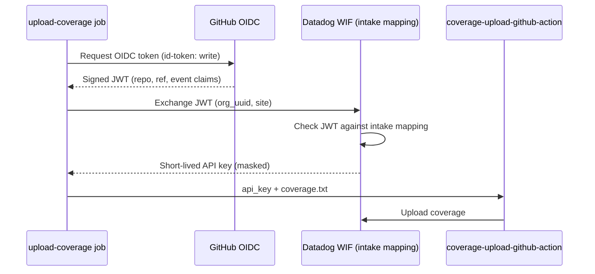

# Migrate coverage upload from `dd-sts` to Workload Identity Federation

- Status: Draft
- Size: Small

## Context

SDLC Security is deprecating `dd-sts` for GitHub workflows. The replacement is
Datadog Workload Identity Federation (WIF). SDLC Security already set up the
intake mapping for `DataDog/dd-iast-go`.

Our only use of `DataDog/dd-sts-action` is in `.github/workflows/ci.yml`, job
`upload-coverage`. It has `id-token: write` and `contents: read` already.

## Approach

Change one file: `.github/workflows/ci.yml`.

1. Replace the `dd-sts` step (`ci.yml:214-217`) with the `intake` action,
   pinned to a full commit SHA:

   ```yaml
   - name: Get Datadog API key
     id: wif
     if: steps.download-coverage.outcome == 'success'
     continue-on-error: true
     uses: DataDog/datadog-workload-identity-federation-github-action/intake@c9456387851248e0a5452f99085b16ad14fc3acb # v1.0.0
     with:
       org_uuid: ${{ secrets.DATADOG_ORG_UUID }}
       site: datadoghq.com
   ```

2. Update both consumers of the old step to the step id:
   - `ci.yml:223`: `steps.<id>.outcome == 'success'`
   - `ci.yml:227`: `api_key: ${{ steps.<id>.outputs.api_key }}`

Keep `if`, `continue-on-error`, and the job permissions as they are. The
`api_key` output is masked in logs. `org_uuid` comes from the repository secret
`DATADOG_ORG_UUID`, which already exists. The repository is public, and the
user guide recommends a secret, so the value is not written in the workflow.

### Flow



## Tradeoff: step id

| Option | Pro | Con |
| --- | --- | --- |
| Keep `dd-sts` | Smaller diff: consumers do not change. | Name is wrong after the migration. Misleads readers. |
| Rename to `wif` | Name matches the action. | Two more lines change (both consumers). |

Recommendation: rename to `wif`. The two extra lines are small, and a `grep`
for `dd-sts` can then prove the migration is complete.

## Constraints

- **Rollout.** Merge the PR. The first real check may be the first `main` run
  (see the mapping constraint below).
- **Recovery.** Revert the PR. SDLC Security keeps the `dd-sts` policy
  `dd-iast-go` until we confirm the migration works. Only after that
  confirmation, they remove it.
- **Fork PRs.** GitHub gives no OIDC token to fork PRs. The step fails, and
  `continue-on-error: true` hides it. Coverage upload is skipped. This is the
  same as today with `dd-sts` (no regression).
- **Intake mapping claim filters (unknown).** The mapping may accept only
  `main` (or only `push`). Then PR runs get no key, and the step fails
  silently. The real check is then the first `main` run after merge. We must
  not report success from a green PR alone.
- **Secrets and Dependabot PRs.** Fork PRs and Dependabot PRs get no secrets.
  `org_uuid` is then empty, the step fails, and the upload is skipped. This is
  the same as today with `dd-sts`.
- **Scope.** No other workflow, composite action, or job changes.
  `system-tests.yml` does not use `dd-sts-action`.

## Acceptance criteria

1. No workflow in `DataDog/dd-iast-go` uses `DataDog/dd-sts-action`.
   `[grep]` `grep -rn "dd-sts" .github/` returns nothing.
2. The `intake` action is pinned to
   `c9456387851248e0a5452f99085b16ad14fc3acb # v1.0.0`. `[grep]`
3. `org_uuid` is `${{ secrets.DATADOG_ORG_UUID }}`, with no literal UUID in the
   workflow. `[grep]`
4. Both consumers use the new step id. `[grep]` and `[CI run]` (the workflow
   is valid and the upload step is not skipped for a wrong id).
5. The `intake` step gets an API key and the coverage upload succeeds. `[CI run]`
   on the PR if the mapping allows it; else `[CI run]` on the first `main` run
   after merge.
6. CI is green on the default branch after merge. `[CI run]`
7. The Slack thread has a reply with the PR link when the PR opens, and a
   reply that the migration is done after merge. SDLC Security (Arnaud Py) is
   told they can remove the `dd-sts` policy `dd-iast-go`. `[manual: Slack]`

## Review requirements

- One standard Reviewer pass.
- No adversarial review: the change is one CI step, with no business logic and
  no new permissions.

## Open questions

1. **Claim filters of the intake mapping.** Ask SDLC Security if PR runs are
   accepted. This decides where criterion 5 is verified.

## Resolved

- `org_uuid` value: stored in the repository secret `DATADOG_ORG_UUID`
  (already created). The workflow reads it with `${{ secrets.DATADOG_ORG_UUID }}`.
